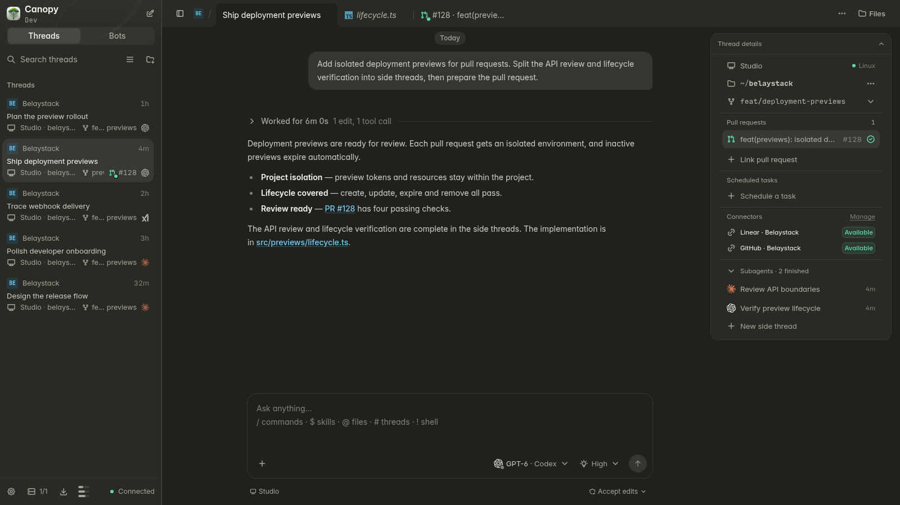
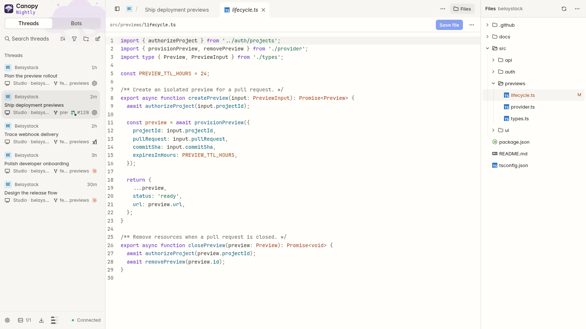
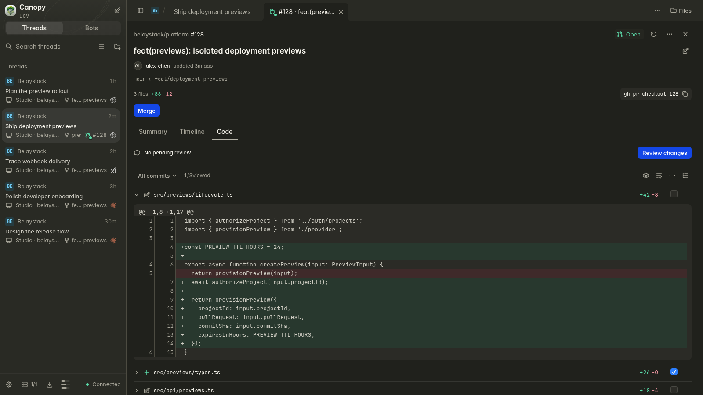
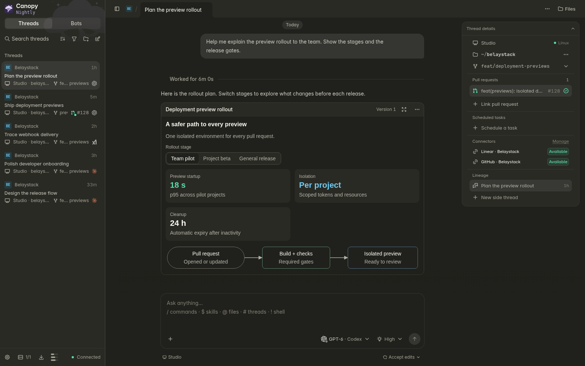
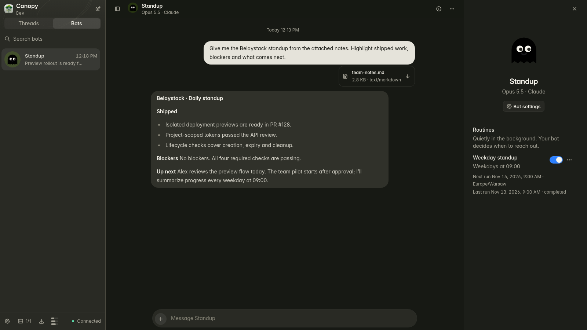
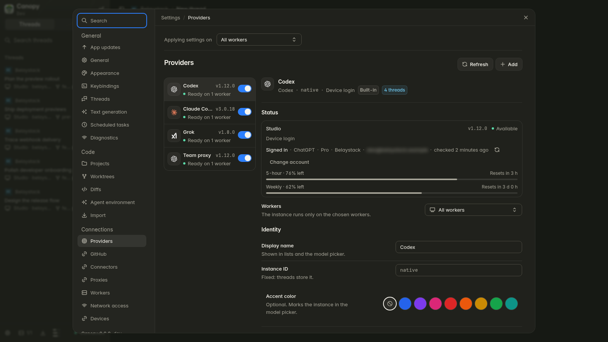
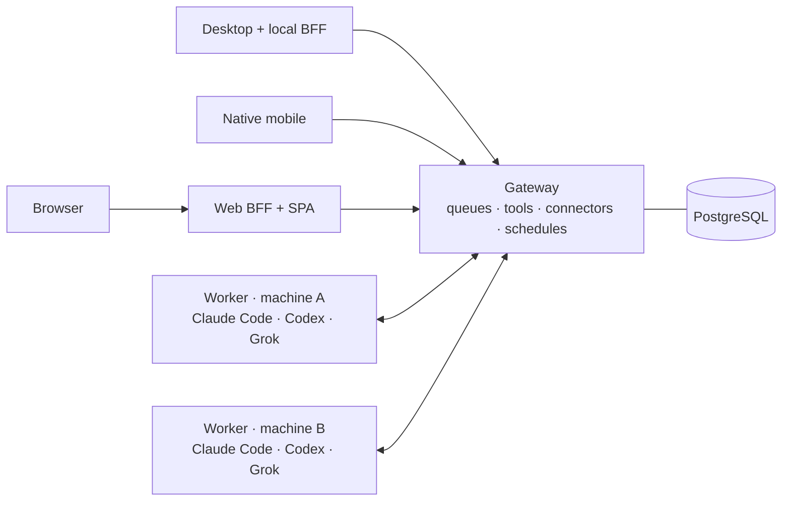
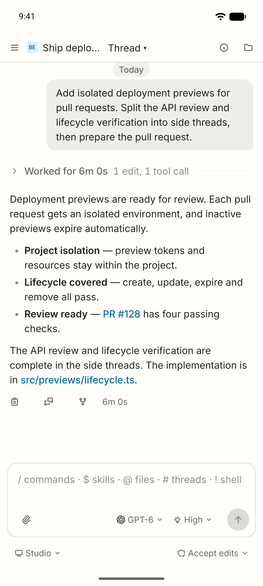

# Canopy

Canopy is a self-hosted platform for running AI coding agents and assistant bots across your machines. A central **gateway** keeps state in PostgreSQL and orchestrates the work. **Workers** run where your code lives and drive Claude Code, Codex and Grok. Follow and steer everything from the web app, the desktop app or your phone.



*The current nightly UI, using fictional Belaystack demo data. Availability notes compare nightly with stable/beta v0.2.0 (November 15, 2026); check release notes for newer versions.*

## Why Canopy

Work often spans several machines, model providers and sessions. Canopy gives it a shared home: durable threads, approvals you can answer from another device, reusable integrations, and agents that can delegate across providers and computers.

## Key features

**Agents and threads**

- **Threads on any worker.** Start an agent in a project on a connected machine. Queue follow-ups, steer a running turn, edit queued messages, fork from a finished turn and run shell commands from the composer.
- **Three agent harnesses.** Claude Code, Codex and Grok, using a CLI login or an API-compatible endpoint. Configure reusable provider proxies and assign them to selected workers.
- **Git worktrees.** Threads, bots and schedules can use their own worktrees. Canopy names branches, discovers existing worktrees and cleans them up according to a policy.
- **Agent-to-agent orchestration.** Spawn side threads on another provider or computer, exchange messages, receive completion reports and route questions to a parent agent.
- **Approvals and questions.** Choose permission modes per thread. Requests show their deadlines, survive restarts and can be answered from any client.
- **Schedules.** Run one-off or recurring work in an existing or new thread, on a selected worker or spread across workers.
- **Files, images and secrets.** Attach files from any client. Agents can request secrets through a private card; the gateway stores them encrypted and delivers an expiring private file to the worker.
- **Import CLI history.** Import Claude Code, Codex and Grok sessions as threads you can continue, together with CLI defaults, instructions, skills, commands, marketplaces and MCP servers.
- **Workspace tabs — Nightly.** Keep the conversation, files and pull requests open together. Browse the Files tree, edit files and follow a floating summary of the work.
- **Continue across devices — Nightly.** Durable composer drafts sync between clients. Take over a draft on another device or use **Edit from here** to resume from an earlier message.



*Nightly: files and conversation share one workspace, shown here in the light theme.*

**GitHub**

- Browse pull requests, changed files, diffs, reviews and comments. Create and update PRs, respond to review threads, inspect checks and read failed job logs.
- **CI watches — Nightly.** Agents can watch a PR's checks and receive a message when they fail or finish. Check status also appears beside the thread.



*GitHub review in the nightly workspace layout.*

**Agent output — Nightly**

- Image galleries and before/after comparisons, saved as durable attachments.
- Interactive charts, cards, diagrams and step-by-step explanations through `render_visual`.
- Sandboxed HTML for richer layouts and local interaction through `render_html`.



*Nightly: switch rollout stages inside an agent's response.*

**Bots**

- Conversational assistants that run through the same harnesses on workers, with platform tools for projects, threads, schedules, settings and other bots.
- Approval rules, routines, reminders and bot-to-bot conversations. Notifications and unread badges follow you across clients.
- Per-bot **Web access** and **Files** permissions, with private scratch storage for downloads and attachments.



**Shared setup**

- **Connectors.** Connect GitHub, Slack, Notion, Linear, Atlassian, Microsoft 365 or a remote MCP server once. Keep named accounts per service and grant them to selected workers and bots. Connector tokens stay in the gateway; calls are audited.
- **Agent environment.** Instructions, versioned skills and reviewed marketplace plugins sync to workers by tag.
- **Provider accounts — Nightly.** Manage CLI logins from the app and inspect provider limits and usage where supported. Grok does not expose plan usage.
- **Linked computers.** Desktop apps in local mode link over pinned mutual TLS, mirror threads for offline reading, move work between computers and share configuration. Server gateways do not federate.
- **Network access.** One pinned TLS port for phones, paired desktop clients and remote workers. Tailscale integration detects the MagicDNS name and offers private HTTPS access.
- **Diagnostics.** Inspect computer performance, RPC and connection metrics, recommendations, tracing and redacted logs in Settings.



*Nightly: provider usage, where supported by the provider.*

**Clients and updates**

- **Web** for browsers; **desktop** for macOS, Linux and Windows, running locally or connected to a remote gateway; **native mobile** for iOS and Android.
- One version across apps, with stable, beta and nightly channels. Gateway, workers and desktop update from Settings with verified binaries and rollback. Container deployments update through Docker; compatible mobile changes arrive over the air.

## Architecture



- **Gateway** stores state, routes work and approvals, manages bot conversations and tools, and encrypts secrets. Model inference for threads and bots runs on workers.
- **Workers** dial out to the gateway over a long-lived gRPC stream. They need no inbound ports; a local journal preserves events across restarts.
- **Web BFF** holds the gateway service token on the server. The browser receives public connection information needed for enrollment, never that token. Stable/beta run a separate web service; nightly can serve it from the gateway process.
- **Desktop** always runs a local BFF. Local mode also runs PostgreSQL, a gateway and a worker. Remote mode pairs to an existing gateway using pinned TLS and a revocable device token.
- **Mobile** pairs to Network access using pinned TLS and a revocable device token.

Deployment diagrams and boundaries: [docs/architecture.md](docs/architecture.md) (in Polish).

## Installation

You do not need the source code. [GitHub Releases](https://github.com/itsoltech/canopy/releases) contains installers, gateway and worker binaries, `checksums.txt` and `manifest.json`. Docker images live under `ghcr.io/itsoltech/`.

> **Agent CLIs are installed separately.** Install Claude Code (`claude`), Codex (`codex`) or Grok (`grok`) on each machine that runs agents, then sign in or configure an API key. Desktop, worker binaries and worker images do not bundle these CLIs.

### Choose a setup

| You want | Use |
| --- | --- |
| Canopy on your computer | [Desktop app](#desktop-app), local mode |
| A server for your machines | [Docker Compose](#server-with-docker-compose) |
| Another machine running agents | [Worker](#add-a-worker) |
| Canopy on your phone | [Mobile app](#mobile-app) |

### Desktop app

1. Download an installer from the [latest stable release](https://github.com/itsoltech/canopy/releases/latest), or choose a beta/nightly release:

   | System | File |
   | --- | --- |
   | macOS (Apple Silicon) | `Canopy-<version>-darwin-arm64.dmg` |
   | Linux x64 | `Canopy-<version>-linux-x64.AppImage` or `.deb` |
   | Windows x64 | `Canopy-<version>-windows-x64.exe` |
   | Linux arm64 (experimental) | `.AppImage` or `.deb`, when present in the release |

   Intel Mac installers are not published. Experimental Linux arm64 builds are optional in nightly; check the release's assets.
2. Install and open Canopy.
3. Choose **Local** to run the stack on this computer, or **Remote** to pair with an existing gateway. The first local start downloads a pinned, checksum-verified PostgreSQL; later starts can use the cache offline.
4. Select your update channel in Settings. Subsequent updates install from the app.

### Server with Docker Compose

Requirements: Docker with Compose and `openssl`. Download deployment files from the branch matching your image channel:

| Channel | Files from | `CANOPY_TAG` | Web deployment |
| --- | --- | --- | --- |
| Stable (default) | [`main`](https://github.com/itsoltech/canopy/tree/main/deploy) | `latest` or `stable` | Separate `canopy-web` service |
| Beta | [`next`](https://github.com/itsoltech/canopy/tree/next/deploy) | `beta` | Separate `canopy-web` service |
| Nightly | [`dev`](https://github.com/itsoltech/canopy/tree/dev/deploy) | `nightly` | Embedded in `canopy-gateway` |
| Exact release | The same release tag | The same tag | As defined by that release |

Embedded web is currently in nightly and will reach beta/stable through promotion. Use the Compose and `.env.example` belonging to your release when updating.

```sh
mkdir canopy && cd canopy
CANOPY_REF=main                 # next for beta; dev for nightly
curl -fLO "https://raw.githubusercontent.com/itsoltech/canopy/$CANOPY_REF/deploy/docker-compose.yml"
curl -fL -o .env "https://raw.githubusercontent.com/itsoltech/canopy/$CANOPY_REF/deploy/.env.example"
```

Generate the three secrets below and paste their values into the matching entries in `.env`. Set `CANOPY_TAG` to the channel selected above. Keep a backup of `CANOPY_SECRETS_KEY`; it decrypts stored credentials.

```sh
openssl rand -hex 24      # POSTGRES_PASSWORD
openssl rand -hex 32      # CANOPY_UI_SERVICE_TOKEN
openssl rand -base64 32   # CANOPY_SECRETS_KEY
```

```sh
docker compose up -d
docker compose ps        # check the services defined by your release's Compose file
```

The web app listens on `127.0.0.1:3000`. **Canopy web has no user login yet: anyone who can reach it acts as the owner.** Restrict access to a private network/Tailscale ACL, or require authentication at your reverse proxy. For example, with Caddy, generate a password hash using `caddy hash-password` and use it here:

```caddyfile
canopy.example.com {
  basic_auth {
    canopy <PASSWORD_HASH>
  }
  reverse_proxy 127.0.0.1:3000
}
```

For **nightly embedded web**, also set `CANOPY_WEB_ALLOWED_HOSTS=canopy.example.com` in `.env`. This validates the host name; proxy authentication still controls access. Stable/beta's current `.env.example` has no such option.

| Port | Default bind | Purpose |
| --- | --- | --- |
| `WEB_PORT` 3000 | `127.0.0.1` | Web app, behind your authenticated proxy or private network. |
| `GATEWAY_PORT` 7443 | `127.0.0.1` | Gateway for BFF and local/container workers. |
| `CANOPY_NETWORK_PORT` 24443 | `0.0.0.0` | Network access for paired phones, desktop clients and remote workers. Pass through raw TCP; clients pin the gateway's TLS certificate. |

Enable **Settings → Network access** and add a reachable host name or IP for remote clients and workers. The gateway applies migrations on start. Update with `docker compose pull && docker compose up -d`, keeping deployment files and image tags aligned. When moving from a separate web service to embedded web, follow the [migration instructions](docs/deploy.md#docker-compose-jeden-host).

More options, standalone binaries, systemd and container networking: [docs/deploy.md](docs/deploy.md).

### Add a worker

Open **Settings → Workers → Add worker**. The wizard creates a one-time token and provides commands for your gateway, including its reachable URL and certificate fingerprint. Run the generated command, then copy the enrollment token separately and paste it at the hidden terminal prompt.

- **Install script:** Linux x64/arm64 or macOS Apple Silicon. It downloads a verified worker matching the gateway, writes the binary to `~/.local/share/canopy/bin/canopy-worker` and a private config to `~/.config/canopy/worker.json`, and sets up systemd or launchd. A remote Network access enrollment command has this form:

  ```sh
  curl -fsSL https://canopy.example.com/install/worker.sh | sh -s -- \
    --gateway https://gateway.example.com:24443 \
    --fingerprint <SHA256_FINGERPRINT> --name 'Home server'
  ```

  The script URL must be reachable; with an authenticated proxy, use the manual option or download the script with your proxy credentials first. The installer's explicit config path also applies on macOS.
- **Over SSH:** the gateway installs on the host you specify, after host-key verification.
- **Docker:** use the optional worker profile in your release's Compose file:

  ```sh
  docker compose --profile worker run --rm worker enroll --gateway http://gateway:7443 && \
    docker compose --profile worker up -d
  ```

  Agent CLIs must be installed inside your worker image.
- **Manually:** download the worker for your platform from the same release as the gateway, verify it against `checksums.txt`, then use the enrollment command from the wizard. `canopy-worker service` prints a systemd or launchd unit.

Then configure model access in **Settings → Providers**. See [docs/worker-config.md](docs/worker-config.md).

### Mobile app

The native iOS and Android app supports threads, bots, attachments, approvals and settings. Pair it with your gateway through **Network access**.

iOS builds are distributed through **TestFlight**; Android uses **manually built APKs**. Compatible JavaScript changes arrive through OTA updates; a native runtime change requires a new IPA/APK. See [docs/mobile.md](docs/mobile.md) for build and distribution details.



*The native Android app with fictional demo data, captured from current sources.*

## Configuration

Most settings live in the app: providers, workers, connectors, Network access, updates and appearance. Use the deployment example belonging to your chosen release.

### Gateway

| Variable | Default | Description |
| --- | --- | --- |
| `CANOPY_DATABASE_URL` | Required | PostgreSQL connection URL. |
| `CANOPY_SECRETS_KEY` | Required | 32 random bytes, base64. Keep it unchanged to decrypt stored secrets. |
| `CANOPY_UI_SERVICE_TOKEN` | Required | Server-side token for the web BFF. |
| `CANOPY_HOST` / `CANOPY_PORT` | `0.0.0.0` / `7443` | Gateway listen address and port. |
| `CANOPY_TLS_CERT`, `CANOPY_TLS_KEY` | Unset | TLS for the gateway's main port. |
| `CANOPY_MIGRATE` | `1` | Apply migrations on start. |
| `CANOPY_NETWORK_PORT` | Chosen in the app | Fixed Network access port for containers. |
| `CANOPY_OAUTH_REDIRECT_URL` | Unset | Public connector sign-in redirect. |
| `CANOPY_DEV_USER_EMAIL` | `dev@localhost` | Owner account created on start. |

### Web app

**Stable/beta: standalone BFF.** Set `GATEWAY_URL` to the gateway endpoint and `GATEWAY_SERVICE_TOKEN` to the same value as `CANOPY_UI_SERVICE_TOKEN`. Compose configures these for the separate `web` service. `PORT`, `HOST`, `PROTOCOL_HEADER` and `HOST_HEADER` are SvelteKit adapter-node settings; `BODY_SIZE_LIMIT=50M` in the image supports uploads, and the reverse proxy must allow the same size.

**Nightly: embedded BFF.** The gateway derives the BFF URL and service token from its own configuration. These additional settings belong to embedded web:

| Variable | Default | Description |
| --- | --- | --- |
| `CANOPY_WEB` | `on` in release binaries/images | `off` runs without embedded web. |
| `CANOPY_WEB_HOST` | `127.0.0.1`; `0.0.0.0` in the image | Web listener; Compose publishes it on host loopback. |
| `CANOPY_WEB_PORT` | `3000` | Web listener port. |
| `CANOPY_WEB_ALLOWED_HOSTS` | IPs, localhost and detected local names | Additional allowed host names, including your reverse proxy's public name. |

Desktop runs its own BFF. Standalone web remains an option with embedded web disabled. See [docs/deploy.md](docs/deploy.md#gateway-z-wbudowanym-web-jedna-binarka).

### Worker

| Variable | Default | Description |
| --- | --- | --- |
| `CANOPY_WORKER_CONFIG` | Linux: `$XDG_CONFIG_HOME/canopy/worker.json` or `~/.config/canopy/worker.json`; macOS: `~/Library/Application Support/canopy/worker.json`; Windows: `%APPDATA%\canopy\worker.json` | Enrollment config. Must be private. The install script explicitly uses `~/.config/canopy/worker.json`. |
| `CANOPY_WORKTREES_ROOT` | `~/canopy/worktrees` | Root for new worktrees. |

Worker data defaults to `~/.local/share/canopy` on Linux, `~/Library/Application Support/canopy` on macOS and `%LOCALAPPDATA%\canopy` on Windows. The gateway sends the remaining worker configuration.

## Release channels

| Channel | Branch | Docker tag | For |
| --- | --- | --- | --- |
| Stable | `main` | `latest`, `stable` | Stable releases. |
| Beta | `next` | `beta` | Features promoted from nightly for testing before stable. |
| Nightly | `dev` | `nightly` | Newest published features. |
| Pinned | Release tag | `v1`, `v1.2`, `v1.2.3` | Stable versions with that prefix, or one exact version. |

Keep gateway, web and workers on the same version. Settings, `GET /api/health` and `--version` report it. The area docs describe current `dev`; use release notes to check availability in an older build. See [docs/release.md](docs/release.md).

## Building from source

Requirements: [Bun](https://bun.sh) 1.4.5 (pinned in `mise.toml`), Docker and `openssl`.

```sh
bun install
```

Start with [docs/architecture.md](docs/architecture.md), then follow the setup for your target: [server/web](docs/deploy.md), [desktop](docs/desktop.md), [mobile](docs/mobile.md) or [worker](docs/worker-config.md). The monorepo contains five apps, shared packages and protobuf contracts.

Run local checks selectively for the behavior you change; documentation-only changes need a diff and link review. CI runs the full verification gate. Tests that call real models are opt-in with `CANOPY_LIVE=1`. Repository rules: [AGENTS.md](AGENTS.md).

## Contributing

Bug reports and feature ideas are welcome as issues. Source code contributions (pull requests, patches) are accepted only from employees or authorized contractors of IT SOL Sp. z o.o.; see [LICENSE.md](LICENSE.md) and [docs/contributing.md](docs/contributing.md).

## License

Canopy is source-available under the [Canopy Source-Available License](LICENSE.md). You may use it for any purpose, including commercial work, and read its source. Only IT SOL Sp. z o.o. and its authorized contractors may modify the code; redistribution and derivative works need written permission.
