# Canopy

Canopy is a self-hosted platform for running AI coding agents and assistant bots across all your machines from one place. A central **gateway** keeps state in PostgreSQL and orchestrates the work. **Workers** run on the machines where your code lives and drive Claude Code, Codex and Grok. You follow and steer everything from the web app, the desktop app or your phone.

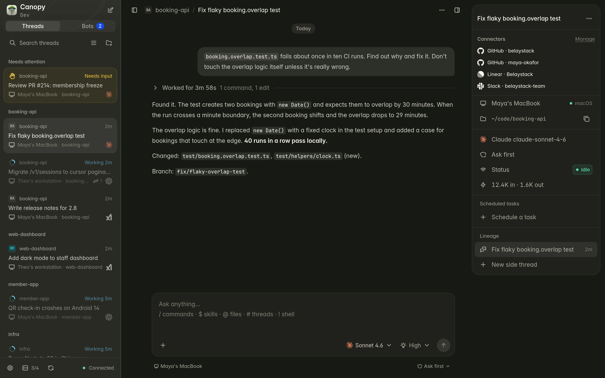

*A finished thread in the fictional Belaystack workspace.*

## Why Canopy

Most agent tools run in one terminal on one machine. That stops working once your work spans several machines, several model providers or more than one session:

- an agent is tied to the machine and terminal that started it, and you lose its context when you switch devices;
- you can only approve an action or answer an agent's question while you sit at that machine;
- you set up API keys, CLI logins and integrations again on every machine;
- mixing providers (say, planning with one model and implementing with another) means copying and pasting by hand;
- long-running work does not survive restarts or dropped connections.

Canopy puts one gateway in front of all of this. Work is durable and visible from every client, and agents can delegate to each other whatever their provider or machine.

## Key features

**Agents and threads**

- **Threads on any worker.** Start an agent in a project on any connected machine. Queue follow-ups or steer the running turn, edit queued messages, fork from any finished turn, run shell commands from the composer, and let a model name the thread.
- **Three agent harnesses.** Claude Code, Codex and Grok. Each can use the CLI's own login or an API-compatible endpoint, optionally through a reusable proxy. You configure a provider once and assign it to selected workers.
- **Git worktrees.** Threads, bots and schedules can work in their own worktree. Canopy names the branch once the task is clear, shows the worktrees Git already knows about, and cleans them up according to a policy.
- **Files and images.** Paste or drop files anywhere in a thread, on web, desktop and mobile. Each attachment shows up as a badge at its place in the message.
- **Agent-to-agent orchestration.** Agents spawn side threads (on another provider too), message other threads, get reports when a followed thread finishes, and ask their parent instead of you.
- **Approvals and questions.** Permission modes per thread, from read only to full access without a sandbox. Each request shows its deadline, survives restarts and can be answered from any client.
- **Schedules.** One-off or recurring schedules, into an existing thread or a new one, on a specific worker or spread across workers.
- **Secrets in threads.** An agent can ask for a secret. The gateway stores it encrypted, and the worker gets it as a private file with an expiry.
- **Import your CLI history.** Canopy scans Claude Code, Codex and Grok homes, imports their sessions as threads you can continue, and imports CLI defaults, instruction files, skills, commands, marketplaces and MCP servers. Canopy offers the import on first run, from workers and on mobile.

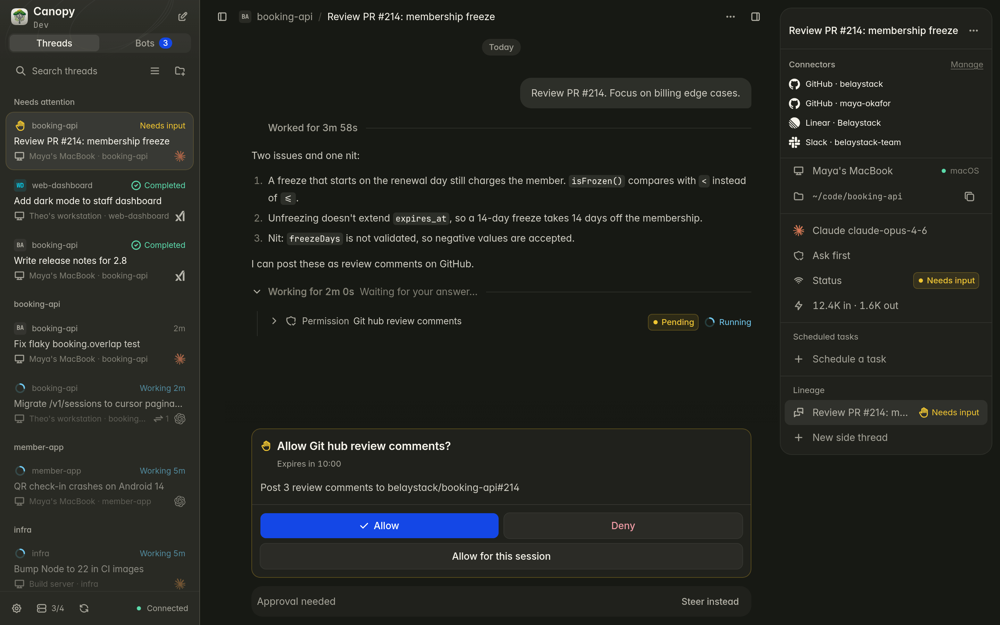

*Review an action and its deadline before allowing it.*

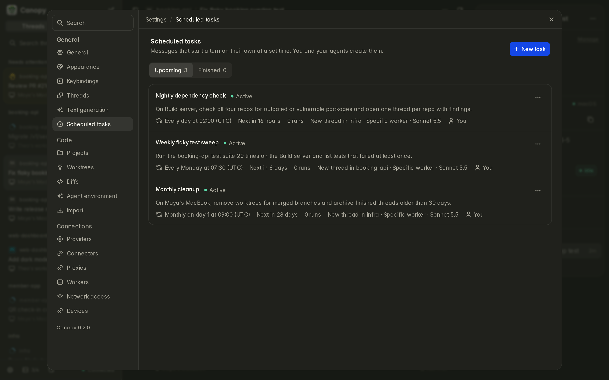

*Recurring dependency checks, flaky test sweeps and worktree cleanup.*

**Bots**

- Bots are conversational assistants. They run turns through the official harnesses on workers and have about fifty platform tools (projects, threads, schedules, settings, other bots).
- They support approval rules, routines that message you only when something matters, reminders, bot-to-bot conversations, and creating other bots.
- Notifications show the bot's name and a message preview, and every client shows unread badges.

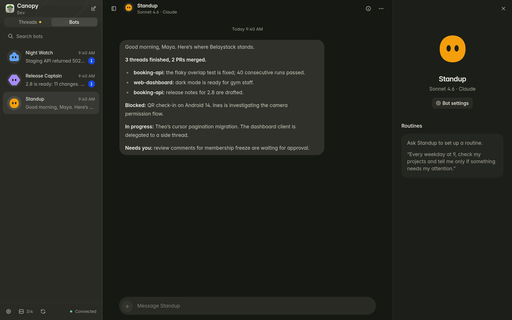

*Standup summarizes the morning; other bots have unread updates.*

**Shared setup**

- **Connectors.** Connect GitHub, Slack, Notion, Linear, Atlassian, Microsoft 365 or any remote MCP server once, with several named accounts per service, and grant each account to selected workers and bots. Tokens stay in the gateway and calls are audited.
- **Agent environment.** Instructions, versioned skills and reviewed marketplace plugins sync to workers by tag.
- **Linked computers.** Desktop apps in local mode can link to each other over pinned mutual TLS. Linked apps can see and drive each other's threads, mirror them for offline reading, move threads and bots between computers, and share projects, providers, connectors and settings.
- **Network access.** One TLS port for phones, paired desktop clients and remote workers, with certificate pinning. When Tailscale is available, Canopy detects it and uses its MagicDNS name and HTTPS.

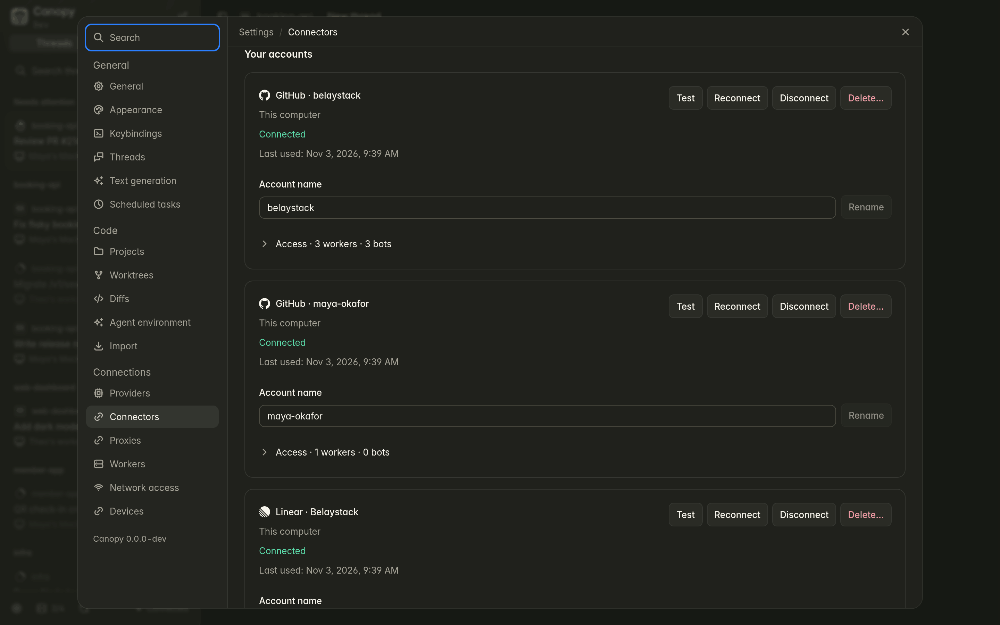

*Separate organization and personal GitHub accounts.*

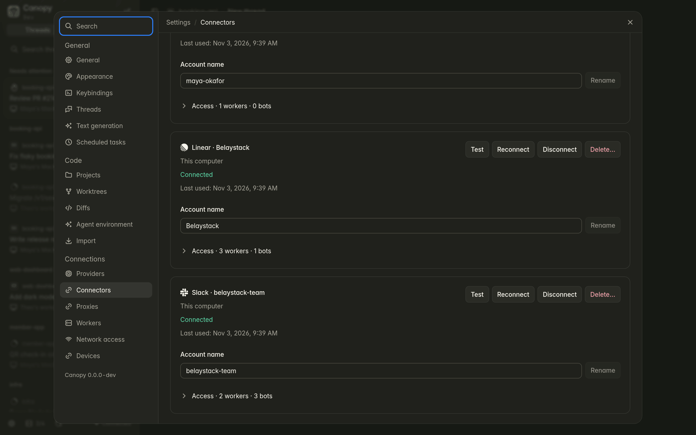

*Linear and Slack accounts in the same workspace.*

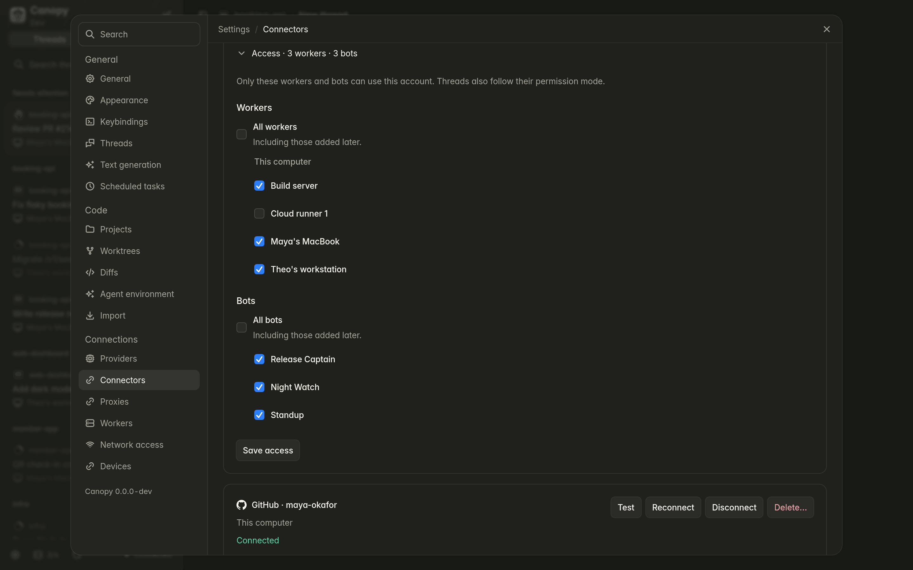

*Choose which workers and bots can use an account.*

**Updates**

- One version for every app, with `stable`, `beta` and `nightly` channels.
- The gateway, workers and desktop apps (also on linked computers) update from **Settings → Updates**, with verified binaries and rollback. You can also install and update agent CLIs on workers on demand.

**Clients**

- **Web app** for any browser.
- **Desktop app** (macOS, Linux, Windows) that runs the whole stack locally or connects to a remote gateway.
- **Mobile app** (iOS and Android, coming soon) paired with your gateway, with threads, bots, composer, files and most settings.

## Architecture

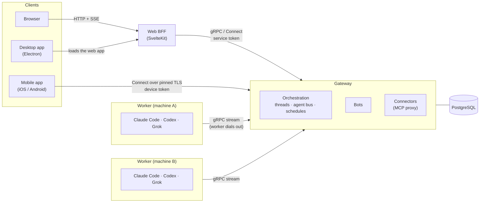

- **Gateway** — the single entry point. It stores everything in PostgreSQL, routes commands to workers, runs bots and the connector proxy, and encrypts secrets.
- **Workers** — each opens a long-lived gRPC stream to the gateway, so the worker machine needs no inbound ports. A local journal makes sure no events are lost across restarts.
- **Web BFF** — the browser talks only to the SvelteKit server; it never sees the gateway address or its token.
- **Mobile** — connects to the gateway's Network access port and pins its certificate. It authenticates with a revocable device token obtained by pairing.

## Installation

You do not need the source code. Every release on [GitHub Releases](https://github.com/itsoltech/canopy/releases) ships desktop installers, standalone gateway and worker binaries, `checksums.txt` and `manifest.json`. Docker images are published as `ghcr.io/itsoltech/canopy-gateway` (gateway and web app) and `canopy-worker` (amd64 and arm64). The gateway binary and image serve the web app themselves; the separate `canopy-web` image is no longer released.

> **Agent CLIs are not included.** Install Claude Code (`claude`), Codex (`codex`) or Grok (`grok`) on every machine that runs agents, and sign in or use an API key. The desktop app, worker binaries and images do not bundle them.

### Choose a setup

| You want | Use |
| --- | --- |
| Canopy on your own computer | [Desktop app](#desktop-app), local mode |
| A shared server for you and your machines | [Docker Compose](#server-with-docker-compose) |
| More machines running agents | [Worker](#add-a-worker) |
| Canopy on your phone | [Mobile app](#mobile-app) (coming soon) |

### Desktop app

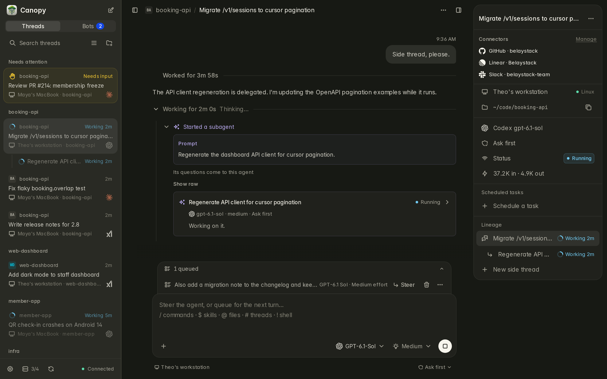

*Web UI at desktop layout: a running thread, queued follow-up and side thread.*

1. Download the installer for your system from the [latest release](https://github.com/itsoltech/canopy/releases/latest):

   | System | File |
   | --- | --- |
   | macOS (Apple Silicon) | `Canopy-<version>-darwin-arm64.dmg` |
   | macOS (Intel) | `Canopy-<version>-darwin-x64.dmg` |
   | Linux x64 / arm64 | `Canopy-<version>-linux-<arch>.AppImage` or `.deb` |
   | Windows x64 | `Canopy-<version>-windows-x64.exe` |

2. Install and open Canopy.
3. Choose a mode:
   - **Local** — Canopy runs PostgreSQL, the gateway, a worker and the web app on this computer. The first start downloads a pinned, checksum-verified PostgreSQL and needs internet; after that it works offline.
   - **Remote** — connect to a gateway you already run.
4. Pick the update channel in the app. Updates install from the app itself.

Check the release page for the files available for your platform and channel.

### Server with Docker Compose

Requirements: Docker with Compose, `openssl`.

```sh
mkdir canopy && cd canopy
curl -LO https://raw.githubusercontent.com/itsoltech/canopy/main/deploy/docker-compose.yml
curl -L -o .env https://raw.githubusercontent.com/itsoltech/canopy/main/deploy/.env.example
```

Fill in `.env`:

```sh
POSTGRES_PASSWORD=$(openssl rand -hex 24)
CANOPY_UI_SERVICE_TOKEN=$(openssl rand -hex 32)
CANOPY_SECRETS_KEY=$(openssl rand -base64 32)   # keep a backup: it encrypts keys and tokens in the database
CANOPY_TAG=latest                               # stable; or beta, nightly, v0.1, v0.1.0
```

Start it:

```sh
docker compose up -d
docker compose ps        # postgres and gateway should be healthy
```

The gateway serves the web app on `127.0.0.1:3000`. Put a TLS reverse proxy in front of it and add its public host name to `CANOPY_WEB_ALLOWED_HOSTS` in `.env` (other names get "421 This host name isn't allowed"), for example Caddy:

```
canopy.example.com {
  reverse_proxy 127.0.0.1:3000
}
```

Ports:

| Port | Default bind | Purpose |
| --- | --- | --- |
| `WEB_PORT` 3000 | `127.0.0.1` | Web app, behind your reverse proxy. |
| `GATEWAY_PORT` 7443 | `127.0.0.1` | Gateway for the web app and workers. |
| `CANOPY_NETWORK_PORT` 24443 | `0.0.0.0` | Network access for phones, desktop clients and remote workers. Raw TCP; do not terminate TLS on a proxy. |

To use Network access, open **Settings → Network access**, turn it on and add the host name or IP address of the server. The gateway runs migrations on start. To update, change `CANOPY_TAG` if needed, then run `docker compose pull && docker compose up -d`. If your `docker-compose.yml` still has a separate `web` service, follow the migration steps in [docs/deploy.md](docs/deploy.md#docker-compose-jeden-host) first.

All options are listed in [`deploy/.env.example`](deploy/.env.example). For details, including standalone binaries with systemd and container networking, see [docs/deploy.md](docs/deploy.md) (in Polish).

### Add a worker

Open **Settings → Workers → Add worker** in the web or desktop app. It creates a one-time token and shows the exact commands for the new machine. Pick one of these options:

- **Install script** (Linux, macOS) — the gateway serves a verified worker binary of its own version:

  ```sh
  curl -fsSL https://canopy.example.com/install/worker.sh | sh -s -- \
    --gateway https://gateway.example.com:7443 --token <TOKEN> --name 'Home server'
  ```

  The binary goes to `~/.local/share/canopy/bin/canopy-worker`, the config to `~/.config/canopy/worker.json` (mode 600), and the script sets up a systemd or launchd service.
- **Over SSH** — the gateway installs the worker on a host you name.
- **Docker** — with the Compose file above:

  ```sh
  docker compose --profile worker run --rm worker enroll --gateway http://gateway:7443 --token <TOKEN>
  docker compose --profile worker up -d
  ```

  The worker image has no agent CLIs. Extend it, for example:

  ```dockerfile
  FROM ghcr.io/itsoltech/canopy-worker:latest
  RUN curl -fsSL https://claude.ai/install.sh | bash
  ENV PATH=/home/canopy/.local/bin:$PATH
  ```

- **Manually** — download `canopy-worker-<os>-<arch>` from a release, verify it, and enroll:

  ```sh
  TAG=v0.1.0
  curl -fLO https://github.com/itsoltech/canopy/releases/download/$TAG/canopy-worker-linux-x64
  curl -fLO https://github.com/itsoltech/canopy/releases/download/$TAG/checksums.txt
  sha256sum -c --ignore-missing checksums.txt
  install -m 0755 canopy-worker-linux-x64 ~/.local/bin/canopy-worker
  canopy-worker enroll --gateway <gateway-url> --token <TOKEN>
  canopy-worker service   # prints a systemd (Linux) or launchd (macOS) unit
  ```

  On macOS, remove the download quarantine first: `xattr -d com.apple.quarantine canopy-worker-darwin-arm64`.

Then add model access in **Settings → Providers** (the CLI login on the worker, or an API-compatible endpoint with a key).

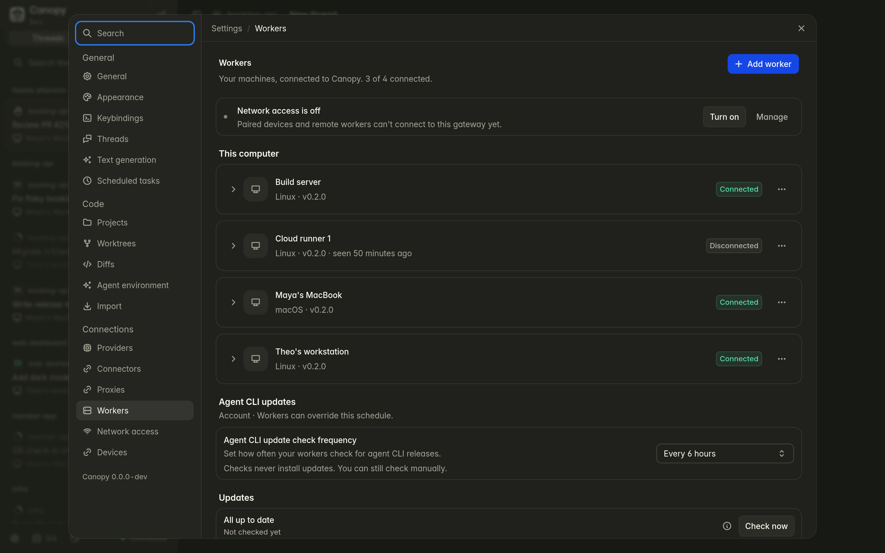

*Three connected workers and one offline cloud runner.*

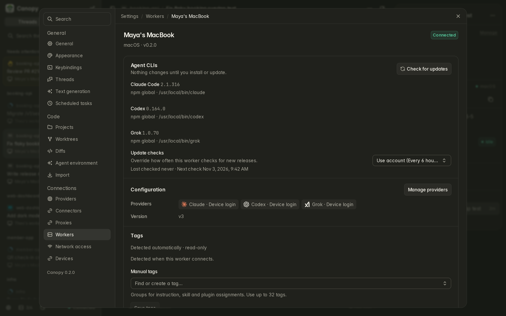

*Detected agent CLIs on Maya's MacBook.*

### Mobile app

The iOS and Android app is coming soon.

## Configuration

Most settings live in the app (providers, workers, connectors, Network access, updates, appearance). The server reads the environment variables below.

### Gateway

| Variable | Default | Description |
| --- | --- | --- |
| `CANOPY_DATABASE_URL` | — (required) | PostgreSQL connection URL. |
| `CANOPY_SECRETS_KEY` | — (required) | 32 random bytes, base64. Encrypts secrets; must stay the same. |
| `CANOPY_UI_SERVICE_TOKEN` | — (required) | Token shared with the web app (`GATEWAY_SERVICE_TOKEN`). |
| `CANOPY_HOST` / `CANOPY_PORT` | `0.0.0.0` / `7443` | Listen address and port. |
| `CANOPY_TLS_CERT`, `CANOPY_TLS_KEY` | — | TLS for the gateway port. |
| `CANOPY_MIGRATE` | `1` | Apply database migrations on start. |
| `CANOPY_NETWORK_PORT` | chosen in the app | Fixed Network access port for containers. |
| `CANOPY_OAUTH_REDIRECT_URL` | — | Public sign-in redirect for connectors. |
| `CANOPY_DEV_USER_EMAIL` | `dev@localhost` | Owner account created on start. |

### Web app

| Variable | Default | Description |
| --- | --- | --- |
| `GATEWAY_URL` | `http://127.0.0.1:7443` | Gateway endpoint. |
| `GATEWAY_SERVICE_TOKEN` | — (required) | Same value as `CANOPY_UI_SERVICE_TOKEN`. |
| `BODY_SIZE_LIMIT` | `50M` in images | Upload limit; your proxy must allow the same size. |
| `PORT`, `HOST`, `PROTOCOL_HEADER`, `HOST_HEADER` | adapter-node defaults | Standard SvelteKit adapter-node settings. |

### Worker

| Variable | Default | Description |
| --- | --- | --- |
| `CANOPY_WORKER_CONFIG` | `~/.config/canopy/worker.json` (Linux, `$XDG_CONFIG_HOME` if set); `~/Library/Application Support/canopy/worker.json` (macOS); `%APPDATA%\canopy\worker.json` (Windows) | Written by `enroll`. Must not be readable by other users. |
| `CANOPY_WORKTREES_ROOT` | `~/canopy/worktrees` | Where new worktrees are created. |

Worker data defaults to `~/.local/share/canopy` on Linux, `~/Library/Application Support/canopy` on macOS and `%LOCALAPPDATA%\canopy` on Windows. The gateway sends everything else a worker needs.

## Release channels

| Channel | Docker tag | For |
| --- | --- | --- |
| `stable` | `latest`, `stable` | Stable releases. |
| `beta` | `beta` | Testing a selected nightly before stable. |
| `nightly` | `nightly` | Newest features, published several times a day. |
| pinned | `v1`, `v1.2`, `v1.2.3` | Only stable versions with that prefix. |

Keep the gateway, web app and workers on the same version. You can check the version in Settings, in `GET /api/health` and with `--version`. See [docs/release.md](docs/release.md).

## Building from source

For contributors. Requirements: [Bun](https://bun.sh) 1.4.4 (pinned in `mise.toml`), Docker and `openssl`.

```bash
bun install
bun run check        # generated code check, typecheck and tests
```

The repository has `apps/` (gateway, worker, web, desktop, mobile), `packages/` (shared libraries) and `proto/` (protocol). Development setup for each app is in `docs/` (in Polish): [deploy.md](docs/deploy.md), [desktop.md](docs/desktop.md), [mobile.md](docs/mobile.md), [worker-config.md](docs/worker-config.md). Tests that call real models are opt-in with `CANOPY_LIVE=1`.

## Contributing

Bug reports and feature ideas are welcome as issues. Source code contributions (pull requests, patches) are accepted only from employees or authorized contractors of IT SOL Sp. z o.o.; see [LICENSE.md](LICENSE.md) and [docs/contributing.md](docs/contributing.md).

## License

Canopy is source-available under the [Canopy Source-Available License](LICENSE.md). You may use it for any purpose, including commercial work, and read its source. Only IT SOL Sp. z o.o. and its authorized contractors may modify the code; redistribution and derivative works need written permission.
