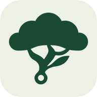

<p align="center">
  
</p>
<h1 align="center">Canopy</h1>
<p align="center">
  <strong>A self-hosted workspace for Claude Code, Codex, and Grok.</strong>
</p>
<p align="center">
  Run agents where your code lives. Follow their work in the desktop app or your browser.
  Respond to approval requests from your phone.
</p>
<p align="center">
  <a href="https://canopy.itsol.tech/#download"><strong>Download Canopy ↓</strong></a>
  &nbsp;·&nbsp; <a href="#quickstart">Quickstart</a>
  &nbsp;·&nbsp; <a href="#documentation">Docs</a>
</p>
<p align="center">
  
</p>
<p align="center">
  <sub>Canopy nightly with demo data · <a href="docs/screenshots/threads-overview.png">Desktop screenshot</a> · <a href="docs/screenshots/mobile-thread.png">Android screenshot</a></sub>
</p>

## From a task to a pull request

1. **Give the feature its own worktree.** Pick the computer with your repository. Ask Codex to add deployment previews while you keep working in your checkout. [Threads](docs/threads.md) · [Worktrees](docs/worktrees.md)
2. **Delegate the review.** Have Claude Code review the API in a side thread. Ask it to report back to the main thread. Send new instructions while an agent is working. [Agent orchestration](docs/agent-bus.md)
3. **Review the changes.** Open changed files and the GitHub pull request alongside the conversation. Ask the agent to tell you when CI checks fail or finish. [Workspace](docs/workspace.md) · [GitHub integration](docs/github.md)

<details>
<summary>See the pull request review in Canopy</summary>


</details>

## Bring your existing workflow

- **Import CLI sessions.** Bring in history, settings, instructions, and skills from Claude Code, Codex, or Grok. Resume supported sessions. [CLI import](docs/import.md)
- **Schedule recurring work.** Have a bot summarize a project or an agent revisit a task. Connect services like Slack and Linear or add a remote MCP server. Choose which projects and bots can use each account. [Bots](docs/bots.md) · [Schedules](docs/agent-bus.md#5-harmonogram) · [Connectors](docs/connectors.md)
- **See results in the thread.** Ask for interactive charts, diagrams, or before-and-after comparisons. [Agent visuals](docs/agent-visuals.md)
- **Choose where work runs.** Use a worker on your laptop, connect a development machine, or run Canopy on a server. The gateway stores thread history and routes tasks. Workers run agents with your chosen model service. [Architecture](docs/architecture.md)

## Installation

### Quickstart

Choose where you want your agents to work.

- **On this computer** · Install the [desktop app](#desktop-app) and choose **Local**.
- **On a server or connected machines** · Set up Canopy with [Docker Compose](#server-with-docker-compose). Then [add a worker](#add-a-worker) where your code lives.
- **Connect to an existing setup** · Choose **Remote** in the [desktop app](#desktop-app) or pair the [mobile app](#mobile-app).

### Desktop app

1. Download and run the installer for **macOS (Apple Silicon)**, **Linux x64**, or **Windows x64**. [Latest stable release](https://github.com/itsoltech/canopy/releases/latest) · [All releases](https://github.com/itsoltech/canopy/releases)
2. Open Canopy. Choose **Local** to start a gateway and worker on this computer. Choose **Remote** and use a desktop invitation to pair with an existing gateway. [Desktop pairing](docs/desktop-remote-frontend.md#parowanie-i-bezpieczeństwo)
3. Install your agent CLI separately on the machine that runs the agent. Sign in or configure a compatible model endpoint. Then add a project and start a thread. [Agent CLI setup](docs/provider-cli.md) · [Provider configuration](docs/worker-config.md#8-profile-dostawców)

### Server with Docker Compose

Use Docker with Compose, `curl`, and `openssl`. This example uses the stable channel.

```sh
mkdir canopy && cd canopy
CANOPY_REF=main
curl -fLO "https://raw.githubusercontent.com/itsoltech/canopy/$CANOPY_REF/deploy/docker-compose.yml"
curl -fL -o .env "https://raw.githubusercontent.com/itsoltech/canopy/$CANOPY_REF/deploy/.env.example"
```

Run each command and paste its output into the matching field in `.env`. Back up `CANOPY_SECRETS_KEY`.

```sh
openssl rand -hex 24     # POSTGRES_PASSWORD
openssl rand -hex 32     # CANOPY_UI_SERVICE_TOKEN
openssl rand -base64 32  # CANOPY_SECRETS_KEY
```

Run `docker compose up -d`. Open `http://127.0.0.1:3000` on the server.

> [!IMPORTANT]
> Anyone who can reach the web app has owner access. For remote browser access, use a private network with access controls or a reverse proxy with authentication. [Web access setup](docs/deploy.md#dostęp-do-web-reverse-proxy-i-tailscale)

Use Compose files and images from the same channel. For beta, use `CANOPY_REF=next` and `CANOPY_TAG=beta`. For nightly, use `CANOPY_REF=dev` and `CANOPY_TAG=nightly`. Set `CANOPY_REF` before downloading the files. Set `CANOPY_TAG` in `.env` before starting Compose. [Deployment guide](docs/deploy.md) · [Release channels](docs/release.md)

### Add a worker

Choose an installation method in **Settings → Workers → Add worker**. Follow the steps to enroll the worker. Install the agent CLI there and set up model access. Enable **Network access** to connect a worker from another machine. [Worker setup](docs/worker-config.md#dodanie-maszyny-z-ui) · [Network access](docs/network-access.md)

### Mobile app

Pair your phone with your gateway through **Network access** to follow threads and respond to approval requests. iOS builds require a TestFlight invitation. Android uses a manually built APK. [Mobile installation and availability](docs/mobile.md#instalacja-i-dostępność)

## Documentation

The Polish guides cover the current development branch. Check the release notes for what's in your build. [GitHub Releases](https://github.com/itsoltech/canopy/releases)

- **Run and maintain Canopy** · [Server deployment](docs/deploy.md) · [Desktop](docs/desktop.md) · [Updates](docs/updates.md) · [Configuration example](deploy/.env.example)
- **Understand the system** · [Architecture](docs/architecture.md) · [Protocol between gateway and workers](docs/protocol.md) · [Data model](docs/data-model.md)

<details>
<summary>Build from source</summary>

Install the [Bun version pinned in the repository](mise.toml), Docker, and `openssl`. Run `bun install` from the repo root. Follow the guide for [server and web](docs/deploy.md), [desktop](docs/desktop.md#build-i-uruchomienie), or [mobile](docs/mobile.md).

See the [contributing guide](docs/contributing.md) and [repository rules](AGENTS.md) for local checks.

</details>

## License

Canopy is source-available and free to use, including for commercial work. Only IT SOL Sp. z o.o. and its authorized contractors may modify the code. You need written permission to redistribute Canopy or create derivative works. Report bugs and request features on GitHub. [License](LICENSE.md) · [GitHub Issues](https://github.com/itsoltech/canopy/issues)
