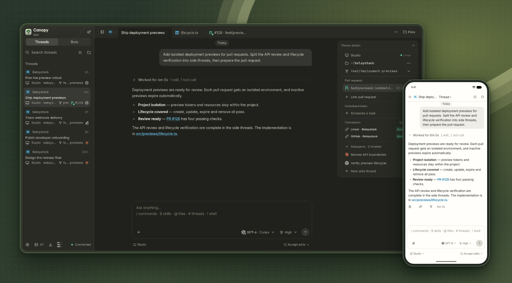

<h1 align="center">
  <picture>
    <source media="(prefers-color-scheme: dark)" srcset="design/brand/canopy-wordmark-inverse.svg">
    
  </picture>
</h1>
<p align="center">
  <strong>A self-hosted workspace for Claude Code, Codex, Grok, and Antigravity.</strong>
</p>
<p align="center">
  Run agents where your code lives. Send your bot a bug report in Slack, Telegram, or Discord. It can delegate the fix to a coding agent and reply with a pull request link or screenshot.
</p>
<p align="center">
  <a href="https://canopy.itsol.tech/#download"><strong>Download Canopy ↓</strong></a>
  &nbsp;·&nbsp; <a href="#quickstart">Quickstart</a>
  &nbsp;·&nbsp; <a href="#documentation">Docs</a>
</p>
<p align="center">
  
</p>
<p align="center">
  <a href="https://itsoltech.github.io/canopy/demo/canopy-demo.mp4"><strong>Watch a Slack report turn into a tested fix (0:32)</strong></a>
</p>
<p align="center">
  <sub>Canopy nightly with demo data · <a href="docs/screenshots/threads-overview.png">Desktop screenshot</a> · <a href="docs/screenshots/mobile-thread.png">Android screenshot</a></sub>
</p>

This README and the guides describe the development branch (`dev`). New features reach nightly builds first, then beta and stable. [Release notes for your version](https://github.com/itsoltech/canopy/releases)

## From a task to a pull request

1. **Give the feature its own worktree.** Pick the computer with your repository. Ask Codex to add deployment previews while you keep working in your checkout. [Threads](docs/threads.md) · [Worktrees](docs/worktrees.md)
2. **Delegate the review.** Ask Claude Code to review the API in a side thread and report back. Send it new instructions as it works. On macOS and Windows, the optional **Activity notch** shows running threads and approval requests over other apps. [Agent orchestration](docs/agent-bus.md) · [Activity notch](docs/desktop.md#activity-notch)
3. **Review the changes.** Link the GitHub pull request and open its diff beside the conversation. Canopy tells the agent about merge conflicts and the final CI result. You can turn these notifications off in settings. [Workspace](docs/workspace.md) · [GitHub integration](docs/github.md)

<details>
<summary>See the pull request review in Canopy</summary>


</details>

## Bring your existing workflow

- **Import CLI sessions.** Bring in history, settings, instructions, and skills from Claude Code, Codex, or Grok. Resume supported sessions. [CLI import](docs/import.md)
- **Automate follow-ups.** Schedule a weekly project summary. Teach a bot your triage steps in a private chat. Set a trigger to use them when an agent run fails in your project. [Bots](docs/bots.md) · [Event triggers](docs/bots.md#wyzwalacze-zdarzeń) · [Agent schedules](docs/agent-bus.md#5-harmonogram)
- **Connect your tools.** Give projects and bots access to Linear or a remote MCP server. Connect GitHub once, then choose which repositories they can read and where they can make changes. [Connectors](docs/connectors.md) · [GitHub access](docs/github.md#dostęp-projektu-i-bota-do-repozytorium)
- **See results in the thread.** Save a project login for your staging site. The agent can sign in through its browser and send a screenshot without seeing the password. On web and desktop, open **Thread details → Artifacts** for images, recordings, and interactive charts from earlier replies. [Project logins](docs/secrets.md#loginy-projektu) · [Agent visuals](docs/agent-visuals.md)
- **Continue on another computer.** Add the same project to two workers on one gateway. On web or desktop, move an idle Claude Code or Codex thread between them. Its agent session, side threads, unpushed commits, and uncommitted changes go with it. [Architecture](docs/architecture.md) · [Thread transfers](docs/thread-transfers.md)

## Installation

### Quickstart

A worker runs your agents. The gateway sends it tasks and stores your thread history.

- **On this computer** · Install the [desktop app](#desktop-app) and choose **Local**.
- **On a server or connected machines** · Set up Canopy with [Docker Compose](#server-with-docker-compose). Then [add a worker](#add-a-worker) where your code lives.
- **Connect to an existing setup** · Choose **Remote** in the [desktop app](#desktop-app) or pair the [mobile app](#mobile-app).

### Desktop app

1. Download and run the installer for **macOS**, **Linux x64**, or **Windows x64**. On macOS, choose `darwin-arm64.dmg` for Apple Silicon or `darwin-x64.dmg` for Intel. Older releases only include the Apple Silicon DMG. [Latest stable release](https://github.com/itsoltech/canopy/releases/latest) · [All releases](https://github.com/itsoltech/canopy/releases)
2. Open Canopy. Choose **Local** to start a gateway and worker on this computer. Choose **Remote** and use a desktop invitation to pair with an existing gateway. [Desktop pairing](docs/desktop-remote-frontend.md#parowanie-i-bezpieczeństwo)
3. Open **Set up Canopy** and choose a worker. Install your agent's CLI there if needed. Sign in or configure a compatible model endpoint. Try the sample task or start a project thread. [First-run setup](docs/onboarding.md#konfiguracja-krok-po-kroku) · [Agent CLI setup](docs/provider-cli.md)

### Server with Docker Compose

Use Docker with Compose, `curl`, and `openssl`. This example uses the stable channel.

```sh
mkdir canopy && cd canopy
CANOPY_REF=main
curl -fLO "https://raw.githubusercontent.com/itsoltech/canopy/$CANOPY_REF/deploy/docker-compose.yml"
curl -fL -o .env "https://raw.githubusercontent.com/itsoltech/canopy/$CANOPY_REF/deploy/.env.example"
```

Run each command and paste its output into the matching field in `.env`. Back up `CANOPY_SECRETS_KEY`.

```sh
openssl rand -hex 24     # POSTGRES_PASSWORD
openssl rand -hex 32     # CANOPY_UI_SERVICE_TOKEN
openssl rand -base64 32  # CANOPY_SECRETS_KEY
```

Run `docker compose up -d`. Open `http://127.0.0.1:3000` on the server.

> [!IMPORTANT]
> Anyone who can reach the web app has owner access. For remote browser access, use a private network with access controls or a reverse proxy with authentication. [Web access setup](docs/deploy.md#dostęp-do-web-reverse-proxy-i-tailscale)

Use Compose files and images from the same channel. For beta, use `CANOPY_REF=next` and `CANOPY_TAG=beta`. For nightly, use `CANOPY_REF=dev` and `CANOPY_TAG=nightly`. Set `CANOPY_REF` before downloading the files. Set `CANOPY_TAG` in `.env` before starting Compose. [Deployment guide](docs/deploy.md) · [Release channels](docs/release.md)

### Add a worker

Choose an installation method in **Settings → Workers → Add worker**. Follow the steps to enroll the worker. Install the agent CLI there and set up model access. Enable **Network access** to connect a worker from another machine. [Worker setup](docs/worker-config.md#dodanie-maszyny-z-ui) · [Network access](docs/network-access.md)

### Mobile app

iOS builds require a TestFlight invitation. On Android, install a manually built APK. Pair your phone with the gateway through **Network access**. [Mobile installation and availability](docs/mobile.md#instalacja-i-dostępność)

Review pull request diffs or answer approval requests. Open **Preview** to watch or control the browser, desktop window, or device the agent is using. [Live preview](docs/mobile.md#podgląd-automatyzacji-i-limity-kont)

## Documentation

The guides below are in Polish.

- **Run and maintain Canopy** · [Server deployment](docs/deploy.md) · [Desktop](docs/desktop.md) · [Updates](docs/updates.md) · [Configuration example](deploy/.env.example)
- **Understand the system** · [Architecture](docs/architecture.md) · [Protocol between gateway and workers](docs/protocol.md) · [Data model](docs/data-model.md)

<details>
<summary>Build from source</summary>

Install the [Bun version pinned in the repository](mise.toml), Docker, and `openssl`. Run `bun install` from the repo root. Follow the guide for [server and web](docs/deploy.md), [desktop](docs/desktop.md#build-i-uruchomienie), or [mobile](docs/mobile.md).

See the [contributing guide](docs/contributing.md) and [repository rules](AGENTS.md) for local checks.

</details>

## License

Canopy is source-available and free to use, including for commercial work. Only IT SOL Sp. z o.o. and its authorized contractors may modify the code. You need written permission to redistribute Canopy or create derivative works. Report bugs and request features on GitHub. [License](LICENSE.md) · [GitHub Issues](https://github.com/itsoltech/canopy/issues)
