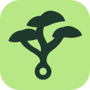
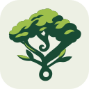
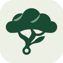
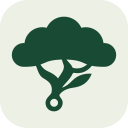
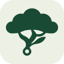
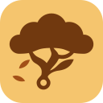
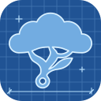

# Propozycje logo Canopy

Każda przedstawiona wersja ma osobny numer i własne pliki SVG. Kolejne zmiany zapisujemy jako nowe propozycje, aby wcześniejsze wersje były dostępne pod tymi samymi linkami.

| Propozycja | Podgląd ikony | Logotyp | Osobne pliki |
| --- | --- | --- | --- |
| **01** · Liść oddzielony od „C” |  | [Na jasne tło](canopy-wordmark.svg) · [Na ciemne tło](canopy-wordmark-inverse.svg) | [Znak](canopy-mark.svg) · [Ikona](canopy-icon.svg) |
| **02** · Liść w obrysie „C” |  | [Na jasne tło](canopy-leaf-wordmark.svg) · [Na ciemne tło](canopy-leaf-wordmark-inverse.svg) | [Znak](canopy-leaf-mark.svg) · [Ikona](canopy-leaf-icon.svg) |
| **03** · Drzewo wyrastające z „a” |  | [Na jasne tło](canopy-tree-wordmark.svg) · [Na ciemne tło](canopy-tree-wordmark-inverse.svg) | [Znak](canopy-tree-mark.svg) · [Ikona](canopy-tree-icon.svg) |
| **04** · Sosna wyrastająca z „a” |  | [Na jasne tło](canopy-pine-wordmark.svg) · [Na ciemne tło](canopy-pine-wordmark-inverse.svg) | [Znak](canopy-pine-mark.svg) · [Ikona](canopy-pine-icon.svg) |
| **05** · Dwutonowe drzewo liściaste |  | [Na jasne tło](canopy-broadleaf-wordmark.svg) · [Na ciemne tło](canopy-broadleaf-wordmark-inverse.svg) | [Znak](canopy-broadleaf-mark.svg) · [Ikona](canopy-broadleaf-icon.svg) |
| **06** · Uproszczone drzewo liściaste |  | [Na jasne tło](canopy-simple-broadleaf-wordmark.svg) · [Na ciemne tło](canopy-simple-broadleaf-wordmark-inverse.svg) | [Znak](canopy-simple-broadleaf-mark.svg) · [Ikona](canopy-simple-broadleaf-icon.svg) |
| **07** · Zagięte liście (Codex) |  | [Na jasne tło](canopy-folded-leaf-wordmark.svg) · [Na ciemne tło](canopy-folded-leaf-wordmark-inverse.svg) | [Znak](canopy-folded-leaf-mark.svg) · [Ikona](canopy-folded-leaf-icon.svg) |
| **08** · Arbor (Fable 5.2) |  | [Na jasne tło](canopy-arbor-wordmark.svg) · [Na ciemne tło](canopy-arbor-wordmark-inverse.svg) | [Znak](canopy-arbor-mark.svg) · [Ikona](canopy-arbor-icon.svg) |
| **09** · Arbor z wygiętym pniem (07 + 08) |  | [Na jasne tło](canopy-arbor-curved-wordmark.svg) · [Na ciemne tło](canopy-arbor-curved-wordmark-inverse.svg) | [Znak](canopy-arbor-curved-mark.svg) · [Ikona](canopy-arbor-curved-icon.svg) |
| **10** · Arbor z ciemną koroną |  | [Na jasne tło](canopy-arbor-deep-wordmark.svg) · [Na ciemne tło](canopy-arbor-deep-wordmark-inverse.svg) | [Znak](canopy-arbor-deep-mark.svg) · [Ikona](canopy-arbor-deep-icon.svg) |
| **11** · Arbor w jednym kolorze |  | [Na jasne tło](canopy-arbor-mono-wordmark.svg) · [Na ciemne tło](canopy-arbor-mono-wordmark-inverse.svg) | [Znak](canopy-arbor-mono-mark.svg) · [Ikona](canopy-arbor-mono-icon.svg) |
| **12** · Arbor z ciaśniejszym napisem |  | [Na jasne tło](canopy-arbor-kerned-wordmark.svg) · [Na ciemne tło](canopy-arbor-kerned-wordmark-inverse.svg) | [Znak](canopy-arbor-kerned-mark.svg) · [Ikona](canopy-arbor-kerned-icon.svg) |
| **13** · Arbor z połączonymi konarami i koroną |  | [Na jasne tło](canopy-arbor-joined-wordmark.svg) · [Na ciemne tło](canopy-arbor-joined-wordmark-inverse.svg) | [Znak](canopy-arbor-joined-mark.svg) · [Ikona](canopy-arbor-joined-icon.svg) |

Wzorcem do dalszych zastosowań jest propozycja 13. Zachowuje sylwetkę i rozstaw liter
z 12. Drzewo ma jeden wspólny obrys. W napisie obrys drzewa łączy się z literą „a”.
[Warstwowy SVG](canopy-arbor-joined-layers.svg) pozwala osobno wypełnić koronę
i konary. Ich ścieżki stykają się na dolnej krawędzi korony.
Te krzywe są dostępne w [geometrii znaku](../../packages/ui/src/canopy-tree.ts).

## Tła sidebara

| Propozycja | Dev · rysunek techniczny | Nightly · gwiazdy | Beta · bursztyn | Stable · sylwetka |
| --- | --- | --- | --- | --- |
| **12** | [SVG Dev](sidebar-12/canopy-dev.svg) | [SVG Nightly](sidebar-12/canopy-nightly.svg) | [SVG Beta](sidebar-12/canopy-beta.svg) | [SVG Stable](sidebar-12/canopy-stable.svg) |
| **13** | [SVG Dev](sidebar-13/canopy-dev.svg) | [SVG Nightly](sidebar-13/canopy-nightly.svg) | [SVG Beta](sidebar-13/canopy-beta.svg) | [SVG Stable](sidebar-13/canopy-stable.svg) |
| **14** | [SVG Dev](sidebar-14/canopy-dev.svg) | [SVG Nightly](sidebar-14/canopy-nightly.svg) | [SVG Beta](sidebar-14/canopy-beta.svg) | [SVG Stable](sidebar-14/canopy-stable.svg) |
| **15** | [SVG Dev](sidebar-15/canopy-dev.svg) | [SVG Nightly](sidebar-15/canopy-nightly.svg) | [SVG Beta](sidebar-15/canopy-beta.svg) | [SVG Stable](sidebar-15/canopy-stable.svg) |
| **16** | [SVG Dev](sidebar-16/canopy-dev.svg) | [SVG Nightly](sidebar-16/canopy-nightly.svg) | [SVG Beta](sidebar-16/canopy-beta.svg) | [SVG Stable](sidebar-16/canopy-stable.svg) |
| **17** | [SVG Dev](sidebar-17/canopy-dev.svg) | [SVG Nightly](sidebar-17/canopy-nightly.svg) | [SVG Beta](sidebar-17/canopy-beta.svg) | [SVG Stable](sidebar-17/canopy-stable.svg) |
| **18** | [SVG Dev](sidebar-17/canopy-dev.svg) | [SVG Nightly](sidebar-17/canopy-nightly.svg) | [SVG Beta](sidebar-18/canopy-beta.svg) | [SVG Stable](sidebar-17/canopy-stable.svg) |

W propozycji 14 drzewo z wersji 13 zajmuje większą część szerokości panelu, a prawa krawędź kadru przycina koronę.
Środek kompozycji przypada na 62% wysokości sidebara (obszar rysunku od 28% do 96%).
W propozycji 15 drzewo zaczyna się tuż pod nawigacją. Pionowy gradient stopniowo wygasza
cały rysunek w stronę dołu listy, łącznie z siatką, gwiazdami i liśćmi danego kanału.
W propozycji 16 górna i prawa krawędź sidebara przycinają koronę. Drzewo widać już za nazwą
aplikacji i zakładkami Threads/Bots, a pień zanika za pierwszymi wierszami listy.
W propozycji 17 korona zajmuje prawą część nagłówka. Pionowy gradient wygasza drzewo
i detale kanału przy wyszukiwarce. Od pierwszego wątku lub bota lista ma jednolite tło.
W Becie z propozycji 17 koronę pokrywa ukośne kreskowanie. W propozycji 18 Beta ma
gładką bursztynową koronę, a po jej lewej stronie opadają dwa liście.

Każdy SVG ma przezroczyste tło i kolory dla jasnego oraz ciemnego motywu.
Web, desktop i mobile korzystają ze [wspólnej grafiki](../../packages/ui/src/sidebar-art.ts).
Dobór wariantu opisuje [dokumentacja wydań](../../docs/release.md).

## Ikony aplikacji

| Propozycja | Stable | Beta | Nightly | Dev |
| --- | --- | --- | --- | --- |
| **19** |  |  |  |  |

Te cztery SVG są źródłem ikon aplikacji. [Generator](../../scripts/icons/channel-icons.ts)
tworzy z nich zasoby web, desktopu i aplikacji mobilnej. W nagłówku sidebara ikona
danego kanału ma 24 px (24 dp na telefonie) i towarzyszy jej tło z propozycji 18.
Wszystkie ikony mają obrys i kadrowanie drzewa z propozycji 13.
Kolor całego kafelka pozwala odróżnić wydania także przy 16 px. Siatka w wariancie
Dev przebiega za drzewem, a oba liście Bety są oddzielone od korony i konarów.
