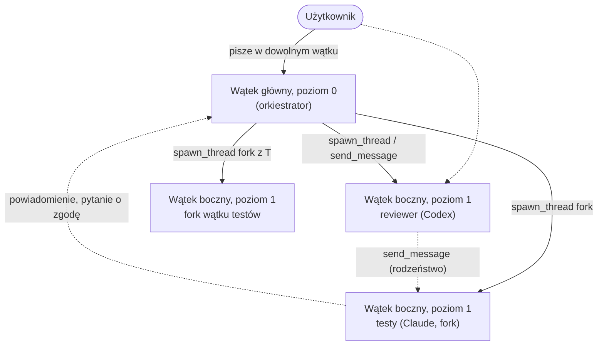
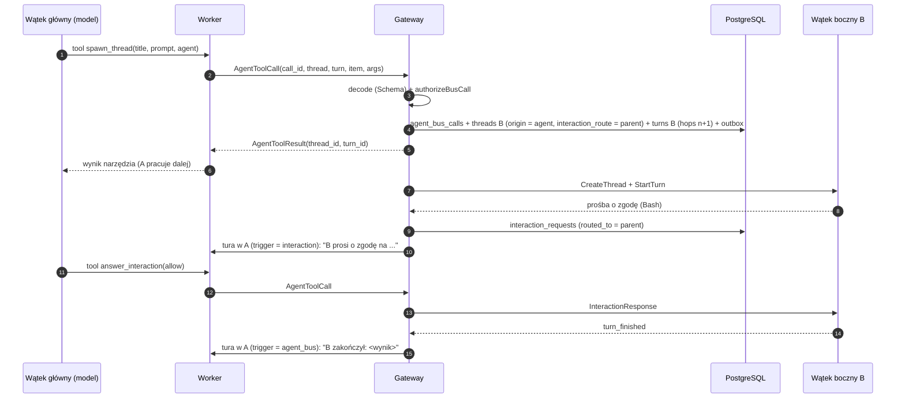

# Szyna agentów: delegowanie, interakcje, harmonogram

Grok CLI ma ten sam zestaw narzędzi przez lokalny HTTP MCP przekazany w ACP `session/new` / `session/load`. Gateway nadal wykonuje i autoryzuje wywołania; instancję wybiera się jako `grok/<id>`, także w `spawn_thread` z Claude/Codex i w przeciwnym kierunku. [Adapter i ograniczenia](grok-adapter.md).

Szyna działa dla Codexa i Claude; Claude korzysta z serwera MCP w procesie workera
([claude-adapter.md](claude-adapter.md#szyna-agentów)):

[Connectors](connectors.md) współdzielą transport `AgentToolCall/AgentToolResult`.
Pole `connector_account_id` (520) wybiera oddzielny dispatcher gateway z kontrolą
właściciela, workera, aktywnej tury, grantu i zgody. Katalog jest namespacowany
per konto; `dynamicTools` Codexa i serwer MCP Claude otrzymują wyłącznie schematy
i etykiety. Poświadczenia dostawcy nigdy nie trafiają do workera.
- wyłączanie natywnych narzędzi dostawców: `apps/worker/src/providers/native-tools.ts`, z testem na prawdziwym Codexie,
- definicje narzędzi, zestawy per poziom i reguły dostępu: `packages/domain/src/agent-bus`,
- schemat: `agent_bus_calls`, `schedules`, `threads.spawned_by_call_id`, `threads.interaction_route`, `interaction_requests.routed_to`, `turns.hops` i wyzwalacze tur (migracja `0004` dopuszcza odrzucone `spawn_thread`/`send_message` bez `hops`),
- worker: narzędzia jako `dynamicTools` Codexa przy `thread/start` (`codexAgentBusTools`), wywołania jako `AgentToolCall` z deterministycznym `call_id` (`toolCallId`), ponawiane po ponownym połączeniu,
- gateway: `AgentBus` (`apps/gateway/src/core/agent-bus.ts`) i `AgentBusStore` (`apps/gateway/src/store/agent-bus.ts`): dekodowanie, fakty z bazy, `authorizeBusCall`, wykonanie, powiadomienia, pytania do rodzica,
- testy: `tests/integration/agent-bus.test.ts` (gateway + skryptowany worker), `codex dynamic tools (live)` w `app-server.live.test.ts`.

Zestaw narzędzi wątku Codexa jest ustalany przy `thread/start`. Wątki utworzone przed zmianą zestawu (np. przed włączeniem harmonogramu) mają stary zestaw.

| Narzędzie | Stan |
|---|---|
| `spawn_thread` (z `fork`, `notify`, `interactions`), `send_message`, `wait_threads`, `get_thread`, `read_thread`, `list_threads`, `interrupt_thread`, `close_thread`, `list_interactions`, `answer_interaction` | działa |
| `list_agents`, `spawn_thread.provider` | działa: subagent na dowolnej instancji dostawcy workera (Claude ↔ Codex), z modelem i wysiłkiem z jej katalogu ([Subagenci dowolnego dostawcy](#subagenci-dowolnego-dostawcy)). Katalogu ról agentów nadal nie ma: pole `agent` zniknęło ze schematu (`instructions` daje rolę) |
| `send_message` / `get_thread` / `read_thread` do dowolnego wątku właściciela | działa: także poza drzewem (inny projekt, inny worker), jak wiadomość człowieka; `list_threads` `scope: all` szuka po tytule ([Wiadomości między dowolnymi wątkami](#wiadomości-między-dowolnymi-wątkami)) |
| `send_message.delivery = steer` | działa: gdy cel ma turę w toku, wiadomość (z notatką o nadawcy) trafia do niej (`turn_steers`, `SteerTurn`; Codex `turn/steer`, Claude strumień wejścia). Wynik narzędzia: `delivery: "steer"` i `turn_id` tury w toku. Powiadomienie przychodzi, gdy skończy się tura, do której wiadomość weszła (wywołanie wskazuje ją dopiero po wejściu). Nie weszła (tura skończyła się wcześniej, odmowa dostawcy): następna tura `agent_bus` z tym samym wywołaniem i `hops`, powiadomienie po niej. Bez tury w toku: kolejka (`delivery: "queue"`) |
| `list_background_tasks`, `get_background_task`, `stop_background_task` | działa (2026-11-02): zadania w tle wątku, sekcja „Zadania w tle” niżej |
| `schedule_wakeup`, `schedule_recurring`, `list_schedules`, `cancel_schedule` | działa (użytkownik ma to samo w UI API: `ListSchedules`, `CreateSchedule`, `SetScheduleStatus`): `Scheduler` w gateway (`apps/gateway/src/core/scheduler.ts`, co 5 s), cron Buna ze strefą czasową (`core/cron.ts`); minimalny odstęp sprawdzany na rzeczywistych terminach |

Powiązane: [threads.md](threads.md), [execution.md](execution.md), [transcript.md](transcript.md).

## 1. Natywna orkiestracja dostawców wyłączona

Subagenci i harmonogramy dostawców działają poza kontrolą platformy: są ulotni, żyją tylko w procesie dostawcy, nie da się ich wznowić ani zaadresować. Dlatego **domyślnie są wyłączeni w obu harnessach**. Zastępują je narzędzia platformy, z których korzystają tak samo Claude i Codex.

| Kategoria | Claude Agent SDK (`disallowedTools`) | Codex app-server (`-c features.*=false`) | Zastępstwo |
|---|---|---|---|
| Subagenci i komunikacja agentów | `Agent`, `Task`, `Workflow`, `ListAgents`, `SendMessage`, `SubagentHandback` | `multi_agent`, `multi_agent_v2` i `agents.enabled=false` | wątki boczne: `spawn_thread`, `send_message`, ... |
| Harmonogram | `ScheduleWakeup`, `CronCreate`, `CronDelete`, `CronList`, `RemoteTrigger` | `in_app_local_automation`, `sleep_tool` | `schedule_wakeup`, `schedule_recurring`, ... |
| Konektory konta właściciela urządzenia | (do sprawdzenia w adapterze Claude) | `apps` (wbudowany MCP `codex_apps`) | — (dostęp do kont przez konfigurację platformy) |

- `disallowedTools` usuwa narzędzia z kontekstu modelu i blokuje także wywołania wewnętrzne. Test sprawdza każdą nazwę z listą `BUILTIN_TOOL_NAMES` przypiętego SDK.
- Codex: `--print-startup-config` nie waliduje kluczy `features.*`, więc test na prawdziwym CLI sprawdza stan efektywny przez `codex features list` z tymi samymi nadpisaniami.
- **Codex: same `features` nie wystarczą.** Model, którego wpis w katalogu ma `multi_agent_version: "v2"` (np. `gpt-6.1-sol`), dostawał narzędzia kolaboracji (`spawn_agent`, `send_message`, `wait_agent`, `followup_task`, `interrupt_agent`, `list_agents`) mimo `features.multi_agent*=false`. Codex 0.164 wybiera wersję tak: `features.multi_agent_v2` włączone → v2; `agents.enabled = false` → wyłączone; dalej katalog modelu; na końcu `features.multi_agent` (`core/src/config/mod.rs`, `multi_agent_version_override`). Tylko `agents.enabled=false` (obsługiwany klucz `[agents]`) wygrywa z katalogiem, także w wątkach, które zapisały już v2. Dowód: `codex collaboration tools (live)` w `app-server.live.test.ts` — przebieg kontrolny bez nadpisania ma te narzędzia w `additional_tools` rolloutu, z nadpisaniem ich nie ma, a prośba o subagenta kończy się wywołaniem `spawn_thread`.
- Agent może włączyć każdą kategorię z powrotem (`ThreadSpec.native_subagents`, `native_scheduling`). Dla Codexa przełącznik działa per proces app-server, bez gwarancji niezależnego przełączania per wątek.
- **Cele zostają włączone celowo:** to cele harnessów (Codex `goals`, Claude `/goal`), które platforma śledzi i którymi użytkownik steruje z UI — [goals.md](goals.md).
- Bez zmian zostają zadania w tle, które nie są agentami (background Bash, procesy Codexa) — [execution.md](execution.md#4-zadania-w-tle).
- **Natywne pytania zostają włączone:** Claude `AskUserQuestion` i Codex `request_user_input`. Platformowe `ask_user` zapewnia wspólny kontrakt i trwałość, lecz synchroniczny wait MCP trzeba odnawiać. Nie ma więc równoważnej gwarancji jednego bezterminowo otwartego wywołania w obu harnessach. Wszystkie trzy źródła pytań korzystają z tego samego panelu nad kompozytorem; różnią się adapterem odpowiedzi i zachowaniem po restarcie (sekcja 3 poniżej i [execution.md §6](execution.md#6-interakcje-z-użytkownikiem)).

## 2. Model: dwa poziomy



- **Poziom 0** (wątek główny) orkiestruje: tworzy wątki boczne, steruje nimi, odpowiada na ich pytania.
- **Poziom 1** (wątek boczny) wykonuje pracę. Nie tworzy kolejnych wątków bocznych i nie dostaje narzędzi do sterowania innymi. Pilnuje tego baza (`threads_max_depth`) i zestaw narzędzi (`agentBusToolsFor`).
- Fork forka to wątek na tym samym poziomie (rodzeństwo z historią innego wątku bocznego).
- **Użytkownik** może pisać w każdym wątku, także w bocznym sterowanym przez agenta. Jego wiadomość jest zwykłą turą (`trigger = user`) i zeruje licznik przeskoków.

## 3. Narzędzia

Jedna definicja w Effect Schema (`AGENT_BUS_TOOLS`). Z niej powstaje JSON Schema dla dostawców, a gateway dekoduje wywołania ściśle: nieznane narzędzie, nadmiarowe pole albo wartość spoza zakresu wracają do modelu jako błąd narzędzia.

| Narzędzie | Poziom 0 | Poziom 1 | Co robi |
|---|:-:|:-:|---|
| `list_agents` | ✓ | ✓ | na czym można uruchomić subagenta: instancje dostawców workera (`claude/native`, `codex/cliproxyapi`, ...) z modelami, wysiłkami i domyślnymi; plus własne ustawienia wywołującego |
| `spawn_thread` | ✓ | | subagent = nowy wątek boczny: `title`, `prompt`, `instructions?` (rola), `provider?`, `model?`, `effort?`, `permission_mode?`, `fork?`, `notify?`, `interactions?` (`parent` domyślnie, `human`), `workspace_mode?` i `base_ref?`; zwraca od razu `thread_id`, `turn_id` i ustawienia dziecka (`provider`, `model`, `effort`, `permission_mode`) |
| `send_message` | ✓ | ✓ | wiadomość do wątku z drzewa albo dowolnego wątku właściciela: `delivery` `queue`/`steer`, `notify?` |
| `wait_threads` | ✓ | ✓ | czekanie na wątki (`any`/`all`, ≤ 300 s, ponawialne); zwraca status, wynik ostatniej tury i ostatnią wiadomość każdego |
| `get_thread` / `read_thread` / `list_threads` | ✓ | ✓ | status (z dostawcą, modelem, wysiłkiem, uprawnieniami, `last_turn`, projektem i workerem), transkrypt, lista (`children`, `tree`, `all` z `query` i `limit`) |
| `interrupt_thread` / `close_thread` | ✓ | | sterowanie potomkami |
| `list_interactions` / `answer_interaction` | ✓ | | pytania i prośby o zgodę od wątków bocznych |
| `ask_user` / `get_answers` | ✓ | ✓ | trwały zestaw 1–4 pytań do człowieka albo rodzica; `wait: true` czeka, `false` pozwala pracować dalej; odczyt odpowiedzi tylko we własnym wątku |
| `request_secret` | ✓ | ✓ | prywatna prośba do człowieka: `label`, `description`, opcjonalne `placeholder`, `name`; odnawialne oczekiwanie przez `request_id`; wynik zawiera wyłącznie status, ścieżkę pliku workera i termin ważności, nigdy wartość ([sekrety](secrets.md)) |
| `schedule_wakeup` | ✓ | ✓ | jednorazowo później (`delay_seconds` albo `at`, do 7 dni) |
| `schedule_recurring` | ✓ | ✓ | cron (min. 5 min), wymagane `until` (do 30 dni) albo `max_runs` |
| `list_schedules` / `cancel_schedule` | ✓ | ✓ | własne harmonogramy i harmonogramy potomków |
| `list_background_tasks` / `get_background_task` | ✓ | ✓ | zadania w tle wątku: status, powód słowami, kod wyjścia, czasy, ogon outputu |
| `stop_background_task` | ✓ | ✓ | zatrzymanie zadania w tle (jak Stop użytkownika) |

### Zadania w tle

Narzędzia do sprawdzania własnej pracy w tle ([execution.md](execution.md#4-zadania-w-tle)): procesy Codexa i background Bash Claude, które trwają po turze. Definicje osobno (`packages/domain/src/agent-bus/background-tasks.ts`, dołączone do `AGENT_BUS_TOOLS`), wykonanie w `apps/gateway/src/core/background-tasks.ts`. Gateway odpowiada z osi czasu, więc widać też zadania poprzednich procesów workera (zatrzymane restartem, utracone w awarii).

| Narzędzie | Argumenty | Wynik |
|---|---|---|
| `list_background_tasks` | `status?` (`all`, `running`, `finished`), `limit?` (≤ 100, domyślnie 20), `thread_id?` | `tasks`: `task_id` (= `item_id`), `provider_task_id`, `title`, `command`, `kind`, `status` (`running`, `completed`, `failed`, `interrupted`), `reason` (słowami: „stopped because the worker was shut down for a restart or deploy…”, „completed with exit code 0”), `stop_reason`, `exit_code`, `started_at`, `ended_at`, `duration`, `started_in_turn_id`, `started_in_turn` |
| `get_background_task` | `task_id` (`item_id`, id procesu Codexa albo zadania Claude), `output_lines?` (≤ 500, domyślnie 80), `thread_id?` | to samo + `output` (ostatnie linie), `output_truncated` |
| `stop_background_task` | `task_id`, `thread_id?` | `stopping: true`; `StopTask` do workera; koniec bez notatki dla agenta (sam zatrzymał) |

- Dostęp: własny wątek zawsze (także wątek boczny). Inny wątek: odczyt jak `get_thread` (każdy wątek tego samego właściciela), zatrzymanie jak `interrupt_thread` (tylko potomkowie).
- Wywołania nie zaczynają tur, więc nie wydłużają łańcucha przeskoków. Notatki o końcach zadań (tury `background_task`) — [execution.md](execution.md#pobudka-agent-dowiaduje-się-o-każdym-końcu-zadania).
- `stop_reason = stopped_by_user` oznacza Stop użytkownika albo agenta.
- Codex: wątki utworzone przed tą zmianą nie mają tych narzędzi (zestaw jest ustalany przy `thread/start`); notatki dostają mimo to.

### Subagenci platformy zamiast natywnych

Każdy subagent to prawdziwy wątek platformy: widoczny w drzewie i na osi czasu rodzica, sterowalny przez użytkownika, z pełnym transkryptem. Opisy narzędzi mówią modelowi, że `spawn_thread` jest narzędziem do delegowania (nie ma `spawn_agent` ani `Task`).

`spawn_thread` domyślnie dziedziczy katalog i worktree rodzica, również gdy zakres projektu × workera
domyślnie tworzy nowe worktree. `workspace_mode` pozwala wybrać `inherit_parent`, `checkout`,
`new_worktree` albo `default` (efektywne ustawienie zakresu); `base_ref` jest bazą nowej gałęzi.
Dziecko pozostaje w tym samym projekcie i workspace na tym samym workerze. Sprzątanie obejmuje
wszystkie wątki współdzielące rekord worktree, także te tworzone przez agentów. Przez połączone
komputery wybór worktree lub dziedziczenia jest jawnie odrzucany do etapu 5; checkout działa jak dotąd.

| Natywnie | Szyna |
|---|---|
| Codex `spawn_agent` (`task_name`, `message`) / Claude `Task` (`description`, `prompt`) | `spawn_thread` (`title`, `prompt`) |
| Codex `agent_type`, Claude `subagent_type` (role z katalogu) | `instructions` (rola wprost); katalogu ról nie ma |
| Codex `model`, `reasoning_effort` | `provider`, `model`, `effort` — dowolna instancja dostawcy workera (także inny harness), sprawdzane przez gateway jak wątek użytkownika |
| Codex `fork_turns` | `fork` (cała historia do ostatniej zakończonej tury) |
| — | `permission_mode` (nie szerszy niż wywołującego), `interactions` |
| Codex `send_message` / `followup_task`, `send_input` | `send_message` (`steer` / `queue`) |
| Codex `wait_agent` (z limitem czasu) | `wait_threads` (`any` / `all`, `timeout_seconds`) |
| Claude `Task` zwraca wynik rodzicowi | powiadomienie z ostatnią wiadomością dziecka (domyślnie) albo `wait_threads` / `get_thread` (`last_message`, `last_turn`) |
| Codex `interrupt_agent`, `close_agent` | `interrupt_thread`, `close_thread` |
| Codex `list_agents` (drzewo) | `list_threads` (`children` / `tree`) |

Reguły (`authorizeBusCall` i gateway):
- głębokość: dwa poziomy (subagent nie tworzy kolejnych), limity jak w sekcji 6,
- uprawnienia: `read_only` < `ask` < `accept_edits` < `full_auto`; subagent dostaje uprawnienia wywołującego albo węższe, nigdy szersze. „Uprawnienia wywołującego” to tryb tury, w której padło wywołanie (`turns.permission_mode`: wiadomość może nadpisać domyślny wątku na jedną turę), a bez niego tryb tury w toku, potem domyślny wątku; ten sam tryb dostaje subagent bez `permission_mode`,
- dostawca, model i wysiłek: patrz [Subagenci dowolnego dostawcy](#subagenci-dowolnego-dostawcy); fork zachowuje dostawcę i instancję,
- rola (`instructions`) dopisuje się do instrukcji wywołującego.

UI: wywołanie `spawn_thread` na osi czasu rodzica ma kartę subagenta (`SubagentCard`) z żywym statusem, dostawcą (znak Claude/Codex) i modelem, wysiłkiem, uprawnieniami i początkiem ostatniej wiadomości dziecka (`Thread.last_message`); wątek dziecka pokazuje, kto go uruchomił (`SubagentOrigin`).

**Panel subagentów** (`features/threads/subagents`): nad kompozytorem wątku, nad panelem kolejki, pokazuje wyłącznie aktywnych agentów: pracujących lub czekających na odpowiedź/zgodę. Podsumowanie liczy tylko ich, np. „2 subagents working · 1 needs you”. Ta sama reguła obowiązuje w kompakcie. Bez aktywnych agentów panel nie jest renderowany. Zakończeni, nieudani, przerwani i zamknięci pozostają dostępni przez karty wywołań na osi czasu, wyszukiwanie i bezpośrednie linki. W Lineage pojawiają się po włączeniu „Show finished subagents” (Settings → Threads, urządzenie, domyślnie Off): ostatnie 10 minut według ostatniej aktywności w głównej liście, starsi pod „Previous subagents” z liczbą nieudanych. Sekcja subagentów jest domyślnie zwinięta i zapamiętuje rozwinięcie na urządzeniu. Sidebar nie pokazuje subagentów; pytania i zgody skierowane do człowieka wyróżniają rodzica i pozostają w panelu nad kompozytorem. Wątki boczne użytkownika są odróżniane przez istniejące `spawned_by_agent = false`. Wejście panelu kompozytora korzysta z `t-rise` / `--duration-fast`, wyjście panelu i wierszy z accordionu / `--duration-quick`; reduced motion jest natychmiastowe. Nakładka kompozytora chroni pozycję czytanego wiersza podczas tych zmian. Rozwinięty panel ma wiersz na aktywnego subagenta: stan (working / waiting for an answer), tytuł, dostawca + model, początek ostatniej wiadomości. Wiersz prowadzi do wątku bocznego. Dane pochodzą z żywego indeksu wątków (overview), bez osobnych zapytań.

### Subagenci dowolnego dostawcy

Subagent może działać na **dowolnej instancji dostawcy + modelu + wysiłku**, które użytkownik mógłby wybrać dla nowego wątku w tym workspace: Claude → Codex, Codex → Claude, Claude → Claude, Codex → Codex (także inna instancja tego samego harnessu, np. `codex/cliproxyapi` z `codex/native`).

- `spawn_thread.provider`: `"<harness>/<instancja>"` jak w `list_agents` (`claude/native`, `codex:cliproxyapi` też), sam harness (`"claude"`: instancja wywołującego, gdy to ten sam harness, inaczej `native`, inaczej pierwsza dostępna) albo samo id instancji (gdy jednoznaczne; przy obu harnessach wygrywa własny).
- Bez `provider` (albo z własną instancją): jak dotąd, kopia wywołującego — jego model i wysiłek, chyba że wywołanie podaje inne.
- Inna instancja: musi być włączona na workerze wątku i zgłoszona jako dostępna (harness zainstalowany, instancja zastosowana i dostępna — te same warunki co przy `CreateThread`); model domyślnie domyślny instancji, wysiłek domyślnie domyślny modelu.
- Model musi być w katalogu instancji (z modelami ukrytymi i własnymi z pickerów; alias też), wysiłek wśród wysiłków modelu; model bez wysiłków dostaje pusty. Bez katalogu, z niepełnym albo pustym gateway nie ocenia (worker ma ostatnie słowo). Przed pierwszym raportem workera tylko własna instancja.
- Czysta funkcja `resolveSpawnTarget` (`packages/domain/src/agent-bus/agents.ts`) dla `spawn_thread` i `agentCatalog` dla `list_agents`; gateway podaje instancje workera z katalogami pickerów (`#spawnInstances`). Wynik trafia do `threads.provider` / `provider_profile_id` / `settings` nowego wątku.
- Kolejność: najpierw reguły szyny (`authorizeBusCall`: poziom, limity, uprawnienia, fork), potem problem z dostawcą/modelem — wątek boczny słyszy, że nie może tworzyć wątków, a nie że model jest zły.
- **Fork** zachowuje dostawcę i instancję (historia żyje w katalogu domowym instancji).
- **Uprawnienia** bez zmian: subagent nigdy szerzej niż tryb tury wywołującego; poziomy, limity i przeskoki też.
- Sterowanie (`send_message` `steer`/`queue`) działa niezależnie od dostawcy dziecka: steer z wątku Codexa trafia do tury Claude (strumień wejścia) i odwrotnie (`turn/steer`) — sprawdzone w `agent-bus-cross.test.ts`.

### Wiadomości między dowolnymi wątkami

Agent może napisać do **dowolnego wątku tego samego właściciela**, jak człowiek: w innym drzewie, projekcie, na innym workerze.

- `send_message`, `get_thread`, `read_thread`: cel = dowolny wątek właściciela (nie tylko drzewo). Wątki innych właścicieli są nieodróżnialne od nieistniejących (`thread <id> not found`).
- Znalezienie celu: `list_threads` z `scope: "all"` (wszystkie niezarchiwizowane wątki właściciela, najnowsza aktywność najpierw; `query` dopasowuje tytuł rozmyto jak `SearchThreads`, `limit` do 50; każdy z `project`, `worker`, `provider`), albo wątek wspomniany przez użytkownika (`#`).
- `wait_threads` i **sterowanie** (`interrupt_thread`, `close_thread`, `answer_interaction`, harmonogramy innych) bez zmian: tylko drzewo / potomkowie.
- **Przeskoki** działają między drzewami: tura celu ma `hops` wywołującego + 1, odpowiedź (`notify`, domyślnie włączone) + 1 dalej; limit zatrzymuje dwa agenty piszące do siebie w kółko.
- Notatka dla modelu celu spoza drzewa: `[canopy] Message from the thread "<tytuł>" (thread_id: …), an agent outside your thread tree; your final message of this turn is reported back to it:` (część o odpowiedzi tylko z `notify`); w drzewie bez zmian.
- Worker mówi tylko za swoje wątki: wywołanie szyny z `thread_id` wątku innego workera jest odrzucane (`thread … not found`), bo wiadomość może teraz dotrzeć na inny worker.

**Oznaczenie nadawcy** (UI): tura od agenta (`source_kind` `task` / `message` / `report`) i steer agenta mają `sender` (`AgentSender`: wątek nadawcy, tytuł, dostawca, instancja, model tury, która wysłała, projekt, worker; widok `turn_sources` z migracji `0023` i zapytanie steerów). Dymek jest fioletowy (fiolet = od agenta) z linią „Message from ‹wątek› ‹znak dostawcy› model · N hops” prowadzącą do nadawcy (`AgentSenderLabel`); tak samo zadanie subagenta, raport i steer agenta (dostarczony: tylko jego treść, bez notatki platformy). Dymek jest domyślnie zwinięty do pierwszej linii (`AgentMessageBubble`, `first-line.ts`): zwykły tekst bez znaczników markdown, ucięty wielokropkiem, z chevronem; kliknięcie wiersza albo chevronu (Enter / Spacja, `aria-expanded`) rozwija pełny markdown i zwija go z powrotem (akordeon `t-acc-panel`, reduced motion bez ruchu). Wiadomość mieszcząca się w jednej linii jest pokazana w całości, bez chevronu; mierzy to sama linia (`ResizeObserver`), więc węższe okno zwija ją ponownie. Zwinięta treść ma `hidden="until-found"`: wyszukiwanie w przeglądarce rozwija wiadomość przy trafieniu (`beforematch`). Stan rozwinięcia jest w pamięci wiersza (`useRemembered`). Linia nadawcy nad dymkiem zostaje bez zmian.

**Karta wysłanej wiadomości** (oś czasu nadawcy, `MessageDeliveryCard`): wątek docelowy (tytuł, projekt i worker, gdy inne), dostarczenie (`Queued as its next turn` / `Steered into its running turn`) i żywy status tury docelowej. Dane: `ThreadSnapshot.bus_deliveries` i `ThreadUpdate.bus_delivery` (`BusDelivery`: `call_id`, wątek i tura docelowa, `delivery`, `status`; `steering`, dopóki steer nie wszedł). Gateway publikuje je wątkowi nadawcy przy każdej zmianie tury z `agent_call_id` i każdego steera agenta.

Na żywo: `tests/integration/platform-subagents.live.test.ts` — Codex (`gpt-6.1-sol`) i Claude na prośbę „użyj subagenta” wołają `spawn_thread`, dziecko jest wątkiem bocznym widocznym w UI API, jego wynik wraca do rodzica; brak natywnych narzędzi subagentów.

### Asynchroniczność

- `spawn_thread` i `send_message` nie blokują. Wynik przychodzi jako **powiadomienie** (`notify`, domyślnie włączone): po zakończeniu wskazanej tury docelowej gateway wstrzykuje raport do trwającej tury wywołującego jako steer platformy z oznaczeniem nadawcy (wątku docelowego). Korzysta ze ścieżki `SteerTurn` i fallbacku notatek platformy opisanej w [execution.md](execution.md#pobudka-agent-dowiaduje-się-o-każdym-końcu-zadania). Bez trwającej tury albo gdy steer nie wejdzie (odmowa dostawcy, tura skończyła się wcześniej), powstaje tura `trigger = agent_bus`. Raport zawiera status i ostatnią wiadomość **tej tury docelowej**, a nie późniejszej tury tego wątku. Przeskoki pozostają takie same: `hops` wywołania + 1 (zarówno steer, jak i jego fallback).
- `wait_threads` jest dla orkiestracji synchronicznej i jest **ograniczone w czasie oraz ponawialne**. Claude SDK ma twardy limit czasu wywołania narzędzia MCP, a limit narzędzi dynamicznych Codexa nie jest udokumentowany. `wait_threads` zwraca też wcześniej, gdy wątek boczny czeka na odpowiedź rodzica.

#### Kiedy wynik został już odebrany

Zapis pomyślnego wywołania odczytu zużywa niedostarczone powiadomienia **tego samego wywołującego i dokładnie odczytanej tury docelowej**. Samo sprawdzenie aktywnego wątku nie wystarcza. Stany końcowe to `completed`, `interrupted`, `failed`, `cancelled`.

1. `get_thread`: zwrócone `last_turn.turn_id` wskazuje zakończoną turę, a `last_message` zawiera jej wynik (skrót do 4000 znaków; pusty tekst, gdy tura nie miała wiadomości). Nowa tura w toku nie zmienia przypisania wyniku do `last_turn`. Status powiadomienia: `consumed_by_read`.
2. `wait_threads`: ta sama reguła dla każdego faktycznie zwróconego podsumowania, także przy `any`, timeout lub `done: false`. Nie zużywa raportu aktywnej tury tylko dlatego, że wątek czeka na rodzica. Status: `consumed_by_wait`.
3. `read_thread`, oba widoki (`messages`, `items`): zwrócona strona musi zawierać ostatni item `agent_message` zakończonej tury docelowej, czyli jej wynik lub jego skrót. Strona ze starszą wiadomością, samymi narzędziami, z zakresem `after_seq` za wynikiem lub pustym zakresem nie wystarcza. Tury bez wiadomości można odebrać przez podsumowanie. Status: `consumed_by_read`.
4. `interrupt_thread` i `close_thread`: zanim gateway przerwie cel, wygasza oczekujące raporty wywołującego o tym celu jako `superseded`, także gdy cel jeszcze działa. `list_threads` ani odczyt przez UI nie zużywa raportów.

Zużycie obejmuje `pending`, steer jeszcze bez potwierdzonego wejścia do transkryptu (`steering`) oraz raport już zapisany jako tura oczekująca, jeśli nie wysłano jeszcze jej `StartTurn`. Taka tura jest anulowana. Raz dostarczonego wejścia nie da się wycofać: raport, który już wszedł do tury, pozostaje w jej historii. Komenda steera wysłana przed odczytem może jeszcze dotrzeć, lecz jej spóźniona odmowa lub upuszczenie nie tworzy dodatkowej tury.

Panel kolejki nad kompozytorem pokazuje wyłącznie wiadomości użytkownika (`trigger = user`, bez źródła platformowego). Oczekujące raporty, ich fallbacki i inne wejścia platformy nie są w nim wiadomościami do edycji lub wysłania. Dostarczony raport ma nadawcę w historii wątku.

### Pytania platformy: ask_user i get_answers

Osobna definicja `packages/domain/src/agent-bus/questions.ts` jest źródłem schematów i opisów obu harnessów (Claude `mcp__canopy__ask_user`, Codex dynamiczne `ask_user`). `questions` zawiera 1–4 pytania: unikalne `id`, krótki `header` (do 32 znaków), `question`, `kind` (`single_choice`, `multiple_choice`, `text`), opcjonalne `options` (1–9, `label` i opcjonalne `description`) oraz `recommended` (etykieta jednej opcji). Rekomendacja nie zaznacza opcji za użytkownika. Własny tekst jest dozwolony przy każdym rodzaju pytania.

`ask_user({questions, wait: false})` od razu zwraca `question_set_id` i `status: pending`. `get_answers({question_set_id, wait?})` odczytuje stan. Odpowiedź zawiera `status: answered | dismissed` i uporządkowaną listę `answers`; każdy element ma `id` i jedną z postaci:

Tura albo steer z odpowiedzią ma w osi czasu własne źródło `answer` (widok `turn_sources`, migracja 0042): „Your answer”, „Answer from ‹wątek›” (rodzic) albo „Answer from ‹bot›” — gdy odpowiedział bot narzędziem `answer_interaction` w imieniu użytkownika (`interaction_requests.answered_by_bot_id`, `Turn.bot_id`). Wcześniej taka tura wyglądała jak wiadomość od samego pytającego wątku.

```json
{"id":"auth","kind":"choice","labels":["OAuth"]}
{"id":"notes","kind":"text","text":"Wymagane SSO"}
{"id":"extras","kind":"skipped"}
```

To trzy osobne przykłady elementów tablicy. `dismissed` oznacza odrzucenie całego zestawu (`answers: []`); „Skip all” daje jawne `skipped` dla każdego pytania. Gateway waliduje kompletność, etykiety, jedno/wiele zaznaczeń i brak duplikatów. Rodzic używa `answer_interaction` z `answer_json: "{\"answers\":[...]}"`; użytkownik może odpowiedzieć zamiast niego. Odpowiadający, treść i pominięcia zostają w `interaction_prompt`.

**Synchronicznie:** `wait: true` trzyma wywołanie najwyżej 120 s. Przy `pending` opis narzędzia i wynik nakazują ponawiać `get_answers({question_set_id, wait: true})` bez wykonywania dalszej pracy. Zestaw nie wygasa po tych 120 s, zakończeniu tury ani restarcie. Jest to odnawialny wait, jak `wait_threads`; po zwróceniu `pending` platforma nie blokuje technicznie innych narzędzi modelu. Po awarii odpowiedź wznawia pracę jako nowa tura, jeśli nie ma już oczekującego wywołania.

**Limity transportu:** przypięty Claude Agent SDK **0.3.316** definiuje `createSdkMcpServer.timeout` jako twardy limit wall-clock, którego progress nie przedłuża. Serwer szyny ma 330000 ms, więcej niż pojedyncze oczekiwanie `get_answers` lub `wait_threads`. W Codex **0.164.0** [`request_dynamic_tool`](https://github.com/openai/codex/blob/rust-v0.164.0/codex-rs/core/src/tools/handlers/dynamic.rs) czeka na `rx_response.or_cancel(...)` bez lokalnego timera. Nie zakładamy bezterminowości pozostałych warstw transportu.

**Asynchronicznie:** zapis odpowiedzi tworzy trwały outbox. Gdy trwa tura, gateway zapisuje `turn_steers` i komendę workera w jednej transakcji. Odmowa lub upuszczenie steera uruchamia istniejący fallback kolejki. Gdy tury już nie ma, odpowiedź zaczyna nową turę `agent_bus`. W obu przypadkach `hops` = `hops` tury pytającej + 1; odpowiedź człowieka nie zeruje tego łańcucha.

Migracja **0025** rozszerza `interaction_requests` o powiązanie z wywołaniem szyny, tryb oczekiwania i stan dostarczenia (`pending`, `consumed`, `delivered`, `cancelled`). Ponowione `call_id` dołącza do tego samego zestawu. Zapis odpowiedzi i rekordu osi czasu jest atomowy. Po przerwaniu/awarii tury synchronicznej również odpowiedź oznaczona jako `consumed` zostaje dostarczona w nowej turze: transport wyniku nie ma osobnego potwierdzenia, więc w tym wąskim wyścigu dopuszczamy powtórne dostarczenie zamiast utraty. Po poprawnym zakończeniu tury nie ma powtórzenia.

Weryfikacja: `questions.test.ts` domeny i UI, `tests/integration/ask-user.test.ts` (sync/async, skip, dismiss, replay, restart, fallback i rodzic), `ask-user.live.test.ts` (sync i async ze steerem w tej samej turze dla Codexa i Claude). Sekrety live pochodzą wyłącznie ze środowiska testów.

## 4. Interakcje w wątkach bocznych

**Połączone komputery (etap 5).** `list_agents` pokazuje bezpośrednich partnerów z nazwami,
workspace'ami, workerami, botami i modelami. `spawn_thread` z kwalifikowanym `workspace_id`
tworzy dziecko w domu tego workera; opcjonalny `project_id` musi wskazywać ten sam dom albo
wspólny projekt. Rodzic zostaje u siebie jako jawne odwołanie. Brak zdalnego forka i wnuków;
sufit permissions, limity i `hops` są sprawdzane przed wysłaniem. `send_message` adresuje
kwalifikowany wątek lub bota (`target_kind: "bot"`). `get_thread`/`read_thread`, oczekiwanie,
odpowiedź na interakcję i sterowanie własnym dzieckiem korzystają z tego samego łącza.
Pytania `ask_user` i dostawcy wracają do rodzica z kwalifikowanymi id; raport zakończenia
wraca do źródła. Gateway domu stosuje własność i walidacje, bot źródłowy także własną politykę
zgód. Offline narzędzie od razu zwraca powód; brak capability — „needs an update”. Nie ma
kolejki dla partnera. Unlink odłącza relacje, zachowując dane wykonania. Pełny kontrakt,
idempotencja i zasady porzucania powiadomień:
[etap 5](linked-computers.md#konkretny-protokół-etapu-5).

Gdy dostawca w wątku bocznym prosi o zgodę albo zadaje pytanie ([execution.md](execution.md#6-interakcje-z-użytkownikiem)), o adresacie decyduje `threads.interaction_route`, ustawiane przy tworzeniu wątku:

| `interaction_route` | Domyślnie dla | Kto odpowiada |
|---|---|---|
| `parent` | wątków tworzonych przez agenta (`spawn_thread`) | agent wątku głównego przez `answer_interaction`; użytkownik może odpowiedzieć zamiast niego |
| `human` | wątków tworzonych przez użytkownika | użytkownik w UI |

- Przy `parent` gateway powiadamia rodzica: kończy jego `wait_threads` albo zaczyna w nim turę `trigger = interaction` (z `hops` tury, która zapytała, + 1).
- Kto faktycznie odpowiedział, jest zapisane: `answered_by` (użytkownik) albo `answered_by_thread_id` (agent). Dokładnie jedno z nich (`interaction_requests_answered_by`).
- Zgoda bez odpowiedzi w terminie wygasa jako odmowa. Pytanie czeka.
- Automatyczna zgoda na konkretne narzędzia to nadal `permission_mode` agenta. Routing dotyczy tylko tego, co dostawca i tak zgłasza.

## 5. Harmonogram

Harmonogram jest funkcją platformy, nie dostawcy: trwały (`schedules`), widoczny w UI, przeżywa restart i wyłączenie workera.

- Gateway odpala zaległe harmonogramy z dzierżawą (`FOR UPDATE SKIP LOCKED`) jako tury `trigger = schedule`. Jeśli worker jest offline, tura czeka w kolejce jak każda inna.
- Po przestoju `missed_policy` decyduje: jedna tura nadrabiająca (`run_once`, domyślnie) albo pominięcie (`skip`).
- Agent może ustawić harmonogram dla siebie albo dla swoich potomków. Harmonogram agenta zawsze ma koniec (jednorazowy, `until` albo `max_runs`) i wydłuża łańcuch przeskoków. Agent, który w kółko planuje sam siebie, zatrzyma się na limicie. Użytkownik może tworzyć harmonogramy bez końca.

### Nowy wątek przy każdym uruchomieniu

Użytkownik może wybrać `target = new_thread` zamiast domyślnego `thread`. Harmonogram zapisuje projekt,
politykę wyboru workspace, instancję dostawcy, model, opcjonalny effort, uprawnienia, opcjonalny tytuł i wiadomość.
Każde wykonane uruchomienie tworzy osobny wątek główny (`origin = schedule`) oraz pierwszą turę
`trigger = schedule`, `hops = 0`. Pusty tytuł uruchamia istniejące generowanie z pierwszej wiadomości
([thread-titles.md](thread-titles.md)); jawny tytuł pozostaje tytułem użytkownika.
Narzędzia harmonogramu agent-bus **pozostają wyłącznie dla istniejących wątków**. Nowe wątki można
planować przez UI API albo narzędzia bota `create_schedule` / `update_schedule`.

`NewThreadSchedule.workspace_mode`: `UNSPECIFIED` rozstrzyga ustawienia worktree przy każdym
wykonaniu; `CHECKOUT` i `NEW_WORKTREE` wybierają miejsce jawnie (`base_ref` opcjonalny).
`INHERIT_PARENT` wymaga `parent_thread_id` tego samego właściciela, projektu i workspace'u oraz
placement `specific`; kopiuje miejsce istniejącego wątku, bez historii. Tworzenie nowego worktree
wymaga połączonego workera: harmonogram offline zachowuje wystąpienie i ponawia, a checkout lub
dziedziczenie istniejącego worktree zachowuje dotychczasowy outbox. Nowe rekordy podlegają tym samym
politykom deleted/settled i ochronie zmian. Szczegóły: [worktrees.md](worktrees.md).

| Polityka | Wybór workspace |
|---|---|
| `specific` | Jeden wskazany aktywny workspace projektu. Gdy worker jest offline, używany jest jego ostatni raport dostępności i aktualne włączenie instancji; wątek i tura powstają od razu, komenda utworzenia czeka w outboxie na powrót workera. |
| `any` (domyślna) | Pierwszy kwalifikujący się workspace w stabilnej kolejności UUID. |
| `least_busy` | Najmniej tur `queued` lub `running` na całym workerze; remisy rozstrzyga UUID workspace. |
| `round_robin` | Kolejny kwalifikujący się workspace po zapisanym `placement_cursor`, z zawinięciem. Kursor jest zapisany w tej samej transakcji co uruchomienie i przeżywa restart. |

Worker puli musi być online, mieć aktywny workspace projektu oraz włączoną i dostępną instancję wybranego
dostawcy i dostępny harness. Wybór odbywa się przy uruchomieniu, nie przy zapisaniu harmonogramu.
Gdy nikogo nie ma, scheduler zachowuje pierwotny termin i ponawia wybór przy kolejnych tickach (co 5 s).
Okno terminowego wykonania wynosi 2 minuty. Po jego przekroczeniu `skip` zapisuje pominięcie,
a `run_once` nadal czeka na jednego kwalifikującego się workera i nadrabia dokładnie raz; kolejne terminy
cronu liczy od chwili wykonania. `until` kończy oczekiwanie. Wyłączona lub niedostępna instancja
również wymaga oczekiwania, także przy `specific`. Jak dotąd, `skip` stosuje się też po przestoju gateway dłuższym niż 2 minuty.

W harmonogramach nowych wątków `concurrency = skip_if_running` jest domyślne: poprzednia tura
w kolejce lub w toku albo zadanie w tle w toku powoduje pominięcie następnego terminu. `allow` pozwala
tworzyć kolejne wątki równolegle. Pominięcia nie zwiększają `runs` ani nie zużywają `max_runs`.
Nie są nadrabiane po zakończeniu poprzedniej pracy.

`schedule_runs` zapisuje każde obsłużone wystąpienie z kluczem `(schedule_id, scheduled_for)`, numerem
wykonania, wynikiem, workerem, workspace oraz odnośnikami do wątku i tury. Dzierżawa jest ponownie
sprawdzana pod blokadą wiersza; stary właściciel nie może zatwierdzić przejętego wystąpienia.
Utworzenie wątku, tury, komendy w outboxie, wpisu historii i przesunięcie harmonogramu to jedna
transakcja. Restart przed zatwierdzeniem pozwala ponowić termin, a po zatwierdzeniu odtwarza komendę
z outboxa bez tworzenia drugiego wątku. Komenda utworzenia nowego wątku ma ważność 365 dni.
Historia UI pokazuje pięć ostatnich wystąpień, w tym pominięcia; pełna historia pozostaje w bazie.

### Edycja harmonogramu przez użytkownika

`UpdateSchedule` zastępuje konfigurację aktywnego albo wstrzymanego harmonogramu i wymaga jego
`expected_version`. Używa tej samej walidacji co tworzenie. Zmienia wiadomość, jawną nazwę, rodzaj celu,
konfigurację nowego wątku, współbieżność, termin jednorazowy lub cron ze strefą, granice i politykę
zaległości. Najbliższy termin jest liczony od nowa. Wstrzymany harmonogram pozostaje wstrzymany
(`next_run_at = NULL`); wznowienie wylicza termin z zapisanej konfiguracji.

Można przełączyć `thread` ↔ `new_thread`, także po wcześniejszych wykonaniach. Bezpośrednie
przeniesienie `thread` na **inny istniejący wątek** jest zabronione: należy utworzyć osobny harmonogram.
Historia i odnośnik do ostatniej tury pozostają, również po zmianie projektu nowego wątku. Licznik
`runs` nie zeruje się; dodatni `max_runs` oznacza łączny limit i musi przekraczać liczbę już wykonanych tur.
Zakończonego ani anulowanego zadania nie można edytować. Konflikt wersji wymaga ponownego otwarcia edytora.

Użytkownik może też edytować harmonogram agenta, w tym usunąć jego granicę końcową. Pierwotny autor
i wywołanie szyny pozostają; `last_edited_by_user_id` i `last_edited_at` zapisują ostatniego edytującego.
Tury istniejącego wątku zachowują licznik przeskoków agenta; nowy wątek zawsze zaczyna od 0.

Pierwsze przejęcie zapisuje osobno `occurrence_at`: klucz historii `(schedule_id, occurrence_at)`.
Edycja zachowuje ten klucz, zmienia termin wykonania i unieważnia lease. Stary snapshot nie może
zatwierdzić tury (sprawdzane są wersja, właściciel, termin lease i termin wykonania). Kolejny tick
przejmuje tę samą tożsamość wystąpienia z nową konfiguracją, dopiero gdy nadejdzie nowy termin.
Dotyczy to też edycji, która nie zmienia godziny. Pauza zachowuje tożsamość do wznowienia;
anulowanie świadomie zatrzymuje oczekujące wykonanie. Jeśli wykonanie zatwierdzi transakcję przed
edycją, zwiększa wersję i edytor dostaje konflikt zamiast nadpisać jego wynik.
Zapis historii, tury i wyczyszczenie `occurrence_at` są atomowe. Zakończone tury i komendy w outboxie
nie są zmieniane przez edycję. Przy przesunięciu przejętego wystąpienia `scheduled_for` historii
pozostaje jego pierwotnym kluczem, a nie nowym czasem wykonania.

## 6. Reguły dostępu i limity

Czysta funkcja `authorizeBusCall` (`packages/domain`), wywoływana przez gateway w tej samej transakcji co zapis.

- **Czekać** (`wait_threads`) można na każdy inny wątek drzewa: dzieci, rodzica, rodzeństwo.
- **Pisać i czytać** (`send_message`, `get_thread`, `read_thread`) można do każdego wątku tego samego właściciela, także spoza drzewa ([Wiadomości między dowolnymi wątkami](#wiadomości-między-dowolnymi-wątkami)). Wątki innych właścicieli są nieodróżnialne od nieistniejących.
- **Sterowanie** (przerwanie, zamknięcie, odpowiadanie na interakcje, harmonogramy innych) tylko nad potomkami.
- **Limity** (domyślne, konfigurowalne): 8 wątków bocznych na wątek główny, 16 aktywnych wątków w drzewie, 10 harmonogramów na wątek, 8 przeskoków.
- **Licznik przeskoków (`hops`):** tura z wejścia człowieka albo pobudki dostawcy ma 0. Tura uruchomiona przez szynę, powiadomienie, pytanie do rodzica albo harmonogram agenta ma `hops` przyczyny + 1. Limit zatrzymuje pętle agentów bez udziału człowieka.
- **Fork** wymaga tego samego dostawcy i instancji. Dziedziczy historię do ostatniej zakończonej tury.
- Zawsze w imieniu właściciela projektu.

**Wspomniane wątki.** Wzmianka `#` ([ui-api.md](ui-api.md#wzmianki)) wskazuje agentowi wątek (notatka z `thread_id`); dostęp wynika z reguły właściciela powyżej (dawny wyjątek „wspomniany = czytelny” nie jest już potrzebny, `ThreadNode.mentioned` zniknęło).

## 7. Przepływ: spawn z powiadomieniem



## 8. Trwałość

- **Idempotencja:** `agent_bus_calls.id = call_id`. Ponowione `AgentToolCall` zwraca zapisany wynik, nie tworzy drugiego wątku ani harmonogramu.
- **Powiadomienia** to outbox (`notify_status`, migracja `0030`). Wybór dostarczenia blokuje wiersz wątku wywołującego i wywołania: `pending` → `steering` → `delivered` albo `pending` → `delivered` z `notified_turn_id`. Steer ma osobne, unikalne `notification_call_id` i powiązanie zwrotne `agent_bus_calls.notified_steer_id` (nie zmienia `target_turn_id` pierwotnego wywołania). Baza wymaga wskazania steera dla `steering` i steera lub tury dla `delivered`. Steer i komenda workera zapisują się w jednej transakcji. Fallback zapisuje turę, `notified_turn_id` i stan steera w jednej transakcji; powtórzony callback niczego nie tworzy. Ponowne wysłanie komendy zachowuje jej ID dla trwałej deduplikacji w dzienniku workera.
- **Restart gateway:** początkowy i okresowy `sweep` wznawia zaległe raporty zakończonych tur i fallbacki, także po awarii pomiędzy zapisem odmowy komendy a utworzeniem tury raportu. Outbox wznawia niewysłane komendy po połączeniu workera. Zużycie raportu i zapis wyniku odczytu są jedną transakcją; zużyty raport nie wraca po restarcie. Harmonogramy także żyją w bazie.
- **Restart w trakcie `wait_threads`:** niezakończone czekanie nie zużywa raportu. Po wznowieniu agent ponawia odczyt albo dostaje powiadomienie, jeśli nie odebrał wcześniej wyniku.

Regresje: `tests/integration/agent-bus-notify.test.ts` (skryptowany worker, wynik podczas `ask_user`, odczyty, fallback i nowa instancja gateway na tej samej bazie), `apps/gateway/src/store/notification-observation.test.ts` (reguły odczytów), `apps/web/src/lib/features/threads/queue/queue.test.ts` (kolejka bez powiadomień) oraz opt-in `agent-bus-notify.live.test.ts` (Codex przez CLIProxyAPI: `spawn_thread` z `notify` → `wait_threads` → `close_thread`, jedna tura rodzica).

## 9. Udostępnienie narzędzi dostawcom

- **Claude:** serwer MCP w procesie workera (`createSdkMcpServer`, nazwy `mcp__canopy__*`) z `timeout` większym niż maksymalne `wait_threads`.
- **Codex:** `thread/start { dynamicTools }` ze specyfikacji `agentBusToolSpecs(agentBusToolsFor(depth))`. Pole jest eksperymentalne; plan B to lokalny serwer MCP.
  - `thread/resume` i `thread/fork` nie przyjmują `dynamicTools`. Codex trzyma narzędzia z wątkiem: działają po wznowieniu w nowym procesie i w forkach (sprawdzone na żywo).
  - Skutek: wątek boczny utworzony forkiem wątku głównego widzi też narzędzia orkiestratora (`spawn_thread` itd.). Gateway i tak odrzuca je według poziomu wywołującego (`authorizeBusCall`).
- Zestaw zależy od poziomu wątku (`ThreadSpec.depth`). Model wątku bocznego nie widzi `spawn_thread` ani narzędzi sterowania.
- Worker tylko przekazuje wywołania (`AgentToolCall`) do gateway i niczego nie wykonuje lokalnie.

### view_image

Narzędzie platformy, które worker wykonuje sam (nie jest wywołaniem szyny, nie trafia do gateway ani do `agent_bus_calls`). Dostaje je każdy wątek workera, także bez szyny:

- **Claude:** `mcp__canopy__view_image` w tym samym serwerze MCP co szyna, w `allowedTools` (każdy tryb uprawnień).
- **Codex:** narzędzie dynamiczne w przestrzeni nazw `canopy` (`view_image`), bo Codex ma wbudowane narzędzie o tej nazwie. Jak szyna: tylko w `thread/start`, więc wątki utworzone przed tą zmianą go nie mają (mają natywne `view_image` Codexa). Na żywo model wywołał je przez tryb kodu (`tools.view_image(...)`).
- Argument `path`: ścieżka absolutna albo względna do `cwd` wątku. Ścieżka jest rozwiązywana (`realpath`, także dowiązania) i musi leżeć w `cwd` wątku albo w jego katalogu załączników; plik najwyżej 50 MB.
- Wynik: obraz (Claude: treść MCP `image`; Codex: `inputImage` z adresem `data:`) i linijka z wymiarami. Obraz jest obrócony według EXIF, bez metadanych, zmniejszony do 2000 px dłuższego boku i do ~3,75 MB (PNG dla przezroczystości, inaczej JPEG; mniejsze rozmiary, aż się zmieści), więc działa dla każdego modelu niezależnie od jego limitów. Czyta PNG, JPEG, GIF (pierwsza klatka), WebP, AVIF, TIFF; HEIC tylko tam, gdzie libvips go dekoduje.
- Błąd (poza katalogami, brak pliku, nie obraz) wraca do modelu jako błąd narzędzia z powodem.
- Na osi czasu: item `image` (`source = view_image`, `path`, `width`/`height` tego, co zobaczył model, `original_width`/`original_height`, przy błędzie `detail`) z podglądem (`Image.blob`) — dokładnie bajty, które dostał model.

Natywne odczyty obrazów też mają podgląd: Codex `imageView` (`source = native`; worker czyta plik i robi podgląd WebP), wygenerowane obrazy (`source = generated`), obrazy w wynikach narzędzi (Claude `Read` na pliku obrazu, obrazy z MCP) jako `ToolCall.images`.

## 10. Ustalenia i otwarte punkty

Ustalone (2026-11-01):

1. Odpowiadanie na interakcje jest konfigurowalne per wątek. Wątki agentów domyślnie trafiają do rodzica-agenta, a użytkownik zawsze może odpowiedzieć i pisać w każdym wątku.
2. Harmonogram dostawców jest wyłączony; zastępuje go harmonogram platformy dla obu dostawców.
3. Wiadomości do rodzeństwa są dozwolone.
4. Dwa poziomy: wątki boczne nie tworzą kolejnych.

5. Szyna nie ma narzędzi celów: cele należą do harnessu (model używa jego narzędzi), platforma je śledzi ([goals.md](goals.md)).
6. (2026-11-02) Subagent może działać na dowolnej instancji dostawcy workera; fork zachowuje instancję. `send_message` i odczyty sięgają każdego wątku właściciela; sterowanie i `wait_threads` zostają w drzewie, przeskoki liczą się między drzewami.

Otwarte:

1. Domyślne wartości limitów (patrz sekcja 6).
