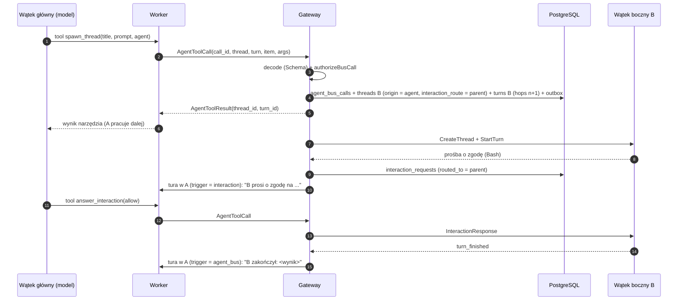

# Szyna agentów: delegowanie, interakcje, harmonogram

Status: **działa dla Codexa i Claude** (2026-11-01; Claude przez serwer MCP w procesie workera, [claude-adapter.md](claude-adapter.md#szyna-agentów)):
- wyłączanie natywnych narzędzi dostawców: `apps/worker/src/providers/native-tools.ts`, z testem na prawdziwym Codexie,
- definicje narzędzi, zestawy per poziom i reguły dostępu: `packages/domain/src/agent-bus`,
- schemat: `agent_bus_calls`, `schedules`, `threads.spawned_by_call_id`, `threads.interaction_route`, `interaction_requests.routed_to`, `turns.hops` i wyzwalacze tur (migracja `0004` dopuszcza odrzucone `spawn_thread`/`send_message` bez `hops`),
- worker: narzędzia jako `dynamicTools` Codexa przy `thread/start` (`codexAgentBusTools`), wywołania jako `AgentToolCall` z deterministycznym `call_id` (`toolCallId`), ponawiane po ponownym połączeniu,
- gateway: `AgentBus` (`apps/gateway/src/core/agent-bus.ts`) i `AgentBusStore` (`apps/gateway/src/store/agent-bus.ts`): dekodowanie, fakty z bazy, `authorizeBusCall`, wykonanie, powiadomienia, pytania do rodzica,
- testy: `tests/integration/agent-bus.test.ts` (gateway + skryptowany worker), `codex dynamic tools (live)` w `app-server.live.test.ts`.

Potwierdzone na żywo (Codex przez CLIProxyAPI, przez UI/BFF):
- wątek główny wywołuje `spawn_thread`, wątek boczny powstaje w tym samym katalogu i wykonuje zadanie, a wynik wraca do wątku głównego jako tura powiadomienia (`hops` 1 → 2), po której model odpowiada użytkownikowi,
- `schedule_wakeup` za 60 s: gateway odpala turę `trigger = schedule` i model wykonuje zaplanowane polecenie.

Zestaw narzędzi wątku Codexa jest ustalany przy `thread/start`. Wątki utworzone przed zmianą zestawu (np. przed włączeniem harmonogramu) mają stary zestaw.

| Narzędzie | Stan |
|---|---|
| `spawn_thread` (z `fork`, `notify`, `interactions`), `send_message`, `wait_threads`, `get_thread`, `read_thread`, `list_threads`, `interrupt_thread`, `close_thread`, `list_interactions`, `answer_interaction` | działa |
| `list_agents`, `spawn_thread.agent` | brak katalogu agentów: `list_agents` zwraca pustą listę, `agent` jest odrzucane (wątek boczny to kopia wywołującego) |
| `send_message.delivery = steer` | działa: gdy cel ma turę w toku, wiadomość (z notatką o nadawcy) trafia do niej (`turn_steers`, `SteerTurn`; Codex `turn/steer`, Claude strumień wejścia). Wynik narzędzia: `delivery: "steer"` i `turn_id` tury w toku. Powiadomienie przychodzi, gdy skończy się tura, do której wiadomość weszła (wywołanie wskazuje ją dopiero po wejściu). Nie weszła (tura skończyła się wcześniej, odmowa dostawcy): następna tura `agent_bus` z tym samym wywołaniem i `hops`, powiadomienie po niej. Bez tury w toku: kolejka (`delivery: "queue"`) |
| `schedule_wakeup`, `schedule_recurring`, `list_schedules`, `cancel_schedule` | działa (użytkownik ma to samo w UI API: `ListSchedules`, `CreateSchedule`, `SetScheduleStatus`): `Scheduler` w gateway (`apps/gateway/src/core/scheduler.ts`, co 5 s), cron Buna ze strefą czasową (`core/cron.ts`); minimalny odstęp sprawdzany na rzeczywistych terminach |

Powiązane: [threads.md](threads.md), [execution.md](execution.md), [transcript.md](transcript.md).

## 1. Natywna orkiestracja dostawców wyłączona

Subagenci i harmonogramy dostawców działają poza kontrolą platformy: są ulotni, żyją tylko w procesie dostawcy, nie da się ich wznowić ani zaadresować. Dlatego **domyślnie są wyłączeni w obu harnessach**. Zastępują je narzędzia platformy, z których korzystają tak samo Claude i Codex.

| Kategoria | Claude Agent SDK (`disallowedTools`) | Codex app-server (`-c features.*=false`) | Zastępstwo |
|---|---|---|---|
| Subagenci i komunikacja agentów | `Agent`, `Task`, `Workflow`, `ListAgents`, `SendMessage`, `SubagentHandback` | `multi_agent`, `multi_agent_v2` i `agents.enabled=false` | wątki boczne: `spawn_thread`, `send_message`, ... |
| Harmonogram | `ScheduleWakeup`, `CronCreate`, `CronDelete`, `CronList`, `RemoteTrigger` | `in_app_local_automation`, `sleep_tool` | `schedule_wakeup`, `schedule_recurring`, ... |
| Konektory konta właściciela urządzenia | (do sprawdzenia w adapterze Claude) | `apps` (wbudowany MCP `codex_apps`) | — (dostęp do kont przez konfigurację platformy) |

- `disallowedTools` usuwa narzędzia z kontekstu modelu i blokuje także wywołania wewnętrzne. Test sprawdza każdą nazwę z listą `BUILTIN_TOOL_NAMES` przypiętego SDK.
- Codex: `--print-startup-config` nie waliduje kluczy `features.*`, więc test na prawdziwym CLI sprawdza stan efektywny przez `codex features list` z tymi samymi nadpisaniami.
- **Codex: same `features` nie wystarczą.** Model, którego wpis w katalogu ma `multi_agent_version: "v2"` (np. `gpt-6.1-sol`), dostawał narzędzia kolaboracji (`spawn_agent`, `send_message`, `wait_agent`, `followup_task`, `interrupt_agent`, `list_agents`) mimo `features.multi_agent*=false`. Codex 0.164 wybiera wersję tak: `features.multi_agent_v2` włączone → v2; `agents.enabled = false` → wyłączone; dalej katalog modelu; na końcu `features.multi_agent` (`core/src/config/mod.rs`, `multi_agent_version_override`). Tylko `agents.enabled=false` (obsługiwany klucz `[agents]`) wygrywa z katalogiem, także w wątkach, które zapisały już v2. Dowód: `codex collaboration tools (live)` w `app-server.live.test.ts` — przebieg kontrolny bez nadpisania ma te narzędzia w `additional_tools` rolloutu, z nadpisaniem ich nie ma, a prośba o subagenta kończy się wywołaniem `spawn_thread`.
- Agent może włączyć każdą kategorię z powrotem (`ThreadSpec.native_subagents`, `native_scheduling`). Dla Codexa przełącznik działa per proces app-server; per wątek do sprawdzenia w spike'u.
- **Cele zostają włączone celowo:** to cele harnessów (Codex `goals`, Claude `/goal`), które platforma śledzi i którymi użytkownik steruje z UI — [goals.md](goals.md).
- Bez zmian zostają zadania w tle, które nie są agentami (background Bash, procesy Codexa) — [execution.md](execution.md#4-zadania-w-tle).

## 2. Model: dwa poziomy

- **Poziom 0** (wątek główny) orkiestruje: tworzy wątki boczne, steruje nimi, odpowiada na ich pytania.
- **Poziom 1** (wątek boczny) wykonuje pracę. Nie tworzy kolejnych wątków bocznych i nie dostaje narzędzi do sterowania innymi. Pilnuje tego baza (`threads_max_depth`) i zestaw narzędzi (`agentBusToolsFor`).
- Fork forka to wątek na tym samym poziomie (rodzeństwo z historią innego wątku bocznego).
- **Użytkownik** może pisać w każdym wątku, także w bocznym sterowanym przez agenta. Jego wiadomość jest zwykłą turą (`trigger = user`) i zeruje licznik przeskoków.

## 3. Narzędzia

Jedna definicja w Effect Schema (`AGENT_BUS_TOOLS`). Z niej powstaje JSON Schema dla dostawców, a gateway dekoduje wywołania ściśle: nieznane narzędzie, nadmiarowe pole albo wartość spoza zakresu wracają do modelu jako błąd narzędzia.

| Narzędzie | Poziom 0 | Poziom 1 | Co robi |
|---|:-:|:-:|---|
| `list_agents` | ✓ | ✓ | agenci do uruchomienia |
| `spawn_thread` | ✓ | | subagent = nowy wątek boczny: `title`, `prompt`, `instructions?` (rola), `model?`, `effort?`, `permission_mode?`, `agent?`, `fork?`, `notify?`, `interactions?` (`parent` domyślnie, `human`); zwraca od razu `thread_id`, `turn_id` i ustawienia dziecka |
| `send_message` | ✓ | ✓ | follow-up do wątku z drzewa: `delivery` `queue`/`steer`, `notify?` |
| `wait_threads` | ✓ | ✓ | czekanie na wątki (`any`/`all`, ≤ 300 s, ponawialne); zwraca status, wynik ostatniej tury i ostatnią wiadomość każdego |
| `get_thread` / `read_thread` / `list_threads` | ✓ | ✓ | status (z modelem, wysiłkiem, uprawnieniami, `last_turn`), transkrypt, lista |
| `interrupt_thread` / `close_thread` | ✓ | | sterowanie potomkami |
| `list_interactions` / `answer_interaction` | ✓ | | pytania i prośby o zgodę od wątków bocznych |
| `schedule_wakeup` | ✓ | ✓ | jednorazowo później (`delay_seconds` albo `at`, do 7 dni) |
| `schedule_recurring` | ✓ | ✓ | cron (min. 5 min), wymagane `until` (do 30 dni) albo `max_runs` |
| `list_schedules` / `cancel_schedule` | ✓ | ✓ | własne harmonogramy i harmonogramy potomków |

### Subagenci platformy zamiast natywnych

Każdy subagent to prawdziwy wątek platformy: widoczny w drzewie i na osi czasu rodzica, sterowalny przez użytkownika, z pełnym transkryptem. Opisy narzędzi mówią modelowi, że `spawn_thread` jest narzędziem do delegowania (nie ma `spawn_agent` ani `Task`).

| Natywnie | Szyna |
|---|---|
| Codex `spawn_agent` (`task_name`, `message`) / Claude `Task` (`description`, `prompt`) | `spawn_thread` (`title`, `prompt`) |
| Codex `agent_type`, Claude `subagent_type` (role z katalogu) | `instructions` (rola wprost); katalog agentów (`agent`, `list_agents`) — jeszcze nie ma |
| Codex `model`, `reasoning_effort` | `model`, `effort` — z katalogu profilu wywołującego (ten sam dostawca i konto), sprawdzane przez gateway |
| Codex `fork_turns` | `fork` (cała historia do ostatniej zakończonej tury) |
| — | `permission_mode` (nie szerszy niż wywołującego), `interactions` |
| Codex `send_message` / `followup_task`, `send_input` | `send_message` (`steer` / `queue`) |
| Codex `wait_agent` (z limitem czasu) | `wait_threads` (`any` / `all`, `timeout_seconds`) |
| Claude `Task` zwraca wynik rodzicowi | powiadomienie z ostatnią wiadomością dziecka (domyślnie) albo `wait_threads` / `get_thread` (`last_message`, `last_turn`) |
| Codex `interrupt_agent`, `close_agent` | `interrupt_thread`, `close_thread` |
| Codex `list_agents` (drzewo) | `list_threads` (`children` / `tree`) |

Reguły (`authorizeBusCall` i gateway):
- głębokość: dwa poziomy (subagent nie tworzy kolejnych), limity jak w sekcji 6,
- uprawnienia: `read_only` < `ask` < `accept_edits` < `full_auto`; subagent dostaje uprawnienia wywołującego albo węższe, nigdy szersze. „Uprawnienia wywołującego” to tryb tury, w której padło wywołanie (`turns.permission_mode`: wiadomość może nadpisać domyślny wątku na jedną turę), a bez niego tryb tury w toku, potem domyślny wątku; ten sam tryb dostaje subagent bez `permission_mode`,
- model i wysiłek: tylko z katalogu profilu wywołującego (gdy worker go zgłosił); fork zachowuje dostawcę,
- rola (`instructions`) dopisuje się do instrukcji wywołującego.

UI: wywołanie `spawn_thread` na osi czasu rodzica ma kartę subagenta (`SubagentCard`) z żywym statusem, modelem, wysiłkiem, uprawnieniami i początkiem ostatniej wiadomości dziecka (`Thread.last_message`); wątek dziecka pokazuje, kto go uruchomił (`SubagentOrigin`).

Na żywo: `tests/integration/platform-subagents.live.test.ts` — Codex (`gpt-6.1-sol`) i Claude na prośbę „użyj subagenta” wołają `spawn_thread`, dziecko jest wątkiem bocznym widocznym w UI API, jego wynik wraca do rodzica; brak natywnych narzędzi subagentów.

### Asynchroniczność

- `spawn_thread` i `send_message` nie blokują. Wynik przychodzi jako **powiadomienie** (`notify`, domyślnie włączone): gdy tura docelowa się kończy, gateway zaczyna w wątku wywołującym nową turę z wynikiem. Jeśli wywołujący ma turę w toku, powiadomienie czeka w kolejce.
- `wait_threads` jest dla orkiestracji synchronicznej i jest **ograniczone w czasie oraz ponawialne**. Claude SDK ma twardy limit czasu wywołania narzędzia MCP, a limit narzędzi dynamicznych Codexa nie jest udokumentowany. `wait_threads` zwraca też wcześniej, gdy wątek boczny czeka na odpowiedź rodzica.

## 4. Interakcje w wątkach bocznych

Gdy dostawca w wątku bocznym prosi o zgodę albo zadaje pytanie ([execution.md](execution.md#6-interakcje-z-użytkownikiem)), o adresacie decyduje `threads.interaction_route`, ustawiane przy tworzeniu wątku:

| `interaction_route` | Domyślnie dla | Kto odpowiada |
|---|---|---|
| `parent` | wątków tworzonych przez agenta (`spawn_thread`) | agent wątku głównego przez `answer_interaction`; użytkownik może odpowiedzieć zamiast niego |
| `human` | wątków tworzonych przez użytkownika | użytkownik w UI |

- Przy `parent` gateway powiadamia rodzica: kończy jego `wait_threads` albo zaczyna w nim turę `trigger = interaction` (z `hops` tury, która zapytała, + 1).
- Kto faktycznie odpowiedział, jest zapisane: `answered_by` (użytkownik) albo `answered_by_thread_id` (agent). Dokładnie jedno z nich (`interaction_requests_answered_by`).
- Zgoda bez odpowiedzi w terminie wygasa jako odmowa. Pytanie czeka.
- Automatyczna zgoda na konkretne narzędzia to nadal `permission_mode` agenta. Routing dotyczy tylko tego, co dostawca i tak zgłasza.

## 5. Harmonogram

Harmonogram jest funkcją platformy, nie dostawcy: trwały (`schedules`), widoczny w UI, przeżywa restart i wyłączenie workera.

- Gateway odpala zaległe harmonogramy z dzierżawą (`FOR UPDATE SKIP LOCKED`) jako tury `trigger = schedule`. Jeśli worker jest offline, tura czeka w kolejce jak każda inna.
- Po przestoju `missed_policy` decyduje: jedna tura nadrabiająca (`run_once`, domyślnie) albo pominięcie (`skip`).
- Agent może ustawić harmonogram dla siebie albo dla swoich potomków. Harmonogram agenta zawsze ma koniec (jednorazowy, `until` albo `max_runs`) i wydłuża łańcuch przeskoków. Agent, który w kółko planuje sam siebie, zatrzyma się na limicie. Użytkownik może tworzyć harmonogramy bez końca.

## 6. Reguły dostępu i limity

Czysta funkcja `authorizeBusCall` (`packages/domain`), wywoływana przez gateway w tej samej transakcji co zapis.

- **Domena komunikacji to jedno drzewo wątków.** Czytać, czekać i pisać można do każdego innego wątku drzewa: dzieci, rodzica, rodzeństwa. Wątki spoza drzewa są nieodróżnialne od nieistniejących.
- **Sterowanie** (przerwanie, zamknięcie, odpowiadanie na interakcje, harmonogramy innych) tylko nad potomkami.
- **Limity** (domyślne, konfigurowalne): 8 wątków bocznych na wątek główny, 16 aktywnych wątków w drzewie, 10 harmonogramów na wątek, 8 przeskoków.
- **Licznik przeskoków (`hops`):** tura z wejścia człowieka albo pobudki dostawcy ma 0. Tura uruchomiona przez szynę, powiadomienie, pytanie do rodzica albo harmonogram agenta ma `hops` przyczyny + 1. Limit zatrzymuje pętle agentów bez udziału człowieka.
- **Fork** wymaga tego samego dostawcy. Dziedziczy historię do ostatniej zakończonej tury.
- Zawsze w imieniu właściciela projektu.

## 7. Przepływ: spawn z powiadomieniem

## 8. Trwałość

- **Idempotencja:** `agent_bus_calls.id = call_id`. Ponowione `AgentToolCall` zwraca zapisany wynik, nie tworzy drugiego wątku ani harmonogramu.
- **Powiadomienia** to outbox (`notify_status`). Harmonogramy żyją w bazie. Jedno i drugie przeżywa restart gateway.
- **Restart w trakcie `wait_threads`:** czekanie to tylko odczyt. Przerwana tura wywołującego po wznowieniu zawoła ponownie albo dostanie powiadomienie.

## 9. Udostępnienie narzędzi dostawcom

- **Claude:** serwer MCP w procesie workera (`createSdkMcpServer`, nazwy `mcp__openagents__*`) z `timeout` większym niż maksymalne `wait_threads`.
- **Codex:** `thread/start { dynamicTools }` ze specyfikacji `agentBusToolSpecs(agentBusToolsFor(depth))`. Pole jest eksperymentalne; plan B to lokalny serwer MCP.
  - `thread/resume` i `thread/fork` nie przyjmują `dynamicTools`. Codex trzyma narzędzia z wątkiem: działają po wznowieniu w nowym procesie i w forkach (sprawdzone na żywo).
  - Skutek: wątek boczny utworzony forkiem wątku głównego widzi też narzędzia orkiestratora (`spawn_thread` itd.). Gateway i tak odrzuca je według poziomu wywołującego (`authorizeBusCall`).
- Zestaw zależy od poziomu wątku (`ThreadSpec.depth`). Model wątku bocznego nie widzi `spawn_thread` ani narzędzi sterowania.
- Worker tylko przekazuje wywołania (`AgentToolCall`) do gateway i niczego nie wykonuje lokalnie.

## 10. Ustalenia i otwarte punkty

Ustalone (2026-11-01):

1. Odpowiadanie na interakcje jest konfigurowalne per wątek. Wątki agentów domyślnie trafiają do rodzica-agenta, a użytkownik zawsze może odpowiedzieć i pisać w każdym wątku.
2. Harmonogram dostawców jest wyłączony; zastępuje go harmonogram platformy dla obu dostawców.
3. Wiadomości do rodzeństwa są dozwolone.
4. Dwa poziomy: wątki boczne nie tworzą kolejnych.

5. Szyna nie ma narzędzi celów: cele należą do harnessu (model używa jego narzędzi), platforma je śledzi ([goals.md](goals.md)).

Otwarte:

1. Domyślne wartości limitów (patrz sekcja 6).
