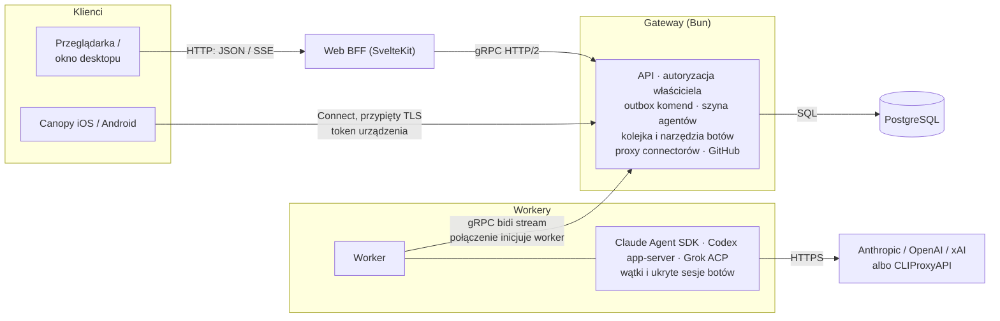
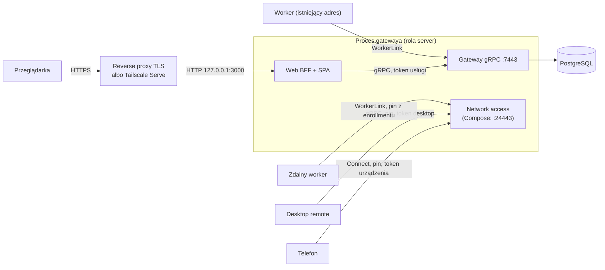
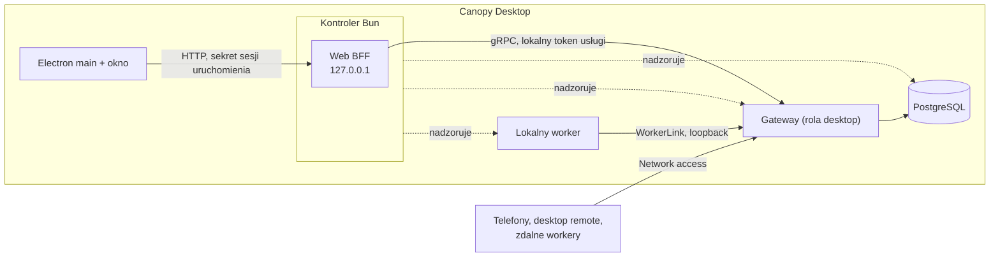
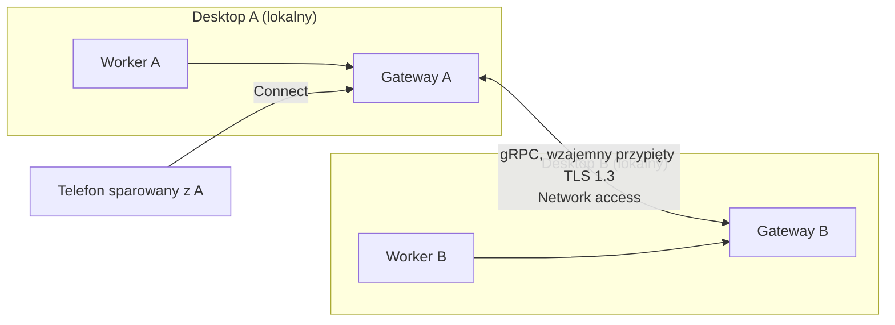
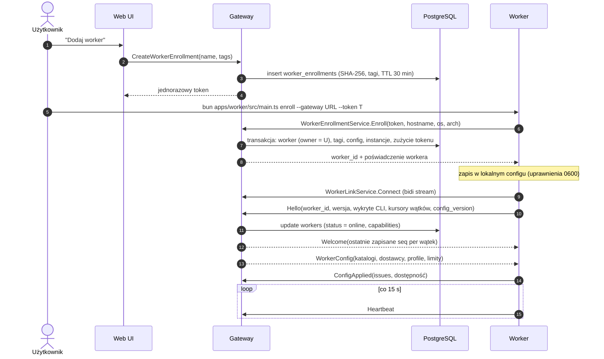
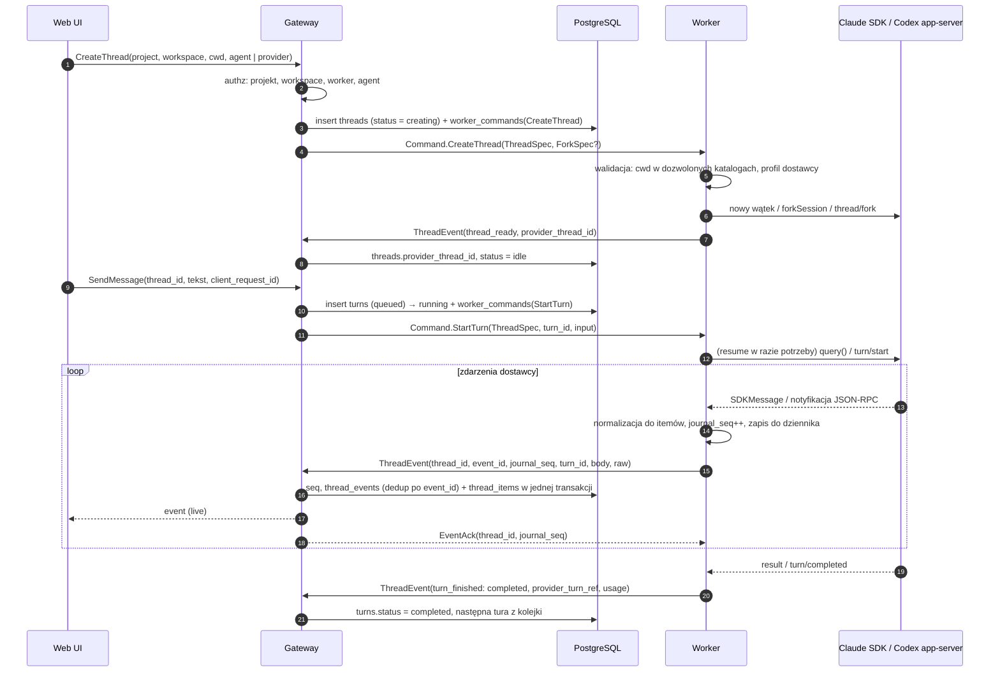
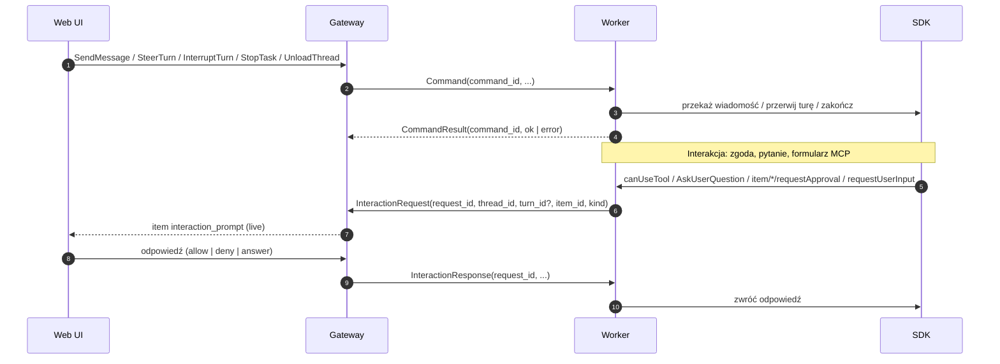
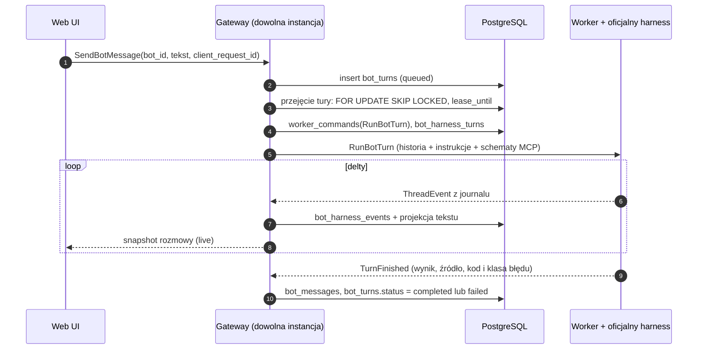

# Canopy — architektura

Status: opis zaimplementowanego kodu (2026-11-18): gateway, workery, web BFF,
trwałe statystyki tokenów, zgłoszonych kosztów i szacowanej równowartości API OpenAI,
Canopy Desktop (tryb lokalny, zdalny, sesja dostępu do BFF i połączone komputery),
interaktywny i automatyczny mini podgląd automatyzacji w wątku oraz aplikacja mobilna
z ręcznym Preview Browser/Desktop/Device oraz kanały botów Slack przez Socket Mode
z trwałym buforem wiadomości, aktualizacjami aktywnej tury i konfiguracją
nasłuchiwania przez prywatną rozmowę z botem.
BFF materializuje stan odczytu ze wspólnego gRPC overview
i współdzieli go między oknami; dogrzewanie historii odbywa się w BFF.
Logowanie użytkowników nie istnieje; otwarte decyzje są w §11. Ten dokument opisuje
zachowanie, nie dostępność w wydaniach: funkcje trafiają najpierw do nightly, potem
do beta i stable ([release.md](release.md)); co zawiera konkretne wydanie, podają
GitHub Releases.

Powiązane dokumenty:

- [bots.md](bots.md) — rozmowy botów, trwałość i narzędzia; [bots-harness.md](bots-harness.md) — migracja inferencji na oficjalne harnessy workerów.
- [connectors.md](connectors.md) — współdzielone konta zewnętrznych MCP, OAuth w gateway, granty workerów/botów i proxy bez poświadczeń na workerze.
- [github.md](github.md) — konto GitHub App, device flow oraz odczyt, review, cykl PR, metadane i sterowanie CI v1.
- [protocol.md](protocol.md) — kanał gRPC gateway ↔ worker
- [data-model.md](data-model.md) — model danych PostgreSQL i reguły dostępu
- [worker-config.md](worker-config.md) — zdalna konfiguracja workerów (lokalnie tylko połączenie z gateway)
- [updates.md](updates.md) — niezależny UpdateService, zgodność protokołów, mirror i rollback binarek
- [provider-cli.md](provider-cli.md) — CLI dostawców na workerach: wykrywanie, najnowsze wersje, instalacja i aktualizacja na kliknięcie (nigdy dołączane do Canopy)
- [usage.md](usage.md) — agregaty tokenów, zgłoszonych kosztów i szacowanej równowartości API OpenAI, niezależne od retencji wątków i synchronizowane między połączonymi komputerami.
- [automation-tools.md](automation-tools.md) — lokalne `agent-browser`, `agent-desktop` i `agent-device`: gotowość, granty, bridge MCP i podgląd
- [codex-adapter.md](codex-adapter.md) — adapter Codex app-server: protokół, testy na żywo, izolacja `CODEX_HOME`
- [grok-adapter.md](grok-adapter.md) — własny SDK ACP stdio Grok CLI, native/CLIProxyAPI i MCP narzędzi platformy
- [ui-api.md](ui-api.md) — API dla UI, SvelteKit jako BFF (HTTP/1.1 + SSE do przeglądarki, gRPC do gateway)
- [diagnostics.md](diagnostics.md) — Settings → Diagnostics: wspólny widok wydajności komputerów, metryki RPC i łączy, zalecenia, tracing i zbieranie zredagowanych logów
- [mobile.md](mobile.md) — Canopy iOS/Android, Connect przez przypięty TLS, parowanie i automatyczne trasy
- [tailscale.md](tailscale.md) — wykrywanie Tailscale, nazwa MagicDNS jako pierwszy adres i opcjonalne HTTPS over Tailscale dla serwerowego web UI
- [threads.md](threads.md) — projekty, wątki, wątki boczne i forki
- [notifications.md](notifications.md) — alerty systemowe wątków i botów: teksty, podglądy, fokus, dźwięk i brak duplikatów
- [worktrees.md](worktrees.md) — git worktrees: ustawienia w zakresach, tworzenie, status, bezpieczne sprzątanie i zarządzanie
- [transcript.md](transcript.md) — zapis wszystkich zdarzeń, itemy, oś czasu dla frontendu
- [execution.md](execution.md) — tury, praca w tle, subagenci, interakcje, limity
- [goals.md](goals.md) — cele: silnikiem jest harness (Codex goals, Claude `/goal`), platforma je śledzi i steruje nimi z UI
- [agent-bus.md](agent-bus.md) — szyna agentów: delegowanie przez wątki boczne, interakcje, harmonogram; natywna orkiestracja dostawców wyłączona
- [agent-visuals.md](agent-visuals.md) — obrazy w odpowiedziach (`show_images`) i interaktywne visuals (`render_visual`, `render_html`): format, sandbox klientów, trwały zapis
- [workspace.md](workspace.md) — zakładki wątku, karta podsumowania i panel Files/Preview
- [desktop.md](desktop.md) — Canopy Desktop: kontroler, tryb lokalny, aktualizacje; [desktop-remote-frontend.md](desktop-remote-frontend.md) — tryb zdalny z lokalnym BFF
- [linked-computers.md](linked-computers.md) — połączone komputery (wyłącznie lokalne gatewaye desktopu); [network-access.md](network-access.md) — wspólny port TLS dla telefonów, desktopów, workerów i komputerów
- [deploy.md](deploy.md) — wdrożenie serwera (Docker Compose, binarki, reverse proxy)
- [durability.md](durability.md) — trwałość, graceful shutdown, aktualizacje w trakcie działania
- [`proto/canopy/worker/v1/worker_link.proto`](../proto/canopy/worker/v1/worker_link.proto) — kontrakt łącza gateway ↔ worker

## 1. Cel

Platforma do zarządzania agentami AI dla wielu użytkowników:

- uruchamianie agentów kodujących (Claude Agent SDK, Codex app-server, Grok CLI przez ACP) na wielu maszynach i w wielu katalogach, opcjonalnie przez CLIProxyAPI,
- boty czatowe z ukrytymi, izolowanymi sesjami harnessów na workerach i trwałą kolejką w gatewayu,
- agenci globalni (dla wszystkich) i prywatni (dla właściciela),
- projekty z wątkami przypiętymi do dostawcy, workera i katalogu; wątki boczne w tym samym katalogu z opcjonalnym forkiem historii,
- rozmowy agent ↔ agent jako wątki boczne (szyna agentów: tworzenie, follow-upy, statusy), które użytkownik może podejrzeć i kontrolować; natywni subagenci dostawców domyślnie wyłączeni.

## 2. Komponenty

| Komponent | Gdzie działa | Odpowiedzialność |
|---|---|---|
| **Web UI + BFF** | przeglądarka; BFF w procesie gatewaya (serwer) albo kontrolera desktopu | SPA Svelte 5 / SvelteKit (`ssr = false`): wątki, boty, transkrypty na żywo, uprawnienia, ustawienia. adapter-node podaje powłokę z wyglądem użytkownika, wersjonowane assety oraz BFF (`/api/*`, SSE i akcje formularzy) do gRPC gateway. Gateway serwerowy (binarka i obraz) uruchamia BFF we własnym procesie; `CANOPY_WEB=off` daje gateway bez web ([deploy.md](deploy.md#gateway-z-wbudowanym-web-jedna-binarka)). |
| **Desktop** | macOS, Linux, Windows (Electron + kontroler Bun) | Tryb lokalny: kontroler nadzoruje PostgreSQL, gateway (rola `desktop`) i worker, a BFF działa w jego procesie. Tryb zdalny: tylko lokalny BFF połączony ze zdalnym gatewayem ([desktop.md](desktop.md), [desktop-remote-frontend.md](desktop-remote-frontend.md)). |
| **Mobile** | iOS/Android | Expo development build, Connect protobuf przez streaming `expo/fetch`, token urządzenia w SecureStore. Bez Expo web. |
| **Gateway** | serwer centralny albo lokalny sidecar desktopu (Bun) | Jedyny punkt kontaktu klientów. Autoryzacja właściciela, API, persystencja, outbox komend do workerów, kolejka i narzędzia botów, proxy connectorów, szyna agent ↔ agent, GitHub. Nie wykonuje inferencji. |
| **Worker** | edge device: Linux, Omarchy, macOS, Windows (Bun) | Uruchamia wątki w dozwolonych katalogach oraz ukryte sesje tur botów, przez oficjalne harnessy; wznawia i forkuje wątki. Wykonuje także przyznane narzędzia automatyzacji przez lokalny bridge MCP. Normalizuje zdarzenia i strumieniuje je do gateway. |
| **PostgreSQL** | obok gateway | Użytkownicy, projekty, agenci, workery, wątki, tury, transkrypty, boty, outbox, audyt. |
| **Dostawcy LLM** | zewnętrznie | Anthropic / OpenAI / xAI. Inferencję wykonują oficjalne CLI/SDK na workerze, również dla botów. |

BFF trzyma w pamięci model odczytu jednego właściciela i celu gatewaya, zasilany
przez wspólny strumień gRPC. Frontend dostaje snapshoty i zmiany przez SSE, w tym
gotowe projekcje wczytanych paneli i list. Cache i odczyty w toku są współdzielone
między oknami procesu; historia ma ograniczony ogon oraz strony na żądanie.
Zmiana celu zamyka strumienie i usuwa prywatny stan. Szczegóły: [ui-api.md](ui-api.md#współdzielone-odczyty).

Tylko gateway łączy się z bazą. Worker nie ma dostępu do bazy i nie przyjmuje połączeń przychodzących.

Lokalne narzędzia automatyzacji są wykonywane wyłącznie przez worker. Gateway
wykrywa gotowość, przechowuje grant per worker i właściciel oraz autoryzuje
wywołania bieżącej tury; nie uruchamia binarek. Claude, Codex i Grok dostają
prywatny workerowy bridge MCP na loopbackie. Osobny, nietrwały podgląd wątku
przenosi obraz i bezpośrednie sterowanie użytkownika przez WorkerLink, gateway
i BFF (SSE). Browser używa natywnego strumienia WebSocket `agent-browser` dla
sesji wątku, Desktop/Device — anulowalnych pętli zrzutów. Klient nie łączy się
z portem ani adresem narzędzia na workerze; gateway egzekwuje właściciela, grant
i bieżące łącze. Po autoryzacji rzeczywistego wywołania lokalnego MCP przez wspólny
bridge gateway publikuje typowaną, nietrwałą aktywność dla żywych obserwatorów
wątku i automatycznego mini podglądu; nie zawiera ona surowych argumentów, URL-i ani
tekstu i nie trafia do historii ([automation-tools.md](automation-tools.md)).

Gateway ma rolę startową: domyślnie `server`; kontroler Canopy Desktop oznacza własny
sidecar trybu lokalnego jako `desktop`. To wewnętrzna decyzja runtime, bez ustawienia
w UI. **Linked computers łączy wyłącznie lokalne gatewaye aplikacji desktopowych**
([linked-computers.md](linked-computers.md)). Serwer Docker/binarny nie uruchamia usług
linkowania ani discovery/mDNS, nie synchronizuje luster/konfiguracji, nie przenosi rzeczy
i nie pośredniczy między gatewayami. Istniejące relacje zachowuje jako `inactive`.
Network access nadal przyjmuje telefony, klienty desktopowe i workery, odrzucając
handshake komputerów. `GetClientCapabilities` ogłasza rolę i `linked_computers`;
web oraz desktop remote chowają linkowanie zgodnie z capability podłączonego gatewaya.

Lokalny odczyt nie czeka na I/O połączonego komputera. Listy korzystają z zatwierdzonych
luster i ostatnich odpowiedzi, a odświeżanie partnerów działa w tle z ograniczeniem
współbieżności i backoffem. Obecność jest oddzielona od danych: utrata łącza wyłącza
akcje wymagające domu, ale nie usuwa jego wątków, workerów ani projektów. Web/desktop
i mobile stosują wspólne reguły `domain/linked-snapshot.ts`. BFF ma oddzielne pule
HTTP/2 dla lokalnych i zdalnych unary oraz lokalnych i zdalnych subskrypcji, więc wisząca zdalna
akcja lub stream nie zajmuje lokalnych slotów. Szczegóły i czasy: [linked-computers.md](linked-computers.md#zsumowany-widok).

### Stan klienta: szkice i workspace wątku

Szkice kompozytora są prywatnymi danymi właściciela, oddzielonymi od historii.
Klient zachowuje lokalny szkic dla każdego wątku i celu nowego wątku.
Gateway przechowuje automatycznie synchronizowane kopie; urządzenie odbierające
wybiera przejęcie. Nie wysyła ich do workerów ani modeli. Szczegóły:
[ui-api.md](ui-api.md#szkice-kompozytora-i-przekazywanie-między-urządzeniami).

Wątek web/desktop i mobile ma lokalny workspace: rozmowę jako pierwszą kartę
(w web/desktop pod tytułem wątku), karty plików (jeden zastępowalny preview
i karty utrwalone), pełnego PR oraz wyniku zadania w tle. Podsumowanie wątku
to pływająca karta w rogu obszaru rozmowy (pigułka, popover albo arkusz),
a prawy panel web/desktop łączy drzewo Files, listę zmian Git `Diff`
z wirtualizowaną kartą wszystkich zmian i zbiorczym review dla agenta oraz interaktywny Preview
(Browser/Desktop/Device), a podsumowanie może mieć pod sobą automatyczny mini
podgląd; natywny mobile ma tytuł jako kartę rozmowy, przełącznik kart i arkusze
`Thread details`, `Files` oraz ręczny, pełnoekranowy `Preview` Browser/Desktop/Device, przesyłany
bezpośrednio przez Connect i przypięty TLS. Metadane kart są stanem urządzenia,
bez synchronizacji między klientami. Treści plików i ich niezapisane edycje
pozostają w ograniczonych cache pamięci, niezależnie od dogrzewania transkryptów.
Gateway wyprowadza zakres plików z właściciela i wątku. Drzewo jest leniwe,
stronicowane; stream zmian niesie invalidacje wybranego zakresu, bez pełnego
snapshotu drzewa ani historii. Szczegóły: [workspace.md](workspace.md),
[ui-api.md](ui-api.md#moduły-workspaceu-wątku) i [mobile.md](mobile.md).

## 3. Diagram komponentów i połączeń

Diagram logiczny pokazuje role, niezależnie od sposobu wdrożenia. Trzy topologie
poniżej pokazują, gdzie działają procesy.



### Topologia: serwer (Docker Compose albo binarka)



Serwer nie uruchamia linkowania komputerów. Wydania sprzed wbudowanego web mają
w Compose osobną usługę `web` z tym samym BFF; migracja: [deploy.md](deploy.md#docker-compose-jeden-host).

### Topologia: Canopy Desktop w trybie lokalnym



BFF desktopu wymaga `X-Canopy-Desktop-Session` z losowym 256-bitowym sekretem
uruchomienia, wspólnym wyłącznie dla Electron main i kontrolera przez prywatne stdin.
Listener HTTP sprawdza sekret oraz Host/Origin przed adapter-node, także dla setupu,
statycznych assetów, API i SSE; odrzuca żądania bez autoryzacji kodem 403 z `no-store`.
Main dodaje nagłówek tylko dla własnych okien i głównej ramki na dokładny origin BFF,
a przed handlerem kontroler go usuwa. Jedyny wyjątek bez sekretu to dokładny GET
callbacku OAuth z kontrolą Host i nawigacji dokumentu oraz state/binding/TTL w gatewayu.
Zwykła przeglądarka nie ma dostępu do aplikacji. Origin i magazyny profilu pozostają
bez zmian. HTTPS over Tailscale jest niedostępne dla roli `desktop`, a Network access
sparowanych klientów nadal działa. Ochrona nie izoluje od procesu tego samego
użytkownika zdolnego czytać pamięć lub użyć debuggera; szczegóły w
[desktop.md](desktop.md#granice-i-zgodność).

W trybie zdalnym kontroler uruchamia tylko BFF: nie startuje lokalnego gatewaya,
bazy ani workera. BFF łączy się ze zdalnym gatewayem przez Network access,
sprawdza pin certyfikatu i używa odwoływalnego tokenu rodzaju `desktop`
z parowania, nigdy tokenu usługi serwera ([desktop-remote-frontend.md](desktop-remote-frontend.md)).

### Topologia: połączone komputery



Każda rzecz ma dom na jednym komputerze; akcje są trasowane do domu, a partnerzy
czytają lustra do odczytu offline. Telefon i klienty widzą zsumowany zbiór przez
gateway, z którym są sparowane ([linked-computers.md](linked-computers.md)).

### Tabela połączeń

| Od → do | Protokół | Kto inicjuje | Uwagi |
|---|---|---|---|
| Przeglądarka ⇄ SvelteKit (BFF) | HTTPS (HTTP/1.1): strony, akcje, JSON; SSE dla zmian na żywo | przeglądarka | Prywatny adres gRPC BFF i token usługi zostają na serwerze; UI pokazuje publiczne adresy dla workerów (z pinem Network access) i jednorazowe sekrety enrollment/rotacji ([ui-api.md](ui-api.md)). |
| Okno desktopu ⇄ lokalny BFF | HTTP na loopback: dokumenty, assety, JSON, SSE | Electron | Sekret sesji uruchomienia w nagłówku dodawanym przez main; bez dostępu z przeglądarki poza wąskim callbackiem OAuth ([desktop.md](desktop.md#granice-i-zgodność)). |
| SvelteKit → Gateway | gRPC (HTTP/2), `GatewayService`, token usługi | SvelteKit | Komendy i strumienie (`WatchThread`, `WatchOverview`); ten sam serwer co workery. Web wbudowany w gateway bierze adres i token z konfiguracji gatewaya; lokalny desktop dostaje je od kontrolera. |
| Desktop remote (lokalny BFF) → Gateway | gRPC (HTTP/2) przez przypięty TLS, port Network access | kontroler desktopu | Odwoływalny token rodzaju `desktop` z parowania (kod + pin), pełny zakres UI właściciela; bez tokenu usługi ([desktop-remote-frontend.md](desktop-remote-frontend.md)). |
| Mobile → Gateway | HTTPS Connect, przypięty certyfikat | aplikacja | Unary i server streaming przez natywny transport TLS. Jeden listener Network access, automatyczne trasy i osobny odwoływalny token urządzenia; administracja urządzeniami tylko przez BFF. |
| Gateway ⇄ połączony komputer | gRPC HTTP/2, wzajemny przypięty TLS 1.3, port [dostępu sieciowego](network-access.md) | oba | Jeden przełącznik Settings → Network access; adresy wykrywane i ogłaszane łączem ([linked-computers.md](linked-computers.md)). |
| Worker ↔ Gateway | gRPC, jeden strumień dwukierunkowy, HTTP/2 + TLS | **Worker** | Nowe zdalne workery używają Network access i pinu z enrollmentu. Istniejące zachowują port serwera; automatycznie przechodzą na osiągalny przypięty adres i zachowują fallback. Lokalny worker desktopu używa loopback. Szczegóły: [protocol.md](protocol.md). |
| Worker → Gateway (aktualizacje) | osobny gRPC `canopy.update.v1.UpdateService`, ten sam port HTTP/2 | **Worker** | Zamrożony kontrakt działa także po odmowie WorkerLink. Werdykt, polecenia, postęp, mirror binarki; [updates.md](updates.md). |
| Gateway → PostgreSQL | SQL po TLS | Gateway | Pula połączeń. Opcjonalnie `LISTEN/NOTIFY` przy wielu instancjach gateway. |
| Worker → LLM | HTTPS (przez SDK/CLI) | Worker | Login CLI (Claude Code / Codex / Grok) zostaje na urządzeniu. Klucz proxy lub endpointu API przychodzi z gateway w `WorkerConfig` i jest trzymany tylko w pamięci workera i env procesu harnessu ([proxies.md](proxies.md)). |

### Dlaczego worker inicjuje połączenie

Edge device zwykle stoi za NAT-em, ma dynamiczne IP lub jest laptopem. Gateway nie może się do niego dodzwonić. Worker otwiera więc jeden długożyjący strumień gRPC do gateway. Komendy z gateway płyną w dół tym samym strumieniem. Na urządzeniu nie trzeba otwierać portów.

## 4. Wątki i boty

| Cecha | Wątek (projekt, wątek główny lub boczny) | Bot |
|---|---|---|
| Runtime | Worker na edge device | Ukryta sesja harnessu na workerze z ustawienia Runs on; kolejka tur, rozmowa i narzędzia w gatewayu |
| Silnik | Claude Agent SDK, Codex app-server, Grok CLI przez ACP | Te same oficjalne harnessy; narzędzia platformy przez Canopy MCP |
| Pliki i shell | Tak, w `cwd` wątku (w dozwolonych katalogach workera) | Brak dostępu do projektów i plików użytkownika workera. Przełącznik Files ogranicza narzędzia plikowe do prywatnego scratch rozmowy (200 MiB) i daje `download_file` oraz wysyłanie plików jako załączników; Web access włącza natywne narzędzia sieciowe harnessu ([bots.md](bots.md#dostęp-do-sieci-i-izolowane-pliki)) |
| Miejsce uruchomienia | wątek: worker + workspace + `cwd`, niezmienne | Runs on + izolowany home i scratch per rozmowa; zmiana Runs on nie przenosi scratch |
| Poświadczenia | Login CLI na workerze albo klucz proxy z `WorkerConfig` | Login instancji lub proxy obsługiwane przez harness; brak credentiali w kontekście bota |
| Transkrypt | `thread_events` + projekcja `thread_items` | Journal workera → `bot_harness_events` → `bot_messages` w rozmowie bota |

Agent to szablon bez miejsca uruchomienia. Wątek przypina agenta (snapshot konfiguracji) do dostawcy, workera i katalogu. Szczegóły: [threads.md](threads.md).

Boty mają własne tabele (`bots`, `bot_turns`, `bot_messages`, `bot_harness_*` i inne),
a nie projekt ani wątek; ich rozmowa nie trafia do `thread_events`. Szczegóły:
[bots.md](bots.md), [bots-harness.md](bots-harness.md).

Slack korzysta z jednej aplikacji i konta w Connectors dla MCP i komunikatora.
Osobne zgody OAuth dają token użytkownika do MCP i odnawiany token bota
do wiadomości; subskrypcja kanału pozostaje niezależna od grantów narzędzi.
Wyłączenie powiązanego konta odcina także działania tur zewnętrznych i outbox.
Gateway odbiera zdarzenia Slack przez wychodzące połączenie Socket Mode, zapisuje je przed ACK
i grupuje wiadomości bez inferencji. Właściciel przypisuje konto do bota,
wybiera kanały i nadawców oraz odpowiedź na Slacku albo powiadomienie w Canopy.
Może też zlecić botowi konfigurację w prywatnej rozmowie: bot rozpoznaje kanały
i uczestników oraz zapisuje instrukcje reakcji. Te instrukcje są trwałe i wracają
z kontekstem źródła; nie powstaje osobna mapa narzędzi dla każdego kanału.
Kolejne paczki tej samej rozmowy trafiają do aktywnej tury przez nietrwały
`SteerBotTurn`; dopiero potwierdzenie konsumpcji w journalu oznacza dostarczenie.
Brak obsługi lub potwierdzenia zachowuje wiadomości do kolejnej tury.

Każda rozmowa zewnętrzna ma osobną historię, home harnessu i scratch; nie dostaje
prywatnej historii ani handoffu bota. Bot dobiera zwykłe przyznane narzędzia
connectorów i pracy z wątkami; obowiązują jego ustawienia Web access, Files,
granty i zgody. Zmiana ustawień właściciela i nasłuchiwania wymaga prywatnej
rozmowy właściciela. Wynik zleconego wątku wraca do rozmowy źródłowej, także gdy
przyjdzie później lub po restarcie. Sekrety Slacka pozostają zaszyfrowane
w gatewayu, a lease konta wybiera jednego odbiorcę zdarzeń. Inferencję nadal
wykonuje worker; idle kanału i buforowanie nie zużywają tokenów modelu.

Wątki używają komend workera; boty mają osobną trwałą komendę `RunBotTurn`, bez
sztucznego projektu lub wątku. Gateway wykonuje narzędzia i autoryzuje efekty;
nie ma klienta HTTP inferencji. Interfejs runtime'u wątków:

```ts
interface ThreadRuntime {
  create(thread: ThreadSpec, fork?: ForkSpec): Effect<void, ThreadError>;
  startTurn(thread: ThreadSpec, turnId: TurnId, input: UserInput): Effect<void, ThreadError>;
  interruptTurn(threadId: ThreadId, turnId: TurnId): Effect<void, ThreadError>;
  unload(threadId: ThreadId): Effect<void, ThreadError>;
}
// WorkerThreadRuntime  — zapisuje komendę w outboxie, dostarcza ją przez strumień gRPC do workera
```

## 5. Przepływy danych

### 5.1 Rejestracja i połączenie workera



### 5.2 Wątek agenta SDK: utworzenie, tura, strumień transkryptu



### 5.3 Akcje z gateway do workera



### 5.4 Bot: kolejka na gatewayu, harness na workerze



### 5.5 Agent ↔ agent: szyna agentów

Natywni subagenci i harmonogramy Claude i Codexa są domyślnie wyłączeni. Zastępuje je **szyna agentów** platformy, dostępna dla obu dostawców: wątki boczne (`spawn_thread`, `send_message`, `wait_threads`, `get_thread`, `read_thread`, `list_threads`, `interrupt_thread`, `close_thread`, `list_agents`), odpowiadanie na pytania wątków bocznych (`list_interactions`, `answer_interaction`) i harmonogram (`schedule_wakeup`, `schedule_recurring`, `list_schedules`, `cancel_schedule`). Dwa poziomy: wątek główny orkiestruje, wątki boczne wykonują pracę. Użytkownik może pisać w każdym wątku.

- `spawn_thread` i `send_message` nie blokują; wynik przychodzi jako powiadomienie (steer do trwającej tury, inaczej nowa tura) albo przez ograniczone w czasie `wait_threads`. Wiadomość dziecka do pracującego rodzica domyślnie dołącza do jego tury; gdy rodzic czeka na dziecko, kończy oczekiwanie z treścią wiadomości. Odczytane wejścia oczekujące są wycofywane transakcyjnie.
- Domena komunikacji to drzewo wątków; sterowanie tylko nad potomkami; limity liczby wątków, harmonogramów i przeskoków (`hops`) bez udziału człowieka.
- Narzędzia trafiają do Claude jako serwer MCP w procesie workera, do Codexa jako `dynamicTools`; wykonuje je gateway.

Szczegóły, diagram przepływu i reguły: [agent-bus.md](agent-bus.md).

## 6. Wielu użytkowników: agenci globalni i prywatni

Szczegóły i tabele: [data-model.md](data-model.md#reguły-dostępu).

- **Agent globalny** (`scope = global`) — tworzy i edytuje go admin. Może go używać każdy użytkownik.
- **Agent prywatny** (`scope = private`) — widzi go i używa tylko właściciel.
- **Projekty i ich wątki należą do właściciela projektu**, także gdy wątek używa agenta globalnego. Użytkownicy nie widzą nawzajem swoich wątków z tym samym agentem globalnym.
- **Workery** mają właściciela albo są współdzielone. Workspace projektu może wskazywać worker właściciela projektu albo współdzielony. Agent (globalny lub prywatny) nie ma miejsca uruchomienia; decyduje o nim wątek.

Autoryzacja ma być w jednym module polityk w gateway. Każde zapytanie do bazy filtruje po użytkowniku. Postgres RLS warto rozważyć jako drugą warstwę.

## 7. Transkrypt i normalizacja zdarzeń

Worker zamienia natywne zdarzenia dostawców na `ThreadEvent` z ściśle typowanymi **itemami** (wiadomość, rozumowanie, komenda, zmiana pliku, narzędzie, subagent, zadanie w tle, plan, zgoda, wywołanie agenta, ...). Każde zdarzenie, także między turami i bez mapowania, trafia do bazy razem z oryginałem. Duże treści idą do blobów, nic nie jest przycinane. Gateway nadaje jedną kolejność (`seq`) zdarzeniom workera i platformy, a projekcja `thread_items` daje frontendowi gotowy stan.

Model, mapowanie Claude/Codex i sposób ładowania na frontendzie: [transcript.md](transcript.md).

Przy zapisie tekstu gateway zamienia NUL i niesparowane surogaty na U+FFFD, także
w JSON dostawcy, ponieważ PostgreSQL nie może ich przechować. Pozostałe trwałe
błędy danych nie blokują łącza: oryginalne bajty trafiają do kwarantanny, a historia
otrzymuje ostrzeżenie. Kursor i wynik zastępczy muszą być zatwierdzone przed ACK
([trwałość](durability.md#31-dziennik-lokalny)).

Typy protokołu app-server generuje sam Codex (`codex app-server generate-ts`); będą wersjonowane razem z przypiętą wersją Codexa.

## 8. Profile dostawców i CLIProxyAPI

Połączenia są teraz definiowane w Settings → Proxies i wskazywane przez instancje
providerów. Dane, migracja i mapowania: [proxies.md](proxies.md). Opis WorkerConfig
poniżej pozostaje formatem dostawy do harnessów; gateway rozwiązuje współdzieloną
referencję proxy przed wysłaniem konfiguracji.

[CLIProxyAPI](https://github.com/router-for-me/CLIProxyAPI) to opcjonalny pośrednik zgodny z API Anthropic/OpenAI. Zapisane proxy konfiguruje połączenia Claude Code, Codexa i Groka; publiczne opcje transportu Codexa przechodzą przez `ProviderProfileConfig.proxy_codex`.

**Profil dostawcy** opisuje, jak agent SDK łączy się z modelem. Profile są częścią zdalnej konfiguracji workera (`WorkerConfig.profiles`, [worker-config.md](worker-config.md)); kształt po stronie workera:

```ts
type ProviderProfileConfig =
  | { kind: "native"; id: string; ...wspólne }             // logowanie CLI na urządzeniu; "native" zawsze jest
  | { kind: "cliproxyapi"; id: string; baseUrl: string;     // endpoint, np. http://127.0.0.1:8317
      apiKey: string; ...wspólne };                         // z gateway (secrets), tylko w pamięci workera
// wspólne: providers?, displayName?, env?: { name, value, secret? }[], disabled?
```

- Gateway wysyła profile w `WorkerConfig`, a worker raportuje ich dostępność w `ConfigApplied` (bez kluczy). Gateway przypisuje profil wątkowi (`threads.provider_profile_id`) i wysyła go w `ThreadSpec.provider_profile_id`.
- Klucz jest sekretem platformy (`secrets`, szyfrowany), trafia do workera tylko w `WorkerConfig` i jest trzymany wyłącznie w pamięci.
- Konfiguracji użytkownika urządzenia (`~/.claude/settings.json`, `~/.codex/config.toml`) worker **nie modyfikuje**. Wszystko jest ustawiane per wątek albo per proces.

| | Claude Agent SDK | Codex app-server |
|---|---|---|
| Gdzie | `query({ options })` per wątek | `-c` przy starcie procesu + `thread/start` per wątek |
| Endpoint | `env.ANTHROPIC_BASE_URL = <baseUrl>` | `model_providers.canopy_<id>.base_url = "<baseUrl>/v1"`, `wire_api = "responses"` |
| Klucz | `env.ANTHROPIC_AUTH_TOKEN`, `ANTHROPIC_API_KEY=""`, usuwane `CLAUDE_CODE_OAUTH_TOKEN` | `env_key = "CANOPY_<ID>_API_KEY"`, wartość w env procesu, nie w argv |
| Wybór | per wątek | `thread/start { modelProvider: "canopy_<id>" }`; jeden proces obsługuje wątki natywne i przez proxy |
| Model | `options.model` z agenta | `thread/start { model }` z agenta |

Profile to globalne instancje dostawców, które użytkownik definiuje raz (Settings → Providers) i włącza na wybranych workerach; zmienne środowiskowe i lista zakazanych nazw: [worker-config.md](worker-config.md#81-zmienne-środowiskowe-profilu), instancje, synchronizacja i modele: [worker-config.md](worker-config.md#9-globalne-instancje-dostawców).

Zasady, które z tego wynikają (`apps/worker/src/providers`):

- `options.env` w Claude Agent SDK **zastępuje** środowisko procesu, nie łączy się z `process.env`. Worker kopiuje bazowe env i podmienia tylko zmienne auth.
- Wątki Claude nie ładują ustawień użytkownika (`settingSources: ["project", "local"]`). Ustawienia użytkownika mogą mieć własne `env.ANTHROPIC_BASE_URL` albo `permissions.defaultMode: "bypassPermissions"` (tak wygląda przykład z dokumentacji CLIProxyAPI). Nie mogą przeciekać do agentów platformy.
- Nadpisania `-c` dla Codexa są sprawdzane w testach na prawdziwym CLI (`codex app-server --print-startup-config`).
- CLIProxyAPI powinno nasłuchiwać na `127.0.0.1` tego samego urządzenia. Zdalny adres wymaga `https`.

Autoryzacja Codexa przez `env_key` używa `Authorization: Bearer` ([codex-adapter.md](codex-adapter.md)).

## 9. Bezpieczeństwo

Worker uruchamia kod na prawdziwych maszynach. To główne ryzyko projektu.

- **Cała konfiguracja workera jest zdalna** ([worker-config.md](worker-config.md)), lokalnie tylko połączenie z gateway. Dozwolone katalogi przychodzą z gateway; worker odrzuca `cwd` spoza listy (po `realpath`, odporne na symlinki i `..`). Granicą bezpieczeństwa na urządzeniu jest dedykowany użytkownik systemowy workera.
- **Tryb uprawnień per agent.** Domyślnie każde narzędzie zapisujące lub wykonujące wymaga akceptacji w UI. Tryby bez pytania tylko świadomie i per agent.
- **Poświadczenie workera** jest unieważnialne z UI. Docelowo mTLS lub krótkotrwały token odświeżany przez worker.
- **Logowania CLI na urządzeniu** (`claude login`, `codex login`) nie trafiają do gateway. Klucze pośredników (CLIProxyAPI) są zarządzane centralnie jako zaszyfrowane sekrety.
- **Praca w tle i subagenci** mają limity (liczba, czas życia, głębokość, budżet) i są zawsze widoczni i zatrzymywalni ([execution.md](execution.md#7-limity-i-zasoby)).
- **Prompt injection przez szynę agentów.** Odpowiedź innego agenta to niezaufane dane. Nie rozszerza uprawnień.
- **Audyt.** Komendy, decyzje o uprawnieniach i zmiany agentów trafiają do `audit_log`.

## 10. Struktura repozytorium

Monorepo na Bun workspaces. Każda aplikacja jest osobno wdrażalna, wspólny kod jest w pakietach, kontrakt jest jeden i generowany.

```text
canopy/
├── apps/
│   ├── gateway/          # gRPC/Connect, API, outbox, boty, connectory, GitHub, szyna agentów; wbudowany web
│   ├── worker/           # klient WorkerLink, adaptery Claude / Codex / Grok, journal, pliki wątków
│   ├── web/              # SvelteKit: SPA + BFF
│   ├── desktop/          # Electron + kontroler Bun (tryb lokalny i zdalny)
│   └── mobile/           # Expo, iOS/Android
├── packages/
│   ├── contracts/        # kod TS wygenerowany z /proto (protoc-gen-es), strict
│   ├── transport/        # serwer/klient HTTP/2 (Connect/gRPC), AsyncChannel
│   ├── db/               # migracje SQL i dostęp przez @effect/sql-pg
│   ├── domain/           # typy domenowe i reguły wspólne dla aplikacji
│   ├── codex-protocol/   # typy app-server generowane z przypiętej wersji Codexa
│   ├── grok-acp/         # klient ACP stdio Grok CLI
│   ├── updater/          # katalog wydań, weryfikacja i mirror binarek
│   ├── logs/             # zapis, redakcja i eksport logów
│   ├── process-governor/ # wspólne limity procesów potomnych
│   ├── syntax/           # podświetlanie i układ tekstu kodu
│   ├── ui/               # wspólne zasoby UI (ikony, fonty, skróty)
│   └── testing/          # pomocnicze narzędzia testów
├── tests/integration/    # testy przekrojowe gateway ↔ worker, interop
├── proto/                # źródłowe pliki .proto (kontrakt)
└── docs/
```

Zasady zależności:

- `apps/*` → `packages/*`. Aplikacje nie importują siebie nawzajem w kodzie; gateway i desktop uruchamiają gotowy build `apps/web`.
- Typy protokołu tylko z `@canopy/contracts`. Ręcznie pisane typy dublujące protokół są niedozwolone.
- `tests/integration` może importować publiczne wejścia aplikacji (`exports` w `package.json`), np. `@canopy/gateway/worker-link`.

<a id="11-decyzje-do-podjęcia"></a>

## 11. Decyzje

### Rozstrzygnięte

- **Biblioteka gRPC w Bun:** ConnectRPC (`@connectrpc/connect` + `connect-node`) na `node:http2`. Strumień dwukierunkowy działa po h2c i TLS, także z `@grpc/grpc-js` na Node. Reguły transportu i zamykania: [protocol.md](protocol.md#transport-http2).
- **Dystrybucja workera:** samodzielne binarki `canopy-worker-<os>-<arch>` w każdym wydaniu oraz obraz `canopy-worker`. CLI dostawców nie są dołączane; worker uruchamia zainstalowane na urządzeniu ([provider-cli.md](provider-cli.md), [release.md](release.md)).
- **Interaktywne uprawnienia w Codexie:** zamiast Codex SDK (tylko statyczne `approvalPolicy`) używamy `codex app-server`, który wysyła prośby o zgodę jako żądania JSON-RPC. **Ryzyko:** app-server jest oznaczony jako eksperymentalny. Ograniczamy je przypięciem wersji Codexa, typami generowanymi z tej wersji (`@canopy/codex-protocol`) i zgłaszaniem wersji w `Hello.providers`.
- **Migracje i dostęp do bazy:** czyste pliki SQL w `packages/db/src/migrations` i zapytania przez `@effect/sql-pg`, bez ORM.
- **Framework UI:** Svelte 5 / SvelteKit z adapter-node (web i desktop), Expo (mobile).
- **Skalowanie gateway** (z wymagania trwałości): gateway bez stanu tylko w pamięci, N ≥ 1 instancji, outbox komend w PostgreSQL i `LISTEN/NOTIFY`, fencing połączeń workerów. Otwarte decyzje trwałości: [durability.md](durability.md#11-decyzje-do-podjęcia).

### Otwarte

1. **Logowanie użytkowników.** Własne konta, OAuth/OIDC czy biblioteka zewnętrzna. Do tego czasu dostęp do serwerowego web chroni loopback, ACL Tailscale lub uwierzytelnianie na reverse proxy, lokalny BFF desktopu wymaga sekretu sesji uruchomienia, a klienci zdalni używają tokenów urządzeń ([deploy.md](deploy.md), [desktop.md](desktop.md#granice-i-zgodność)).
2. **Organizacje/zespoły.** Teraz: użytkownicy + role `admin`/`user`. Czy potrzebny poziom organizacji (tenant)? Dodanie `org_id` później jest kosztowne.
3. **Czy admin widzi prywatnych agentów i rozmowy innych użytkowników?** Wpływa na prywatność i audyt.
