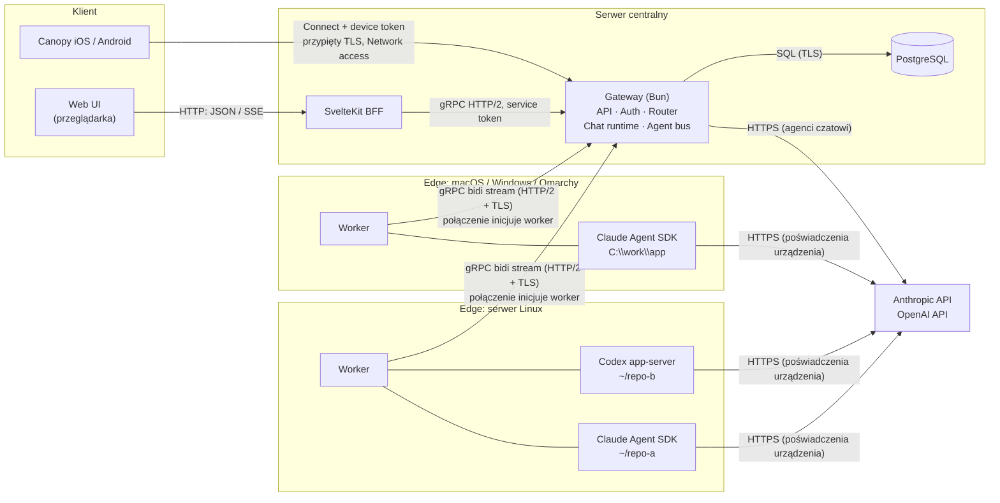
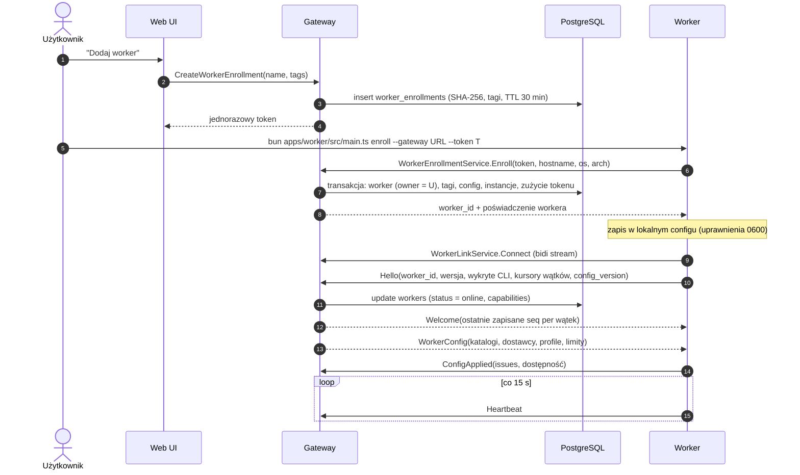
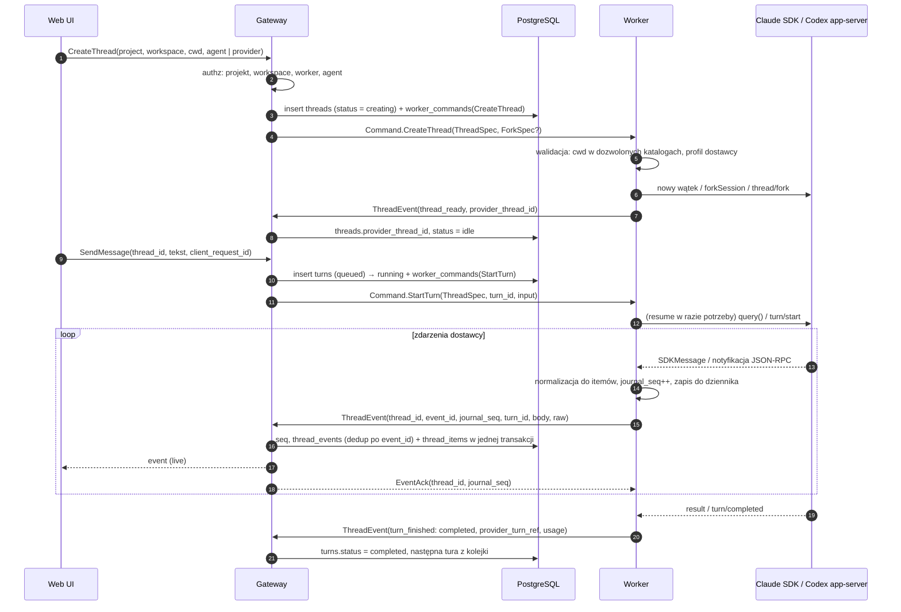
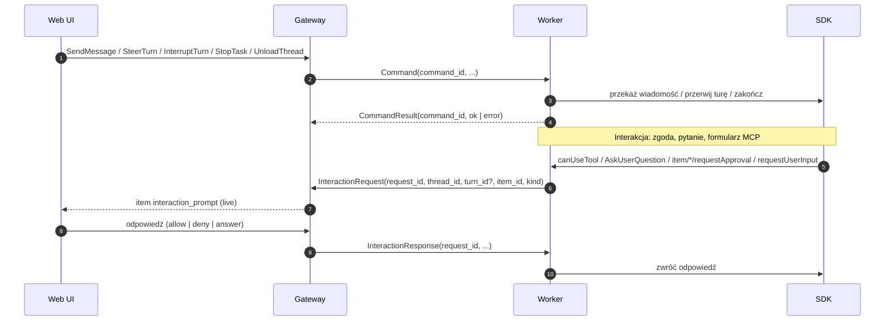
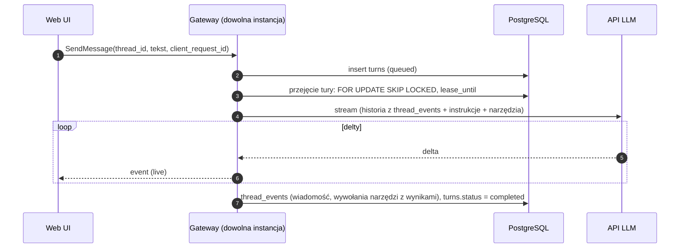

# Canopy — architektura

Status: opis działającego gatewaya, workerów i web BFF oraz pierwszej aplikacji
mobilnej (2026-11-02). Logowanie użytkowników i część docelowych rozszerzeń pozostają w planach.

Powiązane dokumenty:

- [bots.md](bots.md) — boty gateway: bezpośrednie API, trwałość, zdalne MCP i minimalny UI.
- [connectors.md](connectors.md) — współdzielone konta zewnętrznych MCP, OAuth w gateway, granty workerów/botów i proxy bez poświadczeń na workerze.
- [protocol.md](protocol.md) — kanał gRPC gateway ↔ worker
- [data-model.md](data-model.md) — model danych PostgreSQL i reguły dostępu
- [worker-config.md](worker-config.md) — zdalna konfiguracja workerów (lokalnie tylko połączenie z gateway)
- [updates.md](updates.md) — niezależny UpdateService, zgodność protokołów, mirror i rollback binarek
- [provider-cli.md](provider-cli.md) — CLI dostawców na workerach: wykrywanie, najnowsze wersje, instalacja i aktualizacja na kliknięcie (nigdy dołączane do Canopy)
- [codex-adapter.md](codex-adapter.md) — adapter Codex app-server: protokół, testy na żywo, izolacja `CODEX_HOME`
- [grok-adapter.md](grok-adapter.md) — własny SDK ACP stdio Grok CLI, native/CLIProxyAPI i MCP narzędzi platformy
- [ui-api.md](ui-api.md) — API dla UI, SvelteKit jako BFF (HTTP/1.1 + SSE do przeglądarki, gRPC do gateway)
- [mobile.md](mobile.md) — Canopy iOS/Android, Connect przez przypięty TLS, parowanie i automatyczne trasy
- [threads.md](threads.md) — projekty, wątki, wątki boczne i forki
- [transcript.md](transcript.md) — zapis wszystkich zdarzeń, itemy, oś czasu dla frontendu
- [execution.md](execution.md) — tury, praca w tle, subagenci, interakcje, limity
- [goals.md](goals.md) — cele: silnikiem jest harness (Codex goals, Claude `/goal`), platforma je śledzi i steruje nimi z UI
- [agent-bus.md](agent-bus.md) — szyna agentów: delegowanie przez wątki boczne, interakcje, harmonogram; natywna orkiestracja dostawców wyłączona
- [durability.md](durability.md) — trwałość, graceful shutdown, aktualizacje w trakcie działania
- [`proto/canopy/worker/v1/worker_link.proto`](../proto/canopy/worker/v1/worker_link.proto) — szkic kontraktu

## 1. Cel

Platforma do zarządzania agentami AI dla wielu użytkowników:

- uruchamianie agentów kodujących (Claude Agent SDK, Codex app-server) na wielu maszynach i w wielu katalogach, opcjonalnie przez CLIProxyAPI,
- zwykli agenci czatowi uruchamiani bezpośrednio na gateway,
- agenci globalni (dla wszystkich) i prywatni (dla właściciela),
- projekty z wątkami przypiętymi do dostawcy, workera i katalogu; wątki boczne w tym samym katalogu z opcjonalnym forkiem historii,
- rozmowy agent ↔ agent jako wątki boczne (szyna agentów: tworzenie, follow-upy, statusy), które użytkownik może podejrzeć i kontrolować; natywni subagenci dostawców domyślnie wyłączeni.

## 2. Komponenty

| Komponent | Gdzie działa | Odpowiedzialność |
|---|---|---|
| **Web UI** | przeglądarka | SPA Svelte 5 / SvelteKit (`ssr = false`): lista agentów, czaty, transkrypty na żywo, uprawnienia i workery. adapter-node podaje powłokę z wyglądem użytkownika, wersjonowane assety oraz BFF (`/api/*`, SSE i akcje formularzy) do gRPC gateway. |
| **Mobile** | iOS/Android | Expo development build, Connect protobuf przez streaming `expo/fetch`, token urządzenia w SecureStore. Bez Expo web. |
| **Gateway** | serwer centralny (Bun) | Jedyny punkt kontaktu UI. Auth, autoryzacja, API, persystencja, routing komend do workerów, runtime agentów czatowych, szyna agent ↔ agent. |
| **Worker** | edge device: Linux, Omarchy, macOS, Windows (Bun) | Uruchamia wątki agentów SDK w dozwolonych katalogach, wznawia je i forkuje. Normalizuje zdarzenia SDK i strumieniuje je do gateway. |
| **PostgreSQL** | obok gateway | Użytkownicy, projekty, agenci, workery, wątki, tury, transkrypty, outbox, audyt. |
| **Dostawcy LLM** | zewnętrznie | Anthropic / OpenAI. Worker łączy się przez SDK, gateway przez API dla agentów czatowych. |

Tylko gateway łączy się z bazą. Worker nie ma dostępu do bazy i nie przyjmuje połączeń przychodzących.

Gateway ma rolę startową: domyślnie `server`; kontroler Canopy Desktop oznacza własny
sidecar trybu lokalnego jako `desktop`. To wewnętrzna decyzja runtime, bez ustawienia
w UI. **Linked computers łączy wyłącznie lokalne gatewaye aplikacji desktopowych**
([linked-computers.md](linked-computers.md)). Serwer Docker/binarny nie uruchamia usług
linkowania ani discovery/mDNS, nie synchronizuje luster/konfiguracji, nie przenosi rzeczy
i nie pośredniczy między gatewayami. Istniejące relacje zachowuje jako `inactive`.
Network access nadal przyjmuje telefony, klienty desktopowe i workery, odrzucając
handshake komputerów. `GetClientCapabilities` ogłasza rolę i `linked_computers`;
web oraz desktop remote chowają linkowanie zgodnie z capability podłączonego gatewaya.

## 3. Diagram komponentów i połączeń



### Tabela połączeń

| Od → do | Protokół | Kto inicjuje | Uwagi |
|---|---|---|---|
| Przeglądarka ⇄ SvelteKit (BFF) | HTTPS (HTTP/1.1): strony, akcje, JSON; SSE dla zmian na żywo | przeglądarka | Prywatny adres BFF i token usługi zostają na serwerze; UI pokazuje publiczny adres gRPC dla workerów i jednorazowe sekrety enrollment/rotacji ([ui-api.md](ui-api.md)). |
| SvelteKit → Gateway | gRPC (HTTP/2), `GatewayService`, token usługi | SvelteKit | Komendy i strumienie (`WatchThread`, `WatchOverview`); ten sam serwer co workery. |
| Mobile → Gateway | HTTPS Connect, przypięty certyfikat | aplikacja | Unary i server streaming przez natywny transport TLS. Jeden listener Network access, automatyczne trasy i osobny odwoływalny token urządzenia; administracja urządzeniami tylko przez BFF. |
| Gateway ⇄ połączony komputer | gRPC HTTP/2, wzajemny przypięty TLS 1.3, port [dostępu sieciowego](network-access.md) | oba | Jeden przełącznik Settings → Network access; adresy wykrywane i ogłaszane łączem ([linked-computers.md](linked-computers.md)). |
| Worker ↔ Gateway | gRPC, jeden strumień dwukierunkowy, HTTP/2 + TLS | **Worker** | Nowe zdalne workery używają Network access i pinu z enrollmentu. Istniejące zachowują port serwera; automatycznie przechodzą na osiągalny przypięty adres i zachowują fallback. Lokalny worker desktopu używa loopback. Szczegóły: [protocol.md](protocol.md). |
| Worker → Gateway (aktualizacje) | osobny gRPC `canopy.update.v1.UpdateService`, ten sam port HTTP/2 | **Worker** | Zamrożony kontrakt działa także po odmowie WorkerLink. Werdykt, polecenia, postęp, mirror binarki; [updates.md](updates.md). |
| Gateway → PostgreSQL | SQL po TLS | Gateway | Pula połączeń. Opcjonalnie `LISTEN/NOTIFY` przy wielu instancjach gateway. |
| Worker → LLM | HTTPS (przez SDK/CLI) | Worker | Poświadczenia zostają na urządzeniu (login Claude Code / Codex lub klucz API). |
| Gateway → LLM | HTTPS | Gateway | Tylko agenci czatowi. Klucze trzyma gateway. |

### Dlaczego worker inicjuje połączenie

Edge device zwykle stoi za NAT-em, ma dynamiczne IP lub jest laptopem. Gateway nie może się do niego dodzwonić. Worker otwiera więc jeden długożyjący strumień gRPC do gateway. Komendy z gateway płyną w dół tym samym strumieniem. Na urządzeniu nie trzeba otwierać portów.

## 4. Dwa tryby agentów

| Cecha | Agent SDK (`kind = sdk`) | Agent czatowy (`kind = chat`) |
|---|---|---|
| Runtime wątku | Worker na edge device (`runtime = worker`) | Gateway (`runtime = gateway`) |
| Silnik | `@anthropic-ai/claude-agent-sdk` lub `codex app-server` (JSON-RPC po stdio) | Bezpośrednie API LLM (np. Anthropic Messages / OpenAI Responses) |
| Dostęp do plików i shella | Tak, w `cwd` wątku (w dozwolonych katalogach workera) | Nie |
| Miejsce uruchomienia | wątek: worker + workspace + `cwd`, niezmienne | brak |
| Poświadczenia | Urządzenia (worker): logowanie CLI albo profil CLIProxyAPI | Gateway |
| Transkrypt | Worker → gRPC → gateway → DB + UI | Gateway → DB + UI |

Agent to szablon bez miejsca uruchomienia. Wątek przypina agenta (snapshot konfiguracji) do dostawcy, workera i katalogu. Szczegóły: [threads.md](threads.md).

Oba tryby zapisują transkrypt w tym samym formacie (`thread_events`). UI nie musi rozróżniać trybów przy wyświetlaniu.

Gateway ma jeden interfejs runtime'u wątków, implementowany dwukrotnie (serwisy Effect):

```ts
interface ThreadRuntime {
  create(thread: ThreadSpec, fork?: ForkSpec): Effect<void, ThreadError>;
  startTurn(thread: ThreadSpec, turnId: TurnId, input: UserInput): Effect<void, ThreadError>;
  interruptTurn(threadId: ThreadId, turnId: TurnId): Effect<void, ThreadError>;
  unload(threadId: ThreadId): Effect<void, ThreadError>;
}
// WorkerThreadRuntime  — zapisuje komendę w outboxie, dostarcza ją przez strumień gRPC do workera
// GatewayChatRuntime   — tura jako zadanie z dzierżawą, wywołuje API LLM w procesie gateway
```

## 5. Przepływy danych

### 5.1 Rejestracja i połączenie workera



### 5.2 Wątek agenta SDK: utworzenie, tura, strumień transkryptu



### 5.3 Akcje z gateway do workera



### 5.4 Agent czatowy na gateway



### 5.5 Agent ↔ agent: szyna agentów

Natywni subagenci i harmonogramy Claude i Codexa są domyślnie wyłączeni. Zastępuje je **szyna agentów** platformy, dostępna dla obu dostawców: wątki boczne (`spawn_thread`, `send_message`, `wait_threads`, `get_thread`, `read_thread`, `list_threads`, `interrupt_thread`, `close_thread`, `list_agents`), odpowiadanie na pytania wątków bocznych (`list_interactions`, `answer_interaction`) i harmonogram (`schedule_wakeup`, `schedule_recurring`, `list_schedules`, `cancel_schedule`). Dwa poziomy: wątek główny orkiestruje, wątki boczne wykonują pracę. Użytkownik może pisać w każdym wątku.

- `spawn_thread` i `send_message` nie blokują; wynik przychodzi jako powiadomienie (nowa tura wywołującego) albo przez ograniczone w czasie `wait_threads`.
- Domena komunikacji to drzewo wątków; sterowanie tylko nad potomkami; limity liczby wątków, harmonogramów i przeskoków (`hops`) bez udziału człowieka.
- Narzędzia trafiają do Claude jako serwer MCP w procesie workera, do Codexa jako `dynamicTools`; wykonuje je gateway.

Szczegóły, diagram przepływu i reguły: [agent-bus.md](agent-bus.md).

## 6. Wielu użytkowników: agenci globalni i prywatni

Szczegóły i tabele: [data-model.md](data-model.md#reguły-dostępu).

- **Agent globalny** (`scope = global`) — tworzy i edytuje go admin. Może go używać każdy użytkownik.
- **Agent prywatny** (`scope = private`) — widzi go i używa tylko właściciel.
- **Projekty i ich wątki należą do właściciela projektu**, także gdy wątek używa agenta globalnego. Użytkownicy nie widzą nawzajem swoich wątków z tym samym agentem globalnym.
- **Workery** mają właściciela albo są współdzielone. Workspace projektu może wskazywać worker właściciela projektu albo współdzielony. Agent (globalny lub prywatny) nie ma miejsca uruchomienia; decyduje o nim wątek.

Autoryzacja ma być w jednym module polityk w gateway. Każde zapytanie do bazy filtruje po użytkowniku. Postgres RLS warto rozważyć jako drugą warstwę.

## 7. Transkrypt i normalizacja zdarzeń

Worker zamienia natywne zdarzenia dostawców na `ThreadEvent` z ściśle typowanymi **itemami** (wiadomość, rozumowanie, komenda, zmiana pliku, narzędzie, subagent, zadanie w tle, plan, zgoda, wywołanie agenta, ...). Każde zdarzenie, także między turami i bez mapowania, trafia do bazy razem z oryginałem. Duże treści idą do blobów, nic nie jest przycinane. Gateway nadaje jedną kolejność (`seq`) zdarzeniom workera i platformy, a projekcja `thread_items` daje frontendowi gotowy stan.

Model, mapowanie Claude/Codex i sposób ładowania na frontendzie: [transcript.md](transcript.md).

Typy protokołu app-server generuje sam Codex (`codex app-server generate-ts`); będą wersjonowane razem z przypiętą wersją Codexa.

## 8. Profile dostawców i CLIProxyAPI

Połączenia są teraz definiowane w Settings → Proxies i wskazywane przez instancje
providerów. Dane, migracja i mapowania: [proxies.md](proxies.md). Opis WorkerConfig
poniżej pozostaje formatem dostawy do harnessów; gateway rozwiązuje współdzieloną
referencję proxy przed wysłaniem konfiguracji.

[CLIProxyAPI](https://github.com/router-for-me/CLIProxyAPI) to opcjonalny pośrednik zgodny z API Anthropic/OpenAI. Zapisane proxy konfiguruje połączenia Claude Code, Codexa i Groka; publiczne opcje transportu Codexa przechodzą przez `ProviderProfileConfig.proxy_codex`.

**Profil dostawcy** opisuje, jak agent SDK łączy się z modelem. Profile są częścią zdalnej konfiguracji workera (`WorkerConfig.profiles`, [worker-config.md](worker-config.md)); kształt po stronie workera:

```ts
type ProviderProfileConfig =
  | { kind: "native"; id: string; ...wspólne }             // logowanie CLI na urządzeniu; "native" zawsze jest
  | { kind: "cliproxyapi"; id: string; baseUrl: string;     // endpoint, np. http://127.0.0.1:8317
      apiKey: string; ...wspólne };                         // z gateway (secrets), tylko w pamięci workera
// wspólne: providers?, displayName?, env?: { name, value, secret? }[], disabled?
```

- Gateway wysyła profile w `WorkerConfig`, a worker raportuje ich dostępność w `ConfigApplied` (bez kluczy). Gateway przypisuje profil wątkowi (`threads.provider_profile_id`) i wysyła go w `ThreadSpec.provider_profile_id`.
- Klucz jest sekretem platformy (`secrets`, szyfrowany), trafia do workera tylko w `WorkerConfig` i jest trzymany wyłącznie w pamięci.
- Konfiguracji użytkownika urządzenia (`~/.claude/settings.json`, `~/.codex/config.toml`) worker **nie modyfikuje**. Wszystko jest ustawiane per wątek albo per proces.

| | Claude Agent SDK | Codex app-server |
|---|---|---|
| Gdzie | `query({ options })` per wątek | `-c` przy starcie procesu + `thread/start` per wątek |
| Endpoint | `env.ANTHROPIC_BASE_URL = <baseUrl>` | `model_providers.canopy_<id>.base_url = "<baseUrl>/v1"`, `wire_api = "responses"` |
| Klucz | `env.ANTHROPIC_AUTH_TOKEN`, `ANTHROPIC_API_KEY=""`, usuwane `CLAUDE_CODE_OAUTH_TOKEN` | `env_key = "CANOPY_<ID>_API_KEY"`, wartość w env procesu, nie w argv |
| Wybór | per wątek | `thread/start { modelProvider: "canopy_<id>" }`; jeden proces obsługuje wątki natywne i przez proxy |
| Model | `options.model` z agenta | `thread/start { model }` z agenta |

Profile to globalne instancje dostawców, które użytkownik definiuje raz (Settings → Providers) i włącza na wybranych workerach; zmienne środowiskowe i lista zakazanych nazw: [worker-config.md](worker-config.md#81-zmienne-środowiskowe-profilu), instancje, synchronizacja i modele: [worker-config.md](worker-config.md#9-globalne-instancje-dostawców).

Zasady, które z tego wynikają (`apps/worker/src/providers`):

- `options.env` w Claude Agent SDK **zastępuje** środowisko procesu, nie łączy się z `process.env`. Worker kopiuje bazowe env i podmienia tylko zmienne auth.
- Wątki Claude nie ładują ustawień użytkownika (`settingSources: ["project", "local"]`). Ustawienia użytkownika mogą mieć własne `env.ANTHROPIC_BASE_URL` albo `permissions.defaultMode: "bypassPermissions"` (tak wygląda przykład z dokumentacji CLIProxyAPI). Nie mogą przeciekać do agentów platformy.
- Nadpisania `-c` dla Codexa są sprawdzane w testach na prawdziwym CLI (`codex app-server --print-startup-config`).
- CLIProxyAPI powinno nasłuchiwać na `127.0.0.1` tego samego urządzenia. Zdalny adres wymaga `https`.

Potwierdzone na żywej instancji CLIProxyAPI (2026-11-01): autoryzacja Codexa przez `env_key` (`Authorization: Bearer`) działa ([codex-adapter.md](codex-adapter.md)).

## 9. Bezpieczeństwo

Worker uruchamia kod na prawdziwych maszynach. To główne ryzyko projektu.

- **Cała konfiguracja workera jest zdalna** ([worker-config.md](worker-config.md)), lokalnie tylko połączenie z gateway. Dozwolone katalogi przychodzą z gateway; worker odrzuca `cwd` spoza listy (po `realpath`, odporne na symlinki i `..`). Granicą bezpieczeństwa na urządzeniu jest dedykowany użytkownik systemowy workera.
- **Tryb uprawnień per agent.** Domyślnie każde narzędzie zapisujące lub wykonujące wymaga akceptacji w UI. Tryby bez pytania tylko świadomie i per agent.
- **Poświadczenie workera** jest unieważnialne z UI. Docelowo mTLS lub krótkotrwały token odświeżany przez worker.
- **Logowania CLI na urządzeniu** (`claude login`, `codex login`) nie trafiają do gateway. Klucze pośredników (CLIProxyAPI) są zarządzane centralnie jako zaszyfrowane sekrety.
- **Praca w tle i subagenci** mają limity (liczba, czas życia, głębokość, budżet) i są zawsze widoczni i zatrzymywalni ([execution.md](execution.md#7-limity-i-zasoby)).
- **Prompt injection przez szynę agentów.** Odpowiedź innego agenta to niezaufane dane. Nie rozszerza uprawnień.
- **Audyt.** Komendy, decyzje o uprawnieniach i zmiany agentów trafiają do `audit_log`.

## 10. Struktura repozytorium

Monorepo na Bun workspaces. Każda aplikacja jest osobno wdrażalna, wspólny kod jest w pakietach, kontrakt jest jeden i generowany.

```text
canopy/
├── apps/
│   ├── gateway/          # serwer centralny (API, gRPC server, chat runtime, agent bus)
│   ├── worker/           # agent na edge device (gRPC client, adaptery SDK)
│   └── web/              # UI (framework do wyboru, jeszcze nie ma)
├── packages/
│   ├── contracts/        # kod TS wygenerowany z /proto (protoc-gen-es), strict
│   ├── transport/        # serwer/klient HTTP/2 (Connect/gRPC), AsyncChannel
│   ├── db/               # schemat, migracje, zapytania (jeszcze nie ma)
│   └── domain/           # typy domenowe, polityki dostępu (jeszcze nie ma)
├── tests/integration/    # testy przekrojowe gateway ↔ worker, interop
├── proto/                # źródłowe pliki .proto (kontrakt)
└── docs/
```

Zasady zależności:

- `apps/*` → `packages/*`. Aplikacje nie importują siebie nawzajem.
- Typy protokołu tylko z `@canopy/contracts`. Ręcznie pisane typy dublujące protokół są niedozwolone.
- `tests/integration` może importować publiczne wejścia aplikacji (`exports` w `package.json`), np. `@canopy/gateway/worker-link`.

## 11. Decyzje do podjęcia

1. ~~**Biblioteka gRPC w Bun.**~~ **Rozstrzygnięte:** ConnectRPC (`@connectrpc/connect` + `connect-node`) na `node:http2`. Bidi stream działa w Bun po h2c i TLS, także w interop z `@grpc/grpc-js` na Node. Wyniki: [spikes/grpc-http2-bun.md](spikes/grpc-http2-bun.md).
2. **Dystrybucja workera.** `bun build --compile` daje jeden plik na OS. Claude Agent SDK i Codex app-server uruchamiają jednak własne procesy (CLI). Trzeba sprawdzić, czy działa to z poziomu skompilowanej binarki.
3. ~~**Interaktywne uprawnienia w Codexie.**~~ **Rozstrzygnięte:** zamiast Codex SDK (tylko statyczne `approvalPolicy`) używamy `codex app-server`, który wysyła prośby o zgodę jako żądania JSON-RPC. **Ryzyko:** app-server jest oznaczony jako eksperymentalny. Ograniczamy je przypięciem wersji Codexa na workerze, typami generowanymi z tej wersji i zgłaszaniem wersji w `Hello.providers`.
4. **Organizacje/zespoły.** Teraz: użytkownicy + role `admin`/`user`. Czy potrzebny poziom organizacji (tenant) od początku? Dodanie `org_id` później jest kosztowne.
5. **Czy admin widzi prywatnych agentów i rozmowy innych użytkowników?** Wpływa na prywatność i audyt.
6. **Logowanie użytkowników.** Własne konta, OAuth/OIDC czy biblioteka typu Better Auth.
7. **ORM / migracje.** Np. Drizzle albo czyste SQL.
8. **Framework UI.**
9. ~~**Skalowanie gateway.**~~ **Rozstrzygnięte przez wymaganie trwałości:** gateway bez stanu tylko w pamięci, N ≥ 1 instancji, outbox komend w PostgreSQL i `LISTEN/NOTIFY`, fencing połączeń workerów. Otwarte decyzje trwałości: [durability.md](durability.md#11-decyzje-do-podjęcia).

## 12. Kolejne kroki

1. ~~Spike: gRPC bidi stream Bun ↔ Bun (ConnectRPC) przez TLS.~~ Zrobione. Do sprawdzenia przy wdrożeniu: reverse proxy.
2. ~~Szkielet monorepo.~~ Zrobione.
3. Spike: worker (Effect) uruchamia Claude Agent SDK i Codex app-server: tworzenie, wznawianie i fork wątków, mapowanie wszystkich zdarzeń (także między turami) na itemy `ThreadEvent`, bloby, zgody, profil CLIProxyAPI na żywej instancji.
4. Ustalenie pozostałych decyzji z sekcji 10.
5. Dziennik lokalny workera (SQLite) i outbox komend w PostgreSQL ([durability.md](durability.md)).
6. ~~Schemat bazy.~~ Zrobione (`packages/db`). Enrollment workera, pierwsza pionowa ścieżka: UI → gateway → worker → Claude → transkrypt w UI.
