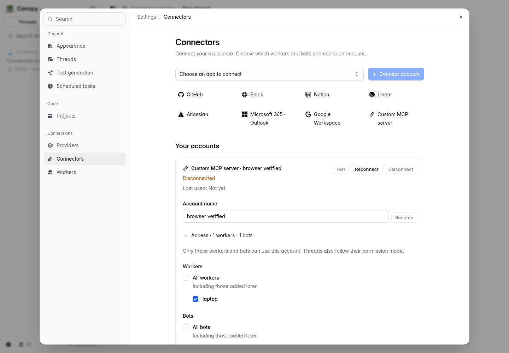
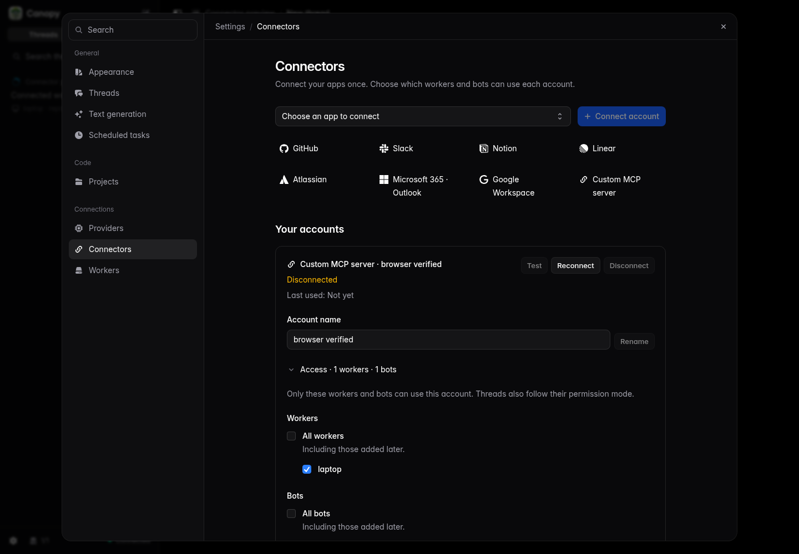
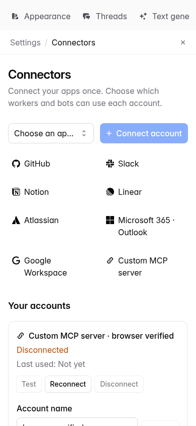
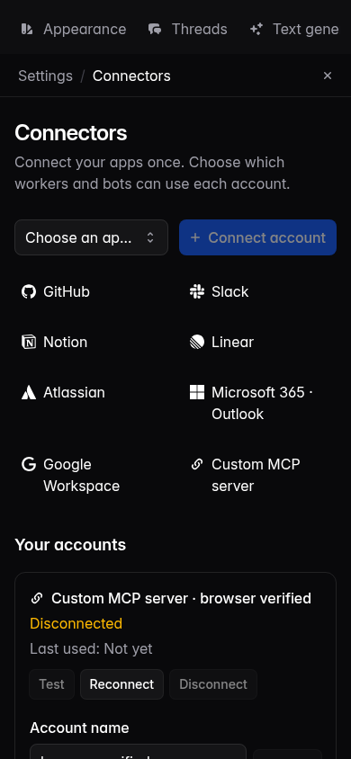

# Konektory — raport weryfikacji

Data: 2026-11-02. Gałąź: `feat/connectors`. Produkt: Canopy.
Badanie dostawców i decyzje projektowe: [connectors.md](connectors.md).

## Zakres sprawdzony end-to-end

1. Konto Custom MCP z tokenem → grant workera → aktywny wątek → wywołanie
   przez rzeczywisty link workera do gateway → lokalny zdalny MCP → wynik.
   Osobno odmowa dla workera bez grantu i dla innego workera wywołującego cudzy wątek.
2. OAuth z lokalnym authorization serverem: discovery, DCR, S256, callback BFF,
   powiązanie przeglądarki/użytkownika, jednorazowy state, rotacja refresh tokenu,
   `needs_reconnect`, ponowna autoryzacja, revoke i usunięcie lokalnych tokenów.
   Osobno ścieżka pre-registered confidential client z zaszyfrowanym sekretem aplikacji.
3. Bot: odmowa bez grantu, narzędzia konta po grancie, zachowanie grantu po
   zmianie ustawień i ponowieniu CreateBot, odmowa wzmianki bez grantu,
   kanoniczna wzmianka `@` w wejściu modelu.
   Istniejące testy botów sprawdzają również karty zgody dla zapisów.
4. Wątek: zgoda `ASK` przed zapisem, odmowa `READ_ONLY`, wykonanie `FULL_AUTO`,
   deduplikacja call ID i odmowa replay po odebraniu grantu. Audyt bez argumentów
   i sekretów; credential echo z fake MCP jest redagowane przed wynikiem workera.
5. Migracja `0041` (przy merge przenumerowana z 0038): stare bot MCP z zaszyfrowanymi odwołaniami do nagłówków,
   zachowane granty własnych botów, odrzucenie obcych attachments, brak grantów workerów.

## Wyniki komend

| Sprawdzenie | Wynik |
|---|---|
| `bun install` | OK, Bun 1.4.4; ponowiono po scaleniu rutyn botów, bez dodatkowych zmian lockfile |
| `bun run typecheck` | OK po scaleniu rutyn i ujednoliceniu błędu walidacji wzmianki; Svelte: 0 errors / 0 warnings |
| `bun run gen:check` | OK, wygenerowane kontrakty zgodne z repo |
| `bun run --filter @canopy/web build` | OK; Vite zgłasza ostrzeżenie wielkości chunków |
| `bun run check:tmp` | 589 pass, 134 skip, 0 fail, 3038 asercji / 116 plików; bez pozostawionych katalogów testów. Baza `main`: `8b8e3ad` |
| `tests/integration/connectors.test.ts` w końcowym zestawie | 5 pass, 0 fail, 64 asercje; także zapis `full_auto` przy zmienionej adnotacji narzędzia |
| `check:tmp` po merge tworzenia botów, 9 plików | 92 pass, 0 fail, 790 asercji; konektory, boty, ustawienia, rutyny, tworzenie botów, platform tools, migracja, schema i policy; bez pozostawionych katalogów testowych |
| `bun run check:tmp tests/integration/connectors.test.ts tests/integration/bots.test.ts tests/integration/bot-platform-tools.test.ts` po merge odpowiedzi strukturalnych | 28 pass, 0 fail, 413 asercji; bez pozostawionych katalogów testowych |
| `check:tmp` po merge `full_auto` i stref czasowych, 6 plików | 50 pass, 0 fail, 643 asercje; konektory, boty, platform tools, rutyny, tworzenie botów i policy; bez pozostawionych katalogów testowych |
| `bun test tests/integration/bots.test.ts --test-name-pattern 'remote MCP registry'` | 1 pass, 0 fail po skierowaniu adaptera przez runtime konektorów |
| Live: `OA_LIVE=1 bun test tests/integration/connectors.live.test.ts` | 2 pass, 0 fail, 25 asercji; rzeczywisty Codex i Claude przez CLIProxyAPI |

Test live używa prawdziwych harnessów (Codex 0.164.0 w `FULL_AUTO`, Claude Agent SDK
2.1.316 w `READ_ONLY`) i lokalnego fake MCP. Sprawdza wynik i audyt oraz brak sekretu w komendach/events
workera, JSONL i logach. Konfiguracja CLIProxyAPI jest wczytywana wyłącznie
z lokalnego `dev-live.env`; jej wartości nie należą do repo ani tego raportu.
Ten test nie potwierdza autoryzacji kont GitHub, Slack ani innych dostawców.

Negatywna próba `sendBotMessage` przez testowy Bun/h2c zawieszała się na odpowiedzi
błędu (zarówno z wcześniejszym `ConnectorFailure`, jak i po mapowaniu na `Invalid`).
Gateway odmówił przed zapisaniem wiadomości. Regresja odmowy wzmianki sprawdza
bezpośrednio `core.bots.send`, zgodnie z istniejącymi testami walidacji botów;
poprawna wiadomość jest nadal wysyłana przez gRPC. Nie potwierdzono przyczyny
problemu transportu ani jego występowania poza tym stackiem testowym.
Przerwany przebieg po dodaniu tej negatywnej próby nie jest liczony jako zielony;
końcowe wyniki pochodzą z ponownego uruchomienia.

## Kontrola UI

Ręczna kontrola własnego jednorazowego stacka na `127.0.0.1:19180`, z osobnym
PostgreSQL, gateway i fake MCP. Chromium: `/usr/bin/chromium`, sterowanie przez
`/tmp/ro-shot/node_modules/playwright-core`. Nie dodano trwałych testów web UI.
Nie używano `/tmp/oa-stack` ani portów 17443, 5180, 8444.

Po scaleniu `main` z rutynami botów ponownie przetestowano katalog i konta,
Test z listą dwóch narzędzi, wybór i zapis grantów,
OAuth redirect → callback → connected, rename, disconnect, panel wątku,
logo/nazwę konta w narzędziu na osi, wybór `@` i wstawiony chip w composerze bota.
We wszystkich czterech wariantach poniżej przepełnienie poziome dokumentu = 0;
zebrane błędy strony = `[]`. Nazwy GitHub/Notion na zrzutach są fixture,
połączonym z lokalnym fake MCP, a nie z kontami tych dostawców.

| Wariant | Zrzut |
|---|---|
| Light, 1440 px |  |
| Dark, 1440 px |  |
| Light, 390 px |  |
| Dark, 390 px |  |

Dodatkowe dowody:

- [Wybór dostępu workerów i botów](evidence/connectors/access-light-1440.png).
- [Dialog OAuth](evidence/connectors/oauth-dialog-light-1440.png).
- [Wątek: panel kont i wynik narzędzia](evidence/connectors/thread-light-1440.png).
- [Grupa Connectors w `@`](evidence/connectors/bot-mention-light-1440.png).
- [Chip wybranego konta](evidence/connectors/bot-chip-light-1440.png).

Zastosowano skille `design` i `transitions-dev`. Przejście `componentize`
przed końcowym commitem wydzieliło wspólny scoped loader kont, odrzucający spóźnione
odpowiedzi po zmianie bota/wątku. Lista grantów, katalog narzędzi, ikony, formularz
aplikacji OAuth i chip są osobnymi komponentami. Kontrolki wyboru korzystają
z kitu i wrapperów; nie dodano natywnych select/multi-select.

## Granice potwierdzenia i konfiguracja użytkownika

1. Publiczne endpointy/metadata sprawdzono zgodnie z tabelą w `connectors.md`.
   Żaden dostawca nie jest oznaczony jako live verified bez konta użytkownika.
2. Slack wymaga własnej aplikacji, client ID/secret i scopes. GitHub: PAT lub
   zarejestrowana aplikacja GitHub z OAuth. Callback aplikacji:
   `https://<origin-canopy>/api/connectors/oauth/callback`. Sekret i issuer
   zapisuje się raz na typ w Settings → Connectors.
3. Notion/Linear/Atlassian mają ogłoszone DCR; wymagają zalogowania użytkownika
   i zgód/usług dostępnych w jego planie i organizacji. Token jest alternatywą
   tylko tam, gdzie serwer go obsługuje.
4. Microsoft 365/Outlook wymaga endpointu zatwierdzonego dla tenantu oraz
   konfiguracji Entra/admin consent. Google Workspace wymaga wybranego zdalnego
   MCP. Nie skonfigurowano fikcyjnego globalnego endpointu dla tych usług.
5. Codex utrwala dynamic tools przy rozpoczęciu sesji: dodanie konta może wymagać
   nowej sesji/wątku. Odebranie grantu jest skuteczne natychmiast w gateway.
   Przed łączeniem kont należy ustawić trwały `OA_SECRETS_KEY`; jego utrata
   uniemożliwia odzyskanie tokenów.

## Commity implementacji

| Commit | Zakres |
|---|---|
| `f310d52` | Model, granty, kontrakty, migracja legacy MCP |
| `6561574` | Gateway OAuth/MCP, grant enforcement, bridge harnessów, testy |
| `6ae5c79` | Bezpieczne wyniki callbacku i przypisanie konta w historii |
| `271a062` | Settings → Connectors, boty, `@`, panel i oś wątku, komponenty |
| `1b004df` | Stary test MCP korzysta z tego samego runtime i redakcji; doprecyzowane wymagania GitHub |
| `a0de29f` | Błąd walidacji wzmianki mapowany na domenę botów przy współpracy z rutynami |
| `d486dcf` | Regresja odmowy wzmianki na granicy API gateway, niezależna od zawieszenia testowego h2c |
| `e252d69` | Nowa nazwa konta w opisie narzędzia po rename, stabilny namespace; fixture oczekuje katalogu API |
| `c641433` | Claude READ_ONLY ma dozwolone narzędzia SDK MCP; gateway egzekwuje granty i odmowę zapisów; live potwierdza odczyt |
| `7f0b7e3` | Dokumentacja decyzji, badanie dostawców, raport i dziewięć zrzutów Chromium |
| `2e009a8` | Polityka botów full_auto z aktualnego main; integracyjna regresja zmienionych adnotacji i zapisu bez karty |

Scalono zmiany `main`: `fcfb7e8`, `01f07bb`, `1449f40`, `14fee9e`, `b80d2bb`,
`ab495be`, `fecbfd3`, `92b744f` (main `4475c82`: rutyny, tworzenie botów,
strukturalne odpowiedzi, full_auto, strefa czasowa i poprawki UI).
Po merge tworzenia botów ponowiono
typecheck, generowanie kontraktów, build, live obu harnessów oraz testy integracyjne
botów/konektorów/tworzenia/rutyn/platformy i migracji. Po zmianie odpowiedzi platformy
ponowiono typecheck i testy konektorów/botów/platformy. Zachowano filtrowanie narzędzi rutyn i zastąpiono
ich starą ścieżkę MCP kontami z grantów. Typecheck wykrył dodatkowy typ błędu
walidacji wzmianki w enqueue; jest mapowany na bezpieczny błąd domenowy botów.
Rename unieważnia katalog narzędzi konta: kolejny opis dla modelu ma nową nazwę,
a nazwa techniczna narzędzia i grant pozostają stabilne. Sprawdza to test integracyjny
bota. Fixture oczekuje na katalog modeli API, zgodnie z walidacją tworzenia botów.
Claude otrzymuje nazwy narzędzi kont również w `allowedTools`, ponieważ `dontAsk`
odmawia narzędzi spoza listy przed callbackiem. Każde wykonanie nadal przechodzi
przez grant i permission mode gateway; READ_ONLY odmawia zapisów. Końcowy live
sprawdza odczyt Claude w READ_ONLY.
Po scaleniu full_auto/stref czasowych ponowiono install, typecheck, gen:check,
build i sześć plików testów. Jawne full_auto bota pozwala na zapis mimo zmiany
starej adnotacji read-only; safe zachowuje wymóg nowej zgody. Kosmetyczną zmianę
wiersza strefy czasowej sprawdzono buildem web.
Końcowy commit uzupełnia dowody i ten raport.
Bez push i bez PR.
