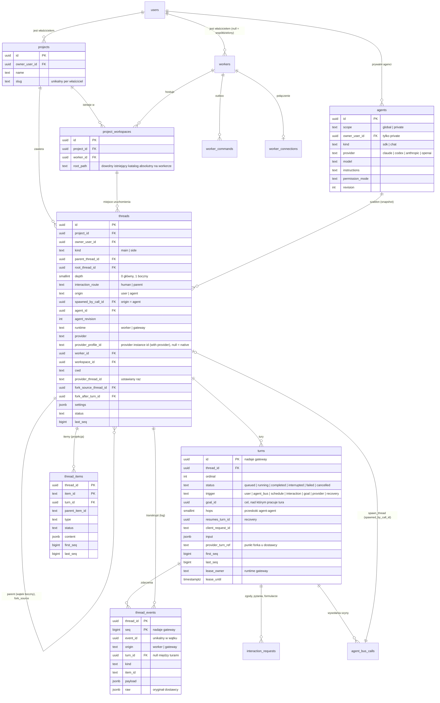

# Model danych (PostgreSQL)

## Połączenia proxy

Migracja `0061_proxies` dodaje owner-scoped `proxies` z FK do zaszyfrowanego sekretu,
rewizją i publicznymi opcjami transportu Codexa. Definicje instancji i nadpisania
workerów wskazują proxy przez FK `proxy_id`; usunięcie używanego połączenia jest
blokowane. Gateway transakcyjnie deduplikuje wcześniejsze endpointy po URL i kluczu
podczas synchronizacji; SQL nie odszyfrowuje danych. Szczegóły: [proxies.md](proxies.md).

## Połączone komputery

Migracja `0048_linked_computers` dodaje singleton `computer_identity` (id z SHA-256 klucza,
nazwa, publiczny certyfikat, prywatny klucz jako AES-256-GCM i ustawienie listenera),
owner-scoped `computer_peers` (pin, adresy, wersje, stan i czasy), `computer_pairings`
(hash jednorazowego kodu, expiry/revoke/use, liczba prób), trwały globalny budżet prób
oraz `computer_revocations` (tylko id odwołanych węzłów, bez aktywnego zaufania).
Parowanie atomowo zużywa kod i zapisuje peer. Unlink usuwa rekord peer; znacznik
odwołania pozwala usunąć relację po stronie partnera wracającego z offline.
Szczegóły i granice bezpieczeństwa: [linked-computers.md](linked-computers.md#konkretny-protokół-etapu-1).

Historyczny protokół `0050_shared_config` został zastąpiony wspólną konfiguracją w migracjach 0073–0075.

Migracja `0073_config_sync` przenosi ustawienia konta z protokołu 0050 do `config_items`
(HLC i poprzednik per liść, tombstone, lokalna rewizja). `config_clock` porządkuje commity
właściciela, `config_peer_cursors` zapisuje checkpoint razem z przyjętą partią i ma kaskadę
do partnera. `config_history` zachowuje przegrane wartości oraz lokalny stan Restore/Dismiss
przez 90 dni; `config_aliases` rezerwuje mapowanie tożsamości kolejnych rodzajów.
`computer_peers.share_config` i `peer_share_config` przechowują obie zgody, a ich rewizje
chronią przed opóźnionymi ramkami. Wyłączenie łącza zachowuje wspólne dane, historię i usunięcia.
[Protokół wspólnej konfiguracji](linked-computers.md#konkretny-protokół-wspólna-konfiguracja).

Migracja `0074_config_providers` dodaje `config_secrets`: wartość każdej wersji pola sekretu (klucz API,
zmienna sekretna, sekret proxy) zaszyfrowaną kluczem tego komputera, z opcjonalnym `secret_id` wiersza
`secrets`, który z niej powstał. `config_history.ciphertext` przechowuje przegraną wartość sekretu do Restore.
Pytania 0050 o instancje i modele stają się wpisami historii; ich wiersze `computer_shared_*` znikają.
Rekordy `instance` (`harness:slug`) i `proxy` (uuid) powstają przy starcie gatewaya z `updated_at` wierszy.

Migracja `0075_config_projects` przenosi pozostałe pytania 0050 o nazwy projektów do historii i usuwa
wszystkie trzy tabele `computer_shared_*`. Dodaje `projects.updated_at` do inicjalizacji wersji oraz
`config_deleted`: tombstone ukrywa projekt, zachowując lokalne workspace'y i klucze obce historii wątków.
Restore zapisuje odzyskane pola z nową wersją. Rekordy `project`, `project_settings` i `worktree_policy`
powstają przy starcie i zmieniają się transakcyjnie razem z tabelami domeny. Ustawienia projektu
pomijają `workspaceId`, polityka bez workera pomija `location`; zakres z workerem nie jest replikowany.
Scalenie origin przenosi globalny klucz rekordów i ich historii przez `config_aliases`, zachowując
`config_items.local_id` i lokalne klucze obce.

Migracja `0051_linked_agents` dodaje atomowo zastępowane projekcje rozmów botów
(`computer_mirror_bots`, `computer_bot_mirror_state`) oraz owner-scoped referencje
`computer_agent_calls` i deduplikację pytań `computer_agent_events`. Referencje mają
kierunek, dom partnera, aktora, cel i pochodzenie rutyny; nie są kolejką wykonawczą.
`threads.remote_parent_ref/kind/detached` zachowuje rodzica poza lokalnym fragmentem
drzewa. `bot_tool_calls.linked_remote` oznacza rozpoczęty zapis do partnera, którego nie wolno
ponowić po restarcie z nieznanym wynikiem. `turns.trigger='linked_agent'` i `linked_call_id` oraz analogiczne pole steerów
zachowują pochodzenie i dodatnie hops bez fikcyjnych lokalnych FK. Unlink usuwa projekcje
przez FK cascade, a trigger odłącza referencje i porzuca raporty. Akceptacja wywołania,
dostarczenie raportu i zapis referencji blokują peer, aby nie ścigać się z unlink.
[Etap 5](linked-computers.md#konkretny-protokół-etapu-5).

## Instalacja workerów przez SSH

Migracja `0047_worker_ssh` dodaje `worker_ssh_keys` (jeden Ed25519 per właściciel,
publiczny klucz, prywatny envelope AES-256-GCM, `key_id`) oraz `worker_ssh_hosts`
(owner/host/port → fingerprint SHA-256). Wszystkie odczyty i zapisy filtrują właściciela;
FK wskazują `users.id` z cascade. Tworzenie/rotacja klucza blokuje wiersz użytkownika,
aby równoległe pierwsze żądania nie wygenerowały dwóch tożsamości. Pin nie jest nadpisywany
przy konflikcie; mismatch blokuje instalację. Audit przechowuje akcje, nigdy tokeny/klucze.

## Urządzenia mobilne

Migracja `0046_mobile_devices` dodaje `mobile_pairings` i `mobile_devices`, powiązane
z `users.id` przez `owner_user_id`. Parowanie przechowuje unikalny SHA-256 kodu,
`expires_at` (10 minut), `used_at`, `revoked_at` i `device_id`. Urządzenie przechowuje
unikalny SHA-256 tokenu, nazwę, platformę iOS/Android, `created_at`, `last_seen_at`
oraz `revoked_at`. Jawny kod/token zwracany jest raz; nie jest zapisywany w bazie.
Wymiana blokuje zaproszenie w transakcji, sprawdza rzeczywisty czas po uzyskaniu blokady
i atomowo tworzy urządzenie oraz oznacza zużyty kod. Revocation i wymiana nie mogą
użyć jednego kodu dwukrotnie. Zarządzanie i parowanie zapisują audit_log.
Autoryzacja sprawdza revocation przy każdym RPC, a zapis last seen ogranicza do raz/minutę.
Szczegóły granicy pojedynczego właściciela i wdrożenia: [mobile.md](mobile.md).

## Zdalne aktualizacje desktopu

Migracja `0063_desktop_updates` dodaje `desktop_updates`: jedno powiązanie workera
z urządzeniem desktopowym, `owner_user_id`, JSONB ostatniego stanu i komendy oraz
czas zapisu. Unikalność `device_id` zapobiega przypięciu jednej aplikacji do kilku
workerów. Oba poświadczenia muszą potwierdzić bieżącą sesję tego samego właściciela;
odczyty i zapisy wykluczają odwołane urządzenia/workery i zarchiwizowane workery.
Zmiana urządzenia wymaga wcześniejszego revoke starego i czyści komendę/stan.
Id żądania i rewizja chronią przed spóźnionymi raportami. Zapis komendy lub wyniku
i `audit_log` są atomowe. Sekrety pozostają w dotychczasowych magazynach.
Przepływ: [updates.md](updates.md#zdalna-aktualizacja-aplikacji-desktopowej).

## Tożsamość workspace'u według git origin

Migracja `0072_workspace_origin` dodaje `project_workspaces.git_origin` (tekst, domyślnie pusty).
To ostatnia znormalizowana tożsamość git origin odczytana przez workera, bez credentiali URL.
Gateway zapisuje ją tylko dla workspace'u właściciela o nadal tej samej ścieżce i workerze.
Zmiana ścieżki czyści wartość. Metadata pozostaje dostępna offline i po restarcie gatewaya;
nie zmienia id ani właściciela projektu. [Reguły pickerów](linked-computers.md#tożsamość-projektu-według-git-origin).

## Wątki bez projektu (scratch)

Migracja `0032_scratch_projects` dodaje `projects.kind`: `project` (domyślnie, także dla
istniejących danych) albo `scratch`. Numer wybrano jako ówczesną ostatnią migrację main (`0029`) + 3;
po scaleniu main poprzedzają go również `0030_bus_notify_delivery` i `0031_bots`.

Każdy użytkownik ma dokładnie jeden automatycznie provisionowany projekt systemowy „No project”.
Unikalny indeks po właścicielu zabezpiecza współbieżne pierwsze odczyty. Tożsamość, właściciel,
nazwa i aktywność projektu systemowego są niezmienne. `GetOverview` ujawnia jego `kind`,
ale UI ukrywa go w zarządzaniu projektami; korzystają z niego pickery, filtr i domyślne ustawienia wątków.

Gateway automatycznie zapewnia workspace na każdym aktywnym, nieunieważnionym workerze
użytkownika lub współdzielonym, który zgłosił `Hello.scratch_root`. Root workspace'u wynosi
`<data_dir>/scratch/<owner-user-id>` (separatory według OS workera).
Nowy główny wątek ma `cwd = <workspace-root>/<thread-id>`; tytuł nie uczestniczy w nazwie ścieżki.
Zmiana zgłoszonej bazy scratch aktualizuje workspace dla przyszłych rozmów, bez przenoszenia plików
ani zmiany cwd istniejących wątków. Wątki boczne, `spawn_thread` i forki dzielą cwd źródła.
Historyczne `allowedRoots` w JSON konfiguracji jest ignorowane. Nie potrzeba migracji SQL:
żadne ograniczenie bazy nie wymaga roots. Istniejące wątki zachowują również stare cwd scratch.

Wszystkie FK, reguły właściciela i drzewa, historia forków, szyna agentów oraz harmonogramy
korzystają z dotychczasowego modelu: `threads.project_id` i `workspace_id` pozostają wymagane.
Harmonogram `new_thread` wskazuje projekt systemowy i workspace; każde wykonanie dostaje
osobny katalog nowego wątku. Publiczne operacje tworzenia, zmiany i usuwania workspace'ów
oraz ustawień projektu nie modyfikują zasobów systemowych. Archiwizacja i soft delete wątku
nie usuwają plików scratch. Nie ma automatycznego czyszczenia.

## Rozmowy botów

Migracja `0031_bots` dodaje osobne rozmowy Bots, ich tury/checkpointy, wiadomości,
wywołania narzędzi, zgody, rejestr zdalnych MCP i outboxy pobudek/wyników workerów.
`turns.trigger='bot'` i `bot_call_id` zachowują pochodzenie oraz hops przy delegowaniu.
Uzasadnienie osobnego modelu i niezmienniki: [bots.md](bots.md).

Migracja `0026_sidebar_threads` dodaje do `threads`: `deleted_at`, `deletion_batch_id`,
`archived_by` (`user` / `agent`) i `archived_by_thread_id`. Soft delete obejmuje rodzica i dzieci;
identyfikator partii pozwala cofnąć tylko tę operację. Triggery blokują nową pracę oraz tworzenie dzieci
i forków po usunięciu. `thread_reads.marked_unread` jest jawnym znacznikiem obok monotonicznego
`seen_seq`. Przypięcia i filtr projektów są sekcją `sidebar` w JSON tabeli `user_settings`.

Migracja `0028_archive_cascade` rozszerza `archived_by` o `cascade`: boczny zarchiwizowany razem
z głównym ma `archived_by_thread_id = parent_thread_id`. Przywrócenie głównego odtwarza tylko te dzieci,
bez wcześniejszych niezależnych archiwizacji. Operacja blokuje rodzica i objęte dzieci, zapisuje
przerwania w outboxie i anuluje ich pracę w tej samej transakcji. Indeks częściowy
`threads_archived_owner(owner_user_id, archived_at DESC, id DESC)` obsługuje kursorowe strony archiwum.
Ustawienie `sidebar.archived_expanded` przechowuje rozwinięcie sekcji; nie wymaga migracji danych JSON.

Status: **zaimplementowany jako migracje `0001_init` i `0002_worker_config`** (`packages/db/src/migrations`). Niezmienniki są sprawdzane w testach na prawdziwym PostgreSQL (`packages/db/test/schema.test.ts`). Pojęcia i cykl życia wątków: [threads.md](threads.md).

Konwencje:

- klucze główne `uuid` (UUIDv7 generowane w aplikacji: sortowalne po czasie i znane przed zapisem, więc ponowienia są idempotentne),
- `timestamptz` dla czasu,
- `jsonb` tylko dla danych zmiennych lub specyficznych dla dostawcy; pola, po których filtrujemy, są kolumnami,
- usuwanie miękkie (`archived_at`), żeby nie gubić historii,
- niezmienniki obejmujące kilka wierszy pilnują triggery w bazie, a nie tylko aplikacja,
- migracje to czysty SQL, dzielony na instrukcje przy uruchomieniu (sterownik `@effect/sql-pg` nie ma protokołu simple query); zastosowanej migracji się nie edytuje (expand/contract).

## Diagram ER

Pozostałe tabele:

| Tabela | Rola |
|---|---|
| `users`, `workers`, `enrollment_tokens` | tożsamości; status online wynika z `worker_connections`, unieważnienie z `revoked_at` |
| `worker_connections` | która instancja gateway trzyma strumień workera; `epoch` do fencingu ([durability.md](durability.md#42-outbox-komend)) |
| `worker_commands` | outbox komend (protobuf `Command` w `payload`), `status`, `expires_at`, `client_request_id` |
| `interaction_requests` | zgody, pytania i formularze MCP; z tury, subagenta albo zadania w tle (`turn_id` może być pusty); `routed_to` i autor odpowiedzi: użytkownik albo agent rodzica |
| `goals` | cele harnessu ([goals.md](goals.md)): objective, status, budżet i zużycie według harnessu, iteracje, ostatni werdykt, autor (`user` z UI albo `provider`), ostatni raport (`native_status`, `native_state`), błąd ostatniej komendy celu (`error`, `error_at`); najwyżej jeden otwarty cel na wątek |
| `schedules` | harmonogram platformy (jednorazowy / cron): cel `thread` albo `new_thread`, projekt, konfiguracja nowego wątku (`new_thread`), współbieżność, trwały kursor round robin, następne uruchomienie, limity, autor, `hops`, dzierżawa (`0027_schedules_new_thread`) |
| `schedule_runs` | trwała historia wystąpień harmonogramu: klucz `(schedule_id, scheduled_for)`, numer wykonanego uruchomienia, wątek, tura, workspace, worker i wynik (`started`, `missed`, `running` — pominięcie przez współbieżność, `expired`) |
| `agent_bus_calls` | szyna agentów: każde wywołanie narzędzia (`spawn_thread`, `send_message`, `wait_threads`, ...), argumenty, wynik, uruchomiony wątek/tura, `hops`, powiadomienie zwrotne (outbox) |
| `blobs` | duże treści (output, diff, obraz), adresowane sha256, inline albo w magazynie obiektów |
| `attachments` | pliki użytkownika do wiadomości: właściciel, blob (sha256) i miniatura WebP obrazu, nazwa (bez katalogów i znaków sterujących), typ rozpoznany z treści, `kind` (`image` / `file`), rozmiar, wymiary; po wysłaniu wątek i tura (raz, razem) |
| `thread_blobs` | bloby, które pokazuje transkrypt wątku (podglądy obrazów od workera): przez nie UI czyta blob (właściciel, drzewo wątku) |
| `worker_journal_cursors` | potwierdzone `journal_seq` per worker, dziennik i wątek (kursory `Welcome`) |
| `worker_configs`, `worker_config_history`, `secrets`, `worker_config_secrets` | zdalna konfiguracja workerów (migracja `0002`) — [worker-config.md](worker-config.md#7-schemat-0002_worker_config) |
| `provider_instances` | instancje dostawców (harness + id): połączenie, sekrety jako odwołania, środowisko uruchomienia, kolor, modele w pickerach (ulubione, ukryte, pokazane, własne), `all_workers` (migracja `0018`). Migracja `0065` zachowuje wymagane id `native` dla instancji wbudowanej, pozwalając zmieniać jej rodzaj połączenia — [worker-config.md](worker-config.md#9-globalne-instancje-dostawców) |
| `provider_instance_workers` | instancja na workerze: `enabled` (`NULL` = `all_workers`) i nadpisania (ścieżki, argumenty, zmienne, endpoint, klucz); efektywny wynik trafia do `worker_configs.config.profiles` (migracja `0018`; `provider_model_selections` z `0015` usunięta, dane przeniesione) |
| `audit_log` | komendy, decyzje, zmiany konfiguracji |
| `agent_environments`, `worker_environments`, `instruction_documents` | rewizja środowiska właściciela, tagi, capabilities i ostatni raport workera oraz dokumenty instrukcji (`0057`) |
| `worker_enrollments.tags` | ręczne tagi zaproszenia właściciela (`0064`), kopiowane atomowo do `worker_environments.manual_tags` przy rejestracji; token i komenda instalacji nie zawierają tagów |
| `agent_skills`, `agent_skill_versions`, `agent_skill_source_previews` | przypisania, niezmienne artefakty i provenance oraz zamrożone preview Git (`0058–0059`) |
| `agent_marketplaces`, `agent_marketplace_previews`, `agent_plugins`, `agent_plugin_versions` | przypięte katalogi marketplace, 30-minutowe preview, przypisania i niezmienne zatwierdzone wersje pluginów (`0060`); każdy odczyt/zapis filtruje ownera; audyt zgody zawiera checksum, commit i wersję |

## Niezmienniki

W SQL (CHECK, FK, indeksy częściowe):

- agent prywatny ma właściciela, globalny nie; `sdk` ⇒ `claude | codex`, `chat` ⇒ `anthropic | openai`,
- wątek `worker` ma worker, workspace i `cwd`; wątek `gateway` nie ma żadnego z nich ani profilu,
- workspace wątku należy do tego samego projektu i workera (złożony FK),
- projekt żyje na workerach, na których ma aktywny workspace (`archived_at IS NULL`); zmiana katalogu (`UpdateWorkspace`) nie przenosi istniejących wątków (ich `cwd` jest własny), a zarchiwizowany workspace (`RemoveWorkspace`) przyjmuje już tylko wątki boczne istniejących wątków,
- `main` ⇔ brak rodzica ⇔ `root_thread_id = id` ⇔ `depth = 0`; najwyżej jeden poziom wątków bocznych (`depth <= 1`); fork dla wątków bocznych i (od migracji 0020, „Fork from here”) głównych; `interaction_route = parent` tylko dla wątków bocznych,
- punkt forka to tura **wątku źródłowego** (złożony FK `(fork_after_turn_id, fork_source_thread_id)`),
- jedna tura `running` na wątek; `client_request_id` unikalny w wątku; kolejność kolejki to `ordinal` (zmiana kolejności permutuje ordinale tur kolejki, `0021`); tura wyjęta z kolejki przez użytkownika ma `withdrawn` (`deleted` | `steered`) i jest `cancelled`; `revision` rośnie z każdą edycją wejścia tury w kolejce; steer z kolejki wskazuje swoją turę (`turn_steers.from_turn_id`); wyzwalacz ma swoje powiązanie (`agent_call_id`, `schedule_id`, `interaction_request_id`, `resumes_turn_id`); `hops` = 0 dla człowieka i dostawcy, > 0 dla szyny,
- cel ustawiony przez harness jest zapisywany tak, jak go zgłosił (bez akceptacji i budżetu, `0010`); autor to `user` (z `created_by_user_id`) albo `provider`; silnika celów platformy nie ma (`0011` usuwa jego kolumny i stan `proposed`); najwyżej jeden otwarty cel na wątek,
- harmonogram agenta zawsze ma koniec i `hops > 0`; dokładnie jeden autor (użytkownik albo wywołanie szyny); decyzja w interakcji ma dokładnie jednego autora,
- harmonogram `thread` ma `thread_id`, a `new_thread` ma konfigurację i autora użytkownika, bez `thread_id`; oba mają `project_id`. Nowy wątek ma `origin = schedule`, `schedule_id`, zapisany `schedule_name` i dodatni `schedule_run`; para harmonogram/numer jest unikalna. Historia i outbox powstają razem z wątkiem i jego pierwszą turą w jednej transakcji. Pochodzenie nie znika po anulowaniu harmonogramu,
- zdarzenie wskazuje turę tego samego wątku.

W triggerach:

- `threads_before_insert`: wątek boczny dzieli projekt, właściciela, drzewo, worker i workspace z rodzicem, a `depth = rodzic + 1`; od `0068_worktree_automation` katalog/worktree jest domyślnie dziedziczony, ale jawnie może wskazać checkout albo inny worktree tego workspace'u. `threads_worktree_placement` wymaga zgodnego właściciela/projektu/workspace'u/workera i ścieżki rekordu worktree albo poprawnego checkoutu/dziedziczenia; miejsce pozostaje niezmienne. Źródło forka wątku bocznego jest w tym samym drzewie, a forkowanego wątku głównego w tym samym projekcie, u tego samego właściciela i na tym samym workerze; źródło ma tego samego dostawcę; punkt forka to zakończona tura (`completed`, `failed`, `interrupted`); brak punktu ⇒ przypięcie do ostatniej tury `completed`,
- `threads_before_update`: placement i pochodzenie są niezmienne; `provider_thread_id` ustawia się raz, a podmienić (nie wyczyścić) można go tylko, dopóki żadna tura wątku nie wystartowała (`0012_worker_restart`: Codex bez rolloutu po restarcie workera).

- zdarzenie itemu ma `item_id`, inne nie; `event_id` unikalny w wątku (deduplikacja ponowień).

Funkcje: `thread_timeline(thread_id)` (pełny log z odziedziczonymi prefiksami forków, bez kopiowania) i `thread_items_view(thread_id)` (snapshot itemów dla frontendu, z flagą `changed_after_fork`). Model transkryptu: [transcript.md](transcript.md).

## Indeksy na start

- `thread_events (thread_id, seq)` — klucz główny, odczyt osi czasu; `(thread_id, event_id)` unikalny — idempotencja.
- `thread_items (thread_id, first_seq)` — snapshot dla frontendu; `(thread_id) WHERE status = 'in_progress'` — elementy w toku.
- `threads (project_id, created_at DESC) WHERE kind = 'main'` — lista wątków projektu.
- `threads (root_thread_id)` — drzewo wątków bocznych.
- `threads (worker_id, provider, provider_thread_id)` unikalny — mapowanie z identyfikatora dostawcy.
- `turns.error_source` (`platform` | `harness`, tylko przy `failed`), `turns.error_code`, `turns.interrupt_source` (`user` | `system`, tylko przy `interrupted`); migracja 0013, stany: [durability.md](durability.md#47-stany-tury-i-wątku). Zdarzenie z `thread_events.origin = 'gateway'` to zamknięcie itemu przez siatkę bezpieczeństwa gateway (powód w `raw`).
- `turns (thread_id) WHERE status = 'running'` unikalny, `turns (thread_id, ordinal) WHERE status = 'queued'` — kolejka tur.
- `worker_commands (worker_id, created_at) WHERE status IN ('pending', 'delivered')` — outbox.
- `agent_bus_calls (target_turn_id) WHERE notify_status = 'pending'` — powiadomienia czekające na koniec tury.
- `schedules (next_run_at) WHERE status = 'active'` — zaległe harmonogramy.

`thread_events` będzie największą tabelą. Przy dużym ruchu: partycjonowanie i kompaktowanie delt tekstu po zapisaniu pełnej wiadomości.

## Reguły dostępu

| Zasób | Odczyt | Użycie / zapis |
|---|---|---|
| Agent globalny | każdy zalogowany | użycie: każdy; edycja: admin |
| Agent prywatny | właściciel | właściciel |
| Worker współdzielony | każdy (nazwa, status) | workspace'y: każdy; administracja: admin |
| Worker prywatny | właściciel | właściciel |
| Projekt, workspace'y, wątki, tury, transkrypty | właściciel projektu | właściciel projektu |
| Wątki utworzone przez szynę agentów | właściciel projektu | tylko gateway (szyna) |

- Użycie agenta globalnego nie udostępnia wątku innym użytkownikom.
- Szyna agentów działa w imieniu właściciela projektu wątku źródłowego. Agent może wywołać tylko agentów, do których ten użytkownik ma dostęp.
- Dostęp admina do prywatnych zasobów innych użytkowników: **decyzja otwarta** ([architecture.md](architecture.md#11-decyzje-do-podjęcia)).

Sprawdzanie dostępu: jeden moduł polityk w gateway (`packages/domain`). Każde zapytanie listujące filtruje po użytkowniku. Postgres RLS jako opcjonalna druga warstwa.
