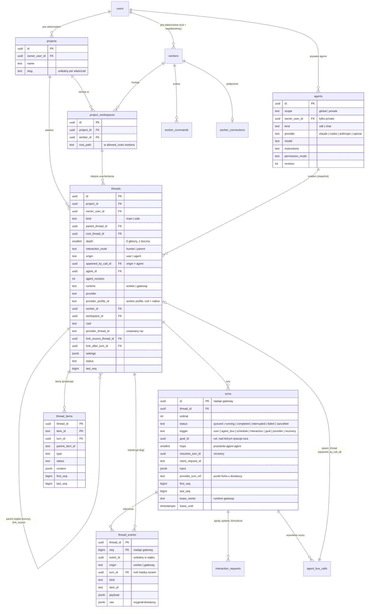

# Model danych (PostgreSQL)

Status: **zaimplementowany jako migracje `0001_init` i `0002_worker_config`** (`packages/db/src/migrations`). Niezmienniki są sprawdzane w testach na prawdziwym PostgreSQL (`packages/db/test/schema.test.ts`). Pojęcia i cykl życia wątków: [threads.md](threads.md).

Konwencje:

- klucze główne `uuid` (UUIDv7 generowane w aplikacji: sortowalne po czasie i znane przed zapisem, więc ponowienia są idempotentne),
- `timestamptz` dla czasu,
- `jsonb` tylko dla danych zmiennych lub specyficznych dla dostawcy; pola, po których filtrujemy, są kolumnami,
- usuwanie miękkie (`archived_at`), żeby nie gubić historii,
- niezmienniki obejmujące kilka wierszy pilnują triggery w bazie, a nie tylko aplikacja,
- migracje to czysty SQL, dzielony na instrukcje przy uruchomieniu (sterownik `@effect/sql-pg` nie ma protokołu simple query); zastosowanej migracji się nie edytuje (expand/contract).

## Diagram ER

Pozostałe tabele:

| Tabela | Rola |
|---|---|
| `users`, `workers`, `enrollment_tokens` | tożsamości; status online wynika z `worker_connections`, unieważnienie z `revoked_at` |
| `worker_connections` | która instancja gateway trzyma strumień workera; `epoch` do fencingu ([durability.md](durability.md#42-outbox-komend)) |
| `worker_commands` | outbox komend (protobuf `Command` w `payload`), `status`, `expires_at`, `client_request_id` |
| `interaction_requests` | zgody, pytania i formularze MCP; z tury, subagenta albo zadania w tle (`turn_id` może być pusty); `routed_to` i autor odpowiedzi: użytkownik albo agent rodzica |
| `goals` | cele harnessu ([goals.md](goals.md)): objective, status, budżet i zużycie według harnessu, iteracje, ostatni werdykt, autor (`user` z UI albo `provider`), ostatni raport (`native_status`, `native_state`), błąd ostatniej komendy celu (`error`, `error_at`); najwyżej jeden otwarty cel na wątek |
| `schedules` | harmonogram platformy (jednorazowy / cron): następne uruchomienie, limity, autor (użytkownik albo wywołanie szyny), `hops`, dzierżawa |
| `agent_bus_calls` | szyna agentów: każde wywołanie narzędzia (`spawn_thread`, `send_message`, `wait_threads`, ...), argumenty, wynik, uruchomiony wątek/tura, `hops`, powiadomienie zwrotne (outbox) |
| `blobs` | duże treści (output, diff, obraz), adresowane sha256, inline albo w magazynie obiektów |
| `worker_journal_cursors` | potwierdzone `journal_seq` per worker, dziennik i wątek (kursory `Welcome`) |
| `worker_configs`, `worker_config_history`, `secrets`, `worker_config_secrets` | zdalna konfiguracja workerów (migracja `0002`) — [worker-config.md](worker-config.md#7-schemat-0002_worker_config) |
| `audit_log` | komendy, decyzje, zmiany konfiguracji |

## Niezmienniki

W SQL (CHECK, FK, indeksy częściowe):

- agent prywatny ma właściciela, globalny nie; `sdk` ⇒ `claude | codex`, `chat` ⇒ `anthropic | openai`,
- wątek `worker` ma worker, workspace i `cwd`; wątek `gateway` nie ma żadnego z nich ani profilu,
- workspace wątku należy do tego samego projektu i workera (złożony FK),
- projekt żyje na workerach, na których ma aktywny workspace (`archived_at IS NULL`); zmiana katalogu (`UpdateWorkspace`) nie przenosi istniejących wątków (ich `cwd` jest własny), a zarchiwizowany workspace (`RemoveWorkspace`) przyjmuje już tylko wątki boczne istniejących wątków,
- `main` ⇔ brak rodzica ⇔ `root_thread_id = id` ⇔ `depth = 0`; najwyżej jeden poziom wątków bocznych (`depth <= 1`); fork tylko dla wątków bocznych; `interaction_route = parent` tylko dla wątków bocznych,
- punkt forka to tura **wątku źródłowego** (złożony FK `(fork_after_turn_id, fork_source_thread_id)`),
- jedna tura `running` na wątek; `client_request_id` unikalny w wątku; wyzwalacz ma swoje powiązanie (`agent_call_id`, `schedule_id`, `interaction_request_id`, `resumes_turn_id`); `hops` = 0 dla człowieka i dostawcy, > 0 dla szyny,
- cel ustawiony przez harness jest zapisywany tak, jak go zgłosił (bez akceptacji i budżetu, `0010`); autor to `user` (z `created_by_user_id`) albo `provider`; silnika celów platformy nie ma (`0011` usuwa jego kolumny i stan `proposed`); najwyżej jeden otwarty cel na wątek,
- harmonogram agenta zawsze ma koniec i `hops > 0`; dokładnie jeden autor (użytkownik albo wywołanie szyny); decyzja w interakcji ma dokładnie jednego autora,
- zdarzenie wskazuje turę tego samego wątku.

W triggerach:

- `threads_before_insert`: wątek boczny dzieli projekt, właściciela, drzewo, worker, workspace i katalog z rodzicem, a `depth = rodzic + 1`; źródło forka jest w tym samym drzewie i ma tego samego dostawcę; punkt forka to zakończona tura; brak punktu ⇒ przypięcie do ostatniej zakończonej tury,
- `threads_before_update`: placement i pochodzenie są niezmienne; `provider_thread_id` ustawia się raz, a podmienić (nie wyczyścić) można go tylko, dopóki żadna tura wątku nie wystartowała (`0012_worker_restart`: Codex bez rolloutu po restarcie workera).

- zdarzenie itemu ma `item_id`, inne nie; `event_id` unikalny w wątku (deduplikacja ponowień).

Funkcje: `thread_timeline(thread_id)` (pełny log z odziedziczonymi prefiksami forków, bez kopiowania) i `thread_items_view(thread_id)` (snapshot itemów dla frontendu, z flagą `changed_after_fork`). Model transkryptu: [transcript.md](transcript.md).

## Indeksy na start

- `thread_events (thread_id, seq)` — klucz główny, odczyt osi czasu; `(thread_id, event_id)` unikalny — idempotencja.
- `thread_items (thread_id, first_seq)` — snapshot dla frontendu; `(thread_id) WHERE status = 'in_progress'` — elementy w toku.
- `threads (project_id, created_at DESC) WHERE kind = 'main'` — lista wątków projektu.
- `threads (root_thread_id)` — drzewo wątków bocznych.
- `threads (worker_id, provider, provider_thread_id)` unikalny — mapowanie z identyfikatora dostawcy.
- `turns.error_source` (`platform` | `harness`, tylko przy `failed`), `turns.error_code`, `turns.interrupt_source` (`user` | `system`, tylko przy `interrupted`); migracja 0013, stany: [durability.md](durability.md#47-stany-tury-i-wątku). Zdarzenie z `thread_events.origin = 'gateway'` to zamknięcie itemu przez siatkę bezpieczeństwa gateway (powód w `raw`).
- `turns (thread_id) WHERE status = 'running'` unikalny, `turns (thread_id, ordinal) WHERE status = 'queued'` — kolejka tur.
- `worker_commands (worker_id, created_at) WHERE status IN ('pending', 'delivered')` — outbox.
- `agent_bus_calls (target_turn_id) WHERE notify_status = 'pending'` — powiadomienia czekające na koniec tury.
- `schedules (next_run_at) WHERE status = 'active'` — zaległe harmonogramy.

`thread_events` będzie największą tabelą. Przy dużym ruchu: partycjonowanie i kompaktowanie delt tekstu po zapisaniu pełnej wiadomości.

## Reguły dostępu

| Zasób | Odczyt | Użycie / zapis |
|---|---|---|
| Agent globalny | każdy zalogowany | użycie: każdy; edycja: admin |
| Agent prywatny | właściciel | właściciel |
| Worker współdzielony | każdy (nazwa, status) | workspace'y: każdy; administracja: admin |
| Worker prywatny | właściciel | właściciel |
| Projekt, workspace'y, wątki, tury, transkrypty | właściciel projektu | właściciel projektu |
| Wątki utworzone przez szynę agentów | właściciel projektu | tylko gateway (szyna) |

- Użycie agenta globalnego nie udostępnia wątku innym użytkownikom.
- Szyna agentów działa w imieniu właściciela projektu wątku źródłowego. Agent może wywołać tylko agentów, do których ten użytkownik ma dostęp.
- Dostęp admina do prywatnych zasobów innych użytkowników: **decyzja otwarta** ([architecture.md](architecture.md#11-decyzje-do-podjęcia)).

Sprawdzanie dostępu: jeden moduł polityk w gateway (`packages/domain`). Każde zapytanie listujące filtruje po użytkowniku. Postgres RLS jako opcjonalna druga warstwa.
