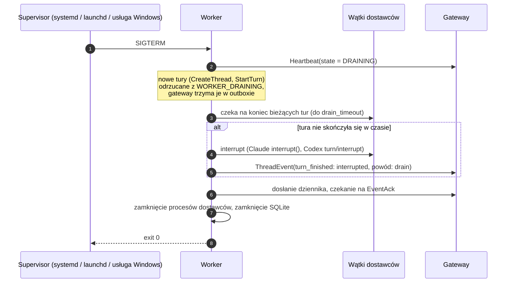
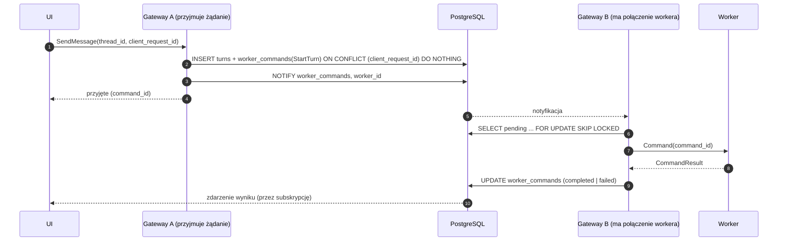
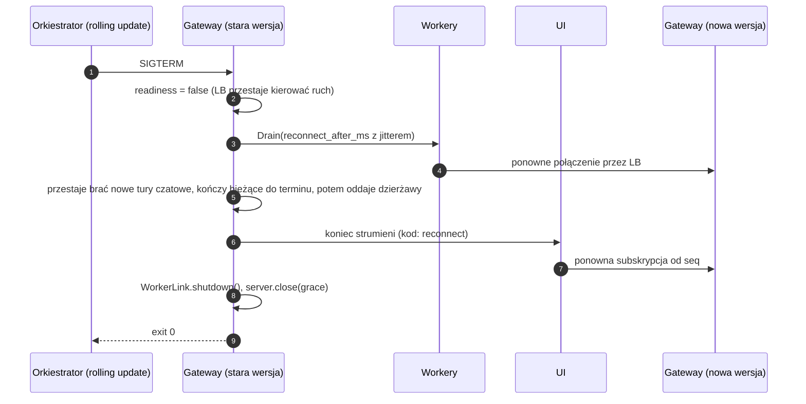

# Trwałość, graceful shutdown i aktualizacje w trakcie działania

Boty mają odrębną kolejkę `bot_turns` i checkpoint pętli narzędzi w PostgreSQL.
Lease z tokenem blokuje zapis starego wykonawcy; platformowe efekty i wyniki są
atomowe. MCP przerwane awarią wraca jako `interrupted`, bez ponowienia.
Szczegóły implementacji i testów: [bots.md](bots.md#3-wykonanie-i-odtwarzanie).

Status: **projekt, w części zaimplementowany** (2026-11-01). Wymaganie: zatrzymanie lub aktualizacja dowolnego procesu nie gubi stanu i nie kończy się błędem widocznym dla użytkownika. Wyjątkiem jest tura agenta przerwana twardym zabiciem procesu (patrz [macierz awarii](#9-macierz-awarii)).

Powiązane: [architecture.md](architecture.md), [protocol.md](protocol.md), [data-model.md](data-model.md).

## 1. Zasady

1. **Crash-only.** Poprawność nie zależy od graceful shutdown. SIGKILL, OOM albo zanik zasilania nie mogą zgubić stanu, który system już potwierdził. Graceful shutdown tylko skraca przerwę i pozwala uniknąć przerwanych tur.
2. **Najpierw zapis, potem efekt (write-ahead).** Komenda trafia do PostgreSQL, zanim pójdzie do workera. Zdarzenie trafia do lokalnego dziennika workera, zanim pójdzie do gateway. ACK wychodzi dopiero po commicie.
3. **At-least-once i idempotencja na każdym styku.** Klucze: `command_id`, `(thread_id, event_id)`, `call_id`, `request_id`. Także identyfikator generowany przez UI dla każdej akcji użytkownika.
4. **Pamięć to tylko cache.** Każdy proces po starcie odtwarza stan z trwałego nośnika: gateway z PostgreSQL, worker z SQLite i plików historii dostawcy.
5. **Wersje N i N+1 działają razem.** Proto zmieniamy tylko addytywnie. Migracje bazy idą w trybie expand/contract. Nieznane pola i wartości enumów są tolerowane.
6. **Efektów ubocznych agenta nie powtarzamy automatycznie.** Komendy shell i zmiany plików mogły się wykonać częściowo. Granicą bezpiecznego wznowienia jest tura, nie pojedyncze narzędzie.

## 2. Inwentarz stanu

| Stan | Nośnik | Po restarcie |
|---|---|---|
| Użytkownicy, projekty, agenci, workery, wątki, tury, transkrypty | PostgreSQL | bez zmian |
| Komendy gateway → worker | PostgreSQL `worker_commands` (outbox) | ponowne dostarczenie, worker deduplikuje po `command_id` |
| Zdarzenia wątków jeszcze niepotwierdzone przez gateway (także między turami) | SQLite workera `journal` | dosłanie po `Welcome`, deduplikacja po `event_id` |
| Rejestr wątków na workerze (`thread_id` ↔ wątek dostawcy, `cwd`, profil, tura w toku, ostatnie `seq`) | SQLite workera `threads` (cache; źródłem prawdy jest `ThreadSpec` z gateway) | wznowienie albo oznaczenie tury jako przerwanej |
| Historia wątku agenta SDK | pliki dostawcy (`~/.claude/projects`, `~/.codex/sessions`) | Claude `resume`, Codex `thread/resume`; źródło prawdy o turze, której koniec worker przegapił ([3.5](#35-rekoncyliacja-z-transkryptu-harnessu)) |
| Tury w toku na workerze: gdzie harness je zapisuje, ich itemy otwarte i skończone, prośby o przerwanie | SQLite workera (`open_turns`, `turn_harness`, `turn_items`, `turn_interrupts`) | rekoncyliacja z transkryptu harnessu |
| Przetworzone `command_id` | SQLite workera `processed_commands` (TTL) | deduplikacja |
| Interakcje (zgody, pytania, formularze) | PostgreSQL `interaction_requests` + SQLite workera | proces dostawcy zginął → `expired` |
| Zadania w tle i subagenci w toku | itemy w `thread_items`; otwarte zadania w dzienniku workera (`background_tasks`); procesy tylko na workerze | `interrupted`: `worker_shutdown` (łagodne zatrzymanie, zapisane i wysłane przed zamknięciem łącza), `worker_lost` (awaria: zamknięte przy następnym starcie), `worker_restart` (restart runtime'u dostawcy); z czasem końca; output zostaje taki, jaki przyszedł deltami; agent dostaje notatkę o każdym końcu ([execution.md](execution.md#8-trwałość)) |
| Cele | PostgreSQL `goals` (odbicie celu harnessu: ostatni raport w `native_state`) | gateway nie ustawia celu ponownie; Codex trzyma go w stanie wątku, cel Claude ginie z procesem ([goals.md](goals.md#6-trwałość)) |
| Konfiguracja workera | PostgreSQL `worker_configs` (+ historia); w workerze tylko w pamięci (sekrety) | po starcie `Hello.config_version = 0`, gateway wysyła ją ponownie |
| Harmonogramy | PostgreSQL `schedules`, odpalane przez gateway z dzierżawą | po przestoju jedna tura nadrabiająca albo pominięcie (`missed_policy`) |
| Wywołania szyny agentów | PostgreSQL `agent_bus_calls` (wynik, powiadomienie jako outbox) + SQLite workera | ponowienie po `call_id` |
| Tury agentów czatowych | PostgreSQL `turns` (kolejka z dzierżawą) | inna instancja przejmuje po wygaśnięciu dzierżawy |
| Połączenia workerów, subskrypcje UI | pamięć | odtwarzane przez ponowne połączenie |
| Delty tekstu w locie | ulotne | pełna wiadomość jest trwała |

## 3. Worker

### 3.1 Dziennik lokalny

**Zaimplementowany:** `apps/worker/src/journal` (serwis Effect `Journal`) i `apps/worker/src/gateway-link/delivery.ts` (`journalHello`, `resendPending`, `applyAck`). Testy jednostkowe na pliku SQLite oraz test integracyjny przez gRPC: zdarzenia zapisane offline, częściowe potwierdzenie, ponowne połączenie z dosłaniem tylko niepotwierdzonych, deduplikacja po `event_id`, nowy dziennik po reinstalacji.

`bun:sqlite` w trybie WAL z `synchronous = FULL`, żeby przetrwać zanik zasilania, nie tylko awarię procesu. `journal_seq` rośnie per wątek i nigdy się nie cofa (tabela `thread_seq`), także po potwierdzeniu wszystkich zdarzeń i restarcie. Tabele: `threads`, `journal`, `processed_commands`, `pending_interactions`, `pending_bus_calls`. Jeden plik w katalogu danych workera z uprawnieniami 0600.

### 3.2 Wątki dostawców

- **Claude:** nowy wątek startuje z `sessionId = thread_id` platformy (identyfikator znany przed pierwszym zdarzeniem); fork przez `forkSession` daje nowy identyfikator. `persistSession: true`. Wznowienie przez `resume: provider_thread_id`.
- **Codex:** `thread.id` trafia do dziennika i do gateway (`thread_ready`) zaraz po `thread/start` / `thread/fork`, przed pierwszą turą. Wznowienie przez `thread/resume`.
- Dziennik i rejestr wątków są aktualizowane, zanim zdarzenie wyjdzie do gateway.

### 3.3 Zatrzymanie łagodne (drain): SIGTERM, aktualizacja

- `drain_timeout` jest konfigurowalny. Aktualizacja workera domyślnie czeka na brak aktywnych tur („update when idle”) z maksymalnym terminem.
- Jeśli gateway jest niedostępny w trakcie drain, zdarzenia zostają w dzienniku i zostaną dosłane po starcie. Drain się nie blokuje.
- **Zaimplementowane dziś** (bez czekania na tury): `DRAINING`, oznaczenie dziennika `beginShutdown`, następnie zatrzymanie runtime'ów dostawców przy działającym łączu (`WorkerHost.shutdown`). Od oznaczenia dziennika każdy końcowy raport zadania w tle (także wysłany przez harness w trakcie zamykania) jest normalizowany **przed zapisem** do `interrupted`, `worker_shutdown` z czasem końca. Raporty nie mogą wygrać z późniejszym przeglądem otwartych zadań i nadać notatce ogólnego powodu `stopped`. Zdarzenia są wysyłane i potwierdzane (`flush`, do 3 s), dopiero potem łącze się zamyka. Komendy, które przyjdą w tym czasie, zostają bez odpowiedzi (gateway trzyma je w outboxie dla następnego procesu, np. turę notatki o zatrzymanych zadaniach; [execution.md](execution.md#pobudka-agent-dowiaduje-się-o-każdym-końcu-zadania)).

### 3.4 Start po awarii

1. Otwarcie dziennika. Tury w toku są rozliczane z transkryptu harnessu ([3.5](#35-rekoncyliacja-z-transkryptu-harnessu)): kończą się tak, jak zapisał je harness, a bez zapisanego końca jako `interrupted` przez system (`worker restarted mid-turn`). **Zaimplementowane:** dziennik śledzi otwarte tury w tej samej transakcji co ich zdarzenia (tabela `open_turns`, jak `background_tasks`), a `WorkerHost.recover` rozlicza je przy starcie, zanim worker się połączy.
2. Prośby o zgodę i wywołania szyny przypięte do zabitych procesów dostają `expired`. **Zaimplementowane w gateway** dla zgód tur, które gateway kończy (punkt 5).
3. Połączenie, `Hello` z kursorami wątków i turami, które proces prowadzi (`running_turns`, capability `running_turns`), dosłanie dziennika.
4. Przerwane tury są wznawiane według polityki (decyzja 1 w sekcji 11). Na razie nie są: kończą się `interrupted`, a wątek przechodzi do następnej tury z kolejki.
5. **Gateway** po `Hello` (najpierw odczyt outboxu, potem to): tury `running` wątków tego workera spoza `running_turns` kończą się `interrupted` przez system z powodem `worker restarted` (`ui.Turn.interrupt_source`, `interrupt_reason`). Zaraz potem przychodzi z dziennika wynik rekoncyliacji workera i zastępuje ten tymczasowy koniec prawdziwym (spóźniony `turn_finished`). To łapie także tury, których dziennik nie zna (stary proces bez śledzenia tur, nowy dziennik). Ich oczekujące interakcje wygasają, steery `pending`/`accepted` są `dropped` (pump kolejkuje je z powodem), kolejka wątku rusza. `InterruptTurn` dla tury, której worker nie prowadzi (`TURN_NOT_RUNNING`), kończy ją tak samo.
6. Wątek Codexa bez żadnej tury nie ma rolloutu, więc nowy proces nie może go wznowić (`thread/resume: no rollout found`): worker zaczyna nowy wątek Codexa z tym samym `thread_id` platformy i zgłasza go w `thread_ready.replaces_provider_thread_id` ([codex-adapter.md](codex-adapter.md#runtime-wątków)).

### 3.5 Rekoncyliacja z transkryptu harnessu

**Zaimplementowane:** `apps/worker/src/providers/reconcile.ts` (wspólne), `codex/transcript.ts`, `claude/transcript.ts`. Gdy tura kończy się bez tego, że worker zobaczył jej koniec, worker (który ma pliki harnessu na dysku) czyta, co harness sam zapisał, i zgłasza to, co naprawdę się stało.

**Kiedy.** Start workera po restarcie albo awarii (`recover`, przyczyna: przerwanie przez system, `worker restarted mid-turn`). Proces Codex app-server kończy się sam, a worker żyje (przyczyna: błąd harnessu, `harness process exited (code …)`, kod `process_exit`; runtime Codexa startuje od nowa przy następnej komendzie, wątki są wznawiane przez `thread/resume`). Proces Claude Code kończy się w trakcie tury bez `result` (ta sama przyczyna). Zatrzymanie workera (drain, shutdown) kończy turę Claude jako przerwaną przez system (`worker stopped mid-turn`); tura Codexa zostaje otwarta w dzienniku i rozlicza ją następny start.

**Co dziennik wie o turze w toku** (te same transakcje co jej zdarzenia, usuwane z jej końcem):

| Tabela | Treść |
|---|---|
| `turn_harness` | harness, ścieżka transkryptu (Codex: plik rolloutu z `Thread.path`; Claude: katalog konfiguracji `CLAUDE_CONFIG_DIR`), id wątku Codexa albo sesji Claude, offset w pliku na starcie tury, id tury Codexa |
| `turn_items` | ostatni stan każdego itemu tury (bez zadań w tle) i czy się skończył |
| `turn_interrupts` | platforma poprosiła o przerwanie (`InterruptTurn`) |

**Źródła prawdy:**

| Harness | Plik | Itemy | Koniec tury |
|---|---|---|---|
| Codex | rollout `sessions/YYYY/MM/DD/rollout-*-<thread id>.jsonl`, tura po `turn_id` (bez niego: pierwsza tura po offsecie) | `event_msg item_completed` (te same id co w app-server: wiadomości, rozumowanie, komendy, zmiany plików, narzędzia) przez ten sam mapper co powiadomienia na żywo; `response_item` (komórki code mode, komendy shell bez itemu) | `task_complete` → `completed`, a z polem `error` → `failed` przez harness (komunikat, kod z `codex_error_info`, np. `http_connection_failed:401`); `turn_aborted` → `interrupted` (powód z rolloutu); zużycie z ostatniego `token_count` |
| Claude Code | `<config>/projects/<katalog projektu>/<sesja>.jsonl`, wszystko po offsecie (jedna tura naraz w sesji), bez wpisów `isSidechain` | blok asystenta (jeden na wpis) pod id `<message.id>:<indeks bloku>` jak na żywo; `tool_use` otwiera item narzędzia, `tool_result` go kończy | wpis z `isApiErrorMessage` → `failed` przez harness (kod `apiError`/`error`, np. `usage_limit_reached`); „[Request interrupted by user…]” → `interrupted`; ostatni wpis asystenta zatrzymany (`end_turn`, `stop_sequence`, `max_tokens`, `refusal`) bez czekającego narzędzia → `completed` |

**Reguły:**

1. **Kolejność.** Itemy idą do dziennika w kolejności transkryptu, przed `turn_finished`; gateway dostaje je po zdarzeniach, które worker przekazał wcześniej, więc oś czasu zachowuje porządek.
2. **Idempotencja.** Item, który dziennik ma jako skończony, jest pomijany. Pozostałe wychodzą jako `item_completed` pod tym samym id: gateway ich nie dubluje (projekcja po `item_id`, `item_completed` zastępuje stan, a tekst i output zebrane z delt zostają). Ponowne rozliczenie tej samej tury daje te same zdarzenia.
3. **Otwarte itemy.** Item rozpoczęty, ale w transkrypcie niedokończony, oraz item otwarty w dzienniku, którego transkrypt nie zna, kończą się `interrupted`.
4. **Koniec.** Koniec zapisany przez harness wygrywa; bez niego decyduje przyczyna. Przerwanie z transkryptu jest użytkownika tylko wtedy, gdy platforma o nie prosiła (`turn_interrupts`): Codex zapisuje `turn_aborted` („interrupted”) także wtedy, gdy jego worker zginął i zamknęło się wejście (sprawdzone na żywo); wtedy to przerwanie przez system, `worker restarted mid-turn (the harness stopped the turn: interrupted)`.
5. **Brak zapisu** (brak pliku, nieczytelny, nic z tury): reguły 3 i 4 i tak wszystko zamykają.

Zdarzenia rekoncyliacji mają w `raw_json` znacznik `{"reconciled": "<harness> transcript", "found": …}`.

### 3.6 Opcja na później: host wątków niezależny od workera

Procesy dostawców w osobnym procesie, który przeżywa restart procesu workera. Worker po aktualizacji podłącza się do niego przez lokalny socket. Daje aktualizację workera bez przerywania długich tur, ale sporo kosztuje: osobny proces, IPC, własny cykl życia. Wracamy do tego, jeśli drain okaże się niewystarczający.

## 4. Gateway

### 4.1 Bez stanu tylko w pamięci, N ≥ 1 instancji

Każda instancja może obsłużyć dowolne żądanie. Wdrożenie może zacząć się od jednej instancji. Projekt nie może tego jednak zakładać, bo aktualizacja bez przerwy to rolling update na co najmniej dwóch instancjach.

### 4.2 Outbox komend

- Każda komenda ma `expires_at` zależne od typu. `InterruptTurn` i `UnloadThread` mają sens krótko. `CreateThread` i `StartTurn` mogą czekać na powrót workera. Przeterminowana komenda kończy się błędem widocznym w UI.
- Po `Welcome` instancja dosyła wszystkie `pending` i `delivered` bez wyniku. Worker deduplikuje po `command_id` i odsyła zapamiętany wynik.
- **Własność połączenia:** `worker_connections(worker_id, instance_id, epoch)`. Nowe połączenie podbija `epoch`, a stara instancja zamyka swoje (fencing). Wynik komendy z nieaktualnego `epoch` jest ignorowany.

- **Jedna tura startuje raz.** Planista tur działa z wielu miejsc naraz (koniec tury, nowa wiadomość, kilka instancji). Unikalny indeks `worker_commands_one_start` dopuszcza jeden żywy `StartTurn` na turę; przegrany przebieg uznaje, że turę wystartował ktoś inny (wcześniej dwa przebiegi mogły wystartować tę samą turę dwa razy).

### 4.3 Transkrypt i zdarzenia live

- `INSERT ... ON CONFLICT (thread_id, seq) DO NOTHING`, `EventAck` po commicie (już w protokole).
- **Jeden wątek nie blokuje pozostałych.** Zdarzenia są zapisywane w transakcji na wątek (`Ingest`). Gdy zapis wątku się nie uda, ten wątek nie dostaje `EventAck`, a jego kolejne zdarzenia na tym połączeniu są pomijane (żeby nie trafiły do bazy w złej kolejności). Pozostałe wątki są zapisywane i potwierdzane. Gateway prosi workera o ponowne połączenie (`Drain`, 10 s), a worker wysyła niepotwierdzone zdarzenia ponownie ze swojego dziennika.
- **Utracone `turn_finished`.** Dostawca prowadzi jedną turę naraz w wątku. Gdy zaczyna kolejną, a tura w bazie nadal jest `running` (np. po awarii dostawcy), gateway zamyka ją jako `interrupted` (`superseded`). Wcześniej ten stan łamał `turns_one_running` i zatrzymywał cały strumień workera (zdarzenie, które po każdym połączeniu psuło zapis od nowa).
- Zdarzenia live do UI idą przez `NOTIFY` z `(thread_id, seq)`. Instancja z subskrypcją UI czyta wiersze z bazy. Działa przy N instancjach, a UI po ponownym połączeniu wznawia od swojego `seq`.

### 4.3.1 Siatka bezpieczeństwa: settle i sweep

**Zaimplementowane:** `Ingest.settle`, `GatewayCore.sweep` (start gateway i co 5 minut). Cokolwiek zgłosił worker, gdy tura osiąga stan końcowy (`turn_finished`, koniec utraconej tury po `Hello`, `TURN_NOT_RUNNING`, tura, która nie mogła wystartować), gateway:

- zamyka jako `interrupted` każdy item tej tury nadal `in_progress` (także zagnieżdżone, rozumowanie, wywołania narzędzi) oraz itemy bez tury, gdy żadna tura wątku nie działa. Wyjątki: zadania w tle (`background_task`, żyją poza turą; kończy je worker razem z procesem) i komenda, którą takie zadanie kontynuuje (`source_item_id`). Zamknięcie to zdarzenie gateway (`thread_events.origin = 'gateway'`, powód w `raw`: `{"settled_by": "gateway", "reason": …}`), publikowane do UI jak każde inne;
- oznacza oczekujące interakcje zakończonych tur jako `expired`;
- przywraca `idle` wątkowi, który tylko wygląda na zajęty albo zepsuty: `running`/`waiting_input` bez działającej tury (sweep: dopiero po 60 s bez zmian i bez `StartTurn` w drodze), `interrupted`, `failed` z wątkiem dostawcy; kolejka wątku rusza.

Sweep szuka tych samych niespójności w całej bazie i naprawia je tak samo (powód `sweep: the item's turn is over`). Jest idempotentny. Spóźnione zdarzenia workera (np. wynik jego rekoncyliacji) nadal ustawiają prawdziwy stan: `item_completed` zastępuje zamknięcie, `turn_finished` zastępuje koniec.

### 4.4 Tury agentów czatowych

- Tury wątków `runtime = gateway` (`turns`) to kolejka z dzierżawą: `SELECT ... FOR UPDATE SKIP LOCKED`, `lease_until`, przedłużanie heartbeatem.
- Każde wywołanie narzędzia przez agenta czatowego jest zapisywane z wynikiem, zanim tura pójdzie dalej. Powtórzona tura nie wykonuje drugi raz narzędzia, które ma zapisany wynik.
- Po śmierci instancji dzierżawa wygasa i inna instancja powtarza turę od ostatniego zapisanego stanu. Delty z przerwanej próby są ulotne. UI dostaje zdarzenie „ponowienie tury”.

### 4.5 Szyna agentów

- `agent_bus_calls.id = call_id`. Worker po ponownym połączeniu ponawia `AgentToolCall`; gateway zwraca zapisany wynik zamiast wykonywać drugi raz (nie powstaje drugi wątek boczny).
- Powiadomienia zwrotne to outbox (`notify_status = pending` → `delivered` z turą w wątku wywołującym). Przeżywają restart gateway.
- `wait_threads` jest ograniczone w czasie i tylko czyta stan, więc przerwanie go niczego nie psuje.
- Harmonogramy są w bazie, a odpalanie z dzierżawą (`FOR UPDATE SKIP LOCKED`, 60 s), więc przy kilku instancjach każdy termin odpala jedna. Po przestoju harmonogram cykliczny odpala jedną turę nadrabiającą (albo pomija zaległe przy `missed_policy = skip`), a następny termin liczy się od teraz.
- Szczegóły: [agent-bus.md](agent-bus.md#6-trwałość).

### 4.6 Drain instancji gateway

Przy jednej instancji kroki są te same, tylko workery i UI łączą się z nową wersją po jej starcie. Agenci na workerach pracują dalej, a zdarzenia czekają w dzienniku.

### 4.7 Stany tury i wątku

Tura kończy się w jednym z trzech stanów (`turns.status`; `queued`/`running` przed końcem, `cancelled` dla tury z kolejki, która nie wystartowała):

| Stan | Znaczenie | Źródło (`ui.Turn`) | Treść |
|---|---|---|---|
| `completed` | harness skończył turę | — | wynik w itemach |
| `interrupted` | turę przerwano | `interrupt_source`: `user` (ktoś poprosił przez platformę: użytkownik, agent rodzica) albo `system` (zdarzenie systemowe: restart workera w trakcie tury, drain, gateway kończy turę, której worker nie prowadzi, `superseded`) | `interrupt_reason` |
| `failed` | prawdziwy błąd | `error_source`: `platform` (nasza strona: gateway, worker, adapter, dziennik, baza, utracone połączenie, tura, która nie mogła wystartować z naszego powodu) albo `harness` (Codex/Claude zgłosił błąd: 401, limit, błąd modelu, proces harnessu zakończył się błędem) | `error` (dokładny komunikat), `error_code` (np. `http_connection_failed:401`, `usage_limit_reached`, `error_max_turns`, `process_exit`, kod komendy workera) |

Worker podaje źródło w `TurnFinished.source` i `error_code`; starszy worker bez źródła: przerwanie = `user`, błąd = `harness`. Nieudany `StartTurn`: `HARNESS_ERROR` (Codex odpowiedział błędem) → `harness`, inne kody → `platform`. Późniejszy `turn_finished` z innym wynikiem przepisuje stan, źródło i treść.

**Macierz rekoncyliacji** (kto decyduje o stanie tury, której koniec worker przegapił):

| Co mówi transkrypt harnessu | Przyczyna po stronie workera | Wynik |
|---|---|---|
| harness skończył turę (`task_complete`, zatrzymany ostatni wpis asystenta) | dowolna | `completed`, z itemami, których worker nie przekazał |
| harness zapisał błąd (`task_complete.error`, `isApiErrorMessage`) | dowolna | `failed` / `harness`, komunikat i kod harnessu |
| harness zapisał przerwanie, platforma o nie prosiła | dowolna | `interrupted` / `user` |
| harness zapisał przerwanie, nikt o nie nie prosił | worker zginął | `interrupted` / `system`, `worker restarted mid-turn (the harness stopped the turn: …)` |
| brak końca | worker zginął (restart, kill, zanik zasilania) | `interrupted` / `system`, `worker restarted mid-turn` |
| brak końca | proces harnessu zakończył się sam, worker żyje | `failed` / `harness`, `harness process exited …`, `process_exit` |
| brak transkryptu | jak wyżej | jak wyżej; otwarte itemy `interrupted` |
| — | błąd po naszej stronie (komenda nie wykonana, wątek nie powstał) | `failed` / `platform` |

**Wątek zostaje używalny po każdym z trzech stanów.** Koniec tury przywraca wątkowi `idle` (chyba że działa już nowsza tura), a wynik zostaje na turze. `failed` jako status wątku znaczy wyłącznie, że wątek nie powstał (brak wątku dostawcy, `status_detail` mówi dlaczego); takiego wątku nie da się używać. `interrupted` nie jest już ustawiany wątkom (zostaje w schemacie dla starszych wierszy; migracja 0013 i sweep przywracają `idle`). Stan aktywności dostawcy (`activity`) zmienia wątek tylko na `idle`, `running`, `waiting_input`; błąd wątku po stronie dostawcy (Codex `systemError`) nie blokuje wątku, bo następna tura go wznawia.

**Kontynuacja.** Tura przerwana przez system ma w UI akcję „Continue”: krótka wiadomość, która wznawia sesję harnessu z pełnym kontekstem (Codex `thread/resume`, Claude `resume`) i prosi o sprawdzenie, co już zrobiono, zanim cokolwiek z efektami ubocznymi zostanie powtórzone (zasada 6). Każda nowa wiadomość robi to samo.

## 5. UI

Lustra połączonych komputerów mają własny trwały dziennik unieważnień domu i zapisany per partner
kursor `epoch:revision`. Offline czytamy ostatnią zatwierdzoną generację; restart odbiorcy nie
usuwa historii ani kursora. Pełny resync podmienia generację atomowo, a urwany pozostawia starą.
Nie ma kolejki zdalnych zapisów: outbox workera opisany wyżej dotyczy wyłącznie domu wątku.
Szczegóły i ograniczenia zawartości plików: [etap 3 połączonych komputerów](linked-computers.md#konkretny-protokół-etapu-3).

- Subskrypcje wznawiane od ostatniego `seq`.
- Każda akcja użytkownika ma `client_request_id`. Ponowienie po zerwaniu połączenia lub podwójne kliknięcie nie dubluje komendy.

## 6. PostgreSQL i migracje

- Expand/contract: najpierw dodajemy (kolumny, tabele), wdrażamy aplikację, potem usuwamy stare. Wersje N i N+1 muszą działać na schemacie po kroku expand.
- Migracje są osobnym krokiem wdrożenia, nie efektem startu aplikacji przy N instancjach.
- Kopie zapasowe, PITR, RPO/RTO: do ustalenia przy projekcie infrastruktury.

## 7. Kompatybilność wersji

- Proto zmieniamy tylko addytywnie (już w [protocol.md](protocol.md#wersjonowanie)).
- `Hello.capabilities`: worker zgłasza obsługiwane funkcje. Gateway nie wysyła komend, których worker nie zna.
- Okno wsparcia: gateway N obsługuje workery N i N-1.
- `thread_events.payload` ma wersję formatu (`format`).

## 8. Health i supervisor

- Gateway: `/livez` (proces żyje), `/readyz` (baza dostępna, nie trwa drain).
- Worker działa pod supervisorem systemowym: systemd user unit (Linux, Omarchy), launchd (macOS), usługa Windows. Supervisor wysyła SIGTERM (Windows: odpowiednik), czeka `drain_timeout + margines`, dopiero potem zabija.

## 9. Macierz awarii

| Zdarzenie | Co się dzieje | Utrata |
|---|---|---|
| SIGTERM gateway | drain (4.6); workery i UI łączą się ponownie | brak |
| SIGKILL gateway | workery i UI łączą się ponownie; dzierżawy tur czatowych wygasają i tury są powtarzane | brak potwierdzonych danych; delty w locie |
| SIGTERM worker | drain (3.3); tury dokończone albo czysto przerwane, dziennik opróżniony | brak; przerwana tura jest oznaczona |
| SIGKILL lub zanik zasilania workera | tura rozliczona z transkryptu harnessu po starcie ([3.5](#35-rekoncyliacja-z-transkryptu-harnessu)): koniec zapisany przez harness albo `interrupted` przez system (`worker restarted mid-turn`); itemy, których worker nie przekazał, dopisane; nic nie zostaje otwarte; kolejka rusza dalej; zdarzenia z dziennika dosłane po starcie | **reszta tury w toku** (harness ginie z workerem albo przerywa turę, gdy zamknie mu się wejście), efekty uboczne mogły zajść częściowo; „Continue” wznawia sesję |
| Proces harnessu kończy się sam (Codex app-server, Claude Code), worker żyje | tura rozliczona z transkryptu: zapisany koniec albo `failed` przez harness (`process_exit`); następna komenda dostaje nowy proces harnessu, wątek wznawiany | reszta tury |
| Restart PostgreSQL | gateway ponawia z backoffem, `readyz = false`; workery buforują w dzienniku | brak |
| Zerwanie sieci worker ↔ gateway | ponowne połączenie, dosłanie dziennika | brak |
| Aktualizacja CLI dostawcy na urządzeniu | nowe tury na nowej wersji (wznowienie wątku); restart Codex app-server przechodzi przez drain wątków | brak |
| Restart lub zerwanie łącza w trakcie przeniesienia wątku/bota na inny komputer | przed decyzją ruch jest cofany, po decyzji kończony; trwałe rekordy po obu stronach ([etap 8](linked-computers.md#konkretny-protokół-etapu-8)) | brak; zawsze dokładnie jeden dom |

## 10. Wpływ na dotychczasowe decyzje

- „MVP: jedna instancja gateway” zmienia się na: projekt dla N ≥ 1 od początku, wdrożenie może zacząć od jednej instancji.
- „Komendy do workera offline od razu kończą się błędem, nie kolejkujemy” zmienia się na: outbox w PostgreSQL z `expires_at` per typ.
- **Effect:** `Scope`, finalizery i przerwania fiberów wprost wspierają drain i kolejność zamykania. `effect/workflow` i `effect/cluster` są w 4.1.1 `@stability unstable`, więc nie opieramy na nich trwałości. Ich zapisany format mógłby się zmienić między wersjami, a to uderza w wymaganie aktualizacji w trakcie działania. Zamiast tego własne, dobrze znane mechanizmy na PostgreSQL: outbox, dzierżawy z `SKIP LOCKED`, `LISTEN/NOTIFY`.

## 11. Decyzje do podjęcia

1. **Polityka przerwanej tury.** Propozycja: przerwanie czyste (drain) wznawiamy automatycznie z wiadomością systemową o restarcie; przerwanie twarde (crash) czeka na decyzję użytkownika („Kontynuuj”), bo efekty uboczne mogły zajść częściowo. Ewentualnie konfigurowalne per agent. **Na razie:** nic nie wznawia się samo; tura przerwana przez system ma w UI akcję „Continue” ([4.7](#47-stany-tury-i-wątku)).
2. **Domyślny `drain_timeout` workera** i zachowanie „update when idle”.
3. **Gateway: od jednej instancji czy od razu ≥ 2.**
4. **Mechanizm aktualizacji workera:** samoaktualizacja sterowana z gateway czy menedżer pakietów systemu.
