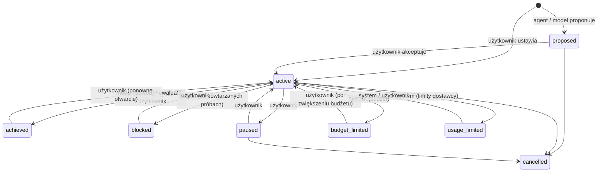
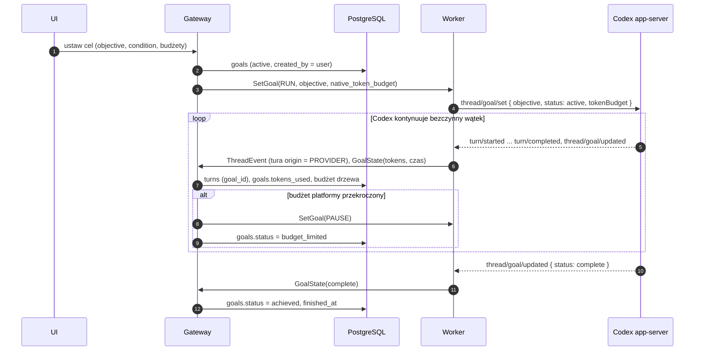

# Cele (goals)

Status: **projekt**, częściowo zaimplementowany:
- model, przejścia i mapowanie na harnessy: `packages/domain/src/goals`,
- narzędzia silnika platformy: `get_goal`, `propose_goal`, `update_goal`,
- schemat: `goals`, `turns.goal_id`, wyzwalacz `goal`,
- kontrakt: `SetGoal`, `GoalState`.

Wykonanie po stronie gateway i workera powstanie w spike'u adapterów.

Powiązane: [agent-bus.md](agent-bus.md), [execution.md](execution.md), [threads.md](threads.md).

## 1. Idea: cel platformy, silnik harnessu

**Cel** to zadanie, nad którym wątek pracuje przez wiele tur, aż do spełnienia warunku albo wyczerpania budżetu.

- **Platforma jest właścicielem celu.** Cel jest trwały, widoczny w UI, ma budżety liczone także dla wątków bocznych, a decyzje (akceptacja, pauza, wznowienie, anulowanie) należą do użytkownika.
- **Silnikiem jest natywny mechanizm harnessu** (nakładka), domyślnie dla obu dostawców. Korzystamy z dopracowanego zachowania dostawców, ale sterujemy nim z platformy.
- **Silnik platformy** (gateway sam zaczyna tury kontynuacji) jest zapasem dla dostawców bez natywnych celów albo gdy natywny mechanizm nie wystarcza.

| | Codex app-server (`goals`) | Claude Agent SDK (`/goal`) | Silnik platformy |
|---|---|---|---|
| Cel u dostawcy | `objective` + `tokenBudget` | warunek zakończenia | — |
| Kontynuacja | Codex sam zaczyna tury, gdy wątek jest bezczynny | ewaluator (hook `Stop`) nie pozwala zakończyć tury, aż warunek jest spełniony | gateway zaczyna turę `trigger = goal` |
| Kto stwierdza sukces | model (`update_goal: complete`, z audytem) | osobny ewaluator na podstawie rozmowy | model (`update_goal`) |
| Status od dostawcy | `thread/goal/updated`, `cleared` | wiadomość `active_goal` (iteracje, powód) | — |
| Sterowanie | `thread/goal/set` (status), `thread/goal/clear` | `/goal <warunek>`, `/goal clear` | — |

Cel platformy ma oba pola: `objective` (co) i `condition` (jak sprawdzić). Codex dostaje `objective` z dopisanym „Done when: <warunek>”, a Claude sam warunek.

## 2. Statusy i kto je zmienia

- **Model** może tylko ogłosić wynik: `achieved` albo `blocked`.
- **Użytkownik** akceptuje, wstrzymuje, wznawia, anuluje i otwiera ponownie.
- **System** egzekwuje limity, ale nigdy nie wznawia celu wstrzymanego przez użytkownika.

Reguły są w `canTransition` (`packages/domain`) i w constraintach bazy.

## 3. Cele tworzone przez model

Model może sam zaproponować cel: natywnie (Codex `create_goal`, Claude `ProposeGoal`) albo narzędziem platformy `propose_goal`. Wtedy:

1. Worker raportuje `GoalState` z `origin = MODEL`. Gateway zapisuje cel jako `proposed` (`created_by = provider | agent`) i **wstrzymuje natywną kontynuację** (`SetGoal PAUSE`).
2. Użytkownik akceptuje albo odrzuca w UI. Dopiero akceptacja (`approved_by`) uruchamia cel (`SetGoal RUN`).
3. Cel spoza UI musi mieć budżet (`goals_agent_budget`). Użytkownik może ustawić cel bez limitu.

Pilnuje tego baza: cel spoza UI nie może być `active` bez `approved_by`.

## 4. Budżety

Budżet tokenów, kosztu, czasu i liczby kontynuacji. Liczy go platforma:

- `scope = tree` (domyślnie): do zużycia wliczają się wątki boczne. Orkiestrator z celem rozdziela pracę, a koszt liczy się w całości.
- Natywny budżet Codexa (`tokenBudget`) dostaje **pozostałą** część budżetu tokenów jako dodatkowe zabezpieczenie. Pozostałe budżety egzekwuje gateway: po przekroczeniu `SetGoal PAUSE` i status `budget_limited`.
- Tury kontynuacji nie zwiększają licznika przeskoków agentów (`hops`). Ograniczają je budżety celu.

## 5. Przepływ (silnik natywny, Codex)

Claude działa analogicznie, z tą różnicą, że kontynuacja dzieje się wewnątrz jednej długiej tury (ewaluator blokuje jej zakończenie). Postęp przychodzi jako `active_goal` z liczbą iteracji i powodem, dla którego warunek nie jest jeszcze spełniony.

## 6. Trwałość

- Cel żyje w PostgreSQL. Stan natywny (`native_state`) to tylko odbicie.
- Po restarcie workera gateway ponownie wysyła `SetGoal RUN` dla aktywnych celów jego wątków. Natywny cel jest ustawiany od nowa (Claude: licznik iteracji startuje od zera, zużycie liczy platforma).
- Silnik platformy: tura kontynuacji to zwykła tura w kolejce (`trigger = goal`), więc przeżywa restart jak każda inna.

## 7. Otwarte punkty (do sprawdzenia w spike'u)

1. **Claude:** czy `/goal` działa przez strumień wejścia SDK i czy ustawienie z `ask_user=false` przez `ProposeGoal` da się przechwycić przed startem kontynuacji.
2. **Codex:** czy `thread/goal/set` z `origin` od klienta (app-server) jest traktowane jak decyzja użytkownika (`Missing provenance does not supply user authorization`).
## 8. Ustalenia

- **Domyślny silnik: natywny dla obu dostawców** (2026-11-01). Silnik platformy zostaje jako zapas, wybierany per cel (`goals.engine`). Stała: `DEFAULT_GOAL_ENGINE` w `packages/domain`.
