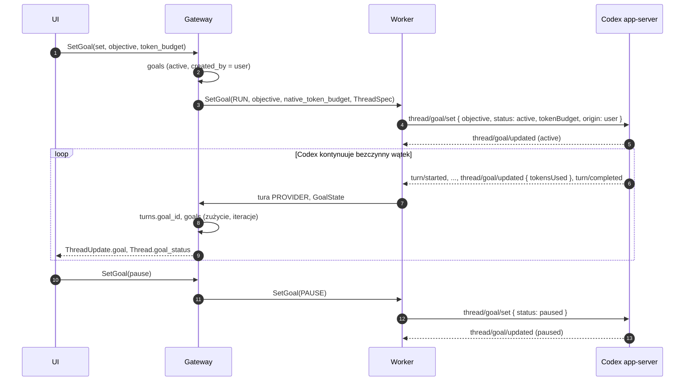

# Cele (goals)

Status: **zaimplementowane** (2026-11-01):
- worker: Codex `thread/goal/*` (`apps/worker/src/providers/codex`), Claude `/goal` (`apps/worker/src/providers/claude`),
- gateway: stan celu z raportów harnessu (`apps/gateway/src/store/goals.ts`, w transakcji ingestu), `SetGoal` w UI API,
- domena: mapowanie statusów (`packages/domain/src/goals`),
- schemat: `goals` (+ `0010_goals_background_harness`; `0011_goals_engine_cleanup` usuwa kolumny i stany porzuconego silnika platformy), `turns.goal_id`,
- testy: nagrania strumieni (`fixtures/goal-*`), integracja ze skryptowanym workerem (`tests/integration/goals-background.test.ts`), na żywo przez cały łańcuch (`goals-background.live.test.ts`).

Powiązane: [execution.md](execution.md), [codex-adapter.md](codex-adapter.md), [claude-adapter.md](claude-adapter.md), [ui-api.md](ui-api.md#2-gatewayservice).

## 1. Decyzja: cel należy do harnessu

**Cel** to zadanie, nad którym wątek pracuje przez wiele kroków, aż warunek zostanie spełniony.

- **Silnikiem jest harness** (Codex goals, Claude Code `/goal`). Platforma nie ma własnego silnika celów: nie zaczyna tur kontynuacji i nie ocenia warunku (decyzja użytkownika, 2026-11-01).
- **Platforma śledzi i pokazuje** cel: treść, status, zużycie, budżet, tury celu, ostatni werdykt. Stan pochodzi z raportów harnessu (`GoalState`) i z decyzji użytkownika w UI.
- **Użytkownik steruje** z UI: ustawia, wstrzymuje, wznawia i usuwa cel (`SetGoal`).
- Najwyżej jeden otwarty cel na wątek (`goals_one_open`). Nowy cel zastępuje otwarty (stary: `cancelled`, „replaced by a new goal”).

Szyna agentów nie ma narzędzi celów: model używa narzędzi harnessu ([agent-bus.md](agent-bus.md#3-narzędzia)).

## 2. Harnessy

| | Codex app-server | Claude Code (Agent SDK) |
|---|---|---|
| Ustawienie | `thread/goal/set { objective, status: active, tokenBudget, origin: user }` | tura z wejściem `/goal <warunek>` (lokalna komenda, sama zaczyna zapytanie) |
| Kontynuacja | Codex sam zaczyna tury, gdy wątek z aktywnym celem jest bezczynny (tury `PROVIDER`) | ewaluator (hook `Stop`) nie pozwala zakończyć tury, dopóki warunek nie jest spełniony |
| Pauza | `status: paused`; tura w toku kończy się normalnie, nowa nie startuje | brak natywnej: platforma przerywa turę i wysyła `/goal clear`, cel w platformie zostaje `paused` |
| Wznowienie | `status: active` (Codex od razu zaczyna turę) | `/goal <warunek>` od nowa (licznik ocen Claude startuje od zera) |
| Usunięcie | `thread/goal/clear` | przerwanie tury + `/goal clear` |
| Budżet | `tokenBudget` (Codex sam przechodzi w `budgetLimited`) | brak (UI API odrzuca budżet dla Claude) |
| Raport | `thread/goal/updated` (status, `tokensUsed`, `timeUsedSeconds`, `tokenBudget`), `thread/goal/cleared` | lokalna odpowiedź `Goal set: …` / `Goal cleared: …`; werdykty ewaluatora `goal_status` z transkryptu sesji |
| Cel od modelu | narzędzie Codexa tworzy cel sam: platforma zapisuje go jako `created_by = provider` | `ProposeGoal` działa tylko w sesjach interaktywnych; w SDK niedostępny |

### Claude: co zaobserwowano (Claude Code 2.1.316, SDK 0.3.316)

- `/goal` ma wariant nieinteraktywny (`supportsNonInteractive`) i działa przez strumień wejścia SDK. Odpowiedź komendy przychodzi jako syntetyczna wiadomość asystenta (`model: "<synthetic>"`), potem zapytanie z poleceniem pracy nad warunkiem.
- Wiadomość `active_goal` (typ SDK `SDKActiveGoalMessage`) **nie trafia** do klientów SDK: Claude Code przekazuje ją tylko w sesjach zdalnych. Werdykty ewaluatora są w transkrypcie sesji (`<CLAUDE_CONFIG_DIR>/projects/<katalog>/<session>.jsonl`) jako załączniki `goal_status` (`met`, `failed`, `reason`, `iterations`). Worker czyta je przyrostowo po każdym `result` i mapuje na `GoalState`. Gdyby `active_goal` zaczęło przychodzić, adapter też je mapuje.
- Cel `/goal` żyje w procesie Claude Code (hook sesji). Po zakończeniu procesu nie wiadomo, czy wznowiona sesja go odtworzy (nie sprawdzone).

## 3. Statusy

`active | paused | blocked | budget_limited | usage_limited | achieved | cancelled`.

| Raport harnessu | Status platformy |
|---|---|
| Codex `active`, `paused`, `blocked`, `usageLimited`, `budgetLimited`, `complete` | `active`, `paused`, `blocked`, `usage_limited`, `budget_limited`, `achieved` |
| Claude `active` (ustawiony, albo ocena „jeszcze nie”) | `active`, `last_reason` = werdykt, `iterations` + 1 |
| Claude `met` / `failed` | `achieved` / `blocked` |
| `cleared` (Codex `thread/goal/cleared`, Claude `Goal cleared`) | `cancelled`, chyba że użytkownik wstrzymał cel (zostaje `paused`) |

- Decyzja użytkownika jest zapisywana od razu (`SetGoal` zmienia wiersz celu), raport harnessu ją potwierdza (`native_status`). Spóźniony raport `active` nie cofa pauzy (`goalStatusFromHarness`).
- Zakończony cel (`achieved`, `cancelled`) zostaje zakończony; późne raporty aktualizują tylko zużycie i `native_status`.
- Raport z inną treścią niż otwarty cel (i nie z tury tego celu) to nowy cel harnessu: `created_by = provider`, poprzedni `cancelled`.

## 4. Tury celu

- **Codex:** tura `PROVIDER` zaczęta, gdy wątek ma aktywny cel, dostaje `turns.goal_id` (ingest, `ensureTurn`); także tura wskazana w `GoalState` (`turn_id` zdarzenia). `iterations` = liczba takich tur.
- **Claude:** `/goal …` to tura `trigger = goal` z `goal_id` w kolejce wątku (jak wiadomość użytkownika, więc nie miesza się z innymi turami). `iterations` = liczba ocen ewaluatora.
- UI: `ui.Turn.goal_id`.

## 5. Przepływ (Codex)

## 6. Trwałość

- Cel w platformie żyje w PostgreSQL (`goals`, `native_state` = ostatni raport harnessu).
- Komenda `SetGoal` idzie przez outbox jak każda inna i niesie `ThreadSpec`, więc worker po restarcie najpierw wznawia wątek Codexa (`thread/resume`), a potem ustawia cel.
- Gateway nie wysyła celu ponownie po restarcie workera. Codex trzyma cel w stanie wątku; czy przetrwa restart app-servera, nie sprawdzono. Cel Claude ginie z procesem (patrz wyżej).
- Tury `/goal` Claude są zwykłymi turami w kolejce, więc przeżywają restart gateway i workera jak każda tura.

## 7. Otwarte

1. Czy cel Codexa przetrwa restart app-servera i czy wznowiona sesja Claude odtwarza `/goal` z transkryptu.
2. Odczyt transkryptu Claude to wewnętrzny format Claude Code; zmiana formatu wyłączy werdykty (status zostanie `active` do końca tury).
