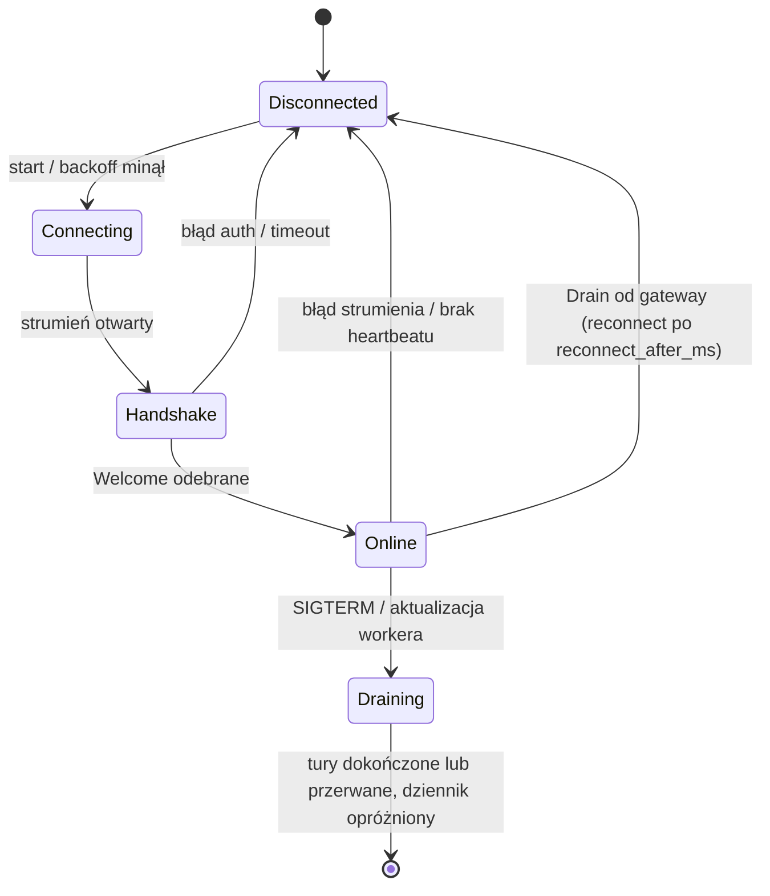
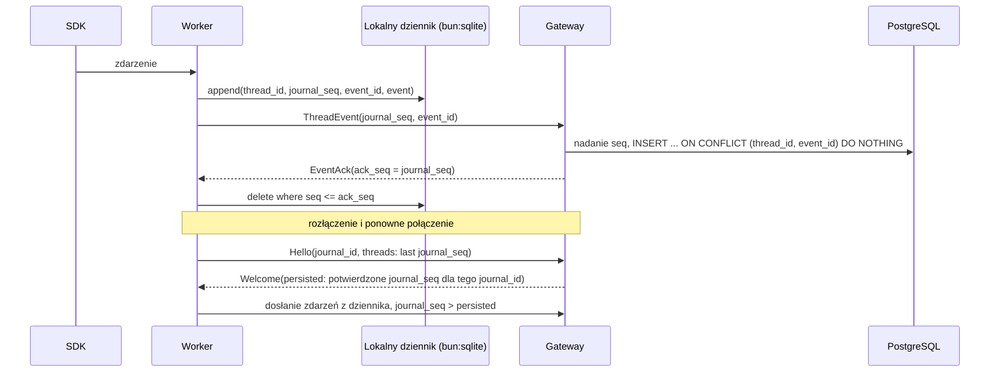

# Protokół gateway ↔ worker

## Ustawienia CLI instancji

Status (2026-11-21) obejmuje edytor wspólnych i lokalnych ustawień Claude,
Codexa i Groka. Dostępność w kanałach wynika z [promocji wydań](release.md).

Worker ogłasza addytywną capability `provider_settings_v1`.
`ProviderProfileConfig.settings_text` (16) przenosi wspólny tekst instancji,
a `settings_override_text` (17) tekst nadpisania tego workera. Worker waliduje
obie warstwy i stosuje nadpisania według kluczy, w Groku wewnątrz tabel TOML. Starszy
worker otrzymuje wyłączony profil tylko dla instancji wymagającej tej
capability, a gateway pokazuje powód z prośbą o aktualizację. Po odnowieniu
łącza z nowszym workerem gateway przesyła zapisaną konfigurację.
Połączone gatewaye ogłaszają tę samą capability w negocjacji swojego łącza,
aby odrzucić zmianę nadpisania, której starszy gateway domu nie potrafi zapisać.
Zasady edycji i lista kluczy są w [konfiguracji workerów](worker-config.md#ustawienia-cli-zapisane-w-canopy).

## Kontynuacja po OOM workera

Status (2026-11-20): worker i gateway obsługują opcjonalną kontynuację rozmowy po potwierdzonym OOM usługi.
Dostępność w kanałach określa [promocja wydania](release.md).

Worker ustawia `TurnFinished.worker_oom_recovery` przy rekoncyliacji tury, którą przerwała utrata usługi z potwierdzonym wynikiem `oom-kill`. Zapisany wynik harnessu i żądanie Stop mają pierwszeństwo. Gateway sprawdza stan wątku i może zakolejkować jedną kontynuację tej sesji. Brak flagi oznacza dotychczasową obsługę przerwania. Starszy gateway może pominąć nowe pole. [Reguły kolejki i rekoncyliacji](durability.md#34-start-po-awarii).

## Powiązanie pobudki Claude z zadaniem w tle

Status (2026-11-21): worker i gateway zapisują pochodzenie wyniku natywnej
pobudki Claude używane w [obserwacjach botów](bots.md#wynik-pracy-kontynuowanej-przez-claude).
Dostępność w kanałach określa [promocja wydania](release.md).

Worker przenosi identyfikator uruchomienia zadania najwyższego poziomu
z `task_started.run_id` do `BackgroundTask.provider_run_id` (233).
Jeśli wynik Claude pochodzi z
`task-notification` i nie wskazuje dołączonej wiadomości klienta, worker przenosi
`origin.runId` do `TurnFinished.background_task_run_id` (9). Pusty ACK
powiadomienia bez pracy modelu nie kończy tury. Gateway zapisuje powiązanie raz
na zakończone zadanie w tym samym wątku, wyłącznie dla tury `provider`.
Jeśli `Hello.running_turns` spowodował przerwanie tej tury, lecz `Hello.threads`
zapowiada zaległe zdarzenia jej wątku, obserwacja może poczekać na odtworzenie
wyniku. Późny wynik z journala zastępuje wtedy przerwanie zapisane przy połączeniu.
Brak pól w starszych wersjach zachowuje dotychczasową obserwację pojedynczej tury.

## Wątki delegowane przez boty

Status (2026-11-19): gateway ustawia `ThreadSpec.has_delegating_bot` przy tworzeniu
i wznawianiu wątku, którego założycielem jest bot. Worker na tej podstawie udostępnia
`message_delegating_bot`. Każdą wiadomość autoryzuje gateway na podstawie bieżącej
tury i zapisanej relacji z botem. Starsze workery pomijają dodatkowe pole i nadal
obsługują automatyczny wynik zakończenia tury. Dostępność według [promocji wydania](release.md).

## Zatrzymanie modułu właściciela

Status (2026-11-18): zaimplementowane w kodzie. Dostępność w kanałach zależy od [promocji wydania](release.md).

Wyłączenie Threads lub Bots wygasza w tej samej transakcji polecenia rozpoczęcia
pracy tego modułu i zapisuje polecenia zatrzymania. Przy wysyłaniu polecenia
gateway ponownie sprawdza ustawienie właściciela oraz blokuje jego wiersz w outboxie
do chwili przekazania ramki na łącze. Spóźnione ACK i ponowne połączenie workera
zachowują wygaszenie również po ponownym włączeniu modułu. Gateway zapisuje
próbę wysłania przed przekazaniem ramki. Wiadomość oczekująca bez próby wysyłki
zachowuje turę i miejsce w kolejce. Po wznowieniu gateway wydaje jej nowe
polecenie. Starszy wpis bez informacji o wysyłce traktuje jak próbę rozpoczęcia.

Dla wątku gateway zapisuje `InterruptTurn` z identyfikatorem rozpoczętej lub
wysłanej tury oraz `UnloadThread`. Worker zwalnia sesję, zatrzymuje zadania
działające w tle i wstrzymuje aktywny cel Codex. Capability
`thread_resource_cleanup_v1` potwierdza pełną obsługę tego sprzątania.
Starszemu workerowi gateway wysyła najpierw `SetGoal(PAUSE)` dla zapisanego celu
Codex i `StopTask` dla zgłoszonych zadań w tle. Wznowienie czeka na ich
potwierdzenie. Usunięcie niezgłoszonych zasobów natywnych wymaga workera
obsługującego pełne sprzątanie sesji. Dla sesji bota
`InterruptBotTurn` anuluje konkretną turę i blokuje jej ponowny start w journalu.
Połączenie odbiera te polecenia po zatwierdzeniu ustawienia, przy kolejnym
heartbeat, jeśli zmianę zapisał inny gateway, albo po powrocie workera online.
Heartbeat dostarcza też oczekującą pracę wznowioną na innej instancji. Gateway
czeka na zakończenie sprzątania przed wysłaniem nowej pracy do tej samej sesji.
Worker przekazuje zaległy journal przed obsługą komend po połączeniu. Gateway
utrzymuje blokadę wątku do zapisania jego zdarzeń odebranych przed odpowiedzią
na `UnloadThread`, również gdy natywny cel rozpoczął turę podczas utraty łącza.

## Szybkość wykonania dostawcy

Status (2026-11-17): zaimplementowane w kodzie; dostępność nightly/beta/stable
wynika z promocji wydań ([release.md](release.md)). Zmiana addytywna,
bez podnoszenia `WORKER_LINK_PROTOCOL`.

Worker ogłasza addytywną capability `service_tiers_v1`. Każde dostarczenie
`StartTurn`, `SteerTurn` i `RunBotTurn` sprawdza ją względem zapisanego wyboru,
także przy odtwarzaniu outboxa po restarcie lub połączeniu starszego workera.
Jawny tryb, również `default` (Standard), bez tej capability kończy komendę
błędem `SERVICE_TIERS_UNSUPPORTED`, zanim trafi ona do workera. Puste pole
zachowuje zgodność ze starszym workerem; w `StartTurn` uwzględniany jest także
wybór odziedziczony z `ThreadSpec`. Odrzucony steer przechodzi do kolejki
z zachowaniem wyboru, a jej start podlega tej samej kontroli.

`ModelInfo.service_tiers` (11) zawiera wiadomości `ServiceTier` z `id`, `name`
i `description`, osobno dla modelu i konta instancji. Identyfikatory, np. `fast`,
`priority` i `ultrafast`, pochodzą z katalogu; gateway nie tworzy listy trybów
na podstawie samej nazwy modelu. Pusty katalog nie uprawnia do przyspieszenia.

`ThreadSpec`, `StartTurn` i `SteerTurn` przenoszą `service_tier` (43). Pusty
wybór wątku oznacza domyślne zachowanie profilu; pusty wybór wiadomości
dziedziczy wątek. Jawne `default` wymusza standardowe wykonanie i pozwala
wyłączyć przyspieszenie odziedziczone z wątku albo sesji dostawcy. Gateway
sprawdza przyspieszenie podczas tworzenia, zmiany i wysyłania oraz przed
startem kolejki. Utrata możliwości kończy turę błędem
`SERVICE_TIER_UNAVAILABLE`, nigdy cichym przejściem na standard.

Wybór jest zapisywany w ustawieniach wątku, turach i steerach oraz w outboxie.
Fallback steer → kolejka zachowuje nadpisanie, także po restarcie. Steer bez
wyboru pozostaje przy działającej turze; adapter, który nie może zmienić
wybranego trybu w trakcie tury, odrzuca steer, a gateway kolejkuje wejście.
Przy zmianie modelu dziedziczone przyspieszenie pozostaje tylko wtedy, gdy nowy
model je oferuje; inaczej nowa tura dostaje jawne `default`, aby wyłączyć też
przyspieszenie zapisane w sesji. Jawny wybór spoza katalogu nadal daje odmowę.
Wątki boczne dziedziczą szybkość w obrębie tego samego konta, według tej samej
reguły modelu.
Fork, kontynuacja w nowym worktree, wątki boczne i nowe wątki harmonogramu
przenoszą wybór. `RunBotTurn.service_tier` (16) przenosi ustawienie bota.

## Statystyki tokenów i kosztów

Status (2026-11-18): zaimplementowane w kodzie; dostępność nightly/beta/stable
wynika z promocji wydań ([release.md](release.md)).

`Usage` zachowuje pola 1–5 i addytywnie dodaje `cache_write_input_tokens` (6),
`reasoning_output_tokens` (7), opcjonalny `reported_cost_usd` (8), `model` (9),
`scope` (10), `requested_service_tier` (12), opcjonalny `estimated_cost_usd` (13)
i `pricing_version` (14). Pole 11 jest zarezerwowane. Szacunek ekwiwalentu API
OpenAI jest niezależny od kosztu zgłoszonego. `pricing_version` jest nieinterpretowanym,
zwartym opisem zamrożonych próbek cennika użytych przez worker dla tego licznika;
gateway zachowuje go w watermarku, bez tabeli odpowiedzi i bez przeliczania starych cen.
`requested_service_tier` opisuje utrwalony wybór wykonania: `default` oznacza
Standard, pusty string brak wiedzy, pozostałe wartości są natywnymi
identyfikatorami bez normalizacji (`priority` nie jest aliasem `fast`).
Nie potwierdza prędkości naliczania opłat i nie dziedziczy bieżących ustawień
wątku. Tożsamość deduplikacji pozostaje niezależna od prędkości; późniejsze
uzupełnienie unknown → known przenosi wcześniejszy wkład bez ponownego naliczenia.
`UsageScope.TURN` oznacza skumulowany pomiar jednej tury
platformy i modelu. Gateway rozlicza przyrost względem ostatniego przyjętego
pomiaru; aktualizacja i koniec tury nie są oddzielnymi porcjami zużycia.
Nie rozlicza starszych raportów bez jawnego zakresu, ponieważ mogły zawierać
sumę całej sesji. Adapter normalizuje zakres przed zapisaniem do journalu.

Input zawiera cache read/write, a reasoning jest częścią output. Odrębny
`ContextUsage` nadal mierzy bieżące okno kontekstu. Brak `reported_cost_usd`
oznacza brak kosztu zgłoszonego; jawne zero jest poprawną kwotą. Pole `cost_usd` pozostaje
dla starszych klientów i nie dostarcza informacji o kompletności wyceny.
Agregaty są zatwierdzane razem ze zdarzeniem przed ACK i przeżywają usunięcie
historii. Nie zmienia się `WORKER_LINK_PROTOCOL` ani zamrożone `update/v1`.
Pomocnicze generowanie zwraca per-modelowe `CommandResult.consumed_usages`
(237), z pojedynczym `consumed_usage` (236) jako fallbackiem. Gateway zapisuje
otrzymane pomiary także przy błędzie komendy i deduplikuje je po jej ID oraz modelu.
Nietrwałe oczekiwanie na wynik `GenerateText` nie odtwarza raportu utraconego
przed odbiorem przez gateway.
`ui.UsageTotals` dodaje `estimated_cost_usd` (9), `unknown_estimated_cost_reports`
(10), `effective_cost_usd` (11), `unknown_effective_cost_reports` (12),
`effective_reported_cost_reports` (13) i `effective_estimated_cost_reports` (14).
Koszt wybrany powstaje per licznik: pełny zgłoszony koszt, inaczej pełny szacunek,
inaczej nieznany. Trzy liczniki źródła wybranej kwoty razem dają `reports`;
nie wolno dodawać dwóch niezależnych wycen. Późniejsza korekta może zmniejszyć
wybraną kwotę, zachowując oba niezależne koszty. Eksport źródłowy przenosi
wszystkie sumy, również wyzerowane koszyki po korekcie szybkości.
Starszy snapshot bez pól 9–14 ma nieznany szacunek i zachowawczo nieznany koszt
wybrany, chyba że wszystkie jego koszty zgłoszone są kompletne.
`ui.GetUsageStatsRequest` dodaje `activity_kind` (5) i `bot_id` (6).
`ui.GetUsageStatsResponse` dodaje `activities` (10), `bots` (11),
`supports_activity_breakdown` (12) i `has_unattributed_usage` (13).
Prywatny snapshot łącza zachowuje dotychczasowy klucz i pełne sumy `UsageBucket`.
Opcjonalne `UsageBucket.activities` (8) rozdziela te same liczniki i zawiera
identyfikatory oraz nazwy botów przypisanych do zużycia. Starszy odbiorca
korzysta z pełnych sum, a starszy snapshot bez podziału daje zużycie nieprzypisane.
Szczegóły: [usage.md](usage.md).

## Postęp tworzenia worktree

Status (2026-11-17): zaimplementowany w kodzie; dostępność nightly/beta/stable
wynika z promocji wydań ([release.md](release.md)). `WORKER_LINK_PROTOCOL` bez zmian.

Worker z capability `worktree_progress_v1` wysyła addytywne `WorkerMessage.query_progress`
dla trwającego `CreateWorktree`. `QueryProgress` zawiera `command_id`, `step`, `status`
i `detail`; kroki to `check_workspace`, `fetch_remote` i `create_worktree`.
Gateway przekazuje raport wyłącznie do oczekującego zapytania na tym samym
uwierzytelnionym łączu workera; obce, zakończone i nieznane komendy są ignorowane.
Raporty nie przechodzą przez outbox ani dziennik zdarzeń i nie potwierdzają wykonania
komendy: ostateczny wynik nadal przychodzi jako `CommandResult`.

Gateway łączy te raporty z walidacją i startem wątku w `CreateThreadWithProgress`
([ui-api.md](ui-api.md#przygotowanie-nowego-wątku)). Starszy worker nadal obsługuje
`CreateWorktree` i dostaje zbiorczy status tworzenia bez szczegółowych etapów.
Fetch jest opcjonalny; brak remote albo nieudane pobranie kończy ten krok jako
pominięty i zachowuje start z lokalnej bazy.

## Domyślne ustawienia narzędzi agentów

Status (2026-11-17): zaimplementowane w kodzie; dostępność nightly/beta/stable
wynika z promocji wydań ([release.md](release.md)).

Addytywne `ThreadSpec.agent_tool_defaults` (522) i
`StartAgentPreview.agent_tool_defaults` (5) przenoszą `AgentToolSessionDefaults`
z ustawień właściciela do workera. Wiadomość zawiera opcjonalne sekcje Browser,
Desktop i Device. Brak sekcji lub wartości oznacza dotychczasowe domyślne zachowanie;
opcjonalne `allow_boot=false` zachowuje jawne wyłączenie. Starsze workery ignorują
nowe pola, a `WORKER_LINK_PROTOCOL` pozostaje bez zmian. Worker zachowuje istniejącą
sesję Browser, stosuje aplikację Desktop tylko jako brakujący cel i nie uruchamia
urządzeń przy biernym Preview. Szczegóły: [automation-tools.md](automation-tools.md#domyślne-ustawienia-sesji).

## Status zmian i pull wątku

Status (2026-11-17): zaimplementowane; dostępność nightly/beta/stable wynika
z promocji wydań. Capability `git_status_v1` dodaje nietrwałe komendy
`GetThreadGitStatus` i `PullThreadOrigin`, obie z `ThreadGitRequest` (id, cwd,
deadline). Wynik `CommandResult.thread_git_status` zawiera liczniki plików i linii,
kompletność odczytu oraz cel i powód blokady pulla. Polecenia nie trafiają do outboxa;
pull używa blokad admission checkoutu i workerowej rezerwacji, tak jak zmiana gałęzi.
Origin aktualizuje checkout wyłącznie przez fast-forward, po sprawdzeniu czystego
statusu przed i po fetch. Starszy worker nie dostaje nowych komend;
`WORKER_LINK_PROTOCOL` pozostaje bez zmian. Szczegóły i limity:
[worktrees.md](worktrees.md#status-zmian-i-pull-z-origin).

## Przełączanie gałęzi i lokalne zmiany

Status (2026-11-17): zaimplementowane; dostępność nightly/beta/stable wynika z promocji wydań
([release.md](release.md)). `WORKER_LINK_PROTOCOL` pozostaje bez zmian.

`SwitchThreadBranch.stash_changes` jest addytywną zgodą użytkownika na zachowanie i przywrócenie
lokalnych zmian. Brak pola zachowuje wymaganie czystego checkoutu. Worker ogłasza
`git_branch_stash_v1`; gateway nie wysyła zgody do starszego workera. Addytywne pole wyniku
`CommandResult.branch_switch_warning` rozdziela zmianę HEAD zakończoną sukcesem od problemu
z odzyskaniem zmian; gateway zapisuje HEAD i notatki także wtedy, gdy stash wymaga ręcznej obsługi.

`workspace_branch_switch_v1` rozszerza tę samą komendę o przełączanie z kompozytora bez istniejącego
wątku. Gateway rozwiązuje id workspace'u i opcjonalnego worktree, nigdy ścieżkę klienta.
Nowe UI RPC to `ListWorkspaceBranches` i `SwitchWorkspaceBranch`; powiązane połączone komputery
wymagają `remote_workspace_branch_switch_v1`, a zgoda stash także `remote_branch_stash_v1`.
`ui.Worker.branch_stash` i `workspace_branch_switch` przekazują capabilities klientom i lustrom.
Szczegóły blokad, odzyskiwania i prywatnego refa: [worktrees.md](worktrees.md#przełączanie-gałęzi-z-podsumowania).

## Konfiguracja użytkownika Claude

Status (2026-11-16): zaimplementowana w kodzie. Dostępność nightly/beta/stable
wynika z promocji wydań; nie zmienia się `WORKER_LINK_PROTOCOL`.

Addytywne `ProviderProfileConfig.user_configuration` (15) przenosi
`ProviderUserConfiguration`: `mode` (1), `source_path` (2), `instructions` (3),
`skills` (4) oraz `hooks` (5). `ProviderConfigurationMode` ma wartości
`UNSPECIFIED=0`, `ISOLATED=1`, `LOCAL=2`, `SHARED=3`. Brak wiadomości i tryb 0
zachowują izolację starszych zapisów. Nadpisanie instancji na workerze jest
opcjonalną całą wiadomością: brak dziedziczy politykę definicji, obecność
zastępuje ją wraz z wartościami `false`.

Worker zachowuje politykę w efektywnym runtime. Sam rozwija `~`, `~/…` oraz
`~\…`; gateway nie interpretuje katalogu domowego innego komputera. Nieprawidłowy
tryb, źródło niebędące katalogiem lub błąd inspekcji ścieżek wyłącza pojedynczą
instancję, pozostawiając pozostałą konfigurację aktywną. Codex/Grok dopuszczają
wyłącznie `ISOLATED`. Capability `claude_user_configuration_v1` potwierdza obsługę
polityki. Dla workera bez niej gateway wysyła profile `LOCAL`/`SHARED` jako
wyłączone i pokazuje wymóg aktualizacji; inne profile nadal działają. Dotyczy to
zarówno konfiguracji początkowej, jak i późniejszych zmian. Żądana polityka
pozostaje zapisana bez zmian. Konfiguracja z aktywną polityką jest wysyłana także
przy zgodnej wersji w `Hello`, aby ponownie zastosować negocjację capability.

`SHARED` wybiera katalog źródłowy jako rzeczywisty katalog sesji Claude.
Prywatny home platformy jest przygotowywany oddzielnie; współdzielony katalog
nie trafia do funkcji przygotowania loginu. Ustawienia są oczyszczane jak
w `LOCAL`, z zachowaniem źródeł project/local i osobnych zgód na instrukcje,
skille oraz hooki. Login nadal wybiera niezależne secure storage.

`ProviderProfile` w `ConfigApplied` dodaje pola `login_home_path` (11),
`configuration_home_path` (12), `session_home_path` (13), `private_home_path` (14).
Gateway przekazuje je właścicielowi w stanie instancji bez odczytywania plików
workera. Starsze raporty mają puste pola. Szczegóły polityki i trwałego
powiązania sesji: [worker-config.md](worker-config.md#konfiguracja-użytkownika-claude).

## Limity kont providerów

`WorkerMessage.provider_usage` (843) przenosi `ProviderUsageReport`: provider,
profil, wersję konfiguracji, niejawny klucz runtime/home i oczyszczony snapshot
okien limitów. Nie zawiera salda, tokenów ani ścieżki CLI home. Gateway utrwala
snapshot po sprawdzeniu właściciela, instancji i bieżącej wersji konfiguracji.
Starsze gatewaye pomijają nowe pole; numer protokołu pozostaje bez zmian.
Źródła, częstotliwość odczytów i ograniczenia kredytów: [provider-accounts.md](provider-accounts.md#limity-planu-i-dodatkowe-użycie).

Harness Grok: `Provider.PROVIDER_GROK = 3`, `WorkerConfig.grok = 640`; używa istniejących komend, eventów, profili native/CLIProxyAPI, zgód i `AgentToolCall`. ACP pozostaje prywatnym protokołem worker ↔ CLI w `packages/grok-acp`; nie rozszerza kontraktu przeglądarki o JSON-RPC. [Adapter Grok](grok-adapter.md).

Status (2026-11-16): zmiana uprawnień bieżącej tury Claude, kanał, handshake, nietrwały interaktywny podgląd wątku i
automatyczny mini podgląd po zatwierdzonych wywołaniach oraz przypisanie uploadu
podglądu do wątku przed zdarzeniem są zaimplementowane
(`apps/gateway/src/worker-link`, `apps/worker/src/gateway-link`);
stan funkcji i plany opisują poszczególne sekcje. Kontrakt: [`proto/canopy/worker/v1/worker_link.proto`](../proto/canopy/worker/v1/worker_link.proto).

### Lokalne narzędzia automatyzacji

Status (2026-11-15): **zaimplementowane**, włącznie z interaktywnym Preview i
automatycznym mini Preview.
Szczegóły funkcji są w [automation-tools.md](automation-tools.md); opis stanu
kodu nie oznacza dostępności w wydaniu. Kanały: [release.md](release.md).

Worker ogłasza addytywną capability `agent_tools_v1` i wysyła
`AgentToolsReport` z wykryciem, przypiętą wersją i gotowością trzech narzędzi.
`probeAgentTools`, `installAgentTool` i `runAgentTool` są bezpośrednimi komendami
diagnostyczno-operacyjnymi: nie trafiają do outboxa ani do ponawialnego zestawu
komend workera. Postęp instalacji wraca jako `agent_tool_progress`; gateway
przechowuje tylko ograniczony, zredagowany log do panelu workera.

Przy tworzeniu wątku i przed startem kolejnej tury gateway owner-scoped dobiera
gotowe narzędzia z grantu workera i wpisuje wyłącznie ich identyfikatory do
`ThreadSpec.local_mcp_tools` (pole 521). Worker rozwiązuje binarkę, uruchamia
stdio i wystawia prywatny endpoint HTTP na loopbackie dla Claude, Codexa albo
Grok. Każdy call MCP wraca do gatewaya jako wewnętrzna autoryzacja bieżącej
tury; gateway sprawdza właściciela, worker, grant i tryb uprawnień przed
wykonaniem. Nie przekazujemy przez ten bridge kluczy modelu.

Po autoryzacji rzeczywistego wywołania lokalnego MCP przez wspólny bridge gateway
publikuje do aktualnych obserwatorów `WatchThread` typowany
`ThreadUpdate.change = automationActivity` (`ThreadAutomationActivity`, proto
`automation_activity = 816`). Pola to `id`, `turnId`, `tool`, `platform`,
`deviceId`, `windowId`, `app`, `target` i `workerId`. Payload zawiera tożsamość
aktywności i bezpieczne selektory celu, bez surowych argumentów, URL-i, tekstu
wejściowego, ścieżek ani sesji wybranej przez klienta. Działa tak samo dla
wszystkich dostawców korzystających ze wspólnego bridge'a; jawna obca sesja lub
nieobsługiwane nadpisanie sesji w MCP tłumi sygnał. Klient sprawdza zgodność
workera ze swoim bieżącym wątkiem przed użyciem aktywności.

Aktywność jest wyłącznie fan-outem na żywo: nie wchodzi do `ThreadSnapshot`,
transkryptu, journala, replayu ani lustra i nie jest zwracana przez catch-up
historii. Nowa strona i przeładowanie nie wywołują mini podglądu na podstawie
starych wywołań. Gateway zachowuje istniejące sprawdzanie właściciela, workera,
grantu, stanu wątku i łącza; mini podgląd używa tych samych limitów Preview, z
limitem klienta 4 klatek na sekundę.
Zasady rozpoznawania celu i przekazania do interaktywnego panelu:
[automation-tools.md](automation-tools.md#automatyczny-mini-preview).

### Interaktywny podgląd wątku

Status (2026-11-17): potwierdzenia klienta web/desktop po narysowaniu klatki
zaimplementowane w kodzie; dostępność kanałów wynika z promocji wydań
([release.md](release.md)).

Capability `agent_preview_v1` dopuszcza `GatewayMessage.agent_preview = 823`
(`AgentPreviewCommand`: start, stop, input, ack) oraz
`WorkerMessage.agent_preview = 823` (`AgentPreviewEvent`: connecting, ready,
frame, error, closed). UI używa `WatchAgentPreview` i `SendAgentPreviewInput`.
To addytywne pola i RPC z wygenerowanymi kontraktami; `WORKER_LINK_PROTOCOL`
pozostaje bez zmian, zamrożone `update/v1` nie jest zmieniane.

Gateway wyprowadza worker i sesję z należącego do właściciela wątku. Klient
wybiera tylko narzędzie i cel (platforma/aplikacja/okno/urządzenie), bez
argumentów komendy ani własnej sesji. Gateway sprawdza grant, capability,
otwarty wątek bez cofania i dokładnie tę samą żywą instancję WorkerLink przy
starcie, wejściu, wysyłce danych i cyklicznie podczas watcha. Nie wymaga aktywnej
tury modelu. Archiwizacja/usunięcie, odebranie dostępu, anulowanie klienta albo
wymiana łącza kończą podgląd; wejście nie trafia do następnego połączenia.

`authorizePreview` wymaga Ready dla Browser/Desktop. Dla Device dopuszcza
odkrywanie celów przed Ready, ale wymaga grantu, zainstalowanego dokładnie
`agent-device` `0.21.37` i braku trwającej instalacji. Worker weryfikuje katalog
i komendy wybranego backendu. Wyjątek nie obejmuje MCP/modelu ani `RunAgentTool`.

| Granica | Kontrakt |
|---|---|
| Sesje | Najwyżej 4 watchy na worker, 64 łącznie w gatewayu; podglądy tego samego celu współdzielą backend workera. |
| Częstotliwość | `max_fps` 1–20, domyślnie 12; faktyczna częstotliwość zależy od backendu i odbiorcy. |
| Klatki | Do 2 MiB PNG/JPEG; wymiary obrazu i viewportu do 8192 na oś. Worker normalizuje obrazy do JPEG o dłuższej krawędzi najwyżej 1600 px. |
| Metadane | Do 32 KiB bez bajtów obrazu, najwyżej 64 cele. |
| Wejście | Do 64 zdarzeń i 32 KiB zakodowanej partii, tekst pojedynczego zdarzenia do 8 KiB, `key`/`code` do 128 B. |
| Wskaźnik | Współrzędne znormalizowane 0–1 względem obrazu bez letterboxingu; skończone delty kółka o wartości bezwzględnej do 100 000, `button` 0–2, maska `buttons` do 7, `modifiers` do 15. |
| Tempo wejścia | Na podgląd: 256 zdarzeń/s, z zapasem na jednorazową serię 256 zdarzeń. |
| ACK i dzierżawa | Jedna niepotwierdzona klatka i najnowsza oczekująca; wyłącznie ACK jej `frame_id` zwalnia następną wysyłkę. Znany ACK, również 0 przed pierwszą klatką, odnawia 15-sekundową dzierżawę. Dla `WatchAgentPreviewRequest.client_ack=true` gateway czeka na `AckAgentPreview` po narysowaniu klatki w UI. Domyślnie potwierdza odbiór kolejnej wiadomości po `yield`. Co sekundę ponawia ostatni rzeczywiście potwierdzony ACK; heartbeat nie potwierdza nieobejrzanej klatki. |
| Trwałość | Klatki, wejście i sterowanie mają wyłącznie przejściowy stan bieżącej sesji: bez outboxa, journala, transkryptu, replay ani lustra komputera. Tymczasowe pliki zrzutów są sprzątane przy zamknięciu backendu. |

Błąd pojedynczej operacji wejścia wraca jako `ready` z `detail` i zwalnia
wejście danego odbiorcy bez zamykania podglądu. `error` i `closed` kończą watch.

Browser odbiera natywny strumień WebSocket `agent-browser` na workerze; Desktop
i Device używają anulowalnych pętli zrzutów. Oba tryby mają ten sam transport
WorkerLink → gateway → BFF SSE, bez wystawiania klientowi portów narzędzia.
Obsługiwane wejście i ograniczenia backendów: [automation-tools.md](automation-tools.md#interaktywny-preview-wątku).

### Trwałe odpowiedzi obrazami

Status (2026-11-19): publikacja, jawny eksport z Temp profilu Windows przez
wbudowanego workera w trybie lokalnym i szybki błąd po utracie połączenia
podczas `show_images` są zaimplementowane. Dostępność kanałów wynika
z [release.md](release.md).

Addytywna capability `thread_image_replies_v1` dopuszcza nietrwałe
`ExportThreadImage` (`Command.export_thread_image = 231`) i
`CommandResult.thread_image_export = 231`. `WORKER_LINK_PROTOCOL` pozostaje 1;
zamrożone `update/v1` nie zmienia się. Starszy worker dostaje jawną odmowę
„Update this computer to show images in Canopy.”, bez wysłania nieznanej komendy.

Gateway sprawdza ownera, przypięcie workera i aktywną turę. Rezerwuje budżet
przed alokacją: 1 transfer na wątek, 2 na worker, 100 obrazów / 200 MiB na turę.
Wywołanie obejmuje 1–10 obrazów, maks. 20 MiB na plik i 50 MiB łącznie;
niższe limity załączników właściciela mają pierwszeństwo. Liczymy większy
z rozmiarów wejścia i wyniku normalizacji. Rezerwacja ma lease 60 s i token
odgradzający wygasłą próbę od nowej; przerwana próba zwalnia niezapisany budżet.

`probe` zwraca sam rozmiar i nazwę. `read` przesyła do 256 KiB na odpowiedź,
z niezmiennym rozmiarem, nazwą i SHA-256; gateway sprawdza hash całości.
Limit bezczynności wynosi 10 s, całości 60 s. `release` usuwa eksport.
Gateway przekazuje tylko katalog bieżącego wątku i jego własny katalog
załączników; worker musi niezależnie sprawdzić zakres oraz tożsamość tury.
Bajty nie trafiają do modelu, outboxa ani journala.

Addytywne pole `ExportThreadImage.allow_local_temp` (9) jest ustawiane przy
jawnym `show_images`, jeśli gateway ma rolę `desktop`, a bieżące Hello
workera zgłasza Windows i `desktop_bundled`. Worker wymaga własnej flagi
trybu lokalnego oraz Windows, sam wyznacza `%LOCALAPPDATA%\Temp` w profilu użytkownika
i bezpiecznie przypina korzeń przy pierwszym eksporcie z tego katalogu.
Pole nie przenosi ścieżki korzenia. Import Markdown pozostawia pole wyłączone.
Starsze workery pomijają to pole i zachowują dotychczasowy zakres.

Gateway rozpoznaje typ z bajtów i używa pipeline załączników: limit 100 Mpx,
normalizacja bez EXIF/GPS/XMP i miniatura WebP do 512 px. Publikacja utrwala
pierwszą klatkę animacji. SVG pozostaje plikiem, nie obrazem galerii.
Limit bajtów wyniku działa podczas kodowania: Unix używa celu plikowego Sharp
do prywatnego FIFO i przestaje gromadzić bajty po przekroczeniu budżetu, Windows blokuje
obowiązkową blokadą pliku zapis od granicy limitu wzwyż. Nie używamy streamu
wyjściowego Sharp, który także tworzy cały wynik w pamięci. Bufory odebranych
fragmentów i końcowa konkatenacja mają rozmiar ograniczony limitem; pamięć roboczą
dekodera/enkodera nadal ogranicza osobny limit pikseli, a nie limit bajtów pliku.
Prywatny cel jest usuwany po zakończeniu lub błędzie natywnego zapisu.
Po przekroczeniu limitu FIFO jest nadal opróżniane bez zapisywania fragmentów,
aby natywny writer nie zablokował się; kodowanie ma timeout 30 s.
Załączniki, `Item.image_gallery = 25`, audyt i wynik `show_images` powstają
w jednej transakcji. Call ID daje ten sam wynik także po restarcie i usunięciu
źródła. Manifest nie zawiera bajtów ani ścieżek workera; przyrostowy sync
korzysta z istniejącej osi czasu. Worker nie może tworzyć ani nadpisywać
gatewayowych itemów galerii przez własne zdarzenia.

Po zamknięciu WorkerLink worker kończy oczekujące jawne `show_images` lokalnym
błędem i usuwa je z kolejki ponowień. Błąd oznacza brak potwierdzenia, ponieważ
gateway mógł zapisać galerię przed utratą odpowiedzi.

Zakończona wiadomość agenta może zawierać lokalne obrazy Markdown. Worker
wysyła wewnętrzne `import_image_reply({item_id})` po zdarzeniu zakończenia
wiadomości, przed końcem tury. Gateway parsuje utrwalony tekst tym samym
lexerem co klienci; pomija kod, HTML i zdalne URL. Ścieżki muszą należeć
wyłącznie do workspace/worktree tej wiadomości. Maksymalnie 10 obrazów
w wiadomości i 100 000 znaków źródła; nadmiar odrzuca całą partię.
Obowiązują te same limity bajtów, rezerwacje i pipeline co dla `show_images`.
Jeśli przejściowy błąd ingestu zwolnił strumień przed zapisem zakończenia
wiadomości, importer czeka do 10 s na ten zapis. Oczekiwanie dotyczy tylko
wywołania importu; pozostałe wątki i odbiór zdarzeń działają dalej.

Manifest trafia do `AgentMessage.images = 3`, a błąd odzyskiwania do
`image_error = 4`. `GalleryImage.markdown_start/end` wskazują zakres UTF-16,
`source_path = 14` oryginalny href tokenu; ścieżka nie uprawnia do odczytu.
Tekst pozostaje niezmieniony, a jedno gatewayowe `item_completed` aktualizuje
istniejący item. Hash tekstu sprawdzany podczas commitu odrzuca zmienione źródło.
Worker nie może dostarczyć własnego manifestu ani komunikatu błędu.

Worker przetrzymuje granicę journala od `turn_finished` do wyniku importu,
bez blokowania tekstu innych wątków. Reconnect nie wysyła tej granicy przed
wynikiem; wywołanie ma stałe ID per wątek/tura/item. Oczekiwanie kończy się
po 65 s lub 256 zatrzymanych zdarzeniach; błąd pozostawia tekst i link do pliku.
Restart procesu przed zapisem kopii może pozostawić tylko link; potwierdzony
zapis przeżywa restart i usunięcie pliku. Wewnętrznego narzędzia nie ma
w katalogach modeli żadnego z trzech harnessów.
### Interaktywne visuals

`render_visual` jest narzędziem szyny ([agent-bus.md](agent-bus.md#3-narzędzia)):
worker przekazuje `AgentToolCall`, a gateway waliduje spec i zapisuje wersję.
Worker ogłasza capability `thread_visuals_v1`; bez niej gateway odpowiada
„Update this computer to show visuals in Canopy.”, a starszy gateway odrzuca
nieznane narzędzie. `Welcome.thread_visuals_v1 = 7` mówi workerowi, że gateway
obsługuje `render_visual`; bez tej flagi worker sam odpowiada „Update Canopy on the
gateway computer to show visuals.” i nie wysyła wywołania. `WORKER_LINK_PROTOCOL` pozostaje 1.

`render_html` korzysta z tego samego RPC i itemu. Worker ogłasza
`thread_html_v1`, gateway `Welcome.thread_html_v1 = 8`. Pole
`Visual.html_document = 10` oznacza źródło JSON `{html}` zamiast spec komponentów;
`kit_version=2` chroni starsze klienty. Limit i zaakceptowane ryzyko sieci
opisuje [agent-visuals.md §9](agent-visuals.md#9-własny-html-render_html).

`Item.visual = 26` (`Visual`) to mały manifest najnowszej wersji: `visual_id`,
`version`, wersje schematu i kitu, tytuł, opis, wysokość, SHA-256 i rozmiar spec.
Spec nie trafia do zdarzeń ani `WatchThread`. Wersja, upsert itemu `visual-<id>`,
zdarzenie `item_completed`, rekord wywołania i audyt powstają w jednej transakcji.
Aktualizacja zachowuje turę i miejsce itemu z wersji 1. Worker nie może tworzyć
ani zmieniać itemów `visual`: takie zdarzenia trafiają do kwarantanny.
`MovedThread.visuals_json = 4` przenosi wersje razem z wątkiem między komputerami.

`AgentToolCall.cancelled` (831) oznacza zakończenie oczekiwania klienta MCP
(timeout lub anulowanie). Worker ponawia tę samą kopertę do `AgentToolResult`, także
po reconnect. Gateway autoryzuje bota/workera i zapisuje anulowanie wywołania oraz
`expired` na oczekującej karcie atomowo z blokadami decyzji i efektów.

Status (2026-11-18): dostarczanie załączników z wyników narzędzi connectorów
zaimplementowane w kodzie. Dostępność zależy od promocji wydań.
`AgentToolResult.attachments = 5` zawiera referencje `InputAttachment` dla workera
z capability `agent_tool_attachments_v1`. Bajty idą osobno przez `FetchBlob`.
Dla wątku worker sprawdza zgodność z wyliczoną ścieżką pod `attachments_root`, rozmiar i SHA-256,
zapisuje plik i dopiero wtedy zwraca modelowi wynik ze ścieżką.
`FetchBlob` bota wskazuje `bot_id` i `bot_turn_id`; pusta ścieżka pozostaje pusta,
a worker dostarcza obsługiwane obrazy jako bloki MCP i ograniczony tekst
z dokumentów. Trwały wynik wywołania przechowuje tekst i referencje.

`InteractionRequest.cancelled` (8) przekazuje analogiczne anulowanie natywnej
interakcji dostawcy. Worker zachowuje kopertę do potwierdzenia, także po reconnect;
gateway zapisuje `expired` i odsyła `InteractionResponse.cancelled`.

Nietrwała komenda `GenerateText` (capability `generate_text`) uruchamia izolowaną generację przez SDK instancji i zwraca `CommandResult.generated_text`, bez platformowej sesji i dziennika. Capability `cancel_text_generation_v1` dodaje nietrwałą komendę `CancelTextGeneration` z identyfikatorem pierwotnego żądania. Wyłączenie Threads przerywa generację na połączeniu workera obsługującego żądanie. Starszy worker zachowuje 30-sekundowy limit. Szczegóły: [thread-titles.md](thread-titles.md).

Nietrwałe `ReadWorkspaceOrigin` (`Command.read_workspace_origin = 216`, capability `workspace_origin`)
odczytuje lokalne `remote.origin.url` workspace'u przez process governor (cache 30 s, limit 2 s).
`CommandResult.workspace_origin = 216` zawiera wyłącznie znormalizowaną tożsamość, bez credentiali.
Brak origin daje pustą tożsamość; błąd komendy zachowuje poprzedni odczyt w gatewayu.
Bez outboxa i journala. Starszy worker nie dostaje komendy; `WORKER_LINK_PROTOCOL` pozostaje 1.
Reguły scalania wyborów: [linked-computers.md](linked-computers.md#tożsamość-projektu-według-git-origin).

Nietrwałe `WorkerMessage.git_heads = 840` (`GitHeads`, capability `git_heads`): bieżąca gałąź albo odłączony
HEAD checkoutów wątków, wysyłane po zmianie pliku `HEAD`, na końcu tury i w pełnym stanie po połączeniu. Gateway
przyjmuje je tylko dla wątków tego workera i rozsyła zmienione wątki. Starszy gateway ignoruje wiadomość,
starszy worker jej nie wysyła; `WORKER_LINK_PROTOCOL` pozostaje 1. Szczegóły:
[worktrees.md](worktrees.md#bieżąca-gałąź).

Nietrwałe `InitRepository` (`Command.init_repository = 217`) i `CloneRepository`
(`Command.clone_repository = 218`), capability `project_sources`: nowy katalog `name` (jeden segment)
w istniejącym bezwzględnym `parent_path`, potem `git init` albo `git clone` z `url` przez process
governor (init: 15 s; clone: 2 min bez postępu i 60 min łącznie). Wynik: rzeczywista ścieżka w `CommandResult.directory_path` (6).
URL z poświadczeniami jest odrzucany; klon używa logowania git urządzenia. Bez outboxa i journala;
starszy worker nie dostaje komend, `WORKER_LINK_PROTOCOL` pozostaje 1.
[Reguły i bezpieczeństwo](linked-computers.md#dodawanie-projektu-na-dowolnym-komputerze).

Addytywna capability `git_clone_progress_v1` włącza `CloneRepository.report_progress` (4),
`WorkerMessage.clone_progress` (841) i `Command.cancel_clone_repository` (226, ID komendy klonowania).
Postęp zawiera rosnący `sequence`, fazę, opcjonalny procent/liczniki/bajty/szybkość oraz snapshot
ostatnich 30 linii stderr. Git działa z `--progress`, parser rozpoznaje także aktualizacje CR i checkout.
Worker wysyła najwyżej jedną ramkę co 250 ms; końcowy flush respektuje to samo okno i poprzedza wynik.
Powtórzenie tych samych liczników nie przedłuża limitu bezczynności. Limit całości to 60 min,
gateway czeka 60 min 15 s, klient/połączony gateway 61 min. Cancel zabija własną grupę procesów git,
czeka na koniec i usuwa tylko utworzony przez tę komendę katalog (sprawdza tożsamość katalogu).
Zerwanie łącza workera i zamknięcie workera również kończy nietrwałe klonowanie.
Log nie trafia do bazy, journala ani outboxa. Worker usuwa sekwencje terminala, znaki sterujące,
URL-e i rozpoznawalne dane logowania; linia ma maks. 500 znaków, wejście bez separatorów też jest ograniczone.
Starszy worker nie otrzymuje flagi ani Cancel; UI pozostaje bez procentu i logu.
`WORKER_LINK_PROTOCOL` nadal wynosi 1; zamrożone `update/v1` pozostaje bez zmian.

Capability `bot_harness_v1` dodaje trwałe `RunBotTurn` i `InterruptBotTurn`.
Bot używa istniejących `ThreadEvent` i ACK (thread_id = bot_id), przechowywanych
oddzielnie od wątków projektowych. `AgentToolCall.bot_id` kieruje MCP do wykonawców
botów w gateway; gateway sprawdza właściciela, przypięcie workera, turę i zgody.
Starsze workery nie dostają tych komend. [Projekt i trwałość](bots-harness.md).

Status (2026-11-17): izolacja rozmów zewnętrznych i wejścia do aktywnej tury
zaimplementowane w workerze; dostępność wynika z promocji wydań.
`bot_conversations_v1` dodaje `RunBotTurn.conversation_id = 16` (UUID);
puste pole zachowuje prywatną sesję. Home i workspace są izolowane per
bot–rozmowa, natomiast journal i autoryzacja narzędzi nadal używają `bot_id`.
Gateway nie może wysłać zewnętrznej rozmowy do starszego workera ignorującego pole.

`bot_steer_v1` dodaje nietrwałe `Command.steer_bot_turn = 833`:
`SteerBotTurn {bot_id=1, turn_id=2, input_id=3, text=4}`. To jednorazowe,
tekstowe wejście do dokładnej aktywnej tury; nie jest ponawiane z outboxa ani
odtwarzane po restarcie. `CommandResult.data_json = 833` zawiera
`{status:"queued"|"delivered"|"unsupported"}`. `queued` nie jest doręczeniem.
Dopiero konsumpcja UUID przez harness daje trwały notice `bot_steer_applied`
z `data_json={"input_id":"…"}`; native RPC acceptance nie wystarcza. Zakończenie
bez dowodu daje `bot_steer_dropped` przed końcem tury. Notice może wyprzedzić
wynik komendy. `delivered` wolno zwrócić dopiero po trwałym `applied`.
Grok zwraca `unsupported`, Claude i Codex używają natywnego wejścia harnessu.
Niepotwierdzony zapis unieważnia cache sesji, a twarda awaria może pozostawić
tylko brak `applied`; gateway zachowuje taką wiadomość i rozstrzyga ją po końcu
tury, bez ponowienia nieznanych efektów. Bez zmiany `WORKER_LINK_PROTOCOL`.
[Szczegóły konsumpcji i odzyskiwania](bots-harness.md#trwałość-i-prezentacja).

`InterruptBotTurn` jest zapisywane razem z zatrzymaniem tury w outboxie gatewaya;
worker potwierdza komendę po zamknięciu jej harnessu. Gateway odrzuca spóźnioną treść
i przed kolejną komendą tej rozmowy czeka na ACK przerwania. Nie zmienia to pól
proto ani `WORKER_LINK_PROTOCOL`. [Semantyka Stop](bots.md#zatrzymanie-odpowiedzi).

## Założenia

### Czasowy tracing diagnostyczny

Capability `diagnostics_trace_v1` dodaje nietrwałe ramki WorkerLink
`diagnostics_trace_command` / `diagnostics_trace_reply` (852) i jawne akcje
`ControlDiagnosticsTrace` / `ExportDiagnosticsTrace`. Jedna lease na komputer
obejmuje wybrany gateway albo jeden połączony worker. Czas 1/5/10 minut
(domyślnie 5), auto-off po monotonicznym deadline, rozłączeniu workera i restarcie.
Stop/eksport wymagają ID aktualnej lease. Sterowanie połączonym komputerem jest
bezpośrednie, owner-scoped; nie przechodzi przez onward ani zbiorcze gather.

Bufor opt-in: 2000 spanów, najwyżej 100 próbek/s i mniej niż 1% operacji
(co 101. zdarzenie, aby uniknąć aliasowania par wait/execution). Numeryczny ring
zajmuje 141 KiB poza zwykłym kolektorem, wewnątrz osobnego limitu tracingu 4 MiB.
Nie przechowuje payloadów, SQL, parametrów, błędów, stosów ani obietnic.
Eksport buduje ograniczoną odpowiedź dopiero po jawnej akcji i jej nie cache'uje.
Zwykłe snapshoty zawierają tylko stan sesji; tracing nie jest utrwalany.
Próbki tracą dostępność najpóźniej 10 minut po końcu sesji. Audyt oddziela start,
stop, expiry, cancel i export, zapisując wyłącznie skalarne metadane.
Starsze workery/komputery nie dostają ramek; capability linku trafia do
`extra_capabilities`, zgodnie z limitem starego handshake. `update/v1` bez zmian.

- **Worker inicjuje połączenie.** Edge device może stać za NAT-em. Nie otwieramy na nim portów.
- **Jeden strumień dwukierunkowy na workera:** `WorkerLinkService.Connect(stream WorkerMessage) returns (stream GatewayMessage)`.
  - w górę: handshake, heartbeaty, transkrypty, wyniki komend, prośby o uprawnienia, wywołania szyny agentów,
  - w dół: komendy, potwierdzenia zapisu, decyzje o uprawnieniach, wyniki szyny agentów.
- **Transport:** gRPC po HTTP/2 + TLS. Reverse proxy przed gateway musi przepuszczać HTTP/2 i długie strumienie (bez krótkich timeoutów bezczynności).
- **Gateway jest źródłem prawdy** o agentach i uprawnieniach. **Worker jest źródłem prawdy** o tym, które katalogi wolno użyć na urządzeniu.

### Transport HTTP/2

Gateway i worker używają ConnectRPC na `node:http2` w Bun; transport obsługuje h2c,
TLS i interoperacyjność z `@grpc/grpc-js` na Node. Przy zamykaniu gateway najpierw
wywołuje `WorkerLink.shutdown()`, potem wysyła GOAWAY przez `session.close()`,
czeka okres karencji i dopiero niszczy pozostałe sesje. Natychmiastowe `destroy()`
urywa trailery `grpc-status`, powodując `Internal: missing status` u klienta.

Strumień wejściowy Connect musi implementować pełny protokół generatora, w tym
`throw`; `AsyncChannel` zwraca ten sam generator przy każdym `[Symbol.asyncIterator]()`.
Błąd certyfikatu connect-node może mieć `Code.Internal`; przyczynę konfiguracji
rozpoznaje się po `error.cause.code`, np. `DEPTH_ZERO_SELF_SIGNED_CERT`.
Klient grpc-js na Node 26 łączący się po IP wymaga `grpc.ssl_target_name_override`
z nazwą certyfikatu. Peer Node w testach jest bundlowany przez
`Bun.build({ target: "node" })`, ponieważ wygenerowane TS zawiera enumy wymagające transformacji.

## Cykl życia połączenia

Capability `workspace_copy_v1` dodaje nietrwałe `Command.workspace_copy` (221)
i wynik o tym samym numerze: scan/read/prepare/write/finish/cancel/release.
Capability `workspace_copy_scope_v2` dodaje `authorize` (8): źródłowy worker
wymusza komplet repozytorium przed odczytem. Manifest dodaje pominięte katalogi (5),
gałąź (6), opcjonalną liczbę nieopublikowanych commitów (7) i zmienione pliki (8).
Wybór klienta dotyczy tylko plików ignorowanych bez zależności i wyniku builda.
Potwierdzane porcje 128 KiB, SHA-256 i ograniczenia współbieżności chronią
strumienie wątków. Komendy i wyniki z plikami omijają outbox i journal.
`WORKER_LINK_PROTOCOL` i UpdateService nie zmieniają się.
Kontrakt i bezpieczeństwo: [workspace-copy.md](workspace-copy.md).

Capability `network_route_migration` dodaje `NetworkRoutes` (adresy + pełny pin) i `NetworkRouteStatus`.
Gateway wysyła trasy po połączeniu, przy zmianie Network access oraz przy heartbeat; starsze workery
nie dostają tych ramek. `WorkerLinkService.ProbeNetworkRoute` sprawdza credential i zgodność worker_id
bez zastępowania aktywnego strumienia. Worker weryfikuje pin przed probe, atomowo zapisuje adres
z kopią i zachowuje pierwotny endpoint na wypadek utraty nowej trasy także po restarcie.
Nieosiągalny Network access nie rozłącza starego workera. Szczegóły: [network-access.md](network-access.md).

Capability `desktop_bundled` ogłasza tylko własny worker aplikacji desktopowej w trybie lokalnym
(`CANOPY_LOCAL_WORKER=1`; zamiast `network_route_migration`). Gateway zapisuje ją w
`workers.capabilities.desktopBundled`, więc pozostaje znana także offline. Znaczenie ma tylko
w roli `desktop`: patrz [updates.md](updates.md#dołączony-gateway-i-worker).
Pola i metoda są addytywne, bez zmiany `WORKER_LINK_PROTOCOL` ani zamrożonego UpdateService.



- **Backoff:** wykładniczy z jitterem, np. 1 s → 60 s. Po `Drain` od gateway worker czeka dokładnie `reconnect_after_ms` (jitter jest już wliczony).
- **Drain gateway:** instancja kończąca pracę wysyła `Drain`, potem kończy strumień statusem OK. Worker łączy się ponownie, zwykle z inną instancją.
- **Drain workera:** `Heartbeat.state = DRAINING`, nowe tury dostają `WORKER_DRAINING`, worker robi half-close po opróżnieniu dziennika. Szczegóły: [durability.md](durability.md).
- **Heartbeat:** worker co `heartbeat_interval_seconds` (domyślnie 15 s). Gateway oznacza workera jako `offline` po 3 brakach.
- **Zamknięcie gateway:** najpierw `WorkerLink.shutdown()` (strumienie kończą się statusem OK), potem `server.close(graceMs)` (GOAWAY, karencja, `destroy`). Bez tego worker dostaje `Internal: missing status`.
- **Tury agentów działają dalej przy zerwanym połączeniu.** Zdarzenia trafiają do lokalnego dziennika i zostaną dosłane.
- **Koniec tury.** `TurnFinished.outcome`: `COMPLETED`, `INTERRUPTED` albo `FAILED`; `source` mówi, kto przerwał (`USER` na prośbę przez platformę, `SYSTEM` zdarzenie systemowe) albo skąd błąd (`PLATFORM` nasza strona, `HARNESS` Codex/Claude), `reason` to powód albo dokładny komunikat, `error_code` krótki kod. Worker bez `source` (starszy): przerwanie = użytkownik, błąd = harness. Turę, której koniec worker przegapił (restart, awaria harnessu), worker rozlicza z transkryptu harnessu i wysyła jej itemy oraz prawdziwy koniec ([durability.md](durability.md#35-rekoncyliacja-z-transkryptu-harnessu)). Błąd, którym Codex odpowiedział na żądanie komendy, ma kod `HARNESS_ERROR` (inaczej `THREAD_ERROR`).
- **Tury w toku po ponownym połączeniu.** `Hello.running_turns` to tury, które proces workera prowadzi teraz (z capability `running_turns`: lista jest pełna). Gateway kończy swoje tury `running` wątków tego workera, których na liście nie ma, jako `interrupted` przez system (`worker restarted`), zamyka ich otwarte itemy i przywraca wątkom `idle`: ich oczekujące interakcje wygasają (`expired`), steery, które do nich nie weszły, idą do kolejki, a kolejka wątku rusza dalej. Spóźniony `turn_finished` takiej tury z dziennika ustawia jej prawdziwy wynik, ale nie zmienia statusu wątku, gdy działa już nowsza tura. Worker bez tej capability (starsza wersja) nie jest oceniany. Szczegóły: [durability.md](durability.md#34-start-po-awarii).

## Uwierzytelnianie

1. Użytkownik generuje w UI jednorazowy token rejestracyjny (TTL 30 min, 32 losowe bajty, w bazie tylko SHA-256).
2. Anonimowy `WorkerEnrollmentService.Enroll` na tym samym porcie gRPC zamienia token i fakty maszyny na `worker_id` i świeży `worker_credential`. Limit: 60 prób/minutę/proces gateway. Utworzenie workera/configu i zużycie tokenu są jedną transakcją; powtórne, wygasłe i odwołane tokeny dostają ten sam błąd bez odbicia wartości sekretu. Właściciel wynika wyłącznie z tokenu.
3. Worker zapisuje je w lokalnym configu z uprawnieniami `0600` (na Windows: ACL tylko dla użytkownika).
4. Każde `Connect` niesie `authorization: Bearer <credential>` w metadanych. Gateway sprawdza hash i czy worker nie jest unieważniony/archiwalny. Rotacja i revoke zamykają obecny strumień i unieważniają handshaki rozpoczęte przed zmianą; stare poświadczenie nie otworzy kolejnego linku. Nie zatrzymuje to lokalnych procesów — trzeba zatrzymać usługę na urządzeniu.
5. Docelowo: mTLS (certyfikat klienta wydany przy enrollment) albo rotowany token krótkotrwały.

Kreator, CLI, konfiguracja adresu gRPC (również Tailscale) i usługi systemd/launchd:
[worker-config.md](worker-config.md#dodanie-maszyny-z-ui).

## Dostarczanie transkryptu (at-least-once + idempotencja)

Status (2026-11-18): gateway grupuje oczekujące delty tekstu przy zapisie. Dostępność według [promocji wydań](release.md).



Zasady:

- `journal_seq` nadaje worker (kolejność w jego dzienniku, do potwierdzeń). `seq` na osi czasu wątku nadaje gateway przy zapisie, wspólny dla zdarzeń workera i platformy (każdy wątek numeruje od 1, także fork).
- Kursory `journal_seq` są ważne tylko w obrębie `Hello.journal_id`. Nowy dziennik (np. reinstalacja workera) oznacza dosłanie wszystkiego; duplikaty odrzuca `event_id`.
- Gateway zapisuje w jednej transakcji do 32 kolejnych, już odebranych delt `item_delta` pola `TEXT` tego samego wątku i tury (do 256 KiB łącznie dla tekstu i surowego JSON). Pierwszą deltę przekazuje do zapisu bez czekania na następną. Inna wiadomość lub przerwa w numeracji kończy partię. Po zatwierdzeniu transakcji gateway wysyła jeden ACK z najwyższym kursorem i publikuje każde zdarzenie osobno. Boty zachowują potwierdzenia poszczególnych zdarzeń.
- Po nieudanym zapisie partii gateway ponawia zapis poszczególnych zdarzeń w kolejności, aby wyczerpanie prób jednego zdarzenia nie przeniosło sąsiednich delt do kwarantanny.
- Duplikaty po wznowieniu ignoruje klucz `(thread_id, event_id)`.
- Granica zapisu gatewaya zamienia U+0000 oraz niesparowane surogaty UTF-16 na
  U+FFFD (`�`), także w kluczach i wartościach oryginalnego JSON. Prawidłowe pary
  surogatów i dosłowny tekst `\u0000` pozostają bez zmian. Ta sama reguła obejmuje
  projekcje itemów, tekst botów, wyniki komend i wygenerowane tytuły. Stary dziennik
  z taką treścią opróżnia się sam po aktualizacji gatewaya; nie należy go usuwać.
- Inny błąd danych lub ograniczeń PostgreSQL (SQLSTATE klasy `22` / `23`) uruchamia izolację zdarzeń
  w odrzuconej partii. Gateway zapisuje oryginalny protobuf do 256 KiB (powyżej limitu tylko metadane) na 7 dni w
  `worker_event_quarantine`, ostrzeżenie `event_quarantined` w historii oraz kursor
  dziennika w jednej transakcji. Ostrzeżenie zachowuje `event_id`, więc replay nie
  powiela go. Dopiero commit pozwala wysłać ACK. Kolejne zdarzenia są przyjmowane
  bez rozłączania workera. Log zawiera identyfikatory i SQLSTATE, bez treści zdarzenia.
  Boty stosują tę samą kwarantannę i umieszczają ostrzeżenie w zapisywanym tekście tury.
- Archiwizacja nie blokuje wyników istniejącej tury ani zdarzeń między turami.
  Zdarzenia nieznanej tury są izolowane z powodem `archived_thread`, bez tworzenia
  tury. Usunięty wątek nie przyjmuje payloadu: gateway atomowo zapisuje tylko
  kursor i wysyła ACK. Nie dopisuje historii ani kwarantanny i nie przywraca wątku.
- Pozostałe błędy, w tym utrata połączenia z bazą, deadlock i serializacja, są
  ponawiane osobno dla każdego wątku po 250 ms, 1 s i 4 s. Następnie oryginał,
  ostrzeżenie i kursor trafiają atomowo do kwarantanny (`retry_exhausted`). Awaria
  tego zapisu oznacza retry co 30 s bez ACK. Kolejność wątku pozostaje zachowana;
  połączenie i inne wątki działają dalej, bez drainu ingestu.
- Addytywne `Welcome.isolated_event_ingest` (pole 5) sygnalizuje tę obsługę;
  `WORKER_LINK_PROTOCOL` pozostaje 1. Stary worker korzysta z niej bez zmian.
  Nowy worker po drainie starego gatewaya z powodem
  `redelivering events that failed to store` zapisuje lokalne `held_delivery`
  dla wszystkich niepotwierdzonych journali (stary gateway nie podaje winnego
  wątku). Po reconnectach nie wysyła ich replay ani nowych zdarzeń tych wątków,
  lecz zachowuje je na dysku; pozostałe wątki działają dalej. Welcome z flagą
  usuwa blokadę i automatycznie wznawia dostarczanie po aktualizacji gatewaya.
- Zdarzenia między turami (zadania w tle, kompaktowanie, zmiany statusu) mają pusty `turn_id` i są przesyłane tak samo.
- Capability `thread_lifecycle_v1` włącza addytywny `ThreadLifecycle`:
  `Welcome.thread_lifecycle` (pole 6) zawiera snapshot przypisanych wątków
  archiwalnych i usuniętych (`closed_thread_ids`, `replace=true`), a komunikat
  `GatewayMessage.thread_lifecycle` (pole 18) aktualizuje zamknięte i przywrócone
  identyfikatory. Po rejestracji połączenia gateway ponawia snapshot z ochroną
  przed nadpisaniem nowszej zmiany starym odczytem. Worker stosuje Welcome przed
  konfiguracją i blokuje nowe `StartTurn` oraz natywną pobudkę Claude w zamkniętym
  wątku. Zamyka też jego zasoby wykonawcze. Po ponownym otrzymaniu tego samego
  snapshotu zachowuje blokadę przyjmowania pracy i ponawia niedokończone sprzątanie.
  Nowy proces sprawdza istniejące sesje narzędzi dla całej grupy zamkniętych wątków.
  Trwałe `UnloadThread` kończy się
  sukcesem dopiero po zatrzymaniu procesów, sesji i podglądów oraz zwolnieniu
  uchwytów; `THREAD_CLEANUP_PENDING` oznacza ponowienie tego samego polecenia.
  Oczekujące sprzątanie nie wygasa i blokuje nowe starty oraz purge historii,
  także po szybkim przywróceniu. Przywrócenie nie odtwarza zasobów; dopiero
  kolejna wiadomość może ponownie załadować sesję z zachowaną historią.
  Nie wymaga to zmiany wersji protokołu:
  stary worker korzysta z ochrony ingestu gatewaya, a nowy worker ze starym
  gatewayem korzysta z trwałego wstrzymania journali po drainie ingestu.
- Kompaktowanie delt po `item_completed` to decyzja retencji, nie protokołu ([transcript.md](transcript.md#7-retencja)).

## Komendy (gateway → worker)

`RewindThread` wymaga capability `thread_rewind_v1`; nie zmienia numeru
`WORKER_LINK_PROTOCOL`. Gateway odmawia staremu workerowi z instrukcją aktualizacji.
Komenda niesie dokładną sesję i granicę zachowanego prefiksu albo jawny pusty
prefiks. `cancelled_turn_ids` zapisuje trwałe zakazy ponownego StartTurn przed
zatrzymaniem i po zatrzymaniu bieżącej pracy. Wynik `CommandResult.rewind`
podaje nową sesję. Podgląd checkpointu (`preview`) nie wysyła promptu do modelu.
Oryginalna sesja zostaje do undo; żadne pliki nie są cofane bez `restore_files`.

| Komenda | Efekt na workerze | Wynik |
|---|---|---|
| `CreateThread` | Walidacja absolutnego, istniejącego katalogu `cwd` i profilu dostawcy. Nowy wątek u dostawcy albo fork (`ForkSpec`: Claude `forkSession`, Codex `thread/fork`). | `CommandResult` + `thread_ready` (`provider_thread_id`) |
| `StartTurn` | Nowa tura. Wątek jest wznawiany w razie potrzeby (Claude `resume`, Codex `thread/resume`) na podstawie pełnego `ThreadSpec`. Idempotentne po `turn_id`. | `CommandResult` + zdarzenia tury |
| `InterruptTurn` | Przerwanie tury (Claude `interrupt()`, Codex `turn/interrupt`). Zadania w tle działają dalej. | `CommandResult` + `turn_finished` (interrupted); `TURN_NOT_RUNNING`, gdy ten proces tury nie prowadzi (gateway kończy ją u siebie) |
| `UnloadThread` | Zatrzymanie pracy wątku i zwolnienie jego procesów, sesji, podglądów oraz uchwytów. Historia zostaje; przywrócenie samo nie uruchamia zasobów. | `CommandResult` po zakończeniu sprzątania |
| `SteerTurn` | Dołączenie wejścia do tury w toku (Claude strumień wejścia, Codex `turn/steer`). Idempotentne po `input_id`. | `CommandResult` (`STEER_NOT_RUNNING` / `STEER_REJECTED`) + item `user_message` z `client_id = input_id` |
| `ListModels` | Lista modeli od nowa (bez pamięci podręcznej workera), opcjonalnie jednego dostawcy i profilu. | `CommandResult.models` |
| `StopTask` | Zatrzymanie zadania w tle lub subagenta w tle (Claude `stopTask`, Codex zakończenie procesu / `closeAgent`). | `CommandResult` + item `interrupted` |
| `BackgroundItem` | Przeniesienie pracy pierwszoplanowej do tła (Claude `backgroundTasks`). | `CommandResult` |
| `ListDirectory` | Listowanie dowolnego dostępnego katalogu absolutnego (wybór workspace); pusta ścieżka = home workera. | `CommandResult.entries` + `directory_path` |

- Każda komenda ma `command_id`. Worker pamięta ostatnio przetworzone ID i nie wykonuje ich drugi raz.
- Ponowione `StartTurn` dla tury zapisanej w dzienniku jako rozpoczęta lub przerwana dostaje pomyślny ACK bez uruchamiania zasobów, również po restarcie workera i dla nadal zamkniętego wątku.
- `StartTurn` czeka per wątek za jego działającą turą; do rzeczywistego startu pozostaje bez ACK w trwałym outboxie gatewaya. Odmowa `TURN_ALREADY_RUNNING` oraz dokładny komunikat starszego workera `THREAD_ERROR: a turn of this thread is already running` powodują wewnętrzne ponowienie z nowym `command_id` i tym samym `turn_id`, bez nieudanej tury w UI. Nie zmienia to proto ani `WORKER_LINK_PROTOCOL`.
- `InterruptTurn` dla tury, której worker nie prowadzi (np. zginęła z poprzednim procesem): `TURN_NOT_RUNNING`; gateway kończy turę jako `interrupted` („the turn was no longer running on the worker”) i uruchamia kolejną z kolejki.
- `thread_ready.replaces_provider_thread_id`: worker zaczął nowy wątek dostawcy zamiast wznowienia (Codex: wątek bez żadnej tury nie ma rolloutu). Gateway podmienia `provider_thread_id` tylko wtedy, gdy zapisany jest ten zastępowany i żadna tura wątku jeszcze nie wystartowała (trigger `threads_before_update`).
- Gateway czeka na `CommandResult` z timeoutem (np. 10 s). Brak odpowiedzi to błąd w UI, nie cicha porażka.
- Komendy są trwałe: outbox w PostgreSQL z `expires_at` zależnym od typu. Po `Welcome` gateway dosyła niepotwierdzone komendy, worker deduplikuje po `command_id` (pamięta wyniki). Przeterminowana komenda kończy się błędem w UI. Szczegóły: [durability.md](durability.md#42-outbox-komend).
- `WORKER_DRAINING`: worker w trakcie zatrzymania nie przyjmuje nowych tur. Komenda zostaje w outboxie i trafi do workera po restarcie.

## Interakcje z użytkownikiem (zgody, pytania, formularze)

1. Dostawca czeka na człowieka: zgoda (Claude `canUseTool`; Codex `item/commandExecution|fileChange|permissions/requestApproval`), pytanie (Claude `AskUserQuestion`; Codex `item/tool/requestUserInput`) albo elicitation MCP.
2. Worker wysyła `InteractionRequest` (`kind`, `item_id`, `turn_id` pusty, gdy pyta zadanie w tle po turze) i wstrzymuje dostawcę.
3. Gateway zapisuje `interaction_requests`, dodaje item `interaction_prompt` na oś czasu i powiadamia UI.
4. Użytkownik odpowiada. Gateway wysyła `InteractionResponse`.
5. Worker zwraca odpowiedź dostawcy (Codex: `accept` / `acceptForSession` / `decline` / `cancel`).

Zgody, pytania i formularze nie mają własnego terminu odpowiedzi: czekają do decyzji albo zakończenia tury lub zatrzymania wątku. Samo zerwanie połączenia z gateway nie oznacza odmowy ani wygaśnięcia, dopóki tura nadal działa na workerze. Po `Welcome` ten sam proces workera ponownie wysyła oczekujące interakcje z tym samym `request_id`; gateway zachowuje jeden item na osi czasu. Odpowiedź zapisana w gateway podczas rozłączenia lub utracona w drodze jest odsyłana z bazy po ponowieniu prośby, a worker przekazuje ją dostawcy tylko raz. Szczegóły: [execution.md](execution.md#6-interakcje-z-użytkownikiem).

## Praca w tle i subagenci

- `InterruptTurn` przerywa tylko turę; zadania w tle zatrzymuje `StopTask`. `BackgroundItem` przenosi pracę pierwszoplanową do tła, a `SteerTurn` dołącza wejście do tury w toku.
- Dostawca może sam zacząć turę (`TurnStarted.trigger = PROVIDER | RECOVERY`), wtedy `turn_id` nadaje worker.
- `ThreadActivity` opisuje turę w toku, zadania w tle i oczekujące interakcje.
- Szczegóły: [execution.md](execution.md).

## Konfiguracja zdalna

- Po `Welcome` gateway wysyła `WorkerConfig`, jeśli `Hello.config_version` jest inna (po starcie procesu zawsze 0). Zmiany wysyła na żywo (`pushConfig`).
- Worker waliduje na urządzeniu i odpowiada `ConfigApplied` (`applied`, `issues`, wykryci dostawcy, dostępność profili). Błąd krytyczny = worker zostaje przy poprzedniej konfiguracji.
- Lokalnie worker ma tylko połączenie z gateway. Szczegóły: [worker-config.md](worker-config.md).

## Modele, effort i steer

**Katalog modeli.** Po każdej zastosowanej konfiguracji (i ponownie po połączeniu) worker wysyła `ModelCatalog`: dla każdej pary dostawca + profil listę `ModelInfo` (`id`, `resolved_model`, nazwa, `hidden`, `legacy`, `is_default`, `efforts`, `default_effort`) albo `detail`, gdy lista jest niepełna. Bez tury modelu:

- Codex: `model/list` app-servera (katalog wbudowany, ten sam dla każdego dostawcy modeli, ze stronicowaniem i `includeHidden`). Profil CLIProxyAPI dodatkowo pyta pośrednika (`GET /v1/models`): zostają modele katalogu, które pośrednik obsługuje, a jego pozostałe zgodne modele dochodzą bez danych o wysiłku.
- Claude: `Query.supportedModels()` zapytania bez promptu (Claude Code startuje i odpowiada na żądania sterujące, model nie jest wołany, ok. 0,5 s). Z profilem CLIProxyAPI Claude Code sam dołącza modele pośrednika (`CLAUDE_CODE_ENABLE_GATEWAY_MODEL_DISCOVERY`).
- Grok: ACP `initialize`, `_meta.modelState.availableModels`; nazwy i wysiłki pochodzą z CLI. Profil CLIProxyAPI przecina listę z `GET /v1/models` i dołącza pozostałe zgodne modele Grok bez zgadywania wysiłku.

**Nazwy i starsze modele.** Worker zachowuje `id` aliasów, żeby zapisane wybory dalej działały. Dla Claude wyprowadza konkretną nazwę (np. `Claude Opus 5.5`) z `resolvedModel`, a następnie konkretnego id; gdy SDK podaje wersję tylko w nazwie lub opisie, odczytuje ją stamtąd. Mały formatter rozpoznaje strukturę id, bez tabeli wersji i bez stałego celu aliasu. Bez wersji w danych zostaje nazwa SDK albo id. Codex i Grok zachowują nazwy katalogu; dodatkowe modele proxy używają `display_name` lub `displayName` z listy modalności, a bez nich formattera id.

Okno kontekstu Claude worker odczytuje także z aliasu i metadanych SDK, nawet gdy `resolvedModel` je pomija; wariant ma krótki dopisek, np. `Claude Opus 5.5 · 1M context`. Przed klasyfikacją starszych modeli worker scala w każdym katalogu (także Codexa, Groka i proxy) wiersze o tej samej konkretnej nazwie i wariancie, zawsze w obrębie jednej instancji (`classifyInstanceCatalogs`): natywna instancja i instancja przez proxy mają osobne wiersze z własnymi id, nawet przy tej samej nazwie. Jawny alias ma pierwszeństwo przed `default`, a widoczny, bieżący wiersz przed ukrytym lub starszym; status domyślny przechodzi na zachowany wiersz. Pozostałe id trafiają do `ModelInfo.aliases` (pole 10), bez zmiany zapisanych wyborów ani id zachowanego wiersza. Gateway nadal waliduje te aliasy i ich wysiłki, a picker wskazuje jeden zachowany wiersz; ulubione i reguły widoczności uwzględniają także scalone aliasy.

Pole `legacy` jest niezależne od `hidden`: wynika z `hidden`/`upgrade`/`upgradeInfo` katalogu Codexa albo obecności nowszej wersji tej samej rodziny i wariantu w katalogu danego profilu. Inne rodziny, warianty i okna kontekstu nie są ze sobą porównywane. Picker pokazuje samą nazwę, skrót, gwiazdkę i zaznaczenie; starsze modele trafiają do zwijanej grupy „Legacy models” z liczbą modeli. Ten sam model nie trafia jednocześnie do listy głównej i grupy starszych modeli. Wyszukiwanie obejmuje również opisy i starsze modele bez rozwijania grupy; ulubione pozostają bezpośrednio dostępne. Ukrycie przez dostawcę lub użytkownika nadal obowiązuje; model ukryty przez dostawcę można jawnie pokazać w ustawieniach. Settings → Providers pokazuje nazwę i id bez opisu.

**Zgodność z harnessem przez proxy.** Wspólny endpoint modeli nie jest wspólną listą wyboru. Worker rozpoznaje rodzinę po rzeczywistym id lub nazwie z proxy, a dopiero potem po `owned_by` (jedno konto może obsługiwać kilka rodzin). Claude dostaje modele Anthropic, Grok modele xAI, a Codex modele OpenAI i xAI przez Responses. Jeśli proxy podaje `supported_endpoint_types`, wymagany jest odpowiednio `messages`, `chat_completions` lub `responses`; jawny brak właściwego protokołu wyklucza model. Nieznana rodzina może trafić do Codexa tylko z jawną obsługą Responses. Bez tej opcjonalnej metadanej stosowana jest mała lista zgodnych rodzin, bez listy konkretnych modeli. Modele Claude i Gemini nie są automatycznie dodawane do Codexa. Syntetyczne aliasy discovery Claude nie są dowodem rodziny: worker dopasowuje je do rzeczywistego katalogu proxy, a nierozpoznane pomija. Ręczne modele instancji i zapisane wybory pozostają dostępne dotychczasową ścieżką.

**Tylko modele agenta.** Katalog nie zawiera modeli, które nie poprowadzą tury agenta (generowanie obrazów i wideo, TTS i mowa, embeddingi, moderacja, realtime, transkrypcja): worker je usuwa (nie `hidden`), więc nie ma ich w pickerze, a gateway odrzuca je przy walidacji z katalogiem. Rozstrzyga `isAgentModel` (`apps/worker/src/providers/models.ts`):

1. metadane źródła: pośrednik CLIProxyAPI podaje modalności tylko w liście w stylu Gemini (`GET /v1beta/models`: `supportedOutputModalities`, `supportedGenerationMethods`; `GET /v1/models` ma tylko `id` i `owned_by`). Model agenta = wyjście wyłącznie tekstowe i metoda `generateContent`. Brak tej listy nie psuje katalogu (zostaje krok 2);
2. bez modalności: słowa w nazwie (id albo nazwa wyświetlana): `image`, `imagine`, `imagen`, `dall`, `sora`, `veo`, `video`, `tts`, `voice`, `audio`, `speech`, `transcribe`, `transcription`, `whisper`, `realtime`, `embed`, `embedding(s)`, `moderation`, `rerank`, `music`, `lyria`.

Modele czatu zgodne z harnessem pozostają także bez danych o wysiłku (puste `efforts`). Wbudowany katalog Codexa (`model/list`) to modele agenta Codexa; dodatkowe modele proxy muszą przejść zarówno filtr modalności, jak i rodziny/protokołu. Metadane proxy dla Claude są dopasowywane po id, `resolved_model` albo nazwie wyświetlanej.

**Domyślny wysiłek** (`default_effort`) to domyślny wysiłek ustawiony przez właściciela urządzenia w harnessie, jeśli model go oferuje (jest w `efforts`), inaczej własny domyślny modelu, inaczej pusty. Wątki platformy działają z izolowanymi katalogami domowymi (Claude bez ustawień użytkownika), więc same harnessy tych plików nie czytają: robi to worker (`providers/default-effort.ts`, tylko odczyt, przy każdym listowaniu i każdej turze) i wysyła tę wartość z turą bez własnego wysiłku. Kolejność:

| Dostawca | Źródło (od najważniejszego) | Domyślny modelu |
|---|---|---|
| Codex | `config.toml` urządzenia (`$CODEX_HOME` procesu workera, inaczej `~/.codex`): `[profiles.<profile>].model_reasoning_effort` dla profilu wybranego przez `profile`, potem `model_reasoning_effort` | `defaultReasoningEffort` z `model/list` |
| Claude | `CLAUDE_CODE_EFFORT_LEVEL` w środowisku workera (Claude Code też je dostaje i tam wygrywa ze wszystkim, także z wybranym wysiłkiem; `auto` / `unset` = domyślny modelu), potem `settings.json` urządzenia (`$CLAUDE_CONFIG_DIR` procesu workera, inaczej `~/.claude`): `modelSettings.<model>.effortLevel` (to zapisuje `/effort`; klucz pasuje też do wersji z datą i `[1m]`), potem `effortLevel` | brak: Claude Code go nie podaje (`ModelInfo` w SDK 0.3.316 nie ma takiego pola; CLI 2.1.316 bierze go z własnego katalogu modeli, inaczej `high`) |

Nieczytane, bo zależą od folderu wątku, a katalog jest per worker: projektowy `.codex/config.toml`, ustawienia projektu i lokalne Claude (`.claude/settings*.json`), a także warstwy systemowe i zarządzane (`/etc/codex`, managed settings Claude, `maxEffortLevel`). Nieczytelny plik = brak ustawienia. Profil workera (native albo CLIProxyAPI) nie zmienia tego wyboru: ustawienie harnessu dotyczy wszystkich jego profili.

Gateway zapisuje ostatni katalog workera (`worker_model_catalogs`) i odświeża go komendą `ListModels`.
Odczyt katalogów wymaga właściciela z kontekstu gatewaya i obejmuje tylko jego
niezarchiwizowane workery oraz workery współdzielone (bez właściciela). Dotyczy to
także powiadomień o zmianach modeli instancji i konfiguracji dostawców. W magazynie
pominięcie listy workerów oznacza wszystkie dostępne temu właścicielowi; jawna
pusta lista zwraca zero katalogów.

**Modele instancji.** Użytkownik wybiera modele instancji widoczne w pickerach, ulubione (pierwsze, w swojej kolejności) i własne id modeli; gateway oznacza pozostałe jako `hidden` w `ListModels` i `OverviewUpdate.models`, dokłada własne modele i układa ulubione na początku; pełny katalog daje `ListModelsRequest.unfiltered`, a walidacja używa pełnego katalogu z własnymi modelami ([worker-config.md](worker-config.md#93-modele-w-pickerach)).

**Model i wysiłek tury.** `StartTurn.model` / `effort` to wartości rozstrzygnięte przez gateway (nadpisanie z wiadomości, inaczej domyślne wątku). Codex dostaje je w `turn/start`, zawsze jawnie: bez wyboru domyślny model katalogu i jego `default_effort` (wyżej), bo nadpisanie w Codexie obowiązuje także kolejne tury. Claude dostaje `model` i `effort` w `query()` (`low | medium | high | xhigh | max`; inna wartość = błąd startu tury); bez wyboru skonfigurowany domyślny wysiłek dla tego modelu, jeśli jest.

**Tryb uprawnień tury.** `StartTurn.permission_mode` to tryb rozstrzygnięty przez gateway, zawsze ustawiony: nadpisanie z wiadomości (`SendMessage.permission_mode`), inaczej domyślny wątku (`ThreadSpec.permission_mode`, zmieniany przez `UpdateThread`). Tura zapisuje go w `turns.permission_mode` (w kolejce: nadpisanie albo pusty). `UNSPECIFIED` (starszy gateway) = tryb wątku. Steer dołącza do tury w toku z jej trybem; nadpisanie steera obowiązuje, gdy wiadomość wraca do kolejki. `UpdateThread` i wybór kolejnej wiadomości nadal dotyczą następnych tur; osobne `UpdateTurnPermissions` zmienia bieżącą turę Claude.

**Zmiana podczas tury Claude.** Capability `claude_live_permissions_v1` dodaje nietrwałą komendę `Command.update_turn_permissions` (20), z dokładnymi `thread_id`, `turn_id` i `permission_mode`. Gateway wymaga właściciela, bieżącej tury Claude i połączonego workera; `FULL_ACCESS` nadal wymaga `full_access`. Worker szereguje zmiany w sesji, wyłącza automatyczne zgody na czas zmiany, stosuje sandbox i tryb SDK, a po sukcesie zapisuje `ThreadEvent.turn_permissions_changed` (21) przed wynikiem komendy. Journal odtwarza zastosowany tryb po utracie ACK; gateway aktualizuje tylko wskazaną turę i publikuje jej zmianę. Autoryzacja narzędzi czeka na zastosowanie zmiany. Błąd częściowej zmiany zatrzymuje sesję. Polecenie nie jest ponawiane przez outbox i nie zmienia domyślnych wątku.

`FULL_ACCESS` pozwala rozstrzygnąć oczekujące `PERMISSION` tej tury oraz zgody przychodzące podczas zmiany; pytania i elicitation pozostają bez zmian. Pozostałe tryby nie zatwierdzają wcześniej przechwyconych natywnych operacji, które mogły powstać bez sandboxa. Wyjątkiem jest autoryzacja przyznanej automatyzacji przez bridge: `FULL_AUTO` również zwalnia jej oczekującą zgodę po ponownym sprawdzeniu grantu i tury. Zmiana nie cofa już uruchomionych komend. Codex w używanym protokole nie udostępnia zmiany approval/sandbox w bieżącej turze, a Grok ustawia sandbox przy starcie procesu: ich picker dotyczy następnej tury. `WORKER_LINK_PROTOCOL` i zamrożone UpdateService pozostają bez zmian.

- **Codex:** `turn/start` dostaje `approvalPolicy` i `sandboxPolicy` z tej samej tabeli co `thread/start` (`codexTurnPermissions`), w każdej turze jawnie, bo Codex trzyma nadpisanie także dla kolejnych tur (jak model i wysiłek).
- **Claude:** nowy proces startuje z trybem tury (`permissionMode`, `sandbox`, automatyczna zgoda w `canUseTool`). Proces żywy tylko przez okres karencji po zadaniach w tle kończy się i tura startuje nowy. Proces trzymany przez zadania w tle przełącza się przed turą: `setPermissionMode`, sandbox przez `applyFlagSettings` (wyłączenie tylko jako `sandbox: { enabled: false }`; `sandbox: null` zostawia sandbox ze startu, a z nim automatyczną zgodę na Bash) i automatyczną zgodę `canUseTool`.
- **Kto wybiera tryb:** tylko właściciel wątku przez UI (`CreateThread`, `SendMessage`, `UpdateThread`); szyna agentów nie ma narzędzia do zmiany trybu, a wątki boczne agenta dziedziczą ustawienia wołającego. `FULL_AUTO` we wszystkich harnessach zostaje w sandboxie workspace'u.
- **`FULL_ACCESS` (5):** bez sandboxa i bez pytań; agent czyta i pisze wszędzie, gdzie może użytkownik OS workera, i ma sieć. Pytania do użytkownika (AskUserQuestion, elicitation MCP) nadal trafiają do platformy. Mapowanie per harness: [codex-adapter.md](codex-adapter.md#runtime-wątków), [claude-adapter.md](claude-adapter.md#uprawnienia), [grok-adapter.md](grok-adapter.md#uprawnienia-i-narzędzia-platformy).
  - **Wybór właściciela:** tryb może być domyślnym w Settings → Threads i nadpisaniem per bot. Subagenci domyślnie dziedziczą bieżące uprawnienia rodzica; stały tryb subagentów może je tylko ograniczyć. Model nie wybiera uprawnień nowych wątków ([agent-bus.md](agent-bus.md)). Gateway utrwala wybór na dziecku i stosuje sufit workera; Full access bez capability `full_access` staje się Full auto z wyjaśnieniem `Thread.permission_mode_note`. Nowe wątki harmonogramów właściciela zachowują jawnie wybrany Full access i wymagają workera z capability `full_access`. Harmonogramy konfigurowane narzędziami bota ograniczają Full access do Full auto z wyjaśnieniem w `NewThreadSchedule.permission_mode_note`. Zwykły fork użytkownika nadal zaczyna od Full auto i wymaga ponownego wyboru Full access. Wiadomość agenta do istniejącego wątku działa w trybie tego wątku.
  - **Zgodność workerów:** worker ogłasza capability `full_access`. Gateway odrzuca `FULL_ACCESS` w `CreateThread`, `UpdateThread` i `SendMessage`, gdy worker wątku jest połączony bez niej, a `StartTurn` w tym trybie do takiego workera nie wychodzi: tura kończy się błędem `FULL_ACCESS_UNSUPPORTED` z czytelnym komunikatem (`apps/gateway/src/core/full-access.ts`). Starszy worker nigdy nie dostaje trybu 5, więc nie może go potraktować jak innego trybu. `WORKER_LINK_PROTOCOL` bez zmian (pole addytywne).
  - **Wyłączenie na urządzeniu:** `"full_access": false` w `worker.json` ([worker-config.md](worker-config.md#2-plik-lokalny)): worker nie ogłasza capability i sam odrzuca takie tury (`FULL_ACCESS_DISABLED`).

**Wysiłek a model.** Wysiłek przechodzi przez katalog profilu wątku (`worker_model_catalogs`, `turnEffort` w `apps/gateway/src/store/models.ts`), żeby tura nie niosła wysiłku do modelu, który go nie ma:

| Model tury w katalogu | Wysiłek w `StartTurn` |
|---|---|
| znany, `efforts` pusta | brak (pusty), także gdy wątek ma domyślny wysiłek |
| znany, wysiłek w `efforts` | ten wysiłek |
| znany, wysiłku nie ma w `efforts` | `default_effort` modelu (jeśli jest w `efforts`), inaczej brak |
| nieznany (brak katalogu, id spoza listy niepełnego katalogu) | bez zmian |

Model pusty = model `is_default` katalogu. Tura zapisuje rozstrzygnięte wartości (`turns.model`, `turns.effort`). Ta sama reguła ustala domyślny wysiłek wątku w `CreateThread` i `UpdateThread`; wysiłek podany wprost w `CreateThread`, `SendMessage` albo `UpdateThread`, którego znany model nie oferuje (a ma niepustą listę), jest nadal odrzucany. Pusty wysiłek w `StartTurn` oddaje wybór workerowi (domyślny wysiłek, wyżej): skonfigurowany wysiłek urządzenia (Claude `effortLevel`, Codex `model_reasoning_effort`) idzie tylko wtedy, gdy model go oferuje, więc model bez `efforts` nie dostaje żadnego. Wyjątek: zmienną `CLAUDE_CODE_EFFORT_LEVEL` w środowisku workera Claude Code stosuje sam, poza workerem.

**Steer.** `SteerTurn(thread_id, turn_id, input_id, input)`:

- Gateway może skierować steer także do tury `queued` z `dispatched = true`, zanim dotrze jej `turn_started`. Worker rozstrzyga, czy tura już działa; samo wysłanie `StartTurn` nie oznacza przyjęcia steera.
- `ok` = dostawca przyjął wejście do tury. Miejsce, w którym weszło, to item `user_message` z `client_id = input_id` w tej turze (Codex `turn/steer` z `clientUserMessageId`, Claude `command_lifecycle started`).
- Tura już się skończyła albo nie działa na tym workerze: `STEER_NOT_RUNNING`; dostawca odmówił: `STEER_REJECTED`. Gateway kolejkuje wtedy wiadomość jako następną turę z powodem.
- Claude przyjął wiadomość, ale tura skończyła się bez niej (przerwanie, błąd, brak dalszych zdarzeń przez 60 s po wyniku): `Notice` z `code = steer_dropped` i `data_json {"input_id"}`; gateway też ją kolejkuje.
- Niezależnie od dostawcy koniec tury bez potwierdzonego `user_message` kieruje steer `pending` lub `accepted` do kolejki. Nie wymaga odmowy RPC ani `steer_dropped`; spóźniony ACK nie cofa fallbacku. To samo działa dla tury pobudki szyny agentów lub zadania w tle. `pump` i startowy/okresowy sweep odnajdują takie wejścia także po restarcie gatewaya.

## Komendy powłoki właściciela

Capability `shell_input_v1` rozszerza `WORKER_LINK_PROTOCOL = 1` addytywnie. Gateway odrzuca
wejście dla starszego workera z `SHELL_UNSUPPORTED` i instrukcją aktualizacji; nigdy nie wysyła
surowego `!…` jako zwykłego tekstu. `UserInput.shell_command` oznacza komendę bez `!`,
`shell_input_id` identyfikuje jedno wykonanie, a `shell_result` pozwala ponownie dostarczyć
już obliczony wynik (np. po odrzuceniu steera). `ThreadEvent.shell_input_prepared` niesie
identyfikator wejścia i `ShellResult`: komendę, cwd, status, kod wyjścia, wynik, powód,
znacznik skrócenia i czas. Protokół aktualizacji pozostaje bez zmian.

Worker uruchamia powłokę logowania użytkownika (`$SHELL`, powłoka konta, potem `/bin/sh`;
Windows: `COMSPEC`) w sprawdzonym cwd wątku, przez istniejący governor procesów i helper
zabijający grupę procesów. stdin jest zamknięte (EOF). Środowisko pochodzi z urządzenia,
bez `CANOPY_*`; poświadczenia instancji dostawcy ani gatewaya nie są dodawane.
Komenda jest jawną akcją właściciela, poza polityką zgód agenta. Wejścia botów i szyny
agentów nie interpretują prefiksu `!`.

Limit wykonania wynosi **120 s** od startu procesu; Stop przerywa także shell steer.
Timeout i Stop zabijają całą własną grupę procesów. stdout i stderr są łączone w kolejności
odczytu; procesy pozostawione w grupie są sprzątane także po zamknięciu komendy. Przechwytywanie działa
bez stdin i bez logowania komendy lub wyniku. Zachowujemy pierwsze i ostatnie
32 KiB oraz oznaczamy liczbę pominiętych bajtów środka; pamięć przechwytywania jest ograniczona.
Niezerowy kod wyjścia to zakończona komenda, której wynik dostaje agent. Błąd startu,
timeout i przerwanie kończą wejście z powodem, bez uruchamiania nowej tury harnessu.

Przed startem procesu worker zapisuje atomowo roszczenie `shell_input_id`, wynik prowizoryczny
komendy outboxa i zdarzenie `running` w SQLite. Wynik końcowy trafia najpierw do dziennika,
potem do gatewaya i harnessu. Restart oznacza niedokończone wejścia jako `interrupted`,
zatrzymuje ich zapisane grupy procesów po sprawdzeniu tożsamości procesu (ochrona przed
ponownym użyciem PID) i zamyka otwarte tury. Nie ponawia komend automatycznie.
Utrata łącza lub restart gatewaya korzysta ze zwykłego replay/ack i idempotencji outboxa.

Harnessy Claude, Codex i Grok dostają identyczny tekst z `shellInputText`: oznaczenie wyniku
jawnej komendy właściciela i niezaufanego outputu, komendę i cwd zapisane jako ciągi JSON,
status, kod wyjścia oraz oddzieloną treść stdout/stderr. Surowy prefiks `!` nie trafia do harnessu.

## Profile dostawców

- Profile są w zdalnej konfiguracji (`WorkerConfig.profiles`): to efektywne **globalne instancje dostawców** włączone na tym workerze, jedna na parę (dostawca, id), z nazwą, zmiennymi, flagą `disabled` i środowiskiem uruchomienia (`executable_path`, `home_path`, `shadow_home_path`, `launch_args`, `own_login`); gateway je wylicza z definicji i nadpisań ([worker-config.md](worker-config.md#9-globalne-instancje-dostawców)). Worker raportuje w `ConfigApplied` dostępność, nazwę, wersję CLI i sposób uwierzytelnienia każdej instancji (`version`, `auth`, `authenticated`; bez kluczy i wartości zmiennych).
- `ProbeProviders` (capability `probe_providers`): ponowne sprawdzenie bieżącej konfiguracji, nowy `ConfigApplied` z tą samą wersją. `StartLogin` (capability `codex_device_login`): logowanie ChatGPT kodem urządzenia dla instancji Codexa z `own_login`, wynik `CommandResult.login` (`verification_url`, `user_code`), zakończenie przez kolejny `ConfigApplied`.
- Gateway zapisuje profil per wątek i przekazuje go w `ThreadSpec.provider_profile_id`. Pusty oznacza `native`.
- Worker odrzuca nieznany, niedostępny albo niepasujący do dostawcy profil (`CommandResult.ok = false`).
- Szczegóły: [architecture.md](architecture.md#8-profile-dostawców-i-cliproxyapi).

## Szyna agentów

Wywołania narzędzi szyny (`spawn_thread`, `send_message`, `wait_threads`, ... — [agent-bus.md](agent-bus.md)) z agenta SDK wracają do gateway jako `AgentToolCall`. Gateway:

1. zwraca zapisany wynik, jeśli `call_id` już był wykonany (ponowienie po zerwaniu połączenia),
2. dekoduje argumenty schematem narzędzia i sprawdza reguły (`authorizeBusCall`: drzewo wątków, potomkowie, limity, `hops`) w imieniu właściciela projektu,
3. zapisuje `agent_bus_calls` i wykonuje operację (np. wątek boczny `origin = agent` z turą i komendami do workera),
4. zwraca `AgentToolResult` (tekst dla modelu + `result_json` dla osi czasu).

`spawn_thread` i `send_message` odpowiadają od razu; `wait_threads` trwa najwyżej `timeout_seconds`. Worker nie blokuje przez to innych wątków, bo strumień jest multipleksowany po `call_id`.

## Załączniki

Boty używają tych samych blobów i weryfikacji plików. Addytywne
`RunBotTurn.attachments` / `history_attachments` (12/13) wymagają capability
`bot_images_v1` dla obrazów, `bot_files_v1` dla pozostałych plików.
`FetchBlob.bot_id` / `bot_turn_id` (4/5) zastępują dla nich
`thread_id`; gateway sprawdza właściciela pliku i aktywną komendę tego workera.
Adaptery dostarczają obrazy natywnie, PDF jako dokument Claude albo wyciąg tekstu,
a UTF-8 jako ograniczony tekst, bez udostępniania botom narzędzi dyskowych.
Szczegóły: [bots-harness.md](bots-harness.md#obrazy-użytkownika).

Pliki, które użytkownik dołącza do wiadomości ([ui-api.md](ui-api.md#załączniki)). Gateway trzyma bajty (blob), worker pobiera je, zanim przekaże turę harnessowi.

- `Hello.attachments_root` (+ capability `attachments`): katalog załączników na urządzeniu, `<data_dir>/attachments` (ścieżka absolutna). Gateway zapisuje go z raportem workera (`workers.capabilities.attachmentsRoot`). Pusty = worker bez załączników: `SendMessage` / `CreateThread` z załącznikami do jego wątku są odrzucane z powodem.
- Plik: `<attachments_root>/<thread_id>/<attachment_id>/<nazwa>` (separator według systemu workera, nazwa bez katalogów i znaków sterujących, `safeFileName`). Gateway liczy tę ścieżkę przy przyjęciu wiadomości i wpisuje ją do notatki platformy w tekście tury.
- `StartTurn.input.attachments[]` (`InputAttachment`: `attachment_id`, `sha256`, `size_bytes`, `mime_type`, `name`, `path`, `kind`). Worker przed turą, dla każdego pliku:
  1. liczy ścieżkę sam; inna niż `path` z komendy = błąd ostateczny `ATTACHMENT_UNAVAILABLE` (komenda nie może wskazać innego miejsca),
  2. plik już jest z tym rozmiarem i sha256 (ponowione `StartTurn`) → nic,
  3. inaczej `WorkerMessage.fetch_blob` (`FetchBlob{request_id, thread_id, sha256}`); gateway odpowiada `GatewayMessage.blob_chunk` z tym samym `request_id` (fragmenty po 256 KiB, `last`), albo jednym `BlobChunk` z `error`. Gateway oddaje tylko bajty załącznika związanego z tym wątkiem, którego wątek biegnie na tym workerze,
  4. sprawdza sha256 i rozmiar, zapisuje atomowo (`.part` + rename, pliki `0600`, katalogi `0700`).
  Brak pliku u gateway: `ATTACHMENT_UNAVAILABLE`, ostateczny (tura `failed` z powodem). Zerwane połączenie, uszkodzone bajty, przekroczony czas (120 s na plik): nieostateczny, gateway dostarcza `StartTurn` ponownie.
- Worker offline: wiadomość czeka w kolejce razem z załącznikami (bajty są w gateway), transfer nastąpi przy starcie tury po połączeniu workera. Nowego wątku na workerze offline UI i tak nie wysyła.
- Steer z załącznikami wymaga capability workera `steer_attachments_v1` (rozszerzenie addytywne, `WORKER_LINK_PROTOCOL = 1`). Gateway zapisuje pełne wejście z notatką ścieżek, cytatami i wzmiankami oraz `SteerTurn` w outboxie w jednej transakcji. Worker pobiera i sprawdza pliki przez ten sam `FetchBlob` co przy `StartTurn`, zapisuje je atomowo w katalogu wątku, po czym ponownie sprawdza dokładne id trwającej tury i dopiero wtedy wywołuje steer harnessu. Notatka ścieżek jest zawsze obecna; Codex może dodatkowo dostać natywne obrazy, Claude dostaje tekst ze ścieżkami do `view_image`.
- Koniec tury podczas transferu, odmowa harnessu i brak capability starszego workera zamieniają steer w jedną turę kolejki z tymi samymi plikami i powodem. Steer z kolejki wraca do tej samej tury na swoim miejscu. Ponowienie `client_request_id` zwraca zapisany wynik; outbox i journal obsługują reconnect i restart workera. Grok ACP nie obsługuje wejścia w trakcie tury, więc również z plikami korzysta z tego fallbacku.

### Załączniki w tekście

Użytkownik może umieścić plik w tekście wiadomości (plakietka w kompozytorze, [ui-api.md](ui-api.md#załączniki-w-tekście)). Pozycja to wzmianka `MentionKind.ATTACHMENT` (8): `name` = `attachment_id`, `label` = nazwa pliku, zakres w tekście. Gateway numeruje pliki w kolejności w tekście (umieszczone najpierw, potem reszta), notatka platformy podaje każdy jako `Attachment N: <ścieżka>`, a znacznik w dostarczonym tekście ma postać `[Attachment N: nazwa]`. `UserInput.attachments` mają tę samą kolejność, `UserInput.mentions` zakresy znaczników.

Worker dzieli tekst za znacznikiem każdego umieszczonego obrazu i wstawia tam obraz (`attachments/inline.ts`):

| Harness | Kolejność treści | Obraz | Inny plik |
|---|---|---|---|
| Claude | bloki `text` i `image` jednej wiadomości użytkownika | base64, przeskalowany jak `view_image` (najwyżej 2000 px, poniżej 5 MB base64); nieczytelny zostaje znacznikiem | znacznik + ścieżka w notatce (`Read`) |
| Codex | itemy `text` (każdy z własnymi `text_elements`) i `localImage {path}` w `turn/start` | Codex czyta plik sam | znacznik + ścieżka |
| Grok | bloki ACP `text` i `image` w `session/prompt` | tylko z capability `promptCapabilities.image`, inaczej znacznik | znacznik + ścieżka |

Na żywo Claude (SDK stream-json) i Codex (`turn/start`) poprawnie wskazały liczbę z obrazu „Attachment 2” i „Attachment 1”, gdy dwa obrazy stały między fragmentami tekstu. Grok ma test na skryptowanym CLI. Echo `userMessage` Codexa łączy fragmenty tekstu nowymi liniami, więc worker zastępuje jego tekst tekstem wysłanym (zakresy wzmianek zostają poprawne).

Zgodność: wiadomość bez pozycji działa jak dotąd (notatka bez numerów, Grok dokleja pliki za tekstem). Starszy worker ignoruje nieznany rodzaj wzmianki: dostaje pliki jak dawniej i czytelne znaczniki z numerami z notatki. Bez zmiany `WORKER_LINK_PROTOCOL`. Połączone komputery: capability `inline_attachments` ([linked-computers.md](linked-computers.md#załączniki-w-tekście)).

**Podglądy obrazów (worker → gateway).** Każdy obraz, który widział model (`view_image` platformy, natywne `view_image` Codexa, obraz w wyniku narzędzia, np. `Read` Claude), dostaje podgląd: worker zapisuje go w `<data_dir>/previews/<sha256>` przed zapisem zdarzenia w dzienniku, a przed wysłaniem zdarzenia (także przy ponownym wysłaniu z dziennika po `Welcome`) wysyła `BlobChunk` (`sha256`, `offset`, `data`, `last`, `mime_type`, `thread_id`) raz na wątek i połączenie. Gateway odbiera fragmenty do 256 KiB i sprawdza SHA-256, dozwolony typ i limit 8 MiB. Od pierwszego fragmentu jest 30 s na dokończenie. Wszystkie połączenia jednego workera dzielą 16 buforów i 16 MiB, a proces gatewaya 256 buforów i 128 MiB. Bajty oczekują na zdarzenie w ograniczonym buforze SQL przez 24 h. Pod blokadą żywego wątku gateway sprawdza przypisanie workera i łączy referencję itemu ze zweryfikowanym uploadem. Replay używa itemu utrwalonego w bazie. `BlobChunk.thread_id` ma addytywny numer **8**. Worker bez tego pola używa bufora przypisanego do jego tożsamości i dziennika. Brakujący podgląd nie blokuje zdarzenia (UI pokazuje „preview not available”). Worker sprząta kopie lokalne starsze niż 7 dni przy starcie i co godzinę, z ochroną trwających zapisów i niepotwierdzonych zdarzeń ([transcript.md](transcript.md#obrazy)).

## Wzmianki

`MentionKind.BOT=6` współdzieli zakresy i edytor z wątkami, ale jest obsługiwany wyłącznie
przez rozmowy botów w gateway (`SendBotMessage` / `BotMessage`, pole 450).
`name` to ID bota, `label` to nazwa w znaczniku `@Nazwa`. Nie trafia do workera.

Wiadomość może nieść wzmianki (`UserInput.mentions`, numery od 140; kontrakt i zasady: [ui-api.md](ui-api.md#wzmianki)): zakresy w `UserInput.text`, które gateway już złożył dla dostawcy (notatka platformy, przepisanie dla Claude). Worker:

- Codex: `turn/start` i `turn/steer` dostają tekst z `text_elements` (zakres bajtów UTF-8 i znacznik każdej wzmianki) oraz itemy `skill {name, path}`, `mention {name, path}` (aplikacje, pluginy) i `localImage` (wspomniany obraz). Echo `userMessage` z `clientId` tury albo steera dostaje te wzmianki w `UserMessage.mentions`.
- Claude: sam tekst (komenda już na początku); item `user_message` niesie wzmianki.

Komendy zapytań (wynik nie jest zapamiętywany w dzienniku: ponowione dostarczenie liczy się od nowa):

| Komenda | Efekt | Wynik |
|---|---|---|
| `ListMentionCatalog` (140) | komendy, skille i pluginy dostawcy dla istniejącego folderu (`cwd`, pusty = home workera), bez modelu: Codex `skills/list`, `plugin/list`, `app/list`; Claude `supportedCommands()` | `CommandResult.mention_catalog` |
| `SearchFiles` (141) | wyszukiwanie fuzzy w folderze: `git ls-files --cached --others --exclude-standard` (śledzone i nieśledzone bez ignorowanych), bez gita przegląd do 20 000 wpisów i 12 poziomów bez ukrytych folderów, zależności i dowiązań; lista w pamięci 10 s; najwyżej 200 wyników | `CommandResult.file_search` |

Wyszukiwanie plików jest własne workera (nie Codexowe `fuzzyFileSearch`), bo musi działać na workerze tylko z Claude i w kompozytorze nowego wątku przed wyborem dostawcy, z tymi samymi wynikami dla obu.

## Git worktrees

Status (2026-11-21): zaimplementowano wydłużony limit checkoutu, sprzątanie scalonych lokalnych gałęzi
po archiwizacji i ręczne sprzątanie zweryfikowanego, niedokończonego checkoutu.
Dostępność w kanałach zależy od [promocji wydania](release.md).

Capability `worktrees` i `Hello.worktrees_root` (`~/canopy/worktrees`, `CANOPY_WORKTREES_ROOT` albo `<data_dir>/worktrees`, zob. [worktrees.md](worktrees.md#położenie)): nietrwałe komendy `ListGitRefs` (210), `CreateWorktree` (211) i `RenameWorktreeBranch` (212), wyniki w `CommandResult.git_refs` / `worktree`. Worker sam liczy ścieżkę worktree pod korzeniem i uruchamia gita bez powłoki. Starszy worker bez capability nie dostaje tych komend. Bez zmiany `WORKER_LINK_PROTOCOL`. Szczegóły: [worktrees.md](worktrees.md).

Przy capability `worktree_checkout_deadline_v1` gateway wysyła `CreateWorktree.checkout_start_deadline_ms`
(7, czas Unix w milisekundach) z terminem rozpoczęcia checkoutu. Worker ogranicza przygotowanie
i kolejkę do tego terminu i najwyżej 35 s od odebrania komendy. Uruchomiony Git ma 240 s.
Brak pola zachowuje limit 60 s dla zgodności ze starszym gatewayem.

Capability `worktree_lifecycle`: nietrwałe `ScanWorktrees` (213), `RevealWorktree` (215) i trwałe
`RemoveWorktree` (214). Status obejmuje HEAD, ahead/behind, pliki dirty, niewypchnięte commity,
merged/unchanged i aktywność. Usunięcie weryfikuje pierwotny korzeń, rejestrację git, oczekiwany HEAD
i brak aktywnej pracy. Zmiany lokalne wymagają jawnego potwierdzenia ręcznej akcji. Gateway zachowuje
komendę do wyniku, worker zapisuje zamiar przed usunięciem i wynik w journalu; retry używa tego samego
command id. Opcjonalny wynik `worktree_branch_deleted` opisuje bezpieczne usunięcie gałęzi.

Capability `failed_worktree_cleanup_v1` dodaje nietrwałe polecenie `FailedWorktreeCleanup` (238).
Pusty `expected_cleanup_token` zleca inspekcję zablokowanego wpisu i zwraca token stanu albo
powód odmowy w `CommandResult.failed_worktree_cleanup` (240). Worker zachowuje tożsamość łącza,
którym odebrał polecenie, i sprawdza ją oraz termin ważności przed pracą i przed usunięciem.
Gateway przekazuje ścieżki zapisane dla tego workera, aby worker
mógł porównać również aliasy. Worker chroni ścieżki workspace’ów także bez wątków oraz
ścieżki nieusuniętych, niezarchiwizowanych wątków.
Worker sprawdza zawartość ponownie przed usunięciem. Żadna z tych komend nie trafia do outboxa
ani do dziennika wyników poleceń. Szczegóły są w [worktrees.md](worktrees.md).

Capability `archived_branch_cleanup` pozwala użyć `RemoveWorktree.delete_archived_branch` po sprawdzeniu
wątków w gatewayu. Pole `track_branch_for_cleanup` pozwala zachować dowód usunięcia czystego checkoutu.
Przy późniejszym `CleanupRemovedBranch` (237) worker porównuje żądanie z lokalnym zapisem pierwotnego
usunięcia, sprawdza repozytorium, gałąź i commit. Wynik odróżnia usunięcie, trwałe pominięcie i ponowienie.
Nowy gateway pomija historyczne pole `delete_branch`, a nowy worker ignoruje je w komendach starszego gatewaya.

Skan worktree wykrywa również squash/rebase merge po fetch przez patch-equivalence albo zawarcie
pełnego diffu gałęzi w bazie. `WorktreeStatus.github_repository` zawiera tylko owner/repo z remote.
Gateway może potwierdzić scalony PR przez konektor właściciela z grantem workera i przekazać
`WorktreeTarget.merged_pr_head` + `merged_pr_repository`; worker uznaje je tylko dla dokładnego HEAD
i własnego remote. Konektor oraz poświadczenia pozostają w gatewayu. Pola są addytywne.

## Folder i pliki wątku

Status (2026-11-18): lokalne wskazywanie pliku w menedżerze systemowym,
podgląd dostępnych plików spoza workspace tylko do odczytu i pobieranie
pełnych plików są zaimplementowane;
dostępność nightly/beta/stable wynika z [release.md](release.md).

Capability `thread_file_reveal_v1` dodaje nietrwałe `RevealFile` (236) z `FileRequest`
oraz `Worker.file_reveal` (873). `RevealThreadFile(ThreadFileRequest)` jest dostępne
wyłącznie dla lokalnego BFF desktopu uwierzytelnionego tokenem usługi; gateway
sprawdza dodatni kontekst uwierzytelnienia, rolę `desktop`, właściciela wątku
i `desktop_bundled` w aktualnym Hello workera. Nie przekazuje tej metody do
połączonych komputerów i nie przyjmuje zdalnych tokenów urządzeń.
Worker rozstrzyga ścieżkę w katalogach wątku, z kontrolą granicy po `realpath`;
szerszy zakres odczytu podglądu nie rozszerza tej akcji.
Finder/Explorer wskazuje plik; Linux używa `org.freedesktop.FileManager1.ShowItems`
albo otwiera katalog nadrzędny, gdy interfejs wskazywania nie jest dostępny.
Argumenty trafiają bezpośrednio do procesów, bez interpretacji przez shell.

Capability `thread_file_highlight_v1` dodaje nietrwałe `GetThreadFileHighlight`
(229) oraz wynik `thread_file_highlight` (229). Gateway wyprowadza owner, worker
i cwd z wątku; kontrola ścieżki i hash odczytu obowiązują ponownie na workerze.
Żądanie obejmuje do 200 linii. Opcjonalny szkic do 400 KiB z rewizją służy tylko
jawnemu podglądowi zmian; nie trafia do outboxa, modelu, DB ani synchronizacji.
Przekazanie szkicu przez linked computers wymaga bezpośredniej trasy do domu;
relay dopuszcza wyłącznie odczyt zapisanej treści. Wynik ma do 64 KiB protobuf
z kopertą: hash, rewizja szkicu, numery linii, offsety UTF-16 i zamknięty enum ról,
bez tekstu, HTML i CSS. Niepełny wynik oznacza plain text dla pozostałych linii.

Jeden leniwy wykonawca CPU obsługuje zadanie, cztery czekają. Ładowanie gramatyki
i rozgrzewka na stałym tekście mają osobny limit 10 s; właściwa praca nad plikiem
ma twardy limit 100 ms i miękki 70 ms między liniami. Linia ponad 2000 jednostek
UTF-16 zatrzymuje propagację stanu gramatyki. LRU ma do 8 sesji / 8 MiB źródeł,
128 checkpointów na sesję i TTL 30 s; rozłączenie workera go czyści.

`FileContent` i `ThreadFile` mają addytywne wymiary obrazu, przyczynę odmowy
preview i opcjonalny statyczny PNG. Worker sprawdza nagłówek przez ograniczony
dekoder przed wysłaniem do klienta: najwyżej 16 MP i 2 MiB podglądu. Nie przekazuje
SVG do dekodera obrazu. Starszy worker bez wymiarów pozostawia akcję otwarcia
pliku na komputerze zamiast nieograniczonego dekodowania bitmapy w kliencie.

Capability `thread_directory_v1` dodaje nietrwałe `ListThreadDirectory` (228) oraz
`CommandResult.thread_directory` (228), bez zmiany `WORKER_LINK_PROTOCOL = 1`.
UI podaje wyłącznie id wątku, względny katalog, filtr, rewizję i kursor. Gateway
sprawdza właściciela, wyprowadza worker oraz rzeczywiste `threads.cwd` i kieruje
odczyt do domu wątku. Worker bez capability wymaga aktualizacji. Komenda nie trafia
do outboxa, dziennika ani synchronizacji metadanych.

Capability `thread_files_watch_v1` dodaje nietrwały start/stop
`WatchThreadFiles` (komenda 230) i `WorkerMessage.thread_files_update` (842).
Gateway wyprowadza ownera, worker i cwd z wątku; żądanie obejmuje do 32 względnych
plików/katalogów, tożsamość korzenia i checkpoint. Worker współdzieli koordynator
checkoutu i nierrekurencyjne obserwatory wyłącznie dla tych katalogów, rodziców
aktywnych plików oraz Git HEAD/index. Nie odczytuje rekurencyjnie drzewa.
Najwyżej 8 checkoutów, 32 odbiorców i 32 katalogi na checkout. Ostatni odbiorca
zamyka uchwyty, timer i historię; rozłączenie workera sprząta wszystkie subskrypcje.
Zwolnienie anuluje także start oczekujący w kolejce. Fence jest sprawdzany wewnątrz
operacji szeregowej oraz po asynchronicznej rekoncyliacji; anulowany start nie może
dodać odbiorcy, zostawić uchwytu ani wysłać spóźnionej partii. Capability przechodzi
przez obsługiwane trasy relay tak samo jak samo RPC.

Partia zawiera tylko invalidacje katalogu, zmiany/usunięcia wskazanego pliku albo
zmianę korzenia: do 64 rekordów / 64 KiB, bez źródła i snapshotu. Historia checkoutu
ma do 256 rekordów / 256 KiB; gateway buforuje do 4 partii / 256 KiB na odbiorcę.
Bursty są łączone przez 150 ms. Przepełnienie, obca epoka lub niedostępny replay
dają `revalidate_required`; klient odczytuje tylko widoczny zakres. Nie ma pollingu
dysku, zapisów w bazie, pełnego manifestu ani automatycznego replay mutacji.
Zmiana dysku unieważnia także współdzielony status Git. Workerowy `FILE_CHANGED`
jest mapowany na Connect `Aborted`, więc klient rozpoznaje konflikt po kodzie.

Odczyt zwraca `FileContent.root_identity` / `ThreadFile.root_identity`. Dokument
przechowuje ten checkpoint razem z bazą i szkicem także po zatrzymaniu obserwacji.
Nowy stream lub odczyt innego korzenia blokuje mutacje niezależnie od zgodności
hashy treści; zwykła rewalidacja nie kasuje tego konfliktu. Dopiero jawne porzucenie
i ponowny odczyt przyjmują nowy korzeń. Zapis i usunięcie przekazują addytywne
`expected_root_identity`, sprawdzane ponownie przez worker. Gateway nie przekazuje
tego zabezpieczenia starszemu workerowi bez `thread_files_watch_v1`; wymaga aktualizacji.

Jedna strona obejmuje do 200 bezpośrednich dzieci i 64 KiB protobuf z kopertą;
klienci żądają 100. Iterator natywny ma bufor do 64 KiB i budżet pracy 2 s.
Nie powstaje pełna lista ani rekurencyjny snapshot. Worker utrzymuje najwyżej
8 iteratorów; kursor jest jednorazowy, związany z właścicielem, wątkiem, tożsamością
korzenia, katalogiem i filtrem, wygasa po 30 s. `release` zwalnia go wcześniej,
a rozłączenie czyści iteratory. Zmiana rewizji katalogu lub korzenia daje typowany
błąd i wymaga ponownego odczytu tego katalogu, bez cichego kontynuowania starej listy.

Ścieżki bezwzględne, `..`, NUL, backslash i `.git` są odrzucane. Komponenty katalogu
nie mogą być dowiązaniami. Worker ponownie sprawdza granicę po enumeracji; wpis
symlinka zawiera typ i nazwę bez celu i nie jest rozwijany. Odpowiedź zawiera wyłącznie
ścieżki względne i nieujawniający korzenia hash jego tożsamości.

Iterator jest związany z uchwytem zweryfikowanego katalogu. Na Unix każdy komponent,
także przodkowie kanonicznego korzenia, jest otwierany przez `openat` z `O_NOFOLLOW`;
`fdopendir` i `fstatat(AT_SYMLINK_NOFOLLOW)` używają tego samego deskryptora.
Na Windows uchwyty bez `FILE_SHARE_DELETE` przypinają wszystkie komponenty bez
reparse points; nazwy i metadane zwraca `GetFileInformationByHandleEx` na końcowym
uchwycie. Chwilowa podmiana przodka nie przekierowuje enumeracji. Zakończenie,
błąd, zwolnienie kursora i rozłączenie zamykają wszystkie uchwyty.

Git korzysta z process governora: współdzielony status porcelain, limit 1 MiB,
2 s i cache 2 s, bez procesu dla każdego pliku. Statusy obejmują modyfikację,
dodanie, usunięcie, zmianę nazwy, konflikt, nieśledzone i ignorowane wpisy.
Usunięte nazwy mają osobny typ; ich metadane na iterator są ograniczone do 128 KiB.
Niepełny lub niedostępny status daje `git_status_complete = false` i komunikat;
nie blokuje zwykłego listowania.

Capability `reveal_path`: nietrwała `RevealPath` (220) otwiera katalog wątku menedżerem plików
komputera workera ([worktrees.md](worktrees.md)).

Capability `thread_files_v1`: nietrwałe, nigdy z outboxa `ReadFile` (222), `OpenFile` (223),
`WriteFile` (224) i `DeleteFile` (225) z `FileRequest`; wynik w `CommandResult.file` (222, `FileContent`).
UI woła `ReadThreadFile`, `WriteThreadFile`, `DeleteThreadFile` i `OpenThreadFile` z ID wątku i ścieżką;
względna ścieżka liczy się od `threads.cwd` (`@canopy/domain/thread-files`). Gateway sprawdza właściciela
i wysyła `roots`: katalog wątku, także gdy jest osobnym worktree. Worker rozwiązuje symlinki
i przyjmuje tylko istniejący zwykły plik. Zapis, usunięcie i akcje aplikacji systemowych
wymagają dozwolonego korzenia (`FILE_OUTSIDE_ROOTS`); odczyt podglądu z `workspace`
dopuszcza również dostępne pliki spoza niego.
Starsze komendy bez rozstrzygania podglądu dopuszczają również katalog załączników danego wątku.
Odczyt zwraca do 2 MiB (`truncated`); przekroczenie limitu nie oblicza hasha całego pliku i zwraca pusty
`sha256`. `FileContent.read_only` (19), przekazywane do `ThreadFile.read_only` (20),
informuje o braku prawa zapisu procesu workera (`W_OK`) albo o podglądzie spoza workspace;
nie zastępuje kontroli systemu
plików przy zapisie. Plik tylko do odczytu nie otrzymuje edytowalnego pola.
Podgląd spoza workspace ma pusty `relative_path`, aby nie trafiał do obserwacji zmian,
oraz pusty `sha256`, aby nie udostępniał akcji edycji i usunięcia w istniejących klientach.
Odświeżanie takiego pliku jest ręczne; natywny mobile pokazuje go bez tokenizacji workera.
Pusty `sha256` nie uprawnia do edycji ani usunięcia. Zapis i usunięcie wymagają `expected_sha256` z odczytu; inna treść na
dysku daje `FILE_CHANGED`, więc edycja nie nadpisze cudzej zmiany. `OpenFile` używa `open`,
`explorer.exe` albo `xdg-open`. Połączone komputery przekazują do domu wątku odczyt, zapis i usunięcie, ale nie `OpenThreadFile`: plik otworzyłby się na innym komputerze.

Addytywne `thread_file_preview_v1` dodaje do `FileRequest` `workspace`, `preferred_paths` oraz
`include_binary`. Gateway przekazuje surową ścieżkę i rzeczywiste `threads.cwd`; worker rozstrzyga
nazwę na komputerze wykonującym wątek. Goła nazwa preferuje ścieżki z tego samego turnu (wskazanego
przez `ThreadFileRequest.item_id`), potem plik bezpośrednio w katalogu wątku, potem dokładne dopasowanie
nazwy z `git ls-files --cached --others --exclude-standard`. Hints: maksymalnie 32 ścieżki z 64 elementów
po 64 KiB; podlegają prawom odczytu konta systemowego workera. Lista git ma limit 100 tys. ścieżek, 8 MiB i 5 s; poza git ograniczony
przegląd ma limit 20 tys. wpisów i 12 poziomów. Niepełna lista nigdy nie daje automatycznego wyboru.
`..` i NUL są odrzucane. Odczyt dopuszcza ścieżki bezwzględne poza workspace i `~/…`,
rozwijane na workerze; symlinki wskazują kanoniczny plik po `realpath`.
Uprawnienia odczytu egzekwuje system plików konta uruchamiającego worker (`R_OK` i odczyt pliku).
Nie jest to osobna tożsamość systemowa właściciela Canopy. Wyszukiwanie po nazwie
pozostaje ograniczone do workspace; zewnętrzne dopasowania z hints mają pełne ścieżki.
Zmiana nie dodaje pól proto ani capability; starszy worker zachowuje wcześniejszą odmowę.

Wynik zawiera `resolution` (`FOUND`, `NOT_FOUND`, `DELETED`, `AMBIGUOUS`), `relative_path`, `mime_type`,
`matches`, `searched_paths` i `search_incomplete`; UI dodaje nazwę komputera domowego. `DELETED` oznacza
brak wcześniej otwartej ścieżki przy odczycie z `expected_sha256`, bez twierdzenia, czy plik przeniesiono,
czy usunięto. Zwykłe nierozstrzygnięcie daje `NOT_FOUND`; błąd połączenia lub uprawnień pozostaje błędem.
`include_binary` przesyła również bajty binarne (limit 2 MiB); starszy klient nadal dostaje pustą treść
binarną. Odczyt przez link używa istniejącego strumienia z porcjami 32 KiB, z kontrolą przepływu,
anulowaniem i limitem ponownego złożenia wiadomości. Nie powstaje URL do systemu plików komputera domowego.

Capability `thread_file_download_v1` dodaje `download_range` do `ThreadFileRequest`
(6) i `FileRequest` (10) oraz `download_chunk` do `ThreadFile` (21) i `FileContent` (20).
Pobieranie korzysta z istniejącej komendy `ReadFile`, trasowania do domu
i zakresu odczytu podglądu, wraz z `item_id` przy rozstrzyganiu pierwszej ścieżki.
Pierwsze żądanie ma offset 0 i pustą rewizję. Kolejne wskazują zwróconą
ścieżkę, offset w bajtach i oczekiwaną rewizję. Każda odpowiedź zawiera do
1 MiB surowych bajtów, całkowity rozmiar, offset i rewizję. Worker sprawdza
tożsamość i metadane otwartego pliku po obu stronach odczytu oraz koniec
pliku przy ostatniej porcji. Zmiana rewizji lub liczby bajtów przerywa
pobieranie. Gateway nie wysyła żądania zakresu do starszego workera.
BFF wymaga potwierdzenia obsługi zakresu od domu. Zmiana nie podnosi
`WORKER_LINK_PROTOCOL`.

## CLI dostawców

Status (2026-11-21): zaimplementowane raportowanie i instalacja CLI na żądanie oraz kontrola wersji na workerze dla poleceń z `upgrade_only`.

Capability `cli_install`: worker wysyła `CliToolsReport` (ścieżka, wersja, sposób instalacji każdego CLI) po połączeniu, po `ProbeProviders`, po instalacji i co 6 h; nietrwała komenda `InstallCli` (nigdy z outboxa) uruchamia stały przepis, postęp idzie w `CliInstallProgress`, wynik w następnym raporcie. Bez zmiany `WORKER_LINK_PROTOCOL`. Szczegóły i zasady: [provider-cli.md](provider-cli.md).
Capability `cli_install_upgrade_only` potwierdza obsługę `InstallCli.upgrade_only`: worker sprawdza wersję tuż przed instalacją i zwraca `CLI_ALREADY_CURRENT`, gdy wersja docelowa lub nowsza jest już zainstalowana.

## Środowisko agentów

Capability `agent_environment_v1` dodaje pełny `AgentEnvironmentDesired` oraz
`AgentEnvironmentReport` (pola oneof 820). `Hello.environment_kind` (820) rozróżnia
desktop/server; fakty hosta i dostępne CLI tworzą automatyczne tagi. Starszy worker
nie otrzymuje tych wiadomości. Bez zmiany `WORKER_LINK_PROTOCOL`.

Gateway wylicza instrukcje per właściciel/worker/harness/destination; wysyła pełny
stan po reconnect i zmianach biblioteki, tagów lub domów instancji. Rewizje chronią
przed starymi wiadomościami, checksum pełnego pliku wiąże jednorazowe rozstrzygnięcie
driftu z podglądem właściciela. Raport zawiera tekst wyłącznie zarządzanego bloku
w konflikcie, nigdy prywatny tekst poza nim. Szczegóły: [agent-environment.md](agent-environment.md).

Etap 2 negocjuje dodatkowo `agent_skills_v1`: pola `AgentEnvironmentDesired.skills`
(4), `skill_resolutions` (5) oraz `AgentEnvironmentReport.skills` (3). Artefakty
zawierają niezmienne pliki i manifest SHA-256; raport pokazuje własność, wersję,
każdy docelowy katalog i tylko zarządzane pliki driftu. Resolution jest jednorazowe
i związane z checksumem całego katalogu. Worker bez tej capability nadal dostaje
instrukcje, bez skilli. Szczegóły limitów, katalogów, wersji i odzyskiwania swapu:
[protokół etapu 2](agent-environment.md#umiejętności--konkretny-protokół-etapu-2).

Etap 4 negocjuje `agent_plugins_v1`: `AgentEnvironmentDesired.plugins=6`,
`plugin_resolutions=7`, `AgentEnvironmentReport.plugins=4`. Reużywa koperty
artefaktu/statusu skilla; `skill_id` w raporcie pluginów oznacza ID pluginu,
pusty ID oznacza plik aktywacji. Keep/Overwrite są jednorazowe, import niedostępny.
UI RPC Preview/Save/DeleteMarketplace, Save/DeleteLibraryPlugin i ResolvePluginDrift
są owner-scoped; SaveLibraryPlugin wymaga checksumu jawnej zgody na kod.
Źródła i credentials pozostają w gateway. Bez zmiany `WORKER_LINK_PROTOCOL`.
Szczegóły: [etap 4](agent-environment.md#marketplace-i-pluginy--protokół-etapu-4).

## Kontrola przepływu

- HTTP/2 ma flow control na poziomie strumienia. Dodatkowo worker ogranicza liczbę niepotwierdzonych zdarzeń (np. 1000). Po przekroczeniu buforuje tylko w dzienniku.
- Duże treści (output komendy, diff, obraz) nie są przycinane. Worker wysyła je jako `BlobChunk` (sha256), a zdarzenie wskazuje blob przez `BlobRef` ([transcript.md](transcript.md#5-zapis-po-stronie-gateway)). Zaimplementowane dla podglądów obrazów ([Załączniki](#załączniki)); output i diff są na razie inline.

### Oczyszczanie sesji workera po purge

Status (2026-11-16): zaimplementowane; dostępność według [release.md](release.md).

Capability `thread_storage_cleanup_v1` oznacza addytywną obsługę wiadomości
`GatewayMessage.thread_storage_cleanup = 844`. Gateway wysyła do połączonego workera
partię do 128 dokładnych zakresów po zakończeniu trwałego purge. Zakres ma UUID wątku,
dostawcę, profil i listę identyfikatorów sesji; nie przenosi ścieżek ani decyzji o wieku.
Worker odpowiada tym samym `request_id` dopiero po zatrzymaniu bezczynnych runtime'ów,
sprawdzeniu journala i usunięciu lokalnych plików, a przy częściowej gotowości zachowuje
wszystkie ukończone identyfikatory do końcowej odpowiedzi.

Grant jest trwały lokalnie i nie upoważnia do usuwania podczas aktywnej pracy, oczekujących
zdarzeń ani rekoncyliacji. Worker usuwa wyłącznie zarządzany katalog załączników wątku i
pliki sesji z własnego domu. Globalne sesje, projekty, worktrees, scratch i zewnętrzne domy
pozostają nietknięte. Manifesty kopii importu i nakładające się katalogi źródłowe importu blokują
usunięcie, aby opóźniony purge nie zniszczył później użytej sesji.

Lokalne i zdalne watchy współdzielą `threadWatchRevision`: jeden koordynator
na runtime i właściciela grupuje odczyty rewizji, zachowując interwał każdego watcha.
Heartbeat potwierdza dane wątku i zależności, a checkpoint nadal pochodzi z dziennika
właściciela. Luka, zmiana epoki i źródła spoza wątku wymagają konserwatywnej rewalidacji.
Mechanizm nie wymaga nowego pola proto ani capability. Szczegóły:
[żywotność watchy](linked-computers.md#żywotność-subskrypcji-i-odzyskiwanie).

`thread_watch_coalesce` negocjuje scalanie kolejnych fragmentów tekstu na łączu:
`WatchThreadRequest.watch_coalesce` (810) i początek zakresu `ThreadEventUpdate.first_seq` (810).
Okno 40 ms, limit 16 384 znaków UTF-16 i wymóg ciągłości `seq` ograniczają liczbę ramek
bez zmiany trwałego zapisu zdarzeń. Starsi partnerzy dostają pojedyncze zdarzenia.
Przepełnienie ograniczonej kolejki kończy dany stream `DataLoss`; odzyskiwanie korzysta
z atomowego checkpointu, a luka wymusza snapshot. Limit całego łącza zamyka tylko to
połączenie. Limity i wyjątek dużego snapshotu SSE: [bufory synchronizacji](linked-computers.md#ograniczenia-buforów-synchronizacji).
Nowi klienci sekwencyjni odtwarzają lukę partii od ostatniego atomowego seq,
bez pełnego snapshotu historii. Nieaktualna epoka lub przyszły seq daje ograniczone
okno. `RemoteResponse.thread_failure` (8) przenosi przez łącze wyłącznie kategorię
błędu i rozmiar ramki, obok istniejącego kodu RPC; starsi partnerzy ignorują to pole.
Lustra grupują elementy istniejących repeated fields w fragmenty o budżecie około 32 KiB;
duży pojedynczy element nadal może przekroczyć ten budżet w ramach limitu RPC.
Oddanie pętli I/O co 16 fragmentów odpowiedzi pozwala opróżniać transport podczas dużego snapshotu.

## Wersjonowanie

- Pakiet `canopy.worker.v1`. Zmiany zgodne wstecz: tylko nowe pola i wartości enumów.
- `Hello.worker_link_protocol` (760) i `min_worker_link_protocol` (761) negocjują dodatni zakres protokołu; brak wspólnego numeru oznacza `FailedPrecondition` z czytelnym powodem. Wersja aplikacji z `CANOPY_VERSION` jest niezależna od zgodności protokołu.
- Osobny zamrożony `canopy.update.v1.UpdateService` działa na tym samym porcie również wtedy, gdy WorkerLink odrzuca handshake. Nie importuje wiadomości WorkerLink/UI, pozostaje dostępny na zawsze, przyjmuje tylko addytywne rozszerzenia. Przepływy aktualizacji, auth, mirror i rollback: [updates.md](updates.md).

## Pomiary synchronizacji

`CANOPY_SYNC_METRICS=1` włącza procesowe liczniki `syncMetrics` z `@canopy/transport`.
`snapshot()` zwraca liczbę wiadomości, bajty, wiadomości/s, bajty/s i mikrosekundy CPU
kodowania/dekodowania. Kanały `link.<metoda>.encode/decode` mierzą rzeczywistą serializację
odpowiedzi wewnątrz łącza, przed fragmentacją; rozróżniają snapshoty, delty i heartbeaty watcha.
`bff.sse.encode` obejmuje protobuf → JSON i UTF-8, w tym ramki kontrolne SSE.
Nie obejmuje TLS, nagłówków HTTP/2, kompresji, CPU bazy ani kodowania zewnętrznej ramki LinkFrame.
Liczniki nie przechowują treści, identyfikatorów, nazw komputerów ani sekretów i niczego same nie logują.
Bez flagi nie ma dodatkowej serializacji ani próbkowania CPU.
Po współdzieleniu zakodowanych delt hook `link.*.encode` mierzy także trafienia w cache.
Pierwsze kodowanie do limitu kolejki odbywa się wcześniej, poza tym hookiem; jego koszt
wchodzi do procesowego CPU. Nie traktuj sumy czasów hooków jako całego kosztu kodeków.

Scenariusz opt-in uruchamia dwa gatewaye, dwa fixture workera, sześć zdalnych widoków,
overview obu komputerów, prawdziwy przypięty transport telefonu i most SSE z koalescencją.
Tura emituje 1500 delt co 20 ms, wyniki narzędzi i postęp zadania w tle. Następnie dom restartuje
się z tą samą bazą, zmienia dane offline i odtwarza lustro po połączeniu.
To test protokołu, bez przeglądarki i natywnego runtime telefonu.

```bash
CANOPY_SYNC_METRICS=1 CANOPY_SYNC_BENCH=1 bun run check:tmp tests/integration/sync-performance.test.ts
```

Ustaw prywatny `TMPDIR` na dysku przed uruchomieniem; plik wymaga Dockera i nie jest wykonywany
w zwykłym przebiegu testów. Wynik `CANOPY_SYNC_BENCH` zawiera osobne okna aktywności
i reconnectu oraz czas od zmiany tytułu do zgodności watchy i od startu łącza do zgodności lustra.
`phone.protobuf` liczy ponownie zakodowany rozmiar wiadomości aplikacyjnych, bez ramek Connect;
CPU równe zero oznacza brak pomiaru kodeka natywnego, nie zerowy koszt.
CPU to suma `process.cpuUsage()` wokół synchronicznej operacji w procesie testowym;
wyniki krótkich przebiegów są zaszumione. Porównuj ten sam scenariusz i oddzielaj kanały
encode/decode, żeby nie liczyć tych samych bajtów dwukrotnie. Wyników nie zapisuj w repozytorium.

`CANOPY_SYNC_LEGACY=1` w tym samym scenariuszu wyłącza nowe capability koalescencji
na obu komputerach, zachowując te same limity buforów. Pozwala porównać format protokołu
w jednym checkoutcie. `processCpuMicros` mierzy cały proces dwóch gatewayów i klientów
w oknie aktywności, bez CPU osobnego Postgresa. Liczniki `textDeltas` i `batches` opisują
ramki tekstowe, `deltas` checkpointy; lustro liczy pełną projekcję/deltę tylko na ramce startowej,
a `messages/bytes` obejmują wszystkie fragmenty.

Rozbicie CPU na procesy zapewnia osobny wariant tego samego ruchu:

```bash
CANOPY_SYNC_METRICS=1 CANOPY_SYNC_PROCESSES=1 bun run check:tmp tests/integration/sync-process-performance.test.ts
```

Dom, komputer oglądający i most BFF działają w trzech procesach Bun. Każdy raportuje
`process.cpuUsage()` w około 30-sekundowym oknie aktywności i osobnym oknie 10,2 s
po turze, wraz z p99 i maksimum opóźnienia pętli zdarzeń. Gateway zawiera fixture workera;
kontroler, czytniki watchy, klient telefonu i PostgreSQL nie wchodzą do sumy tych trzech
procesów. To rozbicie i pomiar jednoprocesowy mają różne granice; nie porównuj ich sum
bezpośrednio. Powtarzaj pomiary na tym samym dev, tym samym fixture i bez profilera
dla tabel CPU. Przy porównaniu wersji przenieś wyłącznie fixture i definicje liczników.

`CANOPY_SYNC_PROFILE_DIR` wskazuje prywatny katalog na profile. Fixture uruchamia każdy
z trzech procesów z `bun --cpu-prof --cpu-prof-md`; profile obejmują także start i teardown,
a raportowane CPU dotyczy wyłącznie wyznaczonego okna. Próbki w `.cpuprofile` służą do
lokalizacji stosów; sekundy w raporcie Markdown profilera nie zastępują procesowego CPU,
zwłaszcza przy długim oczekiwaniu na I/O. Uruchamiaj pliki wielogatewayowe kolejno i usuń
profile po analizie. Nie zapisuj ich ani wyników pomiaru w repozytorium.

## Migawki zmian Git wątku

Status (2026-11-17): zaimplementowane w kodzie, zwiększone limity migawek i stron;
dostępność nightly/beta/stable
wynika z promocji wydań. Addytywna capability `thread_diff_v1` nie zmienia
`WORKER_LINK_PROTOCOL = 1`.

Nietrwałe komendy `ListThreadDiff` (234) i `ReadThreadDiff` (235) zwracają
`CommandResult.thread_diff` (234) i `thread_diff_page` (235). Gateway wyznacza
właściciela, worker i cwd z wątku; klient nie wybiera dowolnego katalogu ani
workera. Oba RPC działają także przez połączony komputer domu i kontrolują
właściciela przed wysłaniem komendy. Starszy worker bez capability wymaga
aktualizacji. Treść nigdy nie trafia do outboxa ani journala.

Lista porównuje końcowy stan plików śledzonych (index i worktree łącznie) z HEAD
oraz dodaje nieignorowane pliki nieśledzone; pusty HEAD oznacza puste drzewo.
Zmiana nazwy zachowuje `old_path`; pliki binarne, symlinki i submoduły mają
jawne metadane zamiast odczytu celu linku. Odczyt zwykłego pliku przypina
przodków bez podążania za symlinkami na Unix i Windows. Zakres podkatalogu pozostaje
ograniczony do cwd wątku. Zduplikowane ścieżki po usunięciu z indexu i ponownym
utworzeniu pliku składają się w jedną zmianę.

`ThreadDiffSnapshot` zawiera `snapshot_id`, kompletną listę metadanych
`{path, old_path, status, additions, deletions, line_count, binary}`, `complete`
i jawny `error`. `ThreadDiffPage` przyjmuje identyfikator, ścieżkę, zerowy
`offset` i `limit` (domyślnie 128, maksymalnie 200). Linia ma rodzaj
context/addition/deletion/hunk/meta, tekst i opcjonalne numery starej/nowej
linii. `line_count` obejmuje wszystkie wiersze, także nagłówki hunk i metadane.
Strona ma maksymalnie 512 KiB protobuf; może zwrócić mniej wierszy niż limit,
więc następny offset wynika z liczby otrzymanych wierszy.

Worker zapisuje linie na prywatnym dysku z rzadkim indeksem co 128 rekordów;
milion zmienionych linii nie wymaga przesłania ani zatrzymania całego patcha
w pamięci klienta. Snapshot zachowuje treść stron po kolejnych edycjach plików,
wiąże ją z właścicielem, wątkiem, cwd i tożsamością katalogu. Wygasa po pięciu
minutach, restarcie lub zamknięciu wątku. Udane odświeżenie zastępuje poprzedni
snapshot tego wątku; równoległe odświeżenia są współdzielone. Błędne odświeżenie
zachowuje poprzedni snapshot do jego wygaśnięcia. Przejście do kolejnych wątków
usuwa najdawniej używany snapshot, zamiast blokować odczyt piątego wątku.
Po restarcie worker usuwa prywatny katalog snapshotów pozostałych po awarii.
Archiwizacja anuluje trwające budowy i usuwa istniejące snapshoty; po zakończeniu
sprzątania autoryzowane odczyty mogą utworzyć nowy snapshot archiwalnego wątku.
Nie otwiera to sesji harnessu. Trwające sprzątanie nadal blokuje nowe odczyty,
a gateway odrzuca usunięte wątki przed wysłaniem komendy.

Limity workera: cztery snapshoty/otwarcia, 10 000 plików, 2 MiB metadanych,
1 GiB przetworzonych bajtów na budowę, 256 KiB na zakodowany rekord linii
i 30 sekund na budowę. Budżet bajtów obejmuje odczyty źródeł, wyjście Git
i zapis rekordów, a nie sam rozmiar patcha. Worker i gateway używają wspólnych
limitów metadanych i stron z `@canopy/domain/thread-diff-limits`.
Procesy Git podlegają governorowi; stderr nie opuszcza procesu, a anulowanie
zabija wyłącznie własną grupę procesu. Worker najpierw odczytuje nazwy sterowników
filtrów ze skutecznej konfiguracji Git (również globalnej i include), a następnie
wyłącza `clean`, `process` i `required` każdego sterownika we wszystkich
poleceniach odczytujących repozytorium lub pliki. Wyłącza także fsmonitor,
zewnętrzny diff i textconv; `GIT_NO_LAZY_FETCH=1` blokuje automatyczne pobieranie
brakujących obiektów i uruchamianie helperów zdalnego repozytorium w partial clone.
Sam odczyt zmian nie wykonuje tych komend konfiguracji.
Wymuszone znaczniki patcha i `diff.suppressBlankEmpty=false` utrzymują prawidłowe
numery linii niezależnie od lokalnych ustawień wyświetlania Git. Przekroczenie limitu daje `TOO_LARGE`
z `complete=false`, bez niejawnie przyciętej listy lub częściowego patcha.
Pozostałe jawne wyniki to `NOT_REPOSITORY`, `SNAPSHOT_EXPIRED`, `BUSY` i `CHANGED`.
