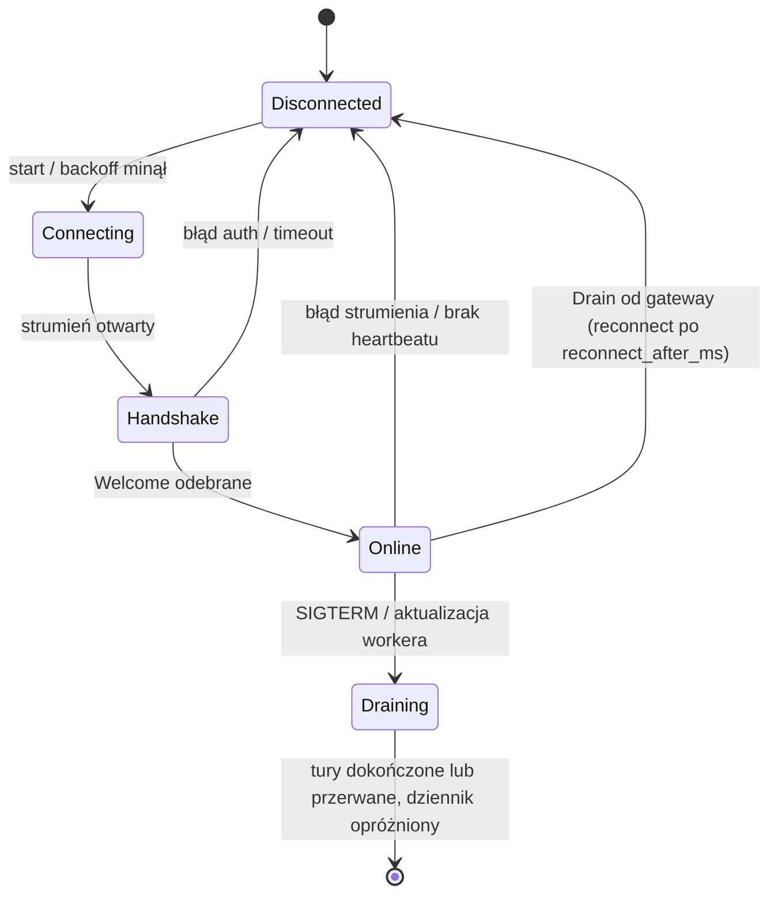
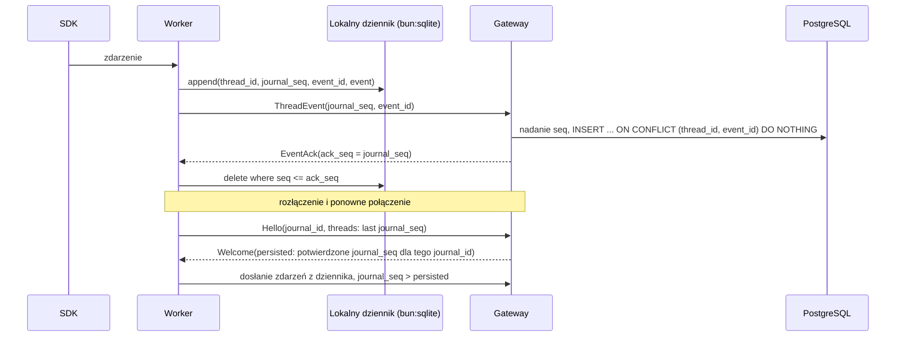

# Protokół gateway ↔ worker

Harness Grok: `Provider.PROVIDER_GROK = 3`, `WorkerConfig.grok = 640`; używa istniejących komend, eventów, profili native/CLIProxyAPI, zgód i `AgentToolCall`. ACP pozostaje prywatnym protokołem worker ↔ CLI w `packages/grok-acp`; nie rozszerza kontraktu przeglądarki o JSON-RPC. [Adapter Grok](grok-adapter.md).

Status: **szkic**, kanał i handshake zaimplementowane (`apps/gateway/src/worker-link`, `apps/worker/src/gateway-link`). Kontrakt: [`proto/canopy/worker/v1/worker_link.proto`](../proto/canopy/worker/v1/worker_link.proto).

Nietrwała komenda `GenerateText` (capability `generate_text`) uruchamia izolowaną generację przez SDK instancji i zwraca `CommandResult.generated_text`, bez platformowej sesji i dziennika. Szczegóły: [thread-titles.md](thread-titles.md).

## Założenia

- **Worker inicjuje połączenie.** Edge device może stać za NAT-em. Nie otwieramy na nim portów.
- **Jeden strumień dwukierunkowy na workera:** `WorkerLinkService.Connect(stream WorkerMessage) returns (stream GatewayMessage)`.
  - w górę: handshake, heartbeaty, transkrypty, wyniki komend, prośby o uprawnienia, wywołania szyny agentów,
  - w dół: komendy, potwierdzenia zapisu, decyzje o uprawnieniach, wyniki szyny agentów.
- **Transport:** gRPC po HTTP/2 + TLS. Reverse proxy przed gateway musi przepuszczać HTTP/2 i długie strumienie (bez krótkich timeoutów bezczynności).
- **Gateway jest źródłem prawdy** o agentach i uprawnieniach. **Worker jest źródłem prawdy** o tym, które katalogi wolno użyć na urządzeniu.

## Cykl życia połączenia

- **Backoff:** wykładniczy z jitterem, np. 1 s → 60 s. Po `Drain` od gateway worker czeka dokładnie `reconnect_after_ms` (jitter jest już wliczony).
- **Drain gateway:** instancja kończąca pracę wysyła `Drain`, potem kończy strumień statusem OK. Worker łączy się ponownie, zwykle z inną instancją.
- **Drain workera:** `Heartbeat.state = DRAINING`, nowe tury dostają `WORKER_DRAINING`, worker robi half-close po opróżnieniu dziennika. Szczegóły: [durability.md](durability.md).
- **Heartbeat:** worker co `heartbeat_interval_seconds` (domyślnie 15 s). Gateway oznacza workera jako `offline` po 3 brakach.
- **Zamknięcie gateway:** najpierw `WorkerLink.shutdown()` (strumienie kończą się statusem OK), potem `server.close(graceMs)` (GOAWAY, karencja, `destroy`). Bez tego worker dostaje `Internal: missing status`.
- **Tury agentów działają dalej przy zerwanym połączeniu.** Zdarzenia trafiają do lokalnego dziennika i zostaną dosłane.
- **Koniec tury.** `TurnFinished.outcome`: `COMPLETED`, `INTERRUPTED` albo `FAILED`; `source` mówi, kto przerwał (`USER` na prośbę przez platformę, `SYSTEM` zdarzenie systemowe) albo skąd błąd (`PLATFORM` nasza strona, `HARNESS` Codex/Claude), `reason` to powód albo dokładny komunikat, `error_code` krótki kod. Worker bez `source` (starszy): przerwanie = użytkownik, błąd = harness. Turę, której koniec worker przegapił (restart, awaria harnessu), worker rozlicza z transkryptu harnessu i wysyła jej itemy oraz prawdziwy koniec ([durability.md](durability.md#35-rekoncyliacja-z-transkryptu-harnessu)). Błąd, którym Codex odpowiedział na żądanie komendy, ma kod `HARNESS_ERROR` (inaczej `THREAD_ERROR`).
- **Tury w toku po ponownym połączeniu.** `Hello.running_turns` to tury, które proces workera prowadzi teraz (z capability `running_turns`: lista jest pełna). Gateway kończy swoje tury `running` wątków tego workera, których na liście nie ma, jako `interrupted` przez system (`worker restarted`), zamyka ich otwarte itemy i przywraca wątkom `idle`: ich oczekujące interakcje wygasają (`expired`), steery, które do nich nie weszły, idą do kolejki, a kolejka wątku rusza dalej. Spóźniony `turn_finished` takiej tury z dziennika ustawia jej prawdziwy wynik, ale nie zmienia statusu wątku, gdy działa już nowsza tura. Worker bez tej capability (starsza wersja) nie jest oceniany. Szczegóły: [durability.md](durability.md#34-start-po-awarii).

## Uwierzytelnianie

1. Użytkownik generuje w UI jednorazowy token rejestracyjny (TTL 30 min, 32 losowe bajty, w bazie tylko SHA-256).
2. Anonimowy `WorkerEnrollmentService.Enroll` na tym samym porcie gRPC zamienia token i fakty maszyny na `worker_id` i świeży `worker_credential`. Limit: 60 prób/minutę/proces gateway. Utworzenie workera/configu i zużycie tokenu są jedną transakcją; powtórne, wygasłe i odwołane tokeny dostają ten sam błąd bez odbicia wartości sekretu. Właściciel wynika wyłącznie z tokenu.
3. Worker zapisuje je w lokalnym configu z uprawnieniami `0600` (na Windows: ACL tylko dla użytkownika).
4. Każde `Connect` niesie `authorization: Bearer <credential>` w metadanych. Gateway sprawdza hash i czy worker nie jest unieważniony/archiwalny. Rotacja i revoke zamykają obecny strumień i unieważniają handshaki rozpoczęte przed zmianą; stare poświadczenie nie otworzy kolejnego linku. Nie zatrzymuje to lokalnych procesów — trzeba zatrzymać usługę na urządzeniu.
5. Docelowo: mTLS (certyfikat klienta wydany przy enrollment) albo rotowany token krótkotrwały.

Kreator, CLI, konfiguracja adresu gRPC (również Tailscale) i usługi systemd/launchd:
[worker-config.md](worker-config.md#dodanie-maszyny-z-ui).

## Dostarczanie transkryptu (at-least-once + idempotencja)

Zasady:

- `journal_seq` nadaje worker (kolejność w jego dzienniku, do potwierdzeń). `seq` na osi czasu wątku nadaje gateway przy zapisie, wspólny dla zdarzeń workera i platformy (każdy wątek numeruje od 1, także fork).
- Kursory `journal_seq` są ważne tylko w obrębie `Hello.journal_id`. Nowy dziennik (np. reinstalacja workera) oznacza dosłanie wszystkiego; duplikaty odrzuca `event_id`.
- Gateway potwierdza zbiorczo (np. co 100 ms lub co N zdarzeń), nie każde zdarzenie osobno.
- Duplikaty po wznowieniu ignoruje klucz `(thread_id, event_id)`.
- Zdarzenia między turami (zadania w tle, kompaktowanie, zmiany statusu) mają pusty `turn_id` i są przesyłane tak samo.
- Kompaktowanie delt po `item_completed` to decyzja retencji, nie protokołu ([transcript.md](transcript.md#7-retencja)).

## Komendy (gateway → worker)

| Komenda | Efekt na workerze | Wynik |
|---|---|---|
| `CreateThread` | Walidacja absolutnego, istniejącego katalogu `cwd` i profilu dostawcy. Nowy wątek u dostawcy albo fork (`ForkSpec`: Claude `forkSession`, Codex `thread/fork`). | `CommandResult` + `thread_ready` (`provider_thread_id`) |
| `StartTurn` | Nowa tura. Wątek jest wznawiany w razie potrzeby (Claude `resume`, Codex `thread/resume`) na podstawie pełnego `ThreadSpec`. Idempotentne po `turn_id`. | `CommandResult` + zdarzenia tury |
| `InterruptTurn` | Przerwanie tury (Claude `interrupt()`, Codex `turn/interrupt`). Zadania w tle działają dalej. | `CommandResult` + `turn_finished` (interrupted); `TURN_NOT_RUNNING`, gdy ten proces tury nie prowadzi (gateway kończy ją u siebie) |
| `UnloadThread` | Zwolnienie procesu dostawcy, tylko gdy wątek nie jest zajęty (brak tury, zadań w tle i interakcji). Historia zostaje. | `CommandResult` |
| `SteerTurn` | Dołączenie wejścia do tury w toku (Claude strumień wejścia, Codex `turn/steer`). Idempotentne po `input_id`. | `CommandResult` (`STEER_NOT_RUNNING` / `STEER_REJECTED`) + item `user_message` z `client_id = input_id` |
| `ListModels` | Lista modeli od nowa (bez pamięci podręcznej workera), opcjonalnie jednego dostawcy i profilu. | `CommandResult.models` |
| `StopTask` | Zatrzymanie zadania w tle lub subagenta w tle (Claude `stopTask`, Codex zakończenie procesu / `closeAgent`). | `CommandResult` + item `interrupted` |
| `BackgroundItem` | Przeniesienie pracy pierwszoplanowej do tła (Claude `backgroundTasks`). | `CommandResult` |
| `ListDirectory` | Listowanie dowolnego dostępnego katalogu absolutnego (wybór workspace); pusta ścieżka = home workera. | `CommandResult.entries` + `directory_path` |

- Każda komenda ma `command_id`. Worker pamięta ostatnio przetworzone ID i nie wykonuje ich drugi raz.
- `InterruptTurn` dla tury, której worker nie prowadzi (np. zginęła z poprzednim procesem): `TURN_NOT_RUNNING`; gateway kończy turę jako `interrupted` („the turn was no longer running on the worker”) i uruchamia kolejną z kolejki.
- `thread_ready.replaces_provider_thread_id`: worker zaczął nowy wątek dostawcy zamiast wznowienia (Codex: wątek bez żadnej tury nie ma rolloutu). Gateway podmienia `provider_thread_id` tylko wtedy, gdy zapisany jest ten zastępowany i żadna tura wątku jeszcze nie wystartowała (trigger `threads_before_update`).
- Gateway czeka na `CommandResult` z timeoutem (np. 10 s). Brak odpowiedzi to błąd w UI, nie cicha porażka.
- Komendy są trwałe: outbox w PostgreSQL z `expires_at` zależnym od typu. Po `Welcome` gateway dosyła niepotwierdzone komendy, worker deduplikuje po `command_id` (pamięta wyniki). Przeterminowana komenda kończy się błędem w UI. Szczegóły: [durability.md](durability.md#42-outbox-komend).
- `WORKER_DRAINING`: worker w trakcie zatrzymania nie przyjmuje nowych tur. Komenda zostaje w outboxie i trafi do workera po restarcie.

## Interakcje z użytkownikiem (zgody, pytania, formularze)

1. Dostawca czeka na człowieka: zgoda (Claude `canUseTool`; Codex `item/commandExecution|fileChange|permissions/requestApproval`), pytanie (Claude `AskUserQuestion`; Codex `item/tool/requestUserInput`) albo elicitation MCP.
2. Worker wysyła `InteractionRequest` (`kind`, `item_id`, `turn_id` pusty, gdy pyta zadanie w tle po turze) i wstrzymuje dostawcę.
3. Gateway zapisuje `interaction_requests`, dodaje item `interaction_prompt` na oś czasu i powiadamia UI.
4. Użytkownik odpowiada. Gateway wysyła `InteractionResponse`.
5. Worker zwraca odpowiedź dostawcy (Codex: `accept` / `acceptForSession` / `decline` / `cancel`).

Zgoda bez decyzji w ustalonym czasie oznacza odmowę. Po zerwaniu połączenia oczekujące interakcje są wysyłane ponownie po `Welcome`. Szczegóły: [execution.md](execution.md#6-interakcje-z-użytkownikiem).

## Praca w tle i subagenci

- `InterruptTurn` przerywa tylko turę; zadania w tle zatrzymuje `StopTask`. `BackgroundItem` przenosi pracę pierwszoplanową do tła, a `SteerTurn` dołącza wejście do tury w toku.
- Dostawca może sam zacząć turę (`TurnStarted.trigger = PROVIDER | RECOVERY`), wtedy `turn_id` nadaje worker.
- `ThreadActivity` opisuje turę w toku, zadania w tle i oczekujące interakcje.
- Szczegóły: [execution.md](execution.md).

## Konfiguracja zdalna

- Po `Welcome` gateway wysyła `WorkerConfig`, jeśli `Hello.config_version` jest inna (po starcie procesu zawsze 0). Zmiany wysyła na żywo (`pushConfig`).
- Worker waliduje na urządzeniu i odpowiada `ConfigApplied` (`applied`, `issues`, wykryci dostawcy, dostępność profili). Błąd krytyczny = worker zostaje przy poprzedniej konfiguracji.
- Lokalnie worker ma tylko połączenie z gateway. Szczegóły: [worker-config.md](worker-config.md).

## Modele, effort i steer

**Katalog modeli.** Po każdej zastosowanej konfiguracji (i ponownie po połączeniu) worker wysyła `ModelCatalog`: dla każdej pary dostawca + profil listę `ModelInfo` (`id`, `resolved_model`, nazwa, `hidden`, `is_default`, `efforts`, `default_effort`) albo `detail`, gdy lista jest niepełna. Bez tury modelu:

- Codex: `model/list` app-servera (katalog wbudowany, ten sam dla każdego dostawcy modeli, ze stronicowaniem). Profil CLIProxyAPI dodatkowo pyta pośrednika (`GET /v1/models`): zostają modele katalogu, które pośrednik obsługuje, a jego pozostałe modele dochodzą bez danych o wysiłku.
- Claude: `Query.supportedModels()` zapytania bez promptu (Claude Code startuje i odpowiada na żądania sterujące, model nie jest wołany, ok. 0,5 s). Z profilem CLIProxyAPI Claude Code sam dołącza modele pośrednika (`CLAUDE_CODE_ENABLE_GATEWAY_MODEL_DISCOVERY`).

**Tylko modele agenta.** Katalog nie zawiera modeli, które nie poprowadzą tury agenta (generowanie obrazów i wideo, TTS i mowa, embeddingi, moderacja, realtime, transkrypcja): worker je usuwa (nie `hidden`), więc nie ma ich w pickerze, a gateway odrzuca je przy walidacji z katalogiem. Rozstrzyga `isAgentModel` (`apps/worker/src/providers/models.ts`):

1. metadane źródła: pośrednik CLIProxyAPI podaje modalności tylko w liście w stylu Gemini (`GET /v1beta/models`: `supportedOutputModalities`, `supportedGenerationMethods`; `GET /v1/models` ma tylko `id` i `owned_by`). Model agenta = wyjście wyłącznie tekstowe i metoda `generateContent`. Brak tej listy nie psuje katalogu (zostaje krok 2);
2. bez modalności: słowa w nazwie (id albo nazwa wyświetlana): `image`, `imagine`, `imagen`, `dall`, `sora`, `veo`, `video`, `tts`, `voice`, `audio`, `speech`, `transcribe`, `transcription`, `whisper`, `realtime`, `embed`, `embedding(s)`, `moderation`, `rerank`, `music`, `lyria`.

Modele czatu bez danych o wysiłku (np. Grok, Gemini, starsze Claude) zostają i działają normalnie (puste `efforts`). Wbudowany katalog Codexa (`model/list`) to modele agenta Codexa i nie jest filtrowany. Claude Code przez CLIProxyAPI pokazuje modele innych dostawców pod własnymi id (na żywo `claude-fable-5-dd-<odwrócone id>`), więc metadane pośrednika są dopasowywane po id, `resolved_model` albo nazwie wyświetlanej. Na żywo (63 modele pośrednika) odpada 15: `gpt-image-*`, `grok-imagine-*`, `grok-tts`, `grok-voice-tts-1.0`, `gemini-3.1-flash-image`.

**Domyślny wysiłek** (`default_effort`) to domyślny wysiłek ustawiony przez właściciela urządzenia w harnessie, jeśli model go oferuje (jest w `efforts`), inaczej własny domyślny modelu, inaczej pusty. Wątki platformy działają z izolowanymi katalogami domowymi (Claude bez ustawień użytkownika), więc same harnessy tych plików nie czytają: robi to worker (`providers/default-effort.ts`, tylko odczyt, przy każdym listowaniu i każdej turze) i wysyła tę wartość z turą bez własnego wysiłku. Kolejność:

| Dostawca | Źródło (od najważniejszego) | Domyślny modelu |
|---|---|---|
| Codex | `config.toml` urządzenia (`$CODEX_HOME` procesu workera, inaczej `~/.codex`): `[profiles.<profile>].model_reasoning_effort` dla profilu wybranego przez `profile`, potem `model_reasoning_effort` | `defaultReasoningEffort` z `model/list` |
| Claude | `CLAUDE_CODE_EFFORT_LEVEL` w środowisku workera (Claude Code też je dostaje i tam wygrywa ze wszystkim, także z wybranym wysiłkiem; `auto` / `unset` = domyślny modelu), potem `settings.json` urządzenia (`$CLAUDE_CONFIG_DIR` procesu workera, inaczej `~/.claude`): `modelSettings.<model>.effortLevel` (to zapisuje `/effort`; klucz pasuje też do wersji z datą i `[1m]`), potem `effortLevel` | brak: Claude Code go nie podaje (`ModelInfo` w SDK 0.3.316 nie ma takiego pola; CLI 2.1.316 bierze go z własnego katalogu modeli, inaczej `high`) |

Nieczytane, bo zależą od folderu wątku, a katalog jest per worker: projektowy `.codex/config.toml`, ustawienia projektu i lokalne Claude (`.claude/settings*.json`), a także warstwy systemowe i zarządzane (`/etc/codex`, managed settings Claude, `maxEffortLevel`). Nieczytelny plik = brak ustawienia. Profil workera (native albo CLIProxyAPI) nie zmienia tego wyboru: ustawienie harnessu dotyczy wszystkich jego profili.

Gateway zapisuje ostatni katalog workera (`worker_model_catalogs`) i odświeża go komendą `ListModels`.

**Modele instancji.** Użytkownik wybiera modele instancji widoczne w pickerach, ulubione (pierwsze, w swojej kolejności) i własne id modeli; gateway oznacza pozostałe jako `hidden` w `ListModels` i `OverviewUpdate.models`, dokłada własne modele i układa ulubione na początku; pełny katalog daje `ListModelsRequest.unfiltered`, a walidacja używa pełnego katalogu z własnymi modelami ([worker-config.md](worker-config.md#93-modele-w-pickerach)).

**Model i wysiłek tury.** `StartTurn.model` / `effort` to wartości rozstrzygnięte przez gateway (nadpisanie z wiadomości, inaczej domyślne wątku). Codex dostaje je w `turn/start`, zawsze jawnie: bez wyboru domyślny model katalogu i jego `default_effort` (wyżej), bo nadpisanie w Codexie obowiązuje także kolejne tury. Claude dostaje `model` i `effort` w `query()` (`low | medium | high | xhigh | max`; inna wartość = błąd startu tury); bez wyboru skonfigurowany domyślny wysiłek dla tego modelu, jeśli jest.

**Tryb uprawnień tury.** `StartTurn.permission_mode` to tryb rozstrzygnięty przez gateway, zawsze ustawiony: nadpisanie z wiadomości (`SendMessage.permission_mode`), inaczej domyślny wątku (`ThreadSpec.permission_mode`, zmieniany przez `UpdateThread`). Tura zapisuje go w `turns.permission_mode` (w kolejce: nadpisanie albo pusty). `UNSPECIFIED` (starszy gateway) = tryb wątku. Steer dołącza do tury w toku z jej trybem; nadpisanie steera obowiązuje, gdy wiadomość wraca do kolejki. Zgody czekające w turze w toku się nie zmieniają: nowy tryb działa od następnej tury.

- **Codex:** `turn/start` dostaje `approvalPolicy` i `sandboxPolicy` z tej samej tabeli co `thread/start` (`codexTurnPermissions`), w każdej turze jawnie, bo Codex trzyma nadpisanie także dla kolejnych tur (jak model i wysiłek).
- **Claude:** nowy proces startuje z trybem tury (`permissionMode`, `sandbox`, automatyczna zgoda w `canUseTool`). Proces żywy tylko przez okres karencji po zadaniach w tle kończy się i tura startuje nowy. Proces trzymany przez zadania w tle przełącza się przed turą: `setPermissionMode`, sandbox przez `applyFlagSettings` (wyłączenie tylko jako `sandbox: { enabled: false }`; `sandbox: null` zostawia sandbox ze startu, a z nim automatyczną zgodę na Bash) i automatyczną zgodę `canUseTool`.
- **Kto wybiera tryb:** tylko właściciel wątku przez UI (`CreateThread`, `SendMessage`, `UpdateThread`); szyna agentów nie ma narzędzia do zmiany trybu, a wątki boczne agenta dziedziczą ustawienia wołającego. `FULL_AUTO` w obu harnessach zostaje w sandboxie workspace'u.

Potwierdzone na żywo (`tests/integration/gateway-permission-mode.live.test.ts`, 2026-11-02, CLIProxyAPI, `gpt-6.1-sol` i `claude-haiku-5-5`): w jednym wątku `READ_ONLY` nie zapisuje i nie pyta, wiadomość z `FULL_AUTO` zapisuje bez pytania, następna bez nadpisania znów nie zapisuje (Codex nie zostaje na `FULL_AUTO`), po `UpdateThread` na `ASK` zapis prosi o zgodę (Codex `shell`, Claude `Bash`). Claude z zadaniem w tle (ten sam proces): `READ_ONLY` odmawia, `ASK` pyta, `FULL_AUTO` zapisuje w workspace, a zapis poza nim kończy się „Read-only file system”.

**Wysiłek a model.** Wysiłek przechodzi przez katalog profilu wątku (`worker_model_catalogs`, `turnEffort` w `apps/gateway/src/store/models.ts`), żeby tura nie niosła wysiłku do modelu, który go nie ma:

| Model tury w katalogu | Wysiłek w `StartTurn` |
|---|---|
| znany, `efforts` pusta | brak (pusty), także gdy wątek ma domyślny wysiłek |
| znany, wysiłek w `efforts` | ten wysiłek |
| znany, wysiłku nie ma w `efforts` | `default_effort` modelu (jeśli jest w `efforts`), inaczej brak |
| nieznany (brak katalogu, id spoza listy niepełnego katalogu) | bez zmian |

Model pusty = model `is_default` katalogu. Tura zapisuje rozstrzygnięte wartości (`turns.model`, `turns.effort`). Ta sama reguła ustala domyślny wysiłek wątku w `CreateThread` i `UpdateThread`; wysiłek podany wprost w `CreateThread`, `SendMessage` albo `UpdateThread`, którego znany model nie oferuje (a ma niepustą listę), jest nadal odrzucany. Pusty wysiłek w `StartTurn` oddaje wybór workerowi (domyślny wysiłek, wyżej): skonfigurowany wysiłek urządzenia (Claude `effortLevel`, Codex `model_reasoning_effort`) idzie tylko wtedy, gdy model go oferuje, więc model bez `efforts` nie dostaje żadnego. Wyjątek: zmienną `CLAUDE_CODE_EFFORT_LEVEL` w środowisku workera Claude Code stosuje sam, poza workerem.

**Steer.** `SteerTurn(thread_id, turn_id, input_id, input)`:

- `ok` = dostawca przyjął wejście do tury. Miejsce, w którym weszło, to item `user_message` z `client_id = input_id` w tej turze (Codex `turn/steer` z `clientUserMessageId`, Claude `command_lifecycle started`).
- Tura już się skończyła albo nie działa na tym workerze: `STEER_NOT_RUNNING`; dostawca odmówił: `STEER_REJECTED`. Gateway kolejkuje wtedy wiadomość jako następną turę z powodem.
- Claude przyjął wiadomość, ale tura skończyła się bez niej (przerwanie, błąd, brak dalszych zdarzeń przez 60 s po wyniku): `Notice` z `code = steer_dropped` i `data_json {"input_id"}`; gateway też ją kolejkuje.

## Profile dostawców

- Profile są w zdalnej konfiguracji (`WorkerConfig.profiles`): to efektywne **globalne instancje dostawców** włączone na tym workerze, jedna na parę (dostawca, id), z nazwą, zmiennymi, flagą `disabled` i środowiskiem uruchomienia (`executable_path`, `home_path`, `shadow_home_path`, `launch_args`, `own_login`); gateway je wylicza z definicji i nadpisań ([worker-config.md](worker-config.md#9-globalne-instancje-dostawców)). Worker raportuje w `ConfigApplied` dostępność, nazwę, wersję CLI i sposób uwierzytelnienia każdej instancji (`version`, `auth`, `authenticated`; bez kluczy i wartości zmiennych).
- `ProbeProviders` (capability `probe_providers`): ponowne sprawdzenie bieżącej konfiguracji, nowy `ConfigApplied` z tą samą wersją. `StartLogin` (capability `codex_device_login`): logowanie ChatGPT kodem urządzenia dla instancji Codexa z `own_login`, wynik `CommandResult.login` (`verification_url`, `user_code`), zakończenie przez kolejny `ConfigApplied`.
- Gateway zapisuje profil per wątek i przekazuje go w `ThreadSpec.provider_profile_id`. Pusty oznacza `native`.
- Worker odrzuca nieznany, niedostępny albo niepasujący do dostawcy profil (`CommandResult.ok = false`).
- Szczegóły: [architecture.md](architecture.md#8-profile-dostawców-i-cliproxyapi).

## Szyna agentów

Wywołania narzędzi szyny (`spawn_thread`, `send_message`, `wait_threads`, ... — [agent-bus.md](agent-bus.md)) z agenta SDK wracają do gateway jako `AgentToolCall`. Gateway:

1. zwraca zapisany wynik, jeśli `call_id` już był wykonany (ponowienie po zerwaniu połączenia),
2. dekoduje argumenty schematem narzędzia i sprawdza reguły (`authorizeBusCall`: drzewo wątków, potomkowie, limity, `hops`) w imieniu właściciela projektu,
3. zapisuje `agent_bus_calls` i wykonuje operację (np. wątek boczny `origin = agent` z turą i komendami do workera),
4. zwraca `AgentToolResult` (tekst dla modelu + `result_json` dla osi czasu).

`spawn_thread` i `send_message` odpowiadają od razu; `wait_threads` trwa najwyżej `timeout_seconds`. Worker nie blokuje przez to innych wątków, bo strumień jest multipleksowany po `call_id`.

## Załączniki

Pliki, które użytkownik dołącza do wiadomości ([ui-api.md](ui-api.md#załączniki)). Gateway trzyma bajty (blob), worker pobiera je, zanim przekaże turę harnessowi.

- `Hello.attachments_root` (+ capability `attachments`): katalog załączników na urządzeniu, `<data_dir>/attachments` (ścieżka absolutna). Gateway zapisuje go z raportem workera (`workers.capabilities.attachmentsRoot`). Pusty = worker bez załączników: `SendMessage` / `CreateThread` z załącznikami do jego wątku są odrzucane z powodem.
- Plik: `<attachments_root>/<thread_id>/<attachment_id>/<nazwa>` (separator według systemu workera, nazwa bez katalogów i znaków sterujących, `safeFileName`). Gateway liczy tę ścieżkę przy przyjęciu wiadomości i wpisuje ją do notatki platformy w tekście tury.
- `StartTurn.input.attachments[]` (`InputAttachment`: `attachment_id`, `sha256`, `size_bytes`, `mime_type`, `name`, `path`, `kind`). Worker przed turą, dla każdego pliku:
  1. liczy ścieżkę sam; inna niż `path` z komendy = błąd ostateczny `ATTACHMENT_UNAVAILABLE` (komenda nie może wskazać innego miejsca),
  2. plik już jest z tym rozmiarem i sha256 (ponowione `StartTurn`) → nic,
  3. inaczej `WorkerMessage.fetch_blob` (`FetchBlob{request_id, thread_id, sha256}`); gateway odpowiada `GatewayMessage.blob_chunk` z tym samym `request_id` (fragmenty po 256 KiB, `last`), albo jednym `BlobChunk` z `error`. Gateway oddaje tylko bajty załącznika związanego z tym wątkiem, którego wątek biegnie na tym workerze,
  4. sprawdza sha256 i rozmiar, zapisuje atomowo (`.part` + rename, pliki `0600`, katalogi `0700`).
  Brak pliku u gateway: `ATTACHMENT_UNAVAILABLE`, ostateczny (tura `failed` z powodem). Zerwane połączenie, uszkodzone bajty, przekroczony czas (120 s na plik): nieostateczny, gateway dostarcza `StartTurn` ponownie.
- Worker offline: wiadomość czeka w kolejce razem z załącznikami (bajty są w gateway), transfer nastąpi przy starcie tury po połączeniu workera. Nowego wątku na workerze offline UI i tak nie wysyła.
- Steer z załącznikami nie istnieje: wiadomość z plikami zawsze jest następną turą.

**Podglądy obrazów (worker → gateway).** Każdy obraz, który widział model (`view_image` platformy, natywne `view_image` Codexa, obraz w wyniku narzędzia, np. `Read` Claude), dostaje podgląd: worker zapisuje go w `<data_dir>/previews/<sha256>` przed zapisem zdarzenia w dzienniku, a przed wysłaniem zdarzenia (także przy ponownym wysłaniu z dziennika po `Welcome`) wysyła `BlobChunk` (`sha256`, `offset`, `data`, `last`, `mime_type`) raz na połączenie. Gateway składa fragmenty, sprawdza sha256, typ (PNG, JPEG, WebP, GIF) i limit 8 MiB, i zapisuje blob; przy ingeście wiąże go z wątkiem (`thread_blobs`). Brakujący podgląd nie blokuje zdarzenia (UI pokazuje „preview not available”). Podglądy starsze niż 7 dni worker usuwa przy starcie.

## Wzmianki

`MentionKind.BOT=6` współdzieli zakresy i edytor z wątkami, ale jest obsługiwany wyłącznie
przez rozmowy botów w gateway (`SendBotMessage` / `BotMessage`, pole 450).
`name` to ID bota, `label` to nazwa w znaczniku `@Nazwa`. Nie trafia do workera.

Wiadomość może nieść wzmianki (`UserInput.mentions`, numery od 140; kontrakt i zasady: [ui-api.md](ui-api.md#wzmianki)): zakresy w `UserInput.text`, które gateway już złożył dla dostawcy (notatka platformy, przepisanie dla Claude). Worker:

- Codex: `turn/start` i `turn/steer` dostają tekst z `text_elements` (zakres bajtów UTF-8 i znacznik każdej wzmianki) oraz itemy `skill {name, path}`, `mention {name, path}` (aplikacje, pluginy) i `localImage` (wspomniany obraz). Echo `userMessage` z `clientId` tury albo steera dostaje te wzmianki w `UserMessage.mentions`.
- Claude: sam tekst (komenda już na początku); item `user_message` niesie wzmianki.

Komendy zapytań (wynik nie jest zapamiętywany w dzienniku: ponowione dostarczenie liczy się od nowa):

| Komenda | Efekt | Wynik |
|---|---|---|
| `ListMentionCatalog` (140) | komendy, skille i pluginy dostawcy dla istniejącego folderu (`cwd`, pusty = home workera), bez modelu: Codex `skills/list`, `plugin/list`, `app/list`; Claude `supportedCommands()` | `CommandResult.mention_catalog` |
| `SearchFiles` (141) | wyszukiwanie fuzzy w folderze: `git ls-files --cached --others --exclude-standard` (śledzone i nieśledzone bez ignorowanych), bez gita przegląd do 20 000 wpisów i 12 poziomów bez ukrytych folderów, zależności i dowiązań; lista w pamięci 10 s; najwyżej 200 wyników | `CommandResult.file_search` |

Wyszukiwanie plików jest własne workera (nie Codexowe `fuzzyFileSearch`), bo musi działać na workerze tylko z Claude i w kompozytorze nowego wątku przed wyborem dostawcy, z tymi samymi wynikami dla obu.

## CLI dostawców

Capability `cli_install`: worker wysyła `CliToolsReport` (ścieżka, wersja, sposób instalacji każdego CLI) po połączeniu, po `ProbeProviders`, po instalacji i co 6 h; nietrwała komenda `InstallCli` (nigdy z outboxa) uruchamia stały przepis, postęp idzie w `CliInstallProgress`, wynik w następnym raporcie. Bez zmiany `WORKER_LINK_PROTOCOL`. Szczegóły i zasady: [provider-cli.md](provider-cli.md).

## Kontrola przepływu

- HTTP/2 ma flow control na poziomie strumienia. Dodatkowo worker ogranicza liczbę niepotwierdzonych zdarzeń (np. 1000). Po przekroczeniu buforuje tylko w dzienniku.
- Duże treści (output komendy, diff, obraz) nie są przycinane. Worker wysyła je jako `BlobChunk` (sha256), a zdarzenie wskazuje blob przez `BlobRef` ([transcript.md](transcript.md#5-zapis-po-stronie-gateway)). Zaimplementowane dla podglądów obrazów ([Załączniki](#załączniki)); output i diff są na razie inline.

## Wersjonowanie

- Pakiet `canopy.worker.v1`. Zmiany zgodne wstecz: tylko nowe pola i wartości enumów.
- `Hello.worker_link_protocol` (760) i `min_worker_link_protocol` (761) negocjują dodatni zakres protokołu; brak wspólnego numeru oznacza `FailedPrecondition` z czytelnym powodem. Wersja aplikacji z `CANOPY_VERSION` jest niezależna od zgodności protokołu.
- Osobny zamrożony `canopy.update.v1.UpdateService` działa na tym samym porcie również wtedy, gdy WorkerLink odrzuca handshake. Nie importuje wiadomości WorkerLink/UI, pozostaje dostępny na zawsze, przyjmuje tylko addytywne rozszerzenia. Przepływy aktualizacji, auth, mirror i rollback: [updates.md](updates.md).
