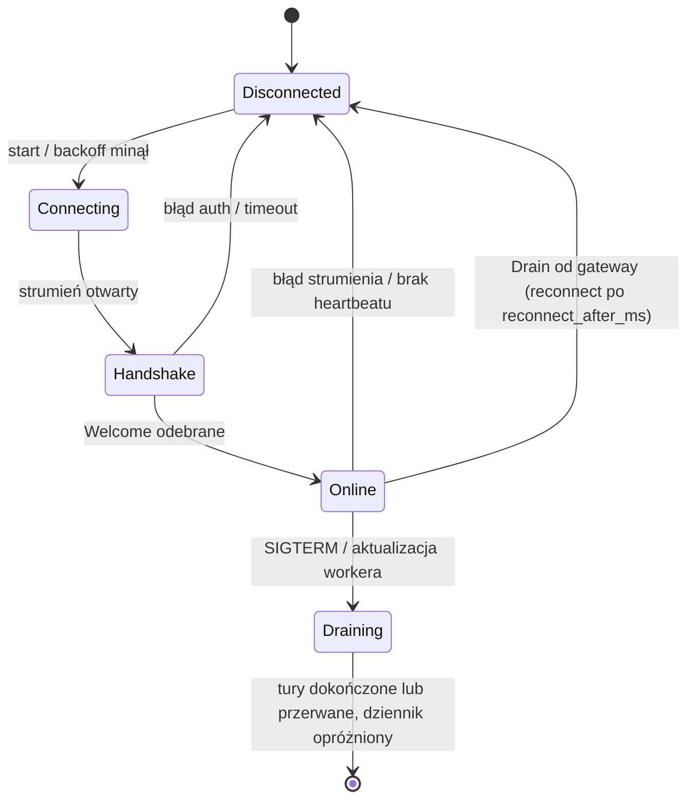
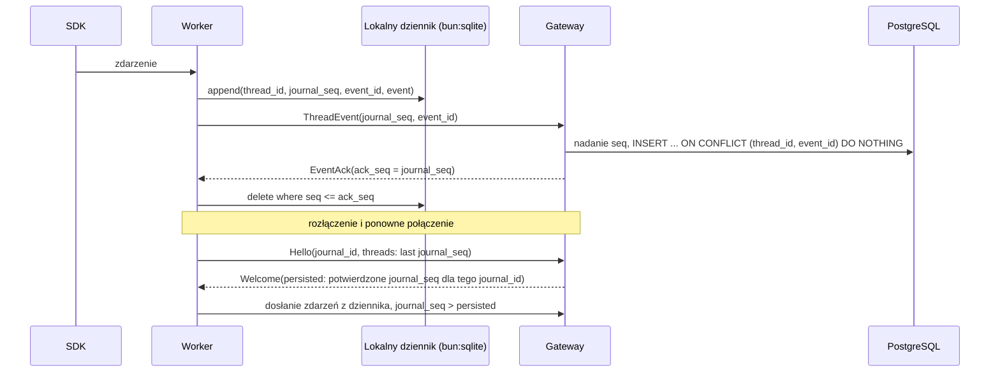

# Protokół gateway ↔ worker

Harness Grok: `Provider.PROVIDER_GROK = 3`, `WorkerConfig.grok = 640`; używa istniejących komend, eventów, profili native/CLIProxyAPI, zgód i `AgentToolCall`. ACP pozostaje prywatnym protokołem worker ↔ CLI w `packages/grok-acp`; nie rozszerza kontraktu przeglądarki o JSON-RPC. [Adapter Grok](grok-adapter.md).

Status: **szkic**, kanał i handshake zaimplementowane (`apps/gateway/src/worker-link`, `apps/worker/src/gateway-link`). Kontrakt: [`proto/canopy/worker/v1/worker_link.proto`](../proto/canopy/worker/v1/worker_link.proto).

### Trwałe odpowiedzi obrazami

Addytywna capability `thread_image_replies_v1` dopuszcza nietrwałe
`ExportThreadImage` (`Command.export_thread_image = 231`) i
`CommandResult.thread_image_export = 231`. `WORKER_LINK_PROTOCOL` pozostaje 1;
zamrożone `update/v1` nie zmienia się. Starszy worker dostaje jawną odmowę
„Update this computer to show images in Canopy.”, bez wysłania nieznanej komendy.

Gateway sprawdza ownera, przypięcie workera i aktywną turę. Rezerwuje budżet
przed alokacją: 1 transfer na wątek, 2 na worker, 100 obrazów / 200 MiB na turę.
Wywołanie obejmuje 1–10 obrazów, maks. 20 MiB na plik i 50 MiB łącznie;
niższe limity załączników właściciela mają pierwszeństwo. Liczymy większy
z rozmiarów wejścia i wyniku normalizacji. Rezerwacja ma lease 60 s i token
odgradzający wygasłą próbę od nowej; przerwana próba zwalnia niezapisany budżet.

`probe` zwraca sam rozmiar i nazwę. `read` przesyła do 256 KiB na odpowiedź,
z niezmiennym rozmiarem, nazwą i SHA-256; gateway sprawdza hash całości.
Limit bezczynności wynosi 10 s, całości 60 s. `release` usuwa eksport.
Gateway przekazuje tylko katalog bieżącego wątku i jego własny katalog
załączników; worker musi niezależnie sprawdzić zakres oraz tożsamość tury.
Bajty nie trafiają do modelu, outboxa ani journala.

Gateway rozpoznaje typ z bajtów i używa pipeline załączników: limit 100 Mpx,
normalizacja bez EXIF/GPS/XMP i miniatura WebP do 512 px. Publikacja utrwala
pierwszą klatkę animacji. SVG pozostaje plikiem, nie obrazem galerii.
Limit bajtów wyniku działa podczas kodowania: Unix używa celu plikowego Sharp
do prywatnego FIFO i przestaje gromadzić bajty po przekroczeniu budżetu, Windows blokuje
obowiązkową blokadą pliku zapis od granicy limitu wzwyż. Nie używamy streamu
wyjściowego Sharp, który także tworzy cały wynik w pamięci. Bufory odebranych
fragmentów i końcowa konkatenacja mają rozmiar ograniczony limitem; pamięć roboczą
dekodera/enkodera nadal ogranicza osobny limit pikseli, a nie limit bajtów pliku.
Prywatny cel jest usuwany po zakończeniu lub błędzie natywnego zapisu.
Po przekroczeniu limitu FIFO jest nadal opróżniane bez zapisywania fragmentów,
aby natywny writer nie zablokował się; kodowanie ma timeout 30 s.
Załączniki, `Item.image_gallery = 25`, audyt i wynik `show_images` powstają
w jednej transakcji. Call ID daje ten sam wynik także po restarcie i usunięciu
źródła. Manifest nie zawiera bajtów ani ścieżek workera; przyrostowy sync
korzysta z istniejącej osi czasu. Worker nie może tworzyć ani nadpisywać
gatewayowych itemów galerii przez własne zdarzenia.

Zakończona wiadomość agenta może zawierać lokalne obrazy Markdown. Worker
wysyła wewnętrzne `import_image_reply({item_id})` po zdarzeniu zakończenia
wiadomości, przed końcem tury. Gateway parsuje utrwalony tekst tym samym
lexerem co klienci; pomija kod, HTML i zdalne URL. Ścieżki muszą należeć
wyłącznie do workspace/worktree tej wiadomości. Maksymalnie 10 obrazów
w wiadomości i 100 000 znaków źródła; nadmiar odrzuca całą partię.
Obowiązują te same limity bajtów, rezerwacje i pipeline co dla `show_images`.
Jeśli przejściowy błąd ingestu zwolnił strumień przed zapisem zakończenia
wiadomości, importer czeka do 10 s na ten zapis. Oczekiwanie dotyczy tylko
wywołania importu; pozostałe wątki i odbiór zdarzeń działają dalej.

Manifest trafia do `AgentMessage.images = 3`, a błąd odzyskiwania do
`image_error = 4`. `GalleryImage.markdown_start/end` wskazują zakres UTF-16,
`source_path = 14` oryginalny href tokenu; ścieżka nie uprawnia do odczytu.
Tekst pozostaje niezmieniony, a jedno gatewayowe `item_completed` aktualizuje
istniejący item. Hash tekstu sprawdzany podczas commitu odrzuca zmienione źródło.
Worker nie może dostarczyć własnego manifestu ani komunikatu błędu.

Worker przetrzymuje granicę journala od `turn_finished` do wyniku importu,
bez blokowania tekstu innych wątków. Reconnect nie wysyła tej granicy przed
wynikiem; wywołanie ma stałe ID per wątek/tura/item. Oczekiwanie kończy się
po 65 s lub 256 zatrzymanych zdarzeniach; błąd pozostawia tekst i link do pliku.
Restart procesu przed zapisem kopii może pozostawić tylko link; potwierdzony
zapis przeżywa restart i usunięcie pliku. Wewnętrznego narzędzia nie ma
w katalogach modeli żadnego z trzech harnessów.
### Interaktywne visuals

`render_visual` jest narzędziem szyny ([agent-bus.md](agent-bus.md#3-narzędzia)):
worker przekazuje `AgentToolCall`, a gateway waliduje spec i zapisuje wersję.
Worker ogłasza capability `thread_visuals_v1`; bez niej gateway odpowiada
„Update this computer to show visuals in Canopy.”, a starszy gateway odrzuca
nieznane narzędzie. `Welcome.thread_visuals_v1 = 7` mówi workerowi, że gateway
obsługuje `render_visual`; bez tej flagi worker sam odpowiada „Update Canopy on the
gateway computer to show visuals.” i nie wysyła wywołania. `WORKER_LINK_PROTOCOL` pozostaje 1.

`Item.visual = 26` (`Visual`) to mały manifest najnowszej wersji: `visual_id`,
`version`, wersje schematu i kitu, tytuł, opis, wysokość, SHA-256 i rozmiar spec.
Spec nie trafia do zdarzeń ani `WatchThread`. Wersja, upsert itemu `visual-<id>`,
zdarzenie `item_completed`, rekord wywołania i audyt powstają w jednej transakcji.
Aktualizacja zachowuje turę i miejsce itemu z wersji 1. Worker nie może tworzyć
ani zmieniać itemów `visual`: takie zdarzenia trafiają do kwarantanny.
`MovedThread.visuals_json = 4` przenosi wersje razem z wątkiem między komputerami.

`AgentToolCall.cancelled` (831) oznacza zakończenie oczekiwania klienta MCP
(timeout lub anulowanie). Worker ponawia tę samą kopertę do `AgentToolResult`, także
po reconnect. Gateway autoryzuje bota/workera i zapisuje anulowanie wywołania oraz
`expired` na oczekującej karcie atomowo z blokadami decyzji i efektów.

`InteractionRequest.cancelled` (8) przekazuje analogiczne anulowanie natywnej
interakcji dostawcy. Worker zachowuje kopertę do potwierdzenia, także po reconnect;
gateway zapisuje `expired` i odsyła `InteractionResponse.cancelled`.

Nietrwała komenda `GenerateText` (capability `generate_text`) uruchamia izolowaną generację przez SDK instancji i zwraca `CommandResult.generated_text`, bez platformowej sesji i dziennika. Szczegóły: [thread-titles.md](thread-titles.md).

Nietrwałe `ReadWorkspaceOrigin` (`Command.read_workspace_origin = 216`, capability `workspace_origin`)
odczytuje lokalne `remote.origin.url` workspace'u przez process governor (cache 30 s, limit 2 s).
`CommandResult.workspace_origin = 216` zawiera wyłącznie znormalizowaną tożsamość, bez credentiali.
Brak origin daje pustą tożsamość; błąd komendy zachowuje poprzedni odczyt w gatewayu.
Bez outboxa i journala. Starszy worker nie dostaje komendy; `WORKER_LINK_PROTOCOL` pozostaje 1.
Reguły scalania wyborów: [linked-computers.md](linked-computers.md#tożsamość-projektu-według-git-origin).

Nietrwałe `WorkerMessage.git_heads = 840` (`GitHeads`, capability `git_heads`): bieżąca gałąź albo odłączony
HEAD checkoutów wątków, wysyłane po zmianie pliku `HEAD`, na końcu tury i w pełnym stanie po połączeniu. Gateway
przyjmuje je tylko dla wątków tego workera i rozsyła zmienione wątki. Starszy gateway ignoruje wiadomość,
starszy worker jej nie wysyła; `WORKER_LINK_PROTOCOL` pozostaje 1. Szczegóły:
[worktrees.md](worktrees.md#bieżąca-gałąź).

Nietrwałe `InitRepository` (`Command.init_repository = 217`) i `CloneRepository`
(`Command.clone_repository = 218`), capability `project_sources`: nowy katalog `name` (jeden segment)
w istniejącym bezwzględnym `parent_path`, potem `git init` albo `git clone` z `url` przez process
governor (init: 15 s; clone: 2 min bez postępu i 60 min łącznie). Wynik: rzeczywista ścieżka w `CommandResult.directory_path` (6).
URL z poświadczeniami jest odrzucany; klon używa logowania git urządzenia. Bez outboxa i journala;
starszy worker nie dostaje komend, `WORKER_LINK_PROTOCOL` pozostaje 1.
[Reguły i bezpieczeństwo](linked-computers.md#dodawanie-projektu-na-dowolnym-komputerze).

Addytywna capability `git_clone_progress_v1` włącza `CloneRepository.report_progress` (4),
`WorkerMessage.clone_progress` (841) i `Command.cancel_clone_repository` (226, ID komendy klonowania).
Postęp zawiera rosnący `sequence`, fazę, opcjonalny procent/liczniki/bajty/szybkość oraz snapshot
ostatnich 30 linii stderr. Git działa z `--progress`, parser rozpoznaje także aktualizacje CR i checkout.
Worker wysyła najwyżej jedną ramkę co 250 ms; końcowy flush respektuje to samo okno i poprzedza wynik.
Powtórzenie tych samych liczników nie przedłuża limitu bezczynności. Limit całości to 60 min,
gateway czeka 60 min 15 s, klient/połączony gateway 61 min. Cancel zabija własną grupę procesów git,
czeka na koniec i usuwa tylko utworzony przez tę komendę katalog (sprawdza tożsamość katalogu).
Zerwanie łącza workera i zamknięcie workera również kończy nietrwałe klonowanie.
Log nie trafia do bazy, journala ani outboxa. Worker usuwa sekwencje terminala, znaki sterujące,
URL-e i rozpoznawalne dane logowania; linia ma maks. 500 znaków, wejście bez separatorów też jest ograniczone.
Starszy worker nie otrzymuje flagi ani Cancel; UI pozostaje bez procentu i logu.
`WORKER_LINK_PROTOCOL` nadal wynosi 1; zamrożone `update/v1` pozostaje bez zmian.

Capability `bot_harness_v1` dodaje trwałe `RunBotTurn` i `InterruptBotTurn`.
Bot używa istniejących `ThreadEvent` i ACK (thread_id = bot_id), przechowywanych
oddzielnie od wątków projektowych. `AgentToolCall.bot_id` kieruje MCP do wykonawców
botów w gateway; gateway sprawdza właściciela, przypięcie workera, turę i zgody.
Starsze workery nie dostają tych komend. [Projekt i trwałość](bots-harness.md).
`InterruptBotTurn` jest zapisywane razem z zatrzymaniem tury w outboxie gatewaya;
worker potwierdza komendę po zamknięciu jej harnessu. Gateway odrzuca spóźnioną treść
i przed kolejną komendą tej rozmowy czeka na ACK przerwania. Nie zmienia to pól
proto ani `WORKER_LINK_PROTOCOL`. [Semantyka Stop](bots.md#zatrzymanie-odpowiedzi).

## Założenia

### Czasowy tracing diagnostyczny

Capability `diagnostics_trace_v1` dodaje nietrwałe ramki WorkerLink
`diagnostics_trace_command` / `diagnostics_trace_reply` (852) i jawne akcje
`ControlDiagnosticsTrace` / `ExportDiagnosticsTrace`. Jedna lease na komputer
obejmuje wybrany gateway albo jeden połączony worker. Czas 1/5/10 minut
(domyślnie 5), auto-off po monotonicznym deadline, rozłączeniu workera i restarcie.
Stop/eksport wymagają ID aktualnej lease. Sterowanie połączonym komputerem jest
bezpośrednie, owner-scoped; nie przechodzi przez onward ani zbiorcze gather.

Bufor opt-in: 2000 spanów, najwyżej 100 próbek/s i mniej niż 1% operacji
(co 101. zdarzenie, aby uniknąć aliasowania par wait/execution). Numeryczny ring
zajmuje 141 KiB poza zwykłym kolektorem, wewnątrz osobnego limitu tracingu 4 MiB.
Nie przechowuje payloadów, SQL, parametrów, błędów, stosów ani obietnic.
Eksport buduje ograniczoną odpowiedź dopiero po jawnej akcji i jej nie cache'uje.
Zwykłe snapshoty zawierają tylko stan sesji; tracing nie jest utrwalany.
Próbki tracą dostępność najpóźniej 10 minut po końcu sesji. Audyt oddziela start,
stop, expiry, cancel i export, zapisując wyłącznie skalarne metadane.
Starsze workery/komputery nie dostają ramek; capability linku trafia do
`extra_capabilities`, zgodnie z limitem starego handshake. `update/v1` bez zmian.

- **Worker inicjuje połączenie.** Edge device może stać za NAT-em. Nie otwieramy na nim portów.
- **Jeden strumień dwukierunkowy na workera:** `WorkerLinkService.Connect(stream WorkerMessage) returns (stream GatewayMessage)`.
  - w górę: handshake, heartbeaty, transkrypty, wyniki komend, prośby o uprawnienia, wywołania szyny agentów,
  - w dół: komendy, potwierdzenia zapisu, decyzje o uprawnieniach, wyniki szyny agentów.
- **Transport:** gRPC po HTTP/2 + TLS. Reverse proxy przed gateway musi przepuszczać HTTP/2 i długie strumienie (bez krótkich timeoutów bezczynności).
- **Gateway jest źródłem prawdy** o agentach i uprawnieniach. **Worker jest źródłem prawdy** o tym, które katalogi wolno użyć na urządzeniu.

### Transport HTTP/2

Gateway i worker używają ConnectRPC na `node:http2` w Bun; transport obsługuje h2c,
TLS i interoperacyjność z `@grpc/grpc-js` na Node. Przy zamykaniu gateway najpierw
wywołuje `WorkerLink.shutdown()`, potem wysyła GOAWAY przez `session.close()`,
czeka okres karencji i dopiero niszczy pozostałe sesje. Natychmiastowe `destroy()`
urywa trailery `grpc-status`, powodując `Internal: missing status` u klienta.

Strumień wejściowy Connect musi implementować pełny protokół generatora, w tym
`throw`; `AsyncChannel` zwraca ten sam generator przy każdym `[Symbol.asyncIterator]()`.
Błąd certyfikatu connect-node może mieć `Code.Internal`; przyczynę konfiguracji
rozpoznaje się po `error.cause.code`, np. `DEPTH_ZERO_SELF_SIGNED_CERT`.
Klient grpc-js na Node 26 łączący się po IP wymaga `grpc.ssl_target_name_override`
z nazwą certyfikatu. Peer Node w testach jest bundlowany przez
`Bun.build({ target: "node" })`, ponieważ wygenerowane TS zawiera enumy wymagające transformacji.

## Cykl życia połączenia

Capability `workspace_copy_v1` dodaje nietrwałe `Command.workspace_copy` (221)
i wynik o tym samym numerze: scan/read/prepare/write/finish/cancel/release.
Capability `workspace_copy_scope_v2` dodaje `authorize` (8): źródłowy worker
wymusza komplet repozytorium przed odczytem. Manifest dodaje pominięte katalogi (5),
gałąź (6), opcjonalną liczbę nieopublikowanych commitów (7) i zmienione pliki (8).
Wybór klienta dotyczy tylko plików ignorowanych bez zależności i wyniku builda.
Potwierdzane porcje 128 KiB, SHA-256 i ograniczenia współbieżności chronią
strumienie wątków. Komendy i wyniki z plikami omijają outbox i journal.
`WORKER_LINK_PROTOCOL` i UpdateService nie zmieniają się.
Kontrakt i bezpieczeństwo: [workspace-copy.md](workspace-copy.md).

Capability `network_route_migration` dodaje `NetworkRoutes` (adresy + pełny pin) i `NetworkRouteStatus`.
Gateway wysyła trasy po połączeniu, przy zmianie Network access oraz przy heartbeat; starsze workery
nie dostają tych ramek. `WorkerLinkService.ProbeNetworkRoute` sprawdza credential i zgodność worker_id
bez zastępowania aktywnego strumienia. Worker weryfikuje pin przed probe, atomowo zapisuje adres
z kopią i zachowuje pierwotny endpoint na wypadek utraty nowej trasy także po restarcie.
Nieosiągalny Network access nie rozłącza starego workera. Szczegóły: [network-access.md](network-access.md).

Capability `desktop_bundled` ogłasza tylko własny worker aplikacji desktopowej w trybie lokalnym
(`CANOPY_LOCAL_WORKER=1`; zamiast `network_route_migration`). Gateway zapisuje ją w
`workers.capabilities.desktopBundled`, więc pozostaje znana także offline. Znaczenie ma tylko
w roli `desktop`: patrz [updates.md](updates.md#dołączony-gateway-i-worker).
Pola i metoda są addytywne, bez zmiany `WORKER_LINK_PROTOCOL` ani zamrożonego UpdateService.



- **Backoff:** wykładniczy z jitterem, np. 1 s → 60 s. Po `Drain` od gateway worker czeka dokładnie `reconnect_after_ms` (jitter jest już wliczony).
- **Drain gateway:** instancja kończąca pracę wysyła `Drain`, potem kończy strumień statusem OK. Worker łączy się ponownie, zwykle z inną instancją.
- **Drain workera:** `Heartbeat.state = DRAINING`, nowe tury dostają `WORKER_DRAINING`, worker robi half-close po opróżnieniu dziennika. Szczegóły: [durability.md](durability.md).
- **Heartbeat:** worker co `heartbeat_interval_seconds` (domyślnie 15 s). Gateway oznacza workera jako `offline` po 3 brakach.
- **Zamknięcie gateway:** najpierw `WorkerLink.shutdown()` (strumienie kończą się statusem OK), potem `server.close(graceMs)` (GOAWAY, karencja, `destroy`). Bez tego worker dostaje `Internal: missing status`.
- **Tury agentów działają dalej przy zerwanym połączeniu.** Zdarzenia trafiają do lokalnego dziennika i zostaną dosłane.
- **Koniec tury.** `TurnFinished.outcome`: `COMPLETED`, `INTERRUPTED` albo `FAILED`; `source` mówi, kto przerwał (`USER` na prośbę przez platformę, `SYSTEM` zdarzenie systemowe) albo skąd błąd (`PLATFORM` nasza strona, `HARNESS` Codex/Claude), `reason` to powód albo dokładny komunikat, `error_code` krótki kod. Worker bez `source` (starszy): przerwanie = użytkownik, błąd = harness. Turę, której koniec worker przegapił (restart, awaria harnessu), worker rozlicza z transkryptu harnessu i wysyła jej itemy oraz prawdziwy koniec ([durability.md](durability.md#35-rekoncyliacja-z-transkryptu-harnessu)). Błąd, którym Codex odpowiedział na żądanie komendy, ma kod `HARNESS_ERROR` (inaczej `THREAD_ERROR`).
- **Tury w toku po ponownym połączeniu.** `Hello.running_turns` to tury, które proces workera prowadzi teraz (z capability `running_turns`: lista jest pełna). Gateway kończy swoje tury `running` wątków tego workera, których na liście nie ma, jako `interrupted` przez system (`worker restarted`), zamyka ich otwarte itemy i przywraca wątkom `idle`: ich oczekujące interakcje wygasają (`expired`), steery, które do nich nie weszły, idą do kolejki, a kolejka wątku rusza dalej. Spóźniony `turn_finished` takiej tury z dziennika ustawia jej prawdziwy wynik, ale nie zmienia statusu wątku, gdy działa już nowsza tura. Worker bez tej capability (starsza wersja) nie jest oceniany. Szczegóły: [durability.md](durability.md#34-start-po-awarii).

## Uwierzytelnianie

1. Użytkownik generuje w UI jednorazowy token rejestracyjny (TTL 30 min, 32 losowe bajty, w bazie tylko SHA-256).
2. Anonimowy `WorkerEnrollmentService.Enroll` na tym samym porcie gRPC zamienia token i fakty maszyny na `worker_id` i świeży `worker_credential`. Limit: 60 prób/minutę/proces gateway. Utworzenie workera/configu i zużycie tokenu są jedną transakcją; powtórne, wygasłe i odwołane tokeny dostają ten sam błąd bez odbicia wartości sekretu. Właściciel wynika wyłącznie z tokenu.
3. Worker zapisuje je w lokalnym configu z uprawnieniami `0600` (na Windows: ACL tylko dla użytkownika).
4. Każde `Connect` niesie `authorization: Bearer <credential>` w metadanych. Gateway sprawdza hash i czy worker nie jest unieważniony/archiwalny. Rotacja i revoke zamykają obecny strumień i unieważniają handshaki rozpoczęte przed zmianą; stare poświadczenie nie otworzy kolejnego linku. Nie zatrzymuje to lokalnych procesów — trzeba zatrzymać usługę na urządzeniu.
5. Docelowo: mTLS (certyfikat klienta wydany przy enrollment) albo rotowany token krótkotrwały.

Kreator, CLI, konfiguracja adresu gRPC (również Tailscale) i usługi systemd/launchd:
[worker-config.md](worker-config.md#dodanie-maszyny-z-ui).

## Dostarczanie transkryptu (at-least-once + idempotencja)



Zasady:

- `journal_seq` nadaje worker (kolejność w jego dzienniku, do potwierdzeń). `seq` na osi czasu wątku nadaje gateway przy zapisie, wspólny dla zdarzeń workera i platformy (każdy wątek numeruje od 1, także fork).
- Kursory `journal_seq` są ważne tylko w obrębie `Hello.journal_id`. Nowy dziennik (np. reinstalacja workera) oznacza dosłanie wszystkiego; duplikaty odrzuca `event_id`.
- Gateway potwierdza zbiorczo (np. co 100 ms lub co N zdarzeń), nie każde zdarzenie osobno.
- Duplikaty po wznowieniu ignoruje klucz `(thread_id, event_id)`.
- Granica zapisu gatewaya zamienia U+0000 oraz niesparowane surogaty UTF-16 na
  U+FFFD (`�`), także w kluczach i wartościach oryginalnego JSON. Prawidłowe pary
  surogatów i dosłowny tekst `\u0000` pozostają bez zmian. Ta sama reguła obejmuje
  projekcje itemów, tekst botów, wyniki komend i wygenerowane tytuły. Stary dziennik
  z taką treścią opróżnia się sam po aktualizacji gatewaya; nie należy go usuwać.
- Inny błąd danych lub ograniczeń PostgreSQL (SQLSTATE klasy `22` / `23`) uruchamia izolację zdarzeń
  w odrzuconej partii. Gateway zapisuje oryginalny protobuf jako `bytea` w
  `worker_event_quarantine`, ostrzeżenie `event_quarantined` w historii oraz kursor
  dziennika w jednej transakcji. Ostrzeżenie zachowuje `event_id`, więc replay nie
  powiela go. Dopiero commit pozwala wysłać ACK. Kolejne zdarzenia są przyjmowane
  bez rozłączania workera. Log zawiera identyfikatory i SQLSTATE, bez treści zdarzenia.
  Boty stosują tę samą kwarantannę i umieszczają ostrzeżenie w zapisywanym tekście tury.
- Archiwizacja nie blokuje wyników istniejącej tury ani zdarzeń między turami.
  Zdarzenia nieznanej tury są izolowane z powodem `archived_thread`, bez tworzenia
  tury. Usunięty wątek nie przyjmuje payloadu: gateway atomowo zapisuje tylko
  kursor i wysyła ACK. Nie dopisuje historii ani kwarantanny i nie przywraca wątku.
- Pozostałe błędy, w tym utrata połączenia z bazą, deadlock i serializacja, są
  ponawiane osobno dla każdego wątku po 250 ms, 1 s i 4 s. Następnie oryginał,
  ostrzeżenie i kursor trafiają atomowo do kwarantanny (`retry_exhausted`). Awaria
  tego zapisu oznacza retry co 30 s bez ACK. Kolejność wątku pozostaje zachowana;
  połączenie i inne wątki działają dalej, bez drainu ingestu.
- Addytywne `Welcome.isolated_event_ingest` (pole 5) sygnalizuje tę obsługę;
  `WORKER_LINK_PROTOCOL` pozostaje 1. Stary worker korzysta z niej bez zmian.
  Nowy worker po drainie starego gatewaya z powodem
  `redelivering events that failed to store` zapisuje lokalne `held_delivery`
  dla wszystkich niepotwierdzonych journali (stary gateway nie podaje winnego
  wątku). Po reconnectach nie wysyła ich replay ani nowych zdarzeń tych wątków,
  lecz zachowuje je na dysku; pozostałe wątki działają dalej. Welcome z flagą
  usuwa blokadę i automatycznie wznawia dostarczanie po aktualizacji gatewaya.
- Zdarzenia między turami (zadania w tle, kompaktowanie, zmiany statusu) mają pusty `turn_id` i są przesyłane tak samo.
- Capability `thread_lifecycle_v1` włącza addytywny `ThreadLifecycle`:
  `Welcome.thread_lifecycle` (pole 6) zawiera snapshot przypisanych wątków
  archiwalnych i usuniętych (`closed_thread_ids`, `replace=true`), a komunikat
  `GatewayMessage.thread_lifecycle` (pole 18) aktualizuje zamknięte i przywrócone
  identyfikatory. Po rejestracji połączenia gateway ponawia snapshot z ochroną
  przed nadpisaniem nowszej zmiany starym odczytem. Worker stosuje Welcome przed
  konfiguracją i blokuje nowe `StartTurn` oraz natywną pobudkę Claude w zamkniętym
  wątku. Zadania w tle działają dalej. Nie wymaga to zmiany wersji protokołu:
  stary worker korzysta z ochrony ingestu gatewaya, a nowy worker ze starym
  gatewayem korzysta z trwałego wstrzymania journali po drainie ingestu.
- Kompaktowanie delt po `item_completed` to decyzja retencji, nie protokołu ([transcript.md](transcript.md#7-retencja)).

## Komendy (gateway → worker)

`RewindThread` wymaga capability `thread_rewind_v1`; nie zmienia numeru
`WORKER_LINK_PROTOCOL`. Gateway odmawia staremu workerowi z instrukcją aktualizacji.
Komenda niesie dokładną sesję i granicę zachowanego prefiksu albo jawny pusty
prefiks. `cancelled_turn_ids` zapisuje trwałe zakazy ponownego StartTurn przed
zatrzymaniem i po zatrzymaniu bieżącej pracy. Wynik `CommandResult.rewind`
podaje nową sesję. Podgląd checkpointu (`preview`) nie wysyła promptu do modelu.
Oryginalna sesja zostaje do undo; żadne pliki nie są cofane bez `restore_files`.

| Komenda | Efekt na workerze | Wynik |
|---|---|---|
| `CreateThread` | Walidacja absolutnego, istniejącego katalogu `cwd` i profilu dostawcy. Nowy wątek u dostawcy albo fork (`ForkSpec`: Claude `forkSession`, Codex `thread/fork`). | `CommandResult` + `thread_ready` (`provider_thread_id`) |
| `StartTurn` | Nowa tura. Wątek jest wznawiany w razie potrzeby (Claude `resume`, Codex `thread/resume`) na podstawie pełnego `ThreadSpec`. Idempotentne po `turn_id`. | `CommandResult` + zdarzenia tury |
| `InterruptTurn` | Przerwanie tury (Claude `interrupt()`, Codex `turn/interrupt`). Zadania w tle działają dalej. | `CommandResult` + `turn_finished` (interrupted); `TURN_NOT_RUNNING`, gdy ten proces tury nie prowadzi (gateway kończy ją u siebie) |
| `UnloadThread` | Zwolnienie procesu dostawcy, tylko gdy wątek nie jest zajęty (brak tury, zadań w tle i interakcji). Historia zostaje. | `CommandResult` |
| `SteerTurn` | Dołączenie wejścia do tury w toku (Claude strumień wejścia, Codex `turn/steer`). Idempotentne po `input_id`. | `CommandResult` (`STEER_NOT_RUNNING` / `STEER_REJECTED`) + item `user_message` z `client_id = input_id` |
| `ListModels` | Lista modeli od nowa (bez pamięci podręcznej workera), opcjonalnie jednego dostawcy i profilu. | `CommandResult.models` |
| `StopTask` | Zatrzymanie zadania w tle lub subagenta w tle (Claude `stopTask`, Codex zakończenie procesu / `closeAgent`). | `CommandResult` + item `interrupted` |
| `BackgroundItem` | Przeniesienie pracy pierwszoplanowej do tła (Claude `backgroundTasks`). | `CommandResult` |
| `ListDirectory` | Listowanie dowolnego dostępnego katalogu absolutnego (wybór workspace); pusta ścieżka = home workera. | `CommandResult.entries` + `directory_path` |

- Każda komenda ma `command_id`. Worker pamięta ostatnio przetworzone ID i nie wykonuje ich drugi raz.
- `StartTurn` czeka per wątek za jego działającą turą; do rzeczywistego startu pozostaje bez ACK w trwałym outboxie gatewaya. Odmowa `TURN_ALREADY_RUNNING` oraz dokładny komunikat starszego workera `THREAD_ERROR: a turn of this thread is already running` powodują wewnętrzne ponowienie z nowym `command_id` i tym samym `turn_id`, bez nieudanej tury w UI. Nie zmienia to proto ani `WORKER_LINK_PROTOCOL`.
- `InterruptTurn` dla tury, której worker nie prowadzi (np. zginęła z poprzednim procesem): `TURN_NOT_RUNNING`; gateway kończy turę jako `interrupted` („the turn was no longer running on the worker”) i uruchamia kolejną z kolejki.
- `thread_ready.replaces_provider_thread_id`: worker zaczął nowy wątek dostawcy zamiast wznowienia (Codex: wątek bez żadnej tury nie ma rolloutu). Gateway podmienia `provider_thread_id` tylko wtedy, gdy zapisany jest ten zastępowany i żadna tura wątku jeszcze nie wystartowała (trigger `threads_before_update`).
- Gateway czeka na `CommandResult` z timeoutem (np. 10 s). Brak odpowiedzi to błąd w UI, nie cicha porażka.
- Komendy są trwałe: outbox w PostgreSQL z `expires_at` zależnym od typu. Po `Welcome` gateway dosyła niepotwierdzone komendy, worker deduplikuje po `command_id` (pamięta wyniki). Przeterminowana komenda kończy się błędem w UI. Szczegóły: [durability.md](durability.md#42-outbox-komend).
- `WORKER_DRAINING`: worker w trakcie zatrzymania nie przyjmuje nowych tur. Komenda zostaje w outboxie i trafi do workera po restarcie.

## Interakcje z użytkownikiem (zgody, pytania, formularze)

1. Dostawca czeka na człowieka: zgoda (Claude `canUseTool`; Codex `item/commandExecution|fileChange|permissions/requestApproval`), pytanie (Claude `AskUserQuestion`; Codex `item/tool/requestUserInput`) albo elicitation MCP.
2. Worker wysyła `InteractionRequest` (`kind`, `item_id`, `turn_id` pusty, gdy pyta zadanie w tle po turze) i wstrzymuje dostawcę.
3. Gateway zapisuje `interaction_requests`, dodaje item `interaction_prompt` na oś czasu i powiadamia UI.
4. Użytkownik odpowiada. Gateway wysyła `InteractionResponse`.
5. Worker zwraca odpowiedź dostawcy (Codex: `accept` / `acceptForSession` / `decline` / `cancel`).

Zgody, pytania i formularze nie mają własnego terminu odpowiedzi: czekają do decyzji albo zakończenia tury lub zatrzymania wątku. Samo zerwanie połączenia z gateway nie oznacza odmowy ani wygaśnięcia, dopóki tura nadal działa na workerze. Po `Welcome` ten sam proces workera ponownie wysyła oczekujące interakcje z tym samym `request_id`; gateway zachowuje jeden item na osi czasu. Odpowiedź zapisana w gateway podczas rozłączenia lub utracona w drodze jest odsyłana z bazy po ponowieniu prośby, a worker przekazuje ją dostawcy tylko raz. Szczegóły: [execution.md](execution.md#6-interakcje-z-użytkownikiem).

## Praca w tle i subagenci

- `InterruptTurn` przerywa tylko turę; zadania w tle zatrzymuje `StopTask`. `BackgroundItem` przenosi pracę pierwszoplanową do tła, a `SteerTurn` dołącza wejście do tury w toku.
- Dostawca może sam zacząć turę (`TurnStarted.trigger = PROVIDER | RECOVERY`), wtedy `turn_id` nadaje worker.
- `ThreadActivity` opisuje turę w toku, zadania w tle i oczekujące interakcje.
- Szczegóły: [execution.md](execution.md).

## Konfiguracja zdalna

- Po `Welcome` gateway wysyła `WorkerConfig`, jeśli `Hello.config_version` jest inna (po starcie procesu zawsze 0). Zmiany wysyła na żywo (`pushConfig`).
- Worker waliduje na urządzeniu i odpowiada `ConfigApplied` (`applied`, `issues`, wykryci dostawcy, dostępność profili). Błąd krytyczny = worker zostaje przy poprzedniej konfiguracji.
- Lokalnie worker ma tylko połączenie z gateway. Szczegóły: [worker-config.md](worker-config.md).

## Modele, effort i steer

**Katalog modeli.** Po każdej zastosowanej konfiguracji (i ponownie po połączeniu) worker wysyła `ModelCatalog`: dla każdej pary dostawca + profil listę `ModelInfo` (`id`, `resolved_model`, nazwa, `hidden`, `legacy`, `is_default`, `efforts`, `default_effort`) albo `detail`, gdy lista jest niepełna. Bez tury modelu:

- Codex: `model/list` app-servera (katalog wbudowany, ten sam dla każdego dostawcy modeli, ze stronicowaniem i `includeHidden`). Profil CLIProxyAPI dodatkowo pyta pośrednika (`GET /v1/models`): zostają modele katalogu, które pośrednik obsługuje, a jego pozostałe zgodne modele dochodzą bez danych o wysiłku.
- Claude: `Query.supportedModels()` zapytania bez promptu (Claude Code startuje i odpowiada na żądania sterujące, model nie jest wołany, ok. 0,5 s). Z profilem CLIProxyAPI Claude Code sam dołącza modele pośrednika (`CLAUDE_CODE_ENABLE_GATEWAY_MODEL_DISCOVERY`).
- Grok: ACP `initialize`, `_meta.modelState.availableModels`; nazwy i wysiłki pochodzą z CLI. Profil CLIProxyAPI przecina listę z `GET /v1/models` i dołącza pozostałe zgodne modele Grok bez zgadywania wysiłku.

**Nazwy i starsze modele.** Worker zachowuje `id` aliasów, żeby zapisane wybory dalej działały. Dla Claude wyprowadza konkretną nazwę (np. `Claude Opus 5.5`) z `resolvedModel`, a następnie konkretnego id; gdy SDK podaje wersję tylko w nazwie lub opisie, odczytuje ją stamtąd. Mały formatter rozpoznaje strukturę id, bez tabeli wersji i bez stałego celu aliasu. Bez wersji w danych zostaje nazwa SDK albo id. Codex i Grok zachowują nazwy katalogu; dodatkowe modele proxy używają `display_name` lub `displayName` z listy modalności, a bez nich formattera id.

Okno kontekstu Claude worker odczytuje także z aliasu i metadanych SDK, nawet gdy `resolvedModel` je pomija; wariant ma krótki dopisek, np. `Claude Opus 5.5 · 1M context`. Przed klasyfikacją starszych modeli worker scala w każdym katalogu (także Codexa, Groka i proxy) wiersze o tej samej konkretnej nazwie i wariancie, zawsze w obrębie jednej instancji (`classifyInstanceCatalogs`): natywna instancja i instancja przez proxy mają osobne wiersze z własnymi id, nawet przy tej samej nazwie. Jawny alias ma pierwszeństwo przed `default`, a widoczny, bieżący wiersz przed ukrytym lub starszym; status domyślny przechodzi na zachowany wiersz. Pozostałe id trafiają do `ModelInfo.aliases` (pole 10), bez zmiany zapisanych wyborów ani id zachowanego wiersza. Gateway nadal waliduje te aliasy i ich wysiłki, a picker wskazuje jeden zachowany wiersz; ulubione i reguły widoczności uwzględniają także scalone aliasy.

Pole `legacy` jest niezależne od `hidden`: wynika z `hidden`/`upgrade`/`upgradeInfo` katalogu Codexa albo obecności nowszej wersji tej samej rodziny i wariantu w katalogu danego profilu. Inne rodziny, warianty i okna kontekstu nie są ze sobą porównywane. Picker pokazuje samą nazwę, skrót, gwiazdkę i zaznaczenie; starsze modele trafiają do zwijanej grupy „Legacy models” z liczbą modeli. Ten sam model nie trafia jednocześnie do listy głównej i grupy starszych modeli. Wyszukiwanie obejmuje również opisy i starsze modele bez rozwijania grupy; ulubione pozostają bezpośrednio dostępne. Ukrycie przez dostawcę lub użytkownika nadal obowiązuje; model ukryty przez dostawcę można jawnie pokazać w ustawieniach. Settings → Providers pokazuje nazwę i id bez opisu.

**Zgodność z harnessem przez proxy.** Wspólny endpoint modeli nie jest wspólną listą wyboru. Worker rozpoznaje rodzinę po rzeczywistym id lub nazwie z proxy, a dopiero potem po `owned_by` (jedno konto może obsługiwać kilka rodzin). Claude dostaje modele Anthropic, Grok modele xAI, a Codex modele OpenAI i xAI przez Responses. Jeśli proxy podaje `supported_endpoint_types`, wymagany jest odpowiednio `messages`, `chat_completions` lub `responses`; jawny brak właściwego protokołu wyklucza model. Nieznana rodzina może trafić do Codexa tylko z jawną obsługą Responses. Bez tej opcjonalnej metadanej stosowana jest mała lista zgodnych rodzin, bez listy konkretnych modeli. Modele Claude i Gemini nie są automatycznie dodawane do Codexa. Syntetyczne aliasy discovery Claude nie są dowodem rodziny: worker dopasowuje je do rzeczywistego katalogu proxy, a nierozpoznane pomija. Ręczne modele instancji i zapisane wybory pozostają dostępne dotychczasową ścieżką.

**Tylko modele agenta.** Katalog nie zawiera modeli, które nie poprowadzą tury agenta (generowanie obrazów i wideo, TTS i mowa, embeddingi, moderacja, realtime, transkrypcja): worker je usuwa (nie `hidden`), więc nie ma ich w pickerze, a gateway odrzuca je przy walidacji z katalogiem. Rozstrzyga `isAgentModel` (`apps/worker/src/providers/models.ts`):

1. metadane źródła: pośrednik CLIProxyAPI podaje modalności tylko w liście w stylu Gemini (`GET /v1beta/models`: `supportedOutputModalities`, `supportedGenerationMethods`; `GET /v1/models` ma tylko `id` i `owned_by`). Model agenta = wyjście wyłącznie tekstowe i metoda `generateContent`. Brak tej listy nie psuje katalogu (zostaje krok 2);
2. bez modalności: słowa w nazwie (id albo nazwa wyświetlana): `image`, `imagine`, `imagen`, `dall`, `sora`, `veo`, `video`, `tts`, `voice`, `audio`, `speech`, `transcribe`, `transcription`, `whisper`, `realtime`, `embed`, `embedding(s)`, `moderation`, `rerank`, `music`, `lyria`.

Modele czatu zgodne z harnessem pozostają także bez danych o wysiłku (puste `efforts`). Wbudowany katalog Codexa (`model/list`) to modele agenta Codexa; dodatkowe modele proxy muszą przejść zarówno filtr modalności, jak i rodziny/protokołu. Metadane proxy dla Claude są dopasowywane po id, `resolved_model` albo nazwie wyświetlanej.

**Domyślny wysiłek** (`default_effort`) to domyślny wysiłek ustawiony przez właściciela urządzenia w harnessie, jeśli model go oferuje (jest w `efforts`), inaczej własny domyślny modelu, inaczej pusty. Wątki platformy działają z izolowanymi katalogami domowymi (Claude bez ustawień użytkownika), więc same harnessy tych plików nie czytają: robi to worker (`providers/default-effort.ts`, tylko odczyt, przy każdym listowaniu i każdej turze) i wysyła tę wartość z turą bez własnego wysiłku. Kolejność:

| Dostawca | Źródło (od najważniejszego) | Domyślny modelu |
|---|---|---|
| Codex | `config.toml` urządzenia (`$CODEX_HOME` procesu workera, inaczej `~/.codex`): `[profiles.<profile>].model_reasoning_effort` dla profilu wybranego przez `profile`, potem `model_reasoning_effort` | `defaultReasoningEffort` z `model/list` |
| Claude | `CLAUDE_CODE_EFFORT_LEVEL` w środowisku workera (Claude Code też je dostaje i tam wygrywa ze wszystkim, także z wybranym wysiłkiem; `auto` / `unset` = domyślny modelu), potem `settings.json` urządzenia (`$CLAUDE_CONFIG_DIR` procesu workera, inaczej `~/.claude`): `modelSettings.<model>.effortLevel` (to zapisuje `/effort`; klucz pasuje też do wersji z datą i `[1m]`), potem `effortLevel` | brak: Claude Code go nie podaje (`ModelInfo` w SDK 0.3.316 nie ma takiego pola; CLI 2.1.316 bierze go z własnego katalogu modeli, inaczej `high`) |

Nieczytane, bo zależą od folderu wątku, a katalog jest per worker: projektowy `.codex/config.toml`, ustawienia projektu i lokalne Claude (`.claude/settings*.json`), a także warstwy systemowe i zarządzane (`/etc/codex`, managed settings Claude, `maxEffortLevel`). Nieczytelny plik = brak ustawienia. Profil workera (native albo CLIProxyAPI) nie zmienia tego wyboru: ustawienie harnessu dotyczy wszystkich jego profili.

Gateway zapisuje ostatni katalog workera (`worker_model_catalogs`) i odświeża go komendą `ListModels`.
Odczyt katalogów wymaga właściciela z kontekstu gatewaya i obejmuje tylko jego
niezarchiwizowane workery oraz workery współdzielone (bez właściciela). Dotyczy to
także powiadomień o zmianach modeli instancji i konfiguracji dostawców. W magazynie
pominięcie listy workerów oznacza wszystkie dostępne temu właścicielowi; jawna
pusta lista zwraca zero katalogów.

**Modele instancji.** Użytkownik wybiera modele instancji widoczne w pickerach, ulubione (pierwsze, w swojej kolejności) i własne id modeli; gateway oznacza pozostałe jako `hidden` w `ListModels` i `OverviewUpdate.models`, dokłada własne modele i układa ulubione na początku; pełny katalog daje `ListModelsRequest.unfiltered`, a walidacja używa pełnego katalogu z własnymi modelami ([worker-config.md](worker-config.md#93-modele-w-pickerach)).

**Model i wysiłek tury.** `StartTurn.model` / `effort` to wartości rozstrzygnięte przez gateway (nadpisanie z wiadomości, inaczej domyślne wątku). Codex dostaje je w `turn/start`, zawsze jawnie: bez wyboru domyślny model katalogu i jego `default_effort` (wyżej), bo nadpisanie w Codexie obowiązuje także kolejne tury. Claude dostaje `model` i `effort` w `query()` (`low | medium | high | xhigh | max`; inna wartość = błąd startu tury); bez wyboru skonfigurowany domyślny wysiłek dla tego modelu, jeśli jest.

**Tryb uprawnień tury.** `StartTurn.permission_mode` to tryb rozstrzygnięty przez gateway, zawsze ustawiony: nadpisanie z wiadomości (`SendMessage.permission_mode`), inaczej domyślny wątku (`ThreadSpec.permission_mode`, zmieniany przez `UpdateThread`). Tura zapisuje go w `turns.permission_mode` (w kolejce: nadpisanie albo pusty). `UNSPECIFIED` (starszy gateway) = tryb wątku. Steer dołącza do tury w toku z jej trybem; nadpisanie steera obowiązuje, gdy wiadomość wraca do kolejki. Zgody czekające w turze w toku się nie zmieniają: nowy tryb działa od następnej tury.

- **Codex:** `turn/start` dostaje `approvalPolicy` i `sandboxPolicy` z tej samej tabeli co `thread/start` (`codexTurnPermissions`), w każdej turze jawnie, bo Codex trzyma nadpisanie także dla kolejnych tur (jak model i wysiłek).
- **Claude:** nowy proces startuje z trybem tury (`permissionMode`, `sandbox`, automatyczna zgoda w `canUseTool`). Proces żywy tylko przez okres karencji po zadaniach w tle kończy się i tura startuje nowy. Proces trzymany przez zadania w tle przełącza się przed turą: `setPermissionMode`, sandbox przez `applyFlagSettings` (wyłączenie tylko jako `sandbox: { enabled: false }`; `sandbox: null` zostawia sandbox ze startu, a z nim automatyczną zgodę na Bash) i automatyczną zgodę `canUseTool`.
- **Kto wybiera tryb:** tylko właściciel wątku przez UI (`CreateThread`, `SendMessage`, `UpdateThread`); szyna agentów nie ma narzędzia do zmiany trybu, a wątki boczne agenta dziedziczą ustawienia wołającego. `FULL_AUTO` we wszystkich harnessach zostaje w sandboxie workspace'u.
- **`FULL_ACCESS` (5):** bez sandboxa i bez pytań; agent czyta i pisze wszędzie, gdzie może użytkownik OS workera, i ma sieć. Pytania do użytkownika (AskUserQuestion, elicitation MCP) nadal trafiają do platformy. Mapowanie per harness: [codex-adapter.md](codex-adapter.md#runtime-wątków), [claude-adapter.md](claude-adapter.md#uprawnienia), [grok-adapter.md](grok-adapter.md#uprawnienia-i-narzędzia-platformy).
  - **Wybór właściciela:** tryb może być domyślnym w Settings → Threads i nadpisaniem per bot. Subagenci domyślnie dziedziczą bieżące uprawnienia rodzica; stały tryb subagentów może je tylko ograniczyć. Model nie wybiera uprawnień nowych wątków ([agent-bus.md](agent-bus.md)). Gateway utrwala wybór na dziecku i stosuje sufit workera; Full access bez capability `full_access` staje się Full auto z wyjaśnieniem `Thread.permission_mode_note`. Nowe wątki harmonogramów zachowują sufit sandboxa: Full auto z wyjaśnieniem także w `NewThreadSchedule.permission_mode_note`. Zwykły fork użytkownika nadal zaczyna od Full auto i wymaga ponownego wyboru Full access. Wiadomość agenta do istniejącego wątku działa w trybie tego wątku.
  - **Zgodność workerów:** worker ogłasza capability `full_access`. Gateway odrzuca `FULL_ACCESS` w `CreateThread`, `UpdateThread` i `SendMessage`, gdy worker wątku jest połączony bez niej, a `StartTurn` w tym trybie do takiego workera nie wychodzi: tura kończy się błędem `FULL_ACCESS_UNSUPPORTED` z czytelnym komunikatem (`apps/gateway/src/core/full-access.ts`). Starszy worker nigdy nie dostaje trybu 5, więc nie może go potraktować jak innego trybu. `WORKER_LINK_PROTOCOL` bez zmian (pole addytywne).
  - **Wyłączenie na urządzeniu:** `"full_access": false` w `worker.json` ([worker-config.md](worker-config.md#2-plik-lokalny)): worker nie ogłasza capability i sam odrzuca takie tury (`FULL_ACCESS_DISABLED`).

**Wysiłek a model.** Wysiłek przechodzi przez katalog profilu wątku (`worker_model_catalogs`, `turnEffort` w `apps/gateway/src/store/models.ts`), żeby tura nie niosła wysiłku do modelu, który go nie ma:

| Model tury w katalogu | Wysiłek w `StartTurn` |
|---|---|
| znany, `efforts` pusta | brak (pusty), także gdy wątek ma domyślny wysiłek |
| znany, wysiłek w `efforts` | ten wysiłek |
| znany, wysiłku nie ma w `efforts` | `default_effort` modelu (jeśli jest w `efforts`), inaczej brak |
| nieznany (brak katalogu, id spoza listy niepełnego katalogu) | bez zmian |

Model pusty = model `is_default` katalogu. Tura zapisuje rozstrzygnięte wartości (`turns.model`, `turns.effort`). Ta sama reguła ustala domyślny wysiłek wątku w `CreateThread` i `UpdateThread`; wysiłek podany wprost w `CreateThread`, `SendMessage` albo `UpdateThread`, którego znany model nie oferuje (a ma niepustą listę), jest nadal odrzucany. Pusty wysiłek w `StartTurn` oddaje wybór workerowi (domyślny wysiłek, wyżej): skonfigurowany wysiłek urządzenia (Claude `effortLevel`, Codex `model_reasoning_effort`) idzie tylko wtedy, gdy model go oferuje, więc model bez `efforts` nie dostaje żadnego. Wyjątek: zmienną `CLAUDE_CODE_EFFORT_LEVEL` w środowisku workera Claude Code stosuje sam, poza workerem.

**Steer.** `SteerTurn(thread_id, turn_id, input_id, input)`:

- Gateway może skierować steer także do tury `queued` z `dispatched = true`, zanim dotrze jej `turn_started`. Worker rozstrzyga, czy tura już działa; samo wysłanie `StartTurn` nie oznacza przyjęcia steera.
- `ok` = dostawca przyjął wejście do tury. Miejsce, w którym weszło, to item `user_message` z `client_id = input_id` w tej turze (Codex `turn/steer` z `clientUserMessageId`, Claude `command_lifecycle started`).
- Tura już się skończyła albo nie działa na tym workerze: `STEER_NOT_RUNNING`; dostawca odmówił: `STEER_REJECTED`. Gateway kolejkuje wtedy wiadomość jako następną turę z powodem.
- Claude przyjął wiadomość, ale tura skończyła się bez niej (przerwanie, błąd, brak dalszych zdarzeń przez 60 s po wyniku): `Notice` z `code = steer_dropped` i `data_json {"input_id"}`; gateway też ją kolejkuje.
- Niezależnie od dostawcy koniec tury bez potwierdzonego `user_message` kieruje steer `pending` lub `accepted` do kolejki. Nie wymaga odmowy RPC ani `steer_dropped`; spóźniony ACK nie cofa fallbacku. To samo działa dla tury pobudki szyny agentów lub zadania w tle. `pump` i startowy/okresowy sweep odnajdują takie wejścia także po restarcie gatewaya.

## Komendy powłoki właściciela

Capability `shell_input_v1` rozszerza `WORKER_LINK_PROTOCOL = 1` addytywnie. Gateway odrzuca
wejście dla starszego workera z `SHELL_UNSUPPORTED` i instrukcją aktualizacji; nigdy nie wysyła
surowego `!…` jako zwykłego tekstu. `UserInput.shell_command` oznacza komendę bez `!`,
`shell_input_id` identyfikuje jedno wykonanie, a `shell_result` pozwala ponownie dostarczyć
już obliczony wynik (np. po odrzuceniu steera). `ThreadEvent.shell_input_prepared` niesie
identyfikator wejścia i `ShellResult`: komendę, cwd, status, kod wyjścia, wynik, powód,
znacznik skrócenia i czas. Protokół aktualizacji pozostaje bez zmian.

Worker uruchamia powłokę logowania użytkownika (`$SHELL`, powłoka konta, potem `/bin/sh`;
Windows: `COMSPEC`) w sprawdzonym cwd wątku, przez istniejący governor procesów i helper
zabijający grupę procesów. stdin jest zamknięte (EOF). Środowisko pochodzi z urządzenia,
bez `CANOPY_*`; poświadczenia instancji dostawcy ani gatewaya nie są dodawane.
Komenda jest jawną akcją właściciela, poza polityką zgód agenta. Wejścia botów i szyny
agentów nie interpretują prefiksu `!`.

Limit wykonania wynosi **120 s** od startu procesu; Stop przerywa także shell steer.
Timeout i Stop zabijają całą własną grupę procesów. stdout i stderr są łączone w kolejności
odczytu; procesy pozostawione w grupie są sprzątane także po zamknięciu komendy. Przechwytywanie działa
bez stdin i bez logowania komendy lub wyniku. Zachowujemy pierwsze i ostatnie
32 KiB oraz oznaczamy liczbę pominiętych bajtów środka; pamięć przechwytywania jest ograniczona.
Niezerowy kod wyjścia to zakończona komenda, której wynik dostaje agent. Błąd startu,
timeout i przerwanie kończą wejście z powodem, bez uruchamiania nowej tury harnessu.

Przed startem procesu worker zapisuje atomowo roszczenie `shell_input_id`, wynik prowizoryczny
komendy outboxa i zdarzenie `running` w SQLite. Wynik końcowy trafia najpierw do dziennika,
potem do gatewaya i harnessu. Restart oznacza niedokończone wejścia jako `interrupted`,
zatrzymuje ich zapisane grupy procesów po sprawdzeniu tożsamości procesu (ochrona przed
ponownym użyciem PID) i zamyka otwarte tury. Nie ponawia komend automatycznie.
Utrata łącza lub restart gatewaya korzysta ze zwykłego replay/ack i idempotencji outboxa.

Harnessy Claude, Codex i Grok dostają identyczny tekst z `shellInputText`: oznaczenie wyniku
jawnej komendy właściciela i niezaufanego outputu, komendę i cwd zapisane jako ciągi JSON,
status, kod wyjścia oraz oddzieloną treść stdout/stderr. Surowy prefiks `!` nie trafia do harnessu.

## Profile dostawców

- Profile są w zdalnej konfiguracji (`WorkerConfig.profiles`): to efektywne **globalne instancje dostawców** włączone na tym workerze, jedna na parę (dostawca, id), z nazwą, zmiennymi, flagą `disabled` i środowiskiem uruchomienia (`executable_path`, `home_path`, `shadow_home_path`, `launch_args`, `own_login`); gateway je wylicza z definicji i nadpisań ([worker-config.md](worker-config.md#9-globalne-instancje-dostawców)). Worker raportuje w `ConfigApplied` dostępność, nazwę, wersję CLI i sposób uwierzytelnienia każdej instancji (`version`, `auth`, `authenticated`; bez kluczy i wartości zmiennych).
- `ProbeProviders` (capability `probe_providers`): ponowne sprawdzenie bieżącej konfiguracji, nowy `ConfigApplied` z tą samą wersją. `StartLogin` (capability `codex_device_login`): logowanie ChatGPT kodem urządzenia dla instancji Codexa z `own_login`, wynik `CommandResult.login` (`verification_url`, `user_code`), zakończenie przez kolejny `ConfigApplied`.
- Gateway zapisuje profil per wątek i przekazuje go w `ThreadSpec.provider_profile_id`. Pusty oznacza `native`.
- Worker odrzuca nieznany, niedostępny albo niepasujący do dostawcy profil (`CommandResult.ok = false`).
- Szczegóły: [architecture.md](architecture.md#8-profile-dostawców-i-cliproxyapi).

## Szyna agentów

Wywołania narzędzi szyny (`spawn_thread`, `send_message`, `wait_threads`, ... — [agent-bus.md](agent-bus.md)) z agenta SDK wracają do gateway jako `AgentToolCall`. Gateway:

1. zwraca zapisany wynik, jeśli `call_id` już był wykonany (ponowienie po zerwaniu połączenia),
2. dekoduje argumenty schematem narzędzia i sprawdza reguły (`authorizeBusCall`: drzewo wątków, potomkowie, limity, `hops`) w imieniu właściciela projektu,
3. zapisuje `agent_bus_calls` i wykonuje operację (np. wątek boczny `origin = agent` z turą i komendami do workera),
4. zwraca `AgentToolResult` (tekst dla modelu + `result_json` dla osi czasu).

`spawn_thread` i `send_message` odpowiadają od razu; `wait_threads` trwa najwyżej `timeout_seconds`. Worker nie blokuje przez to innych wątków, bo strumień jest multipleksowany po `call_id`.

## Załączniki

Boty używają tych samych blobów i weryfikacji plików. Addytywne
`RunBotTurn.attachments` / `history_attachments` (12/13) wymagają capability
`bot_images_v1` dla obrazów, `bot_files_v1` dla pozostałych plików.
`FetchBlob.bot_id` / `bot_turn_id` (4/5) zastępują dla nich
`thread_id`; gateway sprawdza właściciela pliku i aktywną komendę tego workera.
Adaptery dostarczają obrazy natywnie, PDF jako dokument Claude albo wyciąg tekstu,
a UTF-8 jako ograniczony tekst, bez udostępniania botom narzędzi dyskowych.
Szczegóły: [bots-harness.md](bots-harness.md#obrazy-użytkownika).

Pliki, które użytkownik dołącza do wiadomości ([ui-api.md](ui-api.md#załączniki)). Gateway trzyma bajty (blob), worker pobiera je, zanim przekaże turę harnessowi.

- `Hello.attachments_root` (+ capability `attachments`): katalog załączników na urządzeniu, `<data_dir>/attachments` (ścieżka absolutna). Gateway zapisuje go z raportem workera (`workers.capabilities.attachmentsRoot`). Pusty = worker bez załączników: `SendMessage` / `CreateThread` z załącznikami do jego wątku są odrzucane z powodem.
- Plik: `<attachments_root>/<thread_id>/<attachment_id>/<nazwa>` (separator według systemu workera, nazwa bez katalogów i znaków sterujących, `safeFileName`). Gateway liczy tę ścieżkę przy przyjęciu wiadomości i wpisuje ją do notatki platformy w tekście tury.
- `StartTurn.input.attachments[]` (`InputAttachment`: `attachment_id`, `sha256`, `size_bytes`, `mime_type`, `name`, `path`, `kind`). Worker przed turą, dla każdego pliku:
  1. liczy ścieżkę sam; inna niż `path` z komendy = błąd ostateczny `ATTACHMENT_UNAVAILABLE` (komenda nie może wskazać innego miejsca),
  2. plik już jest z tym rozmiarem i sha256 (ponowione `StartTurn`) → nic,
  3. inaczej `WorkerMessage.fetch_blob` (`FetchBlob{request_id, thread_id, sha256}`); gateway odpowiada `GatewayMessage.blob_chunk` z tym samym `request_id` (fragmenty po 256 KiB, `last`), albo jednym `BlobChunk` z `error`. Gateway oddaje tylko bajty załącznika związanego z tym wątkiem, którego wątek biegnie na tym workerze,
  4. sprawdza sha256 i rozmiar, zapisuje atomowo (`.part` + rename, pliki `0600`, katalogi `0700`).
  Brak pliku u gateway: `ATTACHMENT_UNAVAILABLE`, ostateczny (tura `failed` z powodem). Zerwane połączenie, uszkodzone bajty, przekroczony czas (120 s na plik): nieostateczny, gateway dostarcza `StartTurn` ponownie.
- Worker offline: wiadomość czeka w kolejce razem z załącznikami (bajty są w gateway), transfer nastąpi przy starcie tury po połączeniu workera. Nowego wątku na workerze offline UI i tak nie wysyła.
- Steer z załącznikami wymaga capability workera `steer_attachments_v1` (rozszerzenie addytywne, `WORKER_LINK_PROTOCOL = 1`). Gateway zapisuje pełne wejście z notatką ścieżek, cytatami i wzmiankami oraz `SteerTurn` w outboxie w jednej transakcji. Worker pobiera i sprawdza pliki przez ten sam `FetchBlob` co przy `StartTurn`, zapisuje je atomowo w katalogu wątku, po czym ponownie sprawdza dokładne id trwającej tury i dopiero wtedy wywołuje steer harnessu. Notatka ścieżek jest zawsze obecna; Codex może dodatkowo dostać natywne obrazy, Claude dostaje tekst ze ścieżkami do `view_image`.
- Koniec tury podczas transferu, odmowa harnessu i brak capability starszego workera zamieniają steer w jedną turę kolejki z tymi samymi plikami i powodem. Steer z kolejki wraca do tej samej tury na swoim miejscu. Ponowienie `client_request_id` zwraca zapisany wynik; outbox i journal obsługują reconnect i restart workera. Grok ACP nie obsługuje wejścia w trakcie tury, więc również z plikami korzysta z tego fallbacku.

### Załączniki w tekście

Użytkownik może umieścić plik w tekście wiadomości (plakietka w kompozytorze, [ui-api.md](ui-api.md#załączniki-w-tekście)). Pozycja to wzmianka `MentionKind.ATTACHMENT` (8): `name` = `attachment_id`, `label` = nazwa pliku, zakres w tekście. Gateway numeruje pliki w kolejności w tekście (umieszczone najpierw, potem reszta), notatka platformy podaje każdy jako `Attachment N: <ścieżka>`, a znacznik w dostarczonym tekście ma postać `[Attachment N: nazwa]`. `UserInput.attachments` mają tę samą kolejność, `UserInput.mentions` zakresy znaczników.

Worker dzieli tekst za znacznikiem każdego umieszczonego obrazu i wstawia tam obraz (`attachments/inline.ts`):

| Harness | Kolejność treści | Obraz | Inny plik |
|---|---|---|---|
| Claude | bloki `text` i `image` jednej wiadomości użytkownika | base64, przeskalowany jak `view_image` (najwyżej 2000 px, poniżej 5 MB base64); nieczytelny zostaje znacznikiem | znacznik + ścieżka w notatce (`Read`) |
| Codex | itemy `text` (każdy z własnymi `text_elements`) i `localImage {path}` w `turn/start` | Codex czyta plik sam | znacznik + ścieżka |
| Grok | bloki ACP `text` i `image` w `session/prompt` | tylko z capability `promptCapabilities.image`, inaczej znacznik | znacznik + ścieżka |

Na żywo Claude (SDK stream-json) i Codex (`turn/start`) poprawnie wskazały liczbę z obrazu „Attachment 2” i „Attachment 1”, gdy dwa obrazy stały między fragmentami tekstu. Grok ma test na skryptowanym CLI. Echo `userMessage` Codexa łączy fragmenty tekstu nowymi liniami, więc worker zastępuje jego tekst tekstem wysłanym (zakresy wzmianek zostają poprawne).

Zgodność: wiadomość bez pozycji działa jak dotąd (notatka bez numerów, Grok dokleja pliki za tekstem). Starszy worker ignoruje nieznany rodzaj wzmianki: dostaje pliki jak dawniej i czytelne znaczniki z numerami z notatki. Bez zmiany `WORKER_LINK_PROTOCOL`. Połączone komputery: capability `inline_attachments` ([linked-computers.md](linked-computers.md#załączniki-w-tekście)).

**Podglądy obrazów (worker → gateway).** Każdy obraz, który widział model (`view_image` platformy, natywne `view_image` Codexa, obraz w wyniku narzędzia, np. `Read` Claude), dostaje podgląd: worker zapisuje go w `<data_dir>/previews/<sha256>` przed zapisem zdarzenia w dzienniku, a przed wysłaniem zdarzenia (także przy ponownym wysłaniu z dziennika po `Welcome`) wysyła `BlobChunk` (`sha256`, `offset`, `data`, `last`, `mime_type`) raz na połączenie. Gateway składa fragmenty, sprawdza sha256, typ (PNG, JPEG, WebP, GIF) i limit 8 MiB, i zapisuje blob; przy ingeście wiąże go z wątkiem (`thread_blobs`). Brakujący podgląd nie blokuje zdarzenia (UI pokazuje „preview not available”). Podglądy starsze niż 7 dni worker usuwa przy starcie.

## Wzmianki

`MentionKind.BOT=6` współdzieli zakresy i edytor z wątkami, ale jest obsługiwany wyłącznie
przez rozmowy botów w gateway (`SendBotMessage` / `BotMessage`, pole 450).
`name` to ID bota, `label` to nazwa w znaczniku `@Nazwa`. Nie trafia do workera.

Wiadomość może nieść wzmianki (`UserInput.mentions`, numery od 140; kontrakt i zasady: [ui-api.md](ui-api.md#wzmianki)): zakresy w `UserInput.text`, które gateway już złożył dla dostawcy (notatka platformy, przepisanie dla Claude). Worker:

- Codex: `turn/start` i `turn/steer` dostają tekst z `text_elements` (zakres bajtów UTF-8 i znacznik każdej wzmianki) oraz itemy `skill {name, path}`, `mention {name, path}` (aplikacje, pluginy) i `localImage` (wspomniany obraz). Echo `userMessage` z `clientId` tury albo steera dostaje te wzmianki w `UserMessage.mentions`.
- Claude: sam tekst (komenda już na początku); item `user_message` niesie wzmianki.

Komendy zapytań (wynik nie jest zapamiętywany w dzienniku: ponowione dostarczenie liczy się od nowa):

| Komenda | Efekt | Wynik |
|---|---|---|
| `ListMentionCatalog` (140) | komendy, skille i pluginy dostawcy dla istniejącego folderu (`cwd`, pusty = home workera), bez modelu: Codex `skills/list`, `plugin/list`, `app/list`; Claude `supportedCommands()` | `CommandResult.mention_catalog` |
| `SearchFiles` (141) | wyszukiwanie fuzzy w folderze: `git ls-files --cached --others --exclude-standard` (śledzone i nieśledzone bez ignorowanych), bez gita przegląd do 20 000 wpisów i 12 poziomów bez ukrytych folderów, zależności i dowiązań; lista w pamięci 10 s; najwyżej 200 wyników | `CommandResult.file_search` |

Wyszukiwanie plików jest własne workera (nie Codexowe `fuzzyFileSearch`), bo musi działać na workerze tylko z Claude i w kompozytorze nowego wątku przed wyborem dostawcy, z tymi samymi wynikami dla obu.

## Git worktrees

Capability `worktrees` i `Hello.worktrees_root` (`~/canopy/worktrees`, `CANOPY_WORKTREES_ROOT` albo `<data_dir>/worktrees`, zob. [worktrees.md](worktrees.md#położenie)): nietrwałe komendy `ListGitRefs` (210), `CreateWorktree` (211) i `RenameWorktreeBranch` (212), wyniki w `CommandResult.git_refs` / `worktree`. Worker sam liczy ścieżkę worktree pod korzeniem i uruchamia gita bez powłoki. Starszy worker bez capability nie dostaje tych komend. Bez zmiany `WORKER_LINK_PROTOCOL`. Szczegóły: [worktrees.md](worktrees.md).

Capability `worktree_lifecycle`: nietrwałe `ScanWorktrees` (213), `RevealWorktree` (215) i trwałe
`RemoveWorktree` (214). Status obejmuje HEAD, ahead/behind, pliki dirty, niewypchnięte commity,
merged/unchanged i aktywność. Usunięcie weryfikuje pierwotny korzeń, rejestrację git, oczekiwany HEAD
i brak aktywnej pracy. Zmiany lokalne wymagają jawnego potwierdzenia ręcznej akcji. Gateway zachowuje
komendę do wyniku, worker zapisuje zamiar przed usunięciem i wynik w journalu; retry używa tego samego
command id. Opcjonalny wynik `worktree_branch_deleted` opisuje bezpieczne usunięcie gałęzi.

Skan worktree wykrywa również squash/rebase merge po fetch przez patch-equivalence albo zawarcie
pełnego diffu gałęzi w bazie. `WorktreeStatus.github_repository` zawiera tylko owner/repo z remote.
Gateway może potwierdzić scalony PR przez konektor właściciela z grantem workera i przekazać
`WorktreeTarget.merged_pr_head` + `merged_pr_repository`; worker uznaje je tylko dla dokładnego HEAD
i własnego remote. Konektor oraz poświadczenia pozostają w gatewayu. Pola są addytywne.

## Folder i pliki wątku

Capability `thread_file_highlight_v1` dodaje nietrwałe `GetThreadFileHighlight`
(229) oraz wynik `thread_file_highlight` (229). Gateway wyprowadza owner, worker
i cwd z wątku; kontrola ścieżki i hash odczytu obowiązują ponownie na workerze.
Żądanie obejmuje do 200 linii. Opcjonalny szkic do 400 KiB z rewizją służy tylko
jawnemu podglądowi zmian; nie trafia do outboxa, modelu, DB ani synchronizacji.
Przekazanie szkicu przez linked computers wymaga bezpośredniej trasy do domu;
relay dopuszcza wyłącznie odczyt zapisanej treści. Wynik ma do 64 KiB protobuf
z kopertą: hash, rewizja szkicu, numery linii, offsety UTF-16 i zamknięty enum ról,
bez tekstu, HTML i CSS. Niepełny wynik oznacza plain text dla pozostałych linii.

Jeden leniwy wykonawca CPU obsługuje zadanie, cztery czekają. Ładowanie gramatyki
i rozgrzewka na stałym tekście mają osobny limit 10 s; właściwa praca nad plikiem
ma twardy limit 100 ms i miękki 70 ms między liniami. Linia ponad 2000 jednostek
UTF-16 zatrzymuje propagację stanu gramatyki. LRU ma do 8 sesji / 8 MiB źródeł,
128 checkpointów na sesję i TTL 30 s; rozłączenie workera go czyści.

`FileContent` i `ThreadFile` mają addytywne wymiary obrazu, przyczynę odmowy
preview i opcjonalny statyczny PNG. Worker sprawdza nagłówek przez ograniczony
dekoder przed wysłaniem do klienta: najwyżej 16 MP i 2 MiB podglądu. Nie przekazuje
SVG do dekodera obrazu. Starszy worker bez wymiarów pozostawia akcję otwarcia
pliku na komputerze zamiast nieograniczonego dekodowania bitmapy w kliencie.

Capability `thread_directory_v1` dodaje nietrwałe `ListThreadDirectory` (228) oraz
`CommandResult.thread_directory` (228), bez zmiany `WORKER_LINK_PROTOCOL = 1`.
UI podaje wyłącznie id wątku, względny katalog, filtr, rewizję i kursor. Gateway
sprawdza właściciela, wyprowadza worker oraz rzeczywiste `threads.cwd` i kieruje
odczyt do domu wątku. Worker bez capability wymaga aktualizacji. Komenda nie trafia
do outboxa, dziennika ani synchronizacji metadanych.

Capability `thread_files_watch_v1` dodaje nietrwały start/stop
`WatchThreadFiles` (komenda 230) i `WorkerMessage.thread_files_update` (842).
Gateway wyprowadza ownera, worker i cwd z wątku; żądanie obejmuje do 32 względnych
plików/katalogów, tożsamość korzenia i checkpoint. Worker współdzieli koordynator
checkoutu i nierrekurencyjne obserwatory wyłącznie dla tych katalogów, rodziców
aktywnych plików oraz Git HEAD/index. Nie odczytuje rekurencyjnie drzewa.
Najwyżej 8 checkoutów, 32 odbiorców i 32 katalogi na checkout. Ostatni odbiorca
zamyka uchwyty, timer i historię; rozłączenie workera sprząta wszystkie subskrypcje.
Zwolnienie anuluje także start oczekujący w kolejce. Fence jest sprawdzany wewnątrz
operacji szeregowej oraz po asynchronicznej rekoncyliacji; anulowany start nie może
dodać odbiorcy, zostawić uchwytu ani wysłać spóźnionej partii. Capability przechodzi
przez obsługiwane trasy relay tak samo jak samo RPC.

Partia zawiera tylko invalidacje katalogu, zmiany/usunięcia wskazanego pliku albo
zmianę korzenia: do 64 rekordów / 64 KiB, bez źródła i snapshotu. Historia checkoutu
ma do 256 rekordów / 256 KiB; gateway buforuje do 4 partii / 256 KiB na odbiorcę.
Bursty są łączone przez 150 ms. Przepełnienie, obca epoka lub niedostępny replay
dają `revalidate_required`; klient odczytuje tylko widoczny zakres. Nie ma pollingu
dysku, zapisów w bazie, pełnego manifestu ani automatycznego replay mutacji.
Zmiana dysku unieważnia także współdzielony status Git. Workerowy `FILE_CHANGED`
jest mapowany na Connect `Aborted`, więc klient rozpoznaje konflikt po kodzie.

Odczyt zwraca `FileContent.root_identity` / `ThreadFile.root_identity`. Dokument
przechowuje ten checkpoint razem z bazą i szkicem także po zatrzymaniu obserwacji.
Nowy stream lub odczyt innego korzenia blokuje mutacje niezależnie od zgodności
hashy treści; zwykła rewalidacja nie kasuje tego konfliktu. Dopiero jawne porzucenie
i ponowny odczyt przyjmują nowy korzeń. Zapis i usunięcie przekazują addytywne
`expected_root_identity`, sprawdzane ponownie przez worker. Gateway nie przekazuje
tego zabezpieczenia starszemu workerowi bez `thread_files_watch_v1`; wymaga aktualizacji.

Jedna strona obejmuje do 200 bezpośrednich dzieci i 64 KiB protobuf z kopertą;
klienci żądają 100. Iterator natywny ma bufor do 64 KiB i budżet pracy 2 s.
Nie powstaje pełna lista ani rekurencyjny snapshot. Worker utrzymuje najwyżej
8 iteratorów; kursor jest jednorazowy, związany z właścicielem, wątkiem, tożsamością
korzenia, katalogiem i filtrem, wygasa po 30 s. `release` zwalnia go wcześniej,
a rozłączenie czyści iteratory. Zmiana rewizji katalogu lub korzenia daje typowany
błąd i wymaga ponownego odczytu tego katalogu, bez cichego kontynuowania starej listy.

Ścieżki bezwzględne, `..`, NUL, backslash i `.git` są odrzucane. Komponenty katalogu
nie mogą być dowiązaniami. Worker ponownie sprawdza granicę po enumeracji; wpis
symlinka zawiera typ i nazwę bez celu i nie jest rozwijany. Odpowiedź zawiera wyłącznie
ścieżki względne i nieujawniający korzenia hash jego tożsamości.

Iterator jest związany z uchwytem zweryfikowanego katalogu. Na Unix każdy komponent,
także przodkowie kanonicznego korzenia, jest otwierany przez `openat` z `O_NOFOLLOW`;
`fdopendir` i `fstatat(AT_SYMLINK_NOFOLLOW)` używają tego samego deskryptora.
Na Windows uchwyty bez `FILE_SHARE_DELETE` przypinają wszystkie komponenty bez
reparse points; nazwy i metadane zwraca `GetFileInformationByHandleEx` na końcowym
uchwycie. Chwilowa podmiana przodka nie przekierowuje enumeracji. Zakończenie,
błąd, zwolnienie kursora i rozłączenie zamykają wszystkie uchwyty.

Git korzysta z process governora: współdzielony status porcelain, limit 1 MiB,
2 s i cache 2 s, bez procesu dla każdego pliku. Statusy obejmują modyfikację,
dodanie, usunięcie, zmianę nazwy, konflikt, nieśledzone i ignorowane wpisy.
Usunięte nazwy mają osobny typ; ich metadane na iterator są ograniczone do 128 KiB.
Niepełny lub niedostępny status daje `git_status_complete = false` i komunikat;
nie blokuje zwykłego listowania.

Capability `reveal_path`: nietrwała `RevealPath` (220) otwiera katalog wątku menedżerem plików
komputera workera ([worktrees.md](worktrees.md)).

Capability `thread_files_v1`: nietrwałe, nigdy z outboxa `ReadFile` (222), `OpenFile` (223),
`WriteFile` (224) i `DeleteFile` (225) z `FileRequest`; wynik w `CommandResult.file` (222, `FileContent`).
UI woła `ReadThreadFile`, `WriteThreadFile`, `DeleteThreadFile` i `OpenThreadFile` z ID wątku i ścieżką;
względna ścieżka liczy się od `threads.cwd` (`@canopy/domain/thread-files`). Gateway sprawdza właściciela
i wysyła `roots`: katalog wątku, także gdy jest osobnym worktree. Worker rozwiązuje symlinki
i przyjmuje tylko istniejący zwykły plik wewnątrz dozwolonego korzenia (`FILE_OUTSIDE_ROOTS`).
Starsze komendy bez rozstrzygania podglądu dopuszczają również katalog załączników danego wątku.
Odczyt zwraca do 2 MiB (`truncated`); przekroczenie limitu nie oblicza hasha całego pliku i zwraca pusty
`sha256`, więc nie uprawnia do edycji ani usunięcia. Zapis i usunięcie wymagają `expected_sha256` z odczytu; inna treść na
dysku daje `FILE_CHANGED`, więc edycja nie nadpisze cudzej zmiany. `OpenFile` używa `open`,
`explorer.exe` albo `xdg-open`. Połączone komputery przekazują do domu wątku odczyt, zapis i usunięcie, ale nie `OpenThreadFile`: plik otworzyłby się na innym komputerze.

Addytywne `thread_file_preview_v1` dodaje do `FileRequest` `workspace`, `preferred_paths` oraz
`include_binary`. Gateway przekazuje surową ścieżkę i rzeczywiste `threads.cwd`; worker rozstrzyga
nazwę na komputerze wykonującym wątek. Goła nazwa preferuje ścieżki z tego samego turnu (wskazanego
przez `ThreadFileRequest.item_id`), potem plik bezpośrednio w katalogu wątku, potem dokładne dopasowanie
nazwy z `git ls-files --cached --others --exclude-standard`. Hints: maksymalnie 32 ścieżki z 64 elementów
po 64 KiB; nie poszerzają dostępu. Lista git ma limit 100 tys. ścieżek, 8 MiB i 5 s; poza git ograniczony
przegląd ma limit 20 tys. wpisów i 12 poziomów. Niepełna lista nigdy nie daje automatycznego wyboru.
`..`, NUL i ścieżki bezwzględne poza workspace są odrzucane; symlinki sprawdzane są po `realpath`.

Wynik zawiera `resolution` (`FOUND`, `NOT_FOUND`, `DELETED`, `AMBIGUOUS`), `relative_path`, `mime_type`,
`matches`, `searched_paths` i `search_incomplete`; UI dodaje nazwę komputera domowego. `DELETED` oznacza
brak wcześniej otwartej ścieżki przy odczycie z `expected_sha256`, bez twierdzenia, czy plik przeniesiono,
czy usunięto. Zwykłe nierozstrzygnięcie daje `NOT_FOUND`; błąd połączenia lub uprawnień pozostaje błędem.
`include_binary` przesyła również bajty binarne (limit 2 MiB); starszy klient nadal dostaje pustą treść
binarną. Odczyt przez link używa istniejącego strumienia z porcjami 32 KiB, z kontrolą przepływu,
anulowaniem i limitem ponownego złożenia wiadomości. Nie powstaje URL do systemu plików komputera domowego.

## CLI dostawców

Capability `cli_install`: worker wysyła `CliToolsReport` (ścieżka, wersja, sposób instalacji każdego CLI) po połączeniu, po `ProbeProviders`, po instalacji i co 6 h; nietrwała komenda `InstallCli` (nigdy z outboxa) uruchamia stały przepis, postęp idzie w `CliInstallProgress`, wynik w następnym raporcie. Bez zmiany `WORKER_LINK_PROTOCOL`. Szczegóły i zasady: [provider-cli.md](provider-cli.md).

## Środowisko agentów

Capability `agent_environment_v1` dodaje pełny `AgentEnvironmentDesired` oraz
`AgentEnvironmentReport` (pola oneof 820). `Hello.environment_kind` (820) rozróżnia
desktop/server; fakty hosta i dostępne CLI tworzą automatyczne tagi. Starszy worker
nie otrzymuje tych wiadomości. Bez zmiany `WORKER_LINK_PROTOCOL`.

Gateway wylicza instrukcje per właściciel/worker/harness/destination; wysyła pełny
stan po reconnect i zmianach biblioteki, tagów lub domów instancji. Rewizje chronią
przed starymi wiadomościami, checksum pełnego pliku wiąże jednorazowe rozstrzygnięcie
driftu z podglądem właściciela. Raport zawiera tekst wyłącznie zarządzanego bloku
w konflikcie, nigdy prywatny tekst poza nim. Szczegóły: [agent-environment.md](agent-environment.md).

Etap 2 negocjuje dodatkowo `agent_skills_v1`: pola `AgentEnvironmentDesired.skills`
(4), `skill_resolutions` (5) oraz `AgentEnvironmentReport.skills` (3). Artefakty
zawierają niezmienne pliki i manifest SHA-256; raport pokazuje własność, wersję,
każdy docelowy katalog i tylko zarządzane pliki driftu. Resolution jest jednorazowe
i związane z checksumem całego katalogu. Worker bez tej capability nadal dostaje
instrukcje, bez skilli. Szczegóły limitów, katalogów, wersji i odzyskiwania swapu:
[protokół etapu 2](agent-environment.md#umiejętności--konkretny-protokół-etapu-2).

Etap 4 negocjuje `agent_plugins_v1`: `AgentEnvironmentDesired.plugins=6`,
`plugin_resolutions=7`, `AgentEnvironmentReport.plugins=4`. Reużywa koperty
artefaktu/statusu skilla; `skill_id` w raporcie pluginów oznacza ID pluginu,
pusty ID oznacza plik aktywacji. Keep/Overwrite są jednorazowe, import niedostępny.
UI RPC Preview/Save/DeleteMarketplace, Save/DeleteLibraryPlugin i ResolvePluginDrift
są owner-scoped; SaveLibraryPlugin wymaga checksumu jawnej zgody na kod.
Źródła i credentials pozostają w gateway. Bez zmiany `WORKER_LINK_PROTOCOL`.
Szczegóły: [etap 4](agent-environment.md#marketplace-i-pluginy--protokół-etapu-4).

## Kontrola przepływu

- HTTP/2 ma flow control na poziomie strumienia. Dodatkowo worker ogranicza liczbę niepotwierdzonych zdarzeń (np. 1000). Po przekroczeniu buforuje tylko w dzienniku.
- Duże treści (output komendy, diff, obraz) nie są przycinane. Worker wysyła je jako `BlobChunk` (sha256), a zdarzenie wskazuje blob przez `BlobRef` ([transcript.md](transcript.md#5-zapis-po-stronie-gateway)). Zaimplementowane dla podglądów obrazów ([Załączniki](#załączniki)); output i diff są na razie inline.

Lokalne i zdalne watchy współdzielą `threadWatchRevision`: jeden koordynator
na runtime i właściciela grupuje odczyty rewizji, zachowując interwał każdego watcha.
Heartbeat potwierdza dane wątku i zależności, a checkpoint nadal pochodzi z dziennika
właściciela. Luka, zmiana epoki i źródła spoza wątku wymagają konserwatywnej rewalidacji.
Mechanizm nie wymaga nowego pola proto ani capability. Szczegóły:
[żywotność watchy](linked-computers.md#żywotność-subskrypcji-i-odzyskiwanie).

`thread_watch_coalesce` negocjuje scalanie kolejnych fragmentów tekstu na łączu:
`WatchThreadRequest.watch_coalesce` (810) i początek zakresu `ThreadEventUpdate.first_seq` (810).
Okno 40 ms, limit 16 384 znaków UTF-16 i wymóg ciągłości `seq` ograniczają liczbę ramek
bez zmiany trwałego zapisu zdarzeń. Starsi partnerzy dostają pojedyncze zdarzenia.
Przepełnienie ograniczonej kolejki kończy dany stream `DataLoss`; odzyskiwanie korzysta
z atomowego checkpointu, a luka wymusza snapshot. Limit całego łącza zamyka tylko to
połączenie. Limity i wyjątek dużego snapshotu SSE: [bufory synchronizacji](linked-computers.md#ograniczenia-buforów-synchronizacji).
Nowi klienci sekwencyjni odtwarzają lukę partii od ostatniego atomowego seq,
bez pełnego snapshotu historii. Nieaktualna epoka lub przyszły seq daje ograniczone
okno. `RemoteResponse.thread_failure` (8) przenosi przez łącze wyłącznie kategorię
błędu i rozmiar ramki, obok istniejącego kodu RPC; starsi partnerzy ignorują to pole.
Lustra grupują elementy istniejących repeated fields w fragmenty o budżecie około 32 KiB;
duży pojedynczy element nadal może przekroczyć ten budżet w ramach limitu RPC.
Oddanie pętli I/O co 16 fragmentów odpowiedzi pozwala opróżniać transport podczas dużego snapshotu.

## Wersjonowanie

- Pakiet `canopy.worker.v1`. Zmiany zgodne wstecz: tylko nowe pola i wartości enumów.
- `Hello.worker_link_protocol` (760) i `min_worker_link_protocol` (761) negocjują dodatni zakres protokołu; brak wspólnego numeru oznacza `FailedPrecondition` z czytelnym powodem. Wersja aplikacji z `CANOPY_VERSION` jest niezależna od zgodności protokołu.
- Osobny zamrożony `canopy.update.v1.UpdateService` działa na tym samym porcie również wtedy, gdy WorkerLink odrzuca handshake. Nie importuje wiadomości WorkerLink/UI, pozostaje dostępny na zawsze, przyjmuje tylko addytywne rozszerzenia. Przepływy aktualizacji, auth, mirror i rollback: [updates.md](updates.md).

## Pomiary synchronizacji

`CANOPY_SYNC_METRICS=1` włącza procesowe liczniki `syncMetrics` z `@canopy/transport`.
`snapshot()` zwraca liczbę wiadomości, bajty, wiadomości/s, bajty/s i mikrosekundy CPU
kodowania/dekodowania. Kanały `link.<metoda>.encode/decode` mierzą rzeczywistą serializację
odpowiedzi wewnątrz łącza, przed fragmentacją; rozróżniają snapshoty, delty i heartbeaty watcha.
`bff.sse.encode` obejmuje protobuf → JSON i UTF-8, w tym ramki kontrolne SSE.
Nie obejmuje TLS, nagłówków HTTP/2, kompresji, CPU bazy ani kodowania zewnętrznej ramki LinkFrame.
Liczniki nie przechowują treści, identyfikatorów, nazw komputerów ani sekretów i niczego same nie logują.
Bez flagi nie ma dodatkowej serializacji ani próbkowania CPU.
Po współdzieleniu zakodowanych delt hook `link.*.encode` mierzy także trafienia w cache.
Pierwsze kodowanie do limitu kolejki odbywa się wcześniej, poza tym hookiem; jego koszt
wchodzi do procesowego CPU. Nie traktuj sumy czasów hooków jako całego kosztu kodeków.

Scenariusz opt-in uruchamia dwa gatewaye, dwa fixture workera, sześć zdalnych widoków,
overview obu komputerów, prawdziwy przypięty transport telefonu i most SSE z koalescencją.
Tura emituje 1500 delt co 20 ms, wyniki narzędzi i postęp zadania w tle. Następnie dom restartuje
się z tą samą bazą, zmienia dane offline i odtwarza lustro po połączeniu.
To test protokołu, bez przeglądarki i natywnego runtime telefonu.

```bash
CANOPY_SYNC_METRICS=1 CANOPY_SYNC_BENCH=1 bun run check:tmp tests/integration/sync-performance.test.ts
```

Ustaw prywatny `TMPDIR` na dysku przed uruchomieniem; plik wymaga Dockera i nie jest wykonywany
w zwykłym przebiegu testów. Wynik `CANOPY_SYNC_BENCH` zawiera osobne okna aktywności
i reconnectu oraz czas od zmiany tytułu do zgodności watchy i od startu łącza do zgodności lustra.
`phone.protobuf` liczy ponownie zakodowany rozmiar wiadomości aplikacyjnych, bez ramek Connect;
CPU równe zero oznacza brak pomiaru kodeka natywnego, nie zerowy koszt.
CPU to suma `process.cpuUsage()` wokół synchronicznej operacji w procesie testowym;
wyniki krótkich przebiegów są zaszumione. Porównuj ten sam scenariusz i oddzielaj kanały
encode/decode, żeby nie liczyć tych samych bajtów dwukrotnie. Wyników nie zapisuj w repozytorium.

`CANOPY_SYNC_LEGACY=1` w tym samym scenariuszu wyłącza nowe capability koalescencji
na obu komputerach, zachowując te same limity buforów. Pozwala porównać format protokołu
w jednym checkoutcie. `processCpuMicros` mierzy cały proces dwóch gatewayów i klientów
w oknie aktywności, bez CPU osobnego Postgresa. Liczniki `textDeltas` i `batches` opisują
ramki tekstowe, `deltas` checkpointy; lustro liczy pełną projekcję/deltę tylko na ramce startowej,
a `messages/bytes` obejmują wszystkie fragmenty.

Rozbicie CPU na procesy zapewnia osobny wariant tego samego ruchu:

```bash
CANOPY_SYNC_METRICS=1 CANOPY_SYNC_PROCESSES=1 bun run check:tmp tests/integration/sync-process-performance.test.ts
```

Dom, komputer oglądający i most BFF działają w trzech procesach Bun. Każdy raportuje
`process.cpuUsage()` w około 30-sekundowym oknie aktywności i osobnym oknie 10,2 s
po turze, wraz z p99 i maksimum opóźnienia pętli zdarzeń. Gateway zawiera fixture workera;
kontroler, czytniki watchy, klient telefonu i PostgreSQL nie wchodzą do sumy tych trzech
procesów. To rozbicie i pomiar jednoprocesowy mają różne granice; nie porównuj ich sum
bezpośrednio. Powtarzaj pomiary na tym samym dev, tym samym fixture i bez profilera
dla tabel CPU. Przy porównaniu wersji przenieś wyłącznie fixture i definicje liczników.

`CANOPY_SYNC_PROFILE_DIR` wskazuje prywatny katalog na profile. Fixture uruchamia każdy
z trzech procesów z `bun --cpu-prof --cpu-prof-md`; profile obejmują także start i teardown,
a raportowane CPU dotyczy wyłącznie wyznaczonego okna. Próbki w `.cpuprofile` służą do
lokalizacji stosów; sekundy w raporcie Markdown profilera nie zastępują procesowego CPU,
zwłaszcza przy długim oczekiwaniu na I/O. Uruchamiaj pliki wielogatewayowe kolejno i usuń
profile po analizie. Nie zapisuj ich ani wyników pomiaru w repozytorium.
