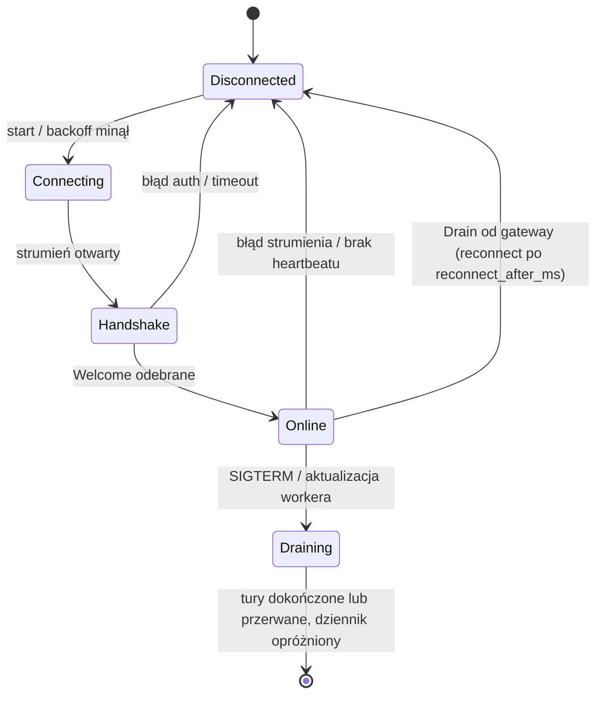
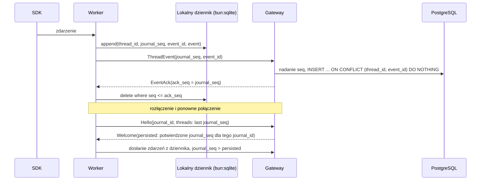

# Protokół gateway ↔ worker

Status: **szkic**, kanał i handshake zaimplementowane (`apps/gateway/src/worker-link`, `apps/worker/src/gateway-link`). Kontrakt: [`proto/openagents/worker/v1/worker_link.proto`](../proto/openagents/worker/v1/worker_link.proto).

## Założenia

- **Worker inicjuje połączenie.** Edge device może stać za NAT-em. Nie otwieramy na nim portów.
- **Jeden strumień dwukierunkowy na workera:** `WorkerLinkService.Connect(stream WorkerMessage) returns (stream GatewayMessage)`.
  - w górę: handshake, heartbeaty, transkrypty, wyniki komend, prośby o uprawnienia, wywołania szyny agentów,
  - w dół: komendy, potwierdzenia zapisu, decyzje o uprawnieniach, wyniki szyny agentów.
- **Transport:** gRPC po HTTP/2 + TLS. Reverse proxy przed gateway musi przepuszczać HTTP/2 i długie strumienie (bez krótkich timeoutów bezczynności).
- **Gateway jest źródłem prawdy** o agentach i uprawnieniach. **Worker jest źródłem prawdy** o tym, które katalogi wolno użyć na urządzeniu.

## Cykl życia połączenia

- **Backoff:** wykładniczy z jitterem, np. 1 s → 60 s. Po `Drain` od gateway worker czeka dokładnie `reconnect_after_ms` (jitter jest już wliczony).
- **Drain gateway:** instancja kończąca pracę wysyła `Drain`, potem kończy strumień statusem OK. Worker łączy się ponownie, zwykle z inną instancją.
- **Drain workera:** `Heartbeat.state = DRAINING`, nowe tury dostają `WORKER_DRAINING`, worker robi half-close po opróżnieniu dziennika. Szczegóły: [durability.md](durability.md).
- **Heartbeat:** worker co `heartbeat_interval_seconds` (domyślnie 15 s). Gateway oznacza workera jako `offline` po 3 brakach.
- **Zamknięcie gateway:** najpierw `WorkerLink.shutdown()` (strumienie kończą się statusem OK), potem `server.close(graceMs)` (GOAWAY, karencja, `destroy`). Bez tego worker dostaje `Internal: missing status`.
- **Tury agentów działają dalej przy zerwanym połączeniu.** Zdarzenia trafiają do lokalnego dziennika i zostaną dosłane.

## Uwierzytelnianie

1. Użytkownik generuje w UI jednorazowy token rejestracyjny (TTL ok. 15 min, w bazie tylko hash).
2. `WorkerEnrollmentService.Enroll` zamienia token na `worker_id` i `worker_credential`.
3. Worker zapisuje je w lokalnym configu z uprawnieniami `0600` (na Windows: ACL tylko dla użytkownika).
4. Każde `Connect` niesie `authorization: Bearer <credential>` w metadanych. Gateway sprawdza hash i czy worker nie jest unieważniony.
5. Docelowo: mTLS (certyfikat klienta wydany przy enrollment) albo rotowany token krótkotrwały.

## Dostarczanie transkryptu (at-least-once + idempotencja)

Zasady:

- `journal_seq` nadaje worker (kolejność w jego dzienniku, do potwierdzeń). `seq` na osi czasu wątku nadaje gateway przy zapisie, wspólny dla zdarzeń workera i platformy (każdy wątek numeruje od 1, także fork).
- Kursory `journal_seq` są ważne tylko w obrębie `Hello.journal_id`. Nowy dziennik (np. reinstalacja workera) oznacza dosłanie wszystkiego; duplikaty odrzuca `event_id`.
- Gateway potwierdza zbiorczo (np. co 100 ms lub co N zdarzeń), nie każde zdarzenie osobno.
- Duplikaty po wznowieniu ignoruje klucz `(thread_id, event_id)`.
- Zdarzenia między turami (zadania w tle, kompaktowanie, zmiany statusu) mają pusty `turn_id` i są przesyłane tak samo.
- Kompaktowanie delt po `item_completed` to decyzja retencji, nie protokołu ([transcript.md](transcript.md#7-retencja)).

## Komendy (gateway → worker)

| Komenda | Efekt na workerze | Wynik |
|---|---|---|
| `CreateThread` | Walidacja `cwd` względem `allowed_roots` i profilu dostawcy. Nowy wątek u dostawcy albo fork (`ForkSpec`: Claude `forkSession`, Codex `thread/fork`). | `CommandResult` + `thread_ready` (`provider_thread_id`) |
| `StartTurn` | Nowa tura. Wątek jest wznawiany w razie potrzeby (Claude `resume`, Codex `thread/resume`) na podstawie pełnego `ThreadSpec`. Idempotentne po `turn_id`. | `CommandResult` + zdarzenia tury |
| `InterruptTurn` | Przerwanie tury (Claude `interrupt()`, Codex `turn/interrupt`). Zadania w tle działają dalej. | `CommandResult` + `turn_finished` (interrupted) |
| `UnloadThread` | Zwolnienie procesu dostawcy, tylko gdy wątek nie jest zajęty (brak tury, zadań w tle i interakcji). Historia zostaje. | `CommandResult` |
| `SteerTurn` | Dołączenie wejścia do tury w toku (Claude strumień wejścia, Codex `turn/steer`). Idempotentne po `input_id`. | `CommandResult` |
| `StopTask` | Zatrzymanie zadania w tle lub subagenta w tle (Claude `stopTask`, Codex zakończenie procesu / `closeAgent`). | `CommandResult` + item `interrupted` |
| `BackgroundItem` | Przeniesienie pracy pierwszoplanowej do tła (Claude `backgroundTasks`). | `CommandResult` |
| `ListDirectory` | Listowanie katalogu w obrębie `allowed_roots` (wybór workspace i `cwd` w UI). | `CommandResult.entries` |

- Każda komenda ma `command_id`. Worker pamięta ostatnio przetworzone ID i nie wykonuje ich drugi raz.
- Gateway czeka na `CommandResult` z timeoutem (np. 10 s). Brak odpowiedzi to błąd w UI, nie cicha porażka.
- Komendy są trwałe: outbox w PostgreSQL z `expires_at` zależnym od typu. Po `Welcome` gateway dosyła niepotwierdzone komendy, worker deduplikuje po `command_id` (pamięta wyniki). Przeterminowana komenda kończy się błędem w UI. Szczegóły: [durability.md](durability.md#42-outbox-komend).
- `WORKER_DRAINING`: worker w trakcie zatrzymania nie przyjmuje nowych tur. Komenda zostaje w outboxie i trafi do workera po restarcie.

## Interakcje z użytkownikiem (zgody, pytania, formularze)

1. Dostawca czeka na człowieka: zgoda (Claude `canUseTool`; Codex `item/commandExecution|fileChange|permissions/requestApproval`), pytanie (Claude `AskUserQuestion`; Codex `item/tool/requestUserInput`) albo elicitation MCP.
2. Worker wysyła `InteractionRequest` (`kind`, `item_id`, `turn_id` pusty, gdy pyta zadanie w tle po turze) i wstrzymuje dostawcę.
3. Gateway zapisuje `interaction_requests`, dodaje item `interaction_prompt` na oś czasu i powiadamia UI.
4. Użytkownik odpowiada. Gateway wysyła `InteractionResponse`.
5. Worker zwraca odpowiedź dostawcy (Codex: `accept` / `acceptForSession` / `decline` / `cancel`).

Zgoda bez decyzji w ustalonym czasie oznacza odmowę. Po zerwaniu połączenia oczekujące interakcje są wysyłane ponownie po `Welcome`. Szczegóły: [execution.md](execution.md#6-interakcje-z-użytkownikiem).

## Praca w tle i subagenci

- `InterruptTurn` przerywa tylko turę; zadania w tle zatrzymuje `StopTask`. `BackgroundItem` przenosi pracę pierwszoplanową do tła, a `SteerTurn` dołącza wejście do tury w toku.
- Dostawca może sam zacząć turę (`TurnStarted.trigger = PROVIDER | RECOVERY`), wtedy `turn_id` nadaje worker.
- `ThreadActivity` opisuje turę w toku, zadania w tle i oczekujące interakcje.
- Szczegóły: [execution.md](execution.md).

## Konfiguracja zdalna

- Po `Welcome` gateway wysyła `WorkerConfig`, jeśli `Hello.config_version` jest inna (po starcie procesu zawsze 0). Zmiany wysyła na żywo (`pushConfig`).
- Worker waliduje na urządzeniu i odpowiada `ConfigApplied` (`applied`, `issues`, wykryci dostawcy, dostępność profili). Błąd krytyczny = worker zostaje przy poprzedniej konfiguracji.
- Lokalnie worker ma tylko połączenie z gateway. Szczegóły: [worker-config.md](worker-config.md).

## Profile dostawców

- Profile są w zdalnej konfiguracji (`WorkerConfig.profiles`); worker raportuje ich dostępność w `ConfigApplied` (bez kluczy).
- Gateway zapisuje profil per wątek i przekazuje go w `ThreadSpec.provider_profile_id`. Pusty oznacza `native`.
- Worker odrzuca nieznany, niedostępny albo niepasujący do dostawcy profil (`CommandResult.ok = false`).
- Szczegóły: [architecture.md](architecture.md#8-profile-dostawców-i-cliproxyapi).

## Szyna agentów

Wywołania narzędzi szyny (`spawn_thread`, `send_message`, `wait_threads`, ... — [agent-bus.md](agent-bus.md)) z agenta SDK wracają do gateway jako `AgentToolCall`. Gateway:

1. zwraca zapisany wynik, jeśli `call_id` już był wykonany (ponowienie po zerwaniu połączenia),
2. dekoduje argumenty schematem narzędzia i sprawdza reguły (`authorizeBusCall`: drzewo wątków, potomkowie, limity, `hops`) w imieniu właściciela projektu,
3. zapisuje `agent_bus_calls` i wykonuje operację (np. wątek boczny `origin = agent` z turą i komendami do workera),
4. zwraca `AgentToolResult` (tekst dla modelu + `result_json` dla osi czasu).

`spawn_thread` i `send_message` odpowiadają od razu; `wait_threads` trwa najwyżej `timeout_seconds`. Worker nie blokuje przez to innych wątków, bo strumień jest multipleksowany po `call_id`.

## Kontrola przepływu

- HTTP/2 ma flow control na poziomie strumienia. Dodatkowo worker ogranicza liczbę niepotwierdzonych zdarzeń (np. 1000). Po przekroczeniu buforuje tylko w dzienniku.
- Duże treści (output komendy, diff, obraz) nie są przycinane. Worker wysyła je jako `BlobChunk` (sha256), a zdarzenie wskazuje blob przez `BlobRef` ([transcript.md](transcript.md#5-zapis-po-stronie-gateway)).

## Wersjonowanie

- Pakiet `openagents.worker.v1`. Zmiany zgodne wstecz: tylko nowe pola i wartości enumów.
- `Hello.host.worker_version` pozwala gateway odrzucić zbyt stare workery z czytelnym komunikatem.
