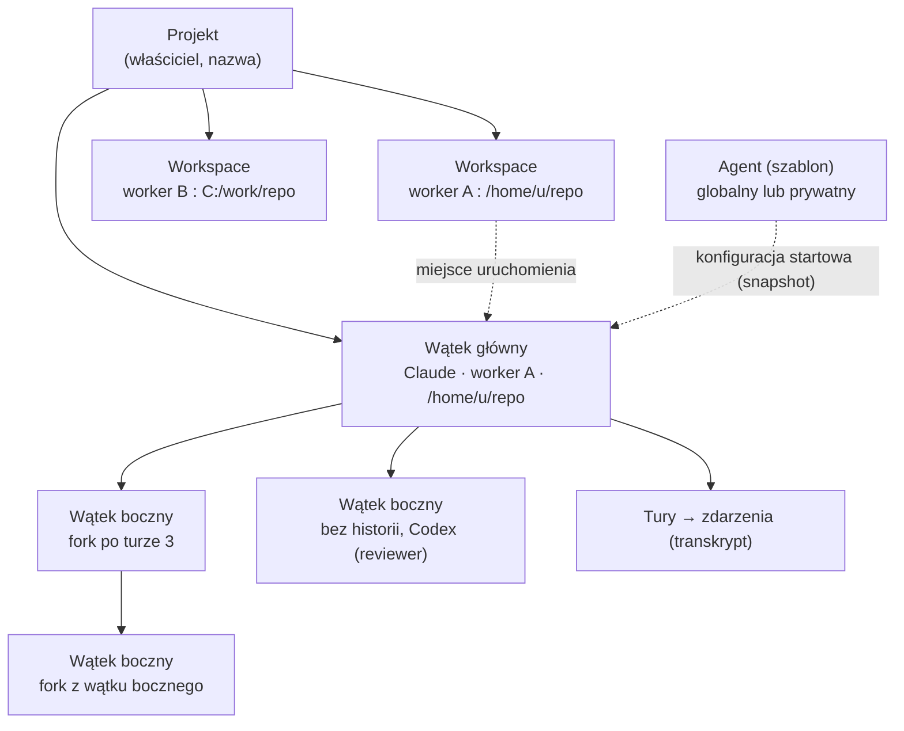
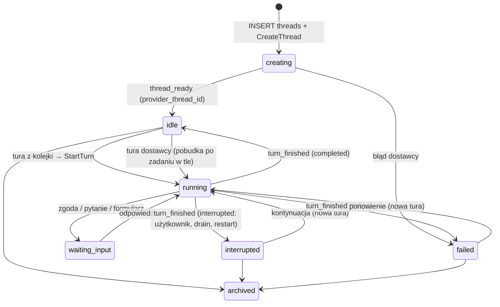

# Projekty, wątki i wątki boczne

## Filtr, menu i archiwum

Przycisk obok „Search threads” otwiera wyszukiwanie projektów i wybór wielu projektów.
Filtr oraz przypięcia są wspólne dla urządzeń, zapisane w gateway.
Wyszukiwanie tytułów wątków głównych i bocznych oraz nazw projektów działa wewnątrz filtra.
Aktywny filtr ma licznik i szybkie czyszczenie; pusty wynik ma „Clear filters”.

Pod aktywnymi wątkami znajduje się zwijana sekcja „Archived · N” z chevronem. Licznik obejmuje
główne wiersze pasujące do filtra projektów i wyszukiwania. Stan rozwinięcia zapisuje się w gateway
(`sidebar.archived_expanded`), także między urządzeniami. Rozwinięcie pobiera pierwsze 20 wierszy,
a „Load more” kolejne strony. Wiersz ma przygaszony awatar projektu, ucięty tytuł, względny czas
archiwizacji po prawej i to samo menu z „Unarchive”. Zwinięcie pozostawia sam nagłówek; jeśli otwarty
wątek jest archiwalny, sekcja pokazuje jego wyróżniony wiersz i przypina całość u dołu podczas
przewijania. Wyjątkiem są boczne pod aktywnym rodzicem: pozostają w jego „Previous agents”.
Indeks startowy nie przesyła całego archiwum. Szczegóły stron: [ui-api.md](ui-api.md#pasek-boczny-i-cykl-życia-wątku).

Menu otwiera prawy przycisk myszy, przytrzymanie na ekranie dotykowym, klawisz Menu lub Shift+F10
na wierszu i przycisk „…” po najechaniu lub ustawieniu fokusu. Dotknięcie przechodzi do wątku.
Strzałki obsługują menu, Escape zamyka je i oddaje fokus. Telefon używa dolnego arkusza.
Akcje: nowa karta, nowy wątek w projekcie, przypięcie, rename, generowanie tytułu, stan przeczytania,
filtr projektu, kopiowanie, ustawienia, archiwizacja i usunięcie. Odpowiednie akcje bieżącego wątku są w Cmd+K.

Archiwum zachowuje czytelną oś czasu. Zamiast kompozytora pokazuje ikonę, czas i autora archiwizacji
(użytkownik, agent albo archiwizacja razem z rodzicem), „Unarchive” i odnośnik do rodzica subagenta.
Przywrócenie płynnie przywraca kompozytor. Starsze archiwum pokazuje tylko znane informacje.
Gateway odrzuca wiadomości do archiwum.

Główny wątek i jego boczne archiwizują się razem. Gateway w jednej transakcji oznacza aktywne
boczne jako `archived_by=cascade`, przerywa działające tury i anuluje kolejkę, harmonogramy oraz
oczekujące dostarczenia, tak jak przy niezależnej archiwizacji. Przywrócenie głównego odtwarza tylko
dzieci z tym oznaczeniem. Boczne zarchiwizowane wcześniej przez użytkownika albo agenta pozostają
w archiwum. „Unarchive with parent” przy takim dziecku przywraca głównego i jego kaskadę.
Samodzielna archiwizacja bocznego nie zmienia rodzica ani rodzeństwa. Najpierw trzeba przywrócić
rodzica, aby niezależnie przywrócić jego dziecko. W Archived główny ma jeden wiersz, a boczne są
pod nim w „Previous agents”; nie powielają się jako osobne wyniki ani na aktywnej liście.

Pasek i Lineage pokazują aktywnych subagentów; archiwalni trafiają do zwijanej grupy „Previous agents · N”
z ikoną dostawcy, tytułem i czasem. Gdy wszystkie dzieci są archiwalne, pod otwartym rodzicem
pozostaje ta zwinięta grupa. Lineage podaje liczbę pracujących subagentów. Przypięcia używają FLIP,
archiwizacja/usunięcie zwija wiersz; menu i grupy respektują wspólne tokeny oraz ograniczenie ruchu.
Wspólny `SidebarThreadChildren` utrzymuje ten sam układ dzieci w obu listach; kompaktowy
`SidebarArchivedThread` korzysta ze wspólnego `SidebarThreadLink`, więc obsługa menu pozostaje jedna.

Usunięcie jest miękkie (`deleted_at`): ukrywa wątek także w wyszukiwaniu, wzmiankach i `list_threads`.
Razem z rodzicem usuwa dzieci, przerywa ich tury, anuluje harmonogramy i kolejkę. Potwierdzenie podaje
liczbę dzieci. „Undo” działa przez sześć sekund, przywraca tę partię, zachowuje wcześniejsze archiwum
i nie wznawia pracy. Nie ma interfejsu trwałego usuwania. Kontrakt: [ui-api.md](ui-api.md#pasek-boczny-i-cykl-życia-wątku).
Archiwizacja i usunięcie anulują również oczekujące dostarczenie odpowiedzi `ask_user` oraz notatek
zadań w tle. Przywrócenie nie odtwarza tych powiadomień jako nowych tur.

Status: **projekt**, schemat zaimplementowany (`packages/db/src/migrations/0001_init.sql`, testy na PostgreSQL w `packages/db/test`).

Powiązane: [data-model.md](data-model.md), [protocol.md](protocol.md), [durability.md](durability.md).

Tytuły generowane przez SDK na workerze, ustawienia i zasady rename/regeneracji: [thread-titles.md](thread-titles.md).

## 1. Pojęcia

| Pojęcie | Co to jest |
|---|---|
| **Projekt** | Logiczna jednostka pracy użytkownika (np. repozytorium). Grupuje wątki. |
| **Workspace** | Fizyczne miejsce projektu: katalog na konkretnym workerze. Ten sam projekt może mieć kopie na kilku maszynach. |
| **Agent** | Szablon: dostawca, model, instrukcje, tryb uprawnień. Globalny (dla wszystkich) albo prywatny. **Nie ma miejsca uruchomienia.** |
| **Wątek** | Jedna trwała rozmowa. Na całe życie przypięta do: jednego dostawcy (Claude albo Codex), jednego wątku u dostawcy, jednego workera i jednego katalogu. |
| **Wątek boczny** | Wątek pod wątkiem głównym (albo innym bocznym), w tym samym katalogu na tym samym workerze. Może dziedziczyć historię rodzica (fork). |
| **Tura** | Jedno wejście (użytkownika albo agenta) i praca dostawcy do zakończenia. Jednostka kolejkowania, przerwania i forka. |
| **Zdarzenie** | Element transkryptu: `(thread_id, seq)`, tylko dopisywane. |

Zmiana względem wcześniejszego szkicu: `agents.worker_id` i `agents.cwd` znikają. Miejsce uruchomienia należy do wątku, nie do agenta. Dzięki temu globalnego agenta można użyć w wątku dowolnego projektu na dowolnym workerze. `conversations`, `messages` i `agent_sessions` zastępuje para wątki + tury.

## 2. Dlaczego wątek jest przypięty do workera i katalogu

Historia rozmowy u dostawcy leży w plikach na urządzeniu (`~/.claude/projects`, `~/.codex/sessions`) i jest związana z katalogiem roboczym. Wznowienie (`resume`, `thread/resume`) i fork (`forkSession`, `thread/fork`) działają tylko tam. Stąd niezmienniki:

- placement wątku (`worker_id`, `workspace_id`, `cwd`, `provider`) jest **niezmienny** (trigger `threads_before_update`),
- `provider_thread_id` ustawia się raz, przy zdarzeniu `thread_ready`,
- wątek boczny ma **ten sam** worker i katalog co rodzic (trigger `threads_before_insert`),
- jeśli worker zostanie wycofany, jego wątki stają się tylko do odczytu. Transkrypt w PostgreSQL zostaje.

Przeniesienie pracy na inną maszynę to nowy wątek w innym workspace tego samego projektu, nie migracja wątku.

### Projekt na wielu workerach i systemach

Projekt nie jest przypięty do maszyny. Ma dowolnie wiele workspace'ów, każdy to para (worker, katalog), np. to samo repozytorium na serwerze Linux, na Macu i na Windows. Wątek wybiera jeden workspace i zostaje na nim do końca.

- **Ścieżki według systemu workera**, nie gateway (`apps/gateway/src/store/paths.ts`). Styl wynika z `os` zgłoszonego przez workera, a przed pierwszym połączeniem z jego dozwolonych katalogów. Gateway zapisuje ścieżkę w postaci kanonicznej (separatory systemu, bez końcowego separatora, rozwiązane `..`).
- **Sprawdzenia w gateway** (leksykalne): workspace leży w dozwolonych katalogach workera; ten sam katalog nie jest dwa razy workspace'em projektu na tym workerze (bez rozróżniania wielkości liter na Windows i macOS); `cwd` wątku leży w jego workspace; wątek boczny jest w workspace rodzica. Worker i tak sprawdza ścieżki rzeczywiste (dowiązania) przy starcie wątku.
- **Worker offline:** wątek i wiadomości są przyjmowane, a komendy czekają w outboxie do ponownego połączenia tego workera. Komendy nigdy nie trafiają do innego workera projektu.
- Synchronizacja kodu między kopiami projektu (git push/pull) jest poza platformą: workspace'y to niezależne katalogi.
- **Na których workerach żyje projekt:** na tych, na których ma workspace (wszystkich albo tylko niektórych, jak skonfiguruje użytkownik). Nowy wątek wybiera projekt, a potem worker spośród jego workspace'ów. `UpdateWorkspace` zmienia katalog (te same sprawdzenia co przy dodaniu); istniejące wątki zostają w swoim `cwd`. `RemoveWorkspace` zdejmuje projekt z workera (archiwizacja workspace'u): nowe wątki główne nie mogą go wybrać, istniejące działają dalej, a ich wątki boczne i forki powstają w tym samym workspace'ie.

## 3. Wątki boczne

- Tworzy je użytkownik (`origin = user`) albo agent przez szynę agentów (`origin = agent`, patrz 6).
- Dziedziczą projekt, właściciela, drzewo (`root_thread_id`), worker, workspace i katalog.
- **Dwa poziomy:** wątek główny (0) i wątki boczne (1). Wątek boczny nie ma własnych wątków bocznych (`threads_max_depth`); fork wątku bocznego to jego rodzeństwo.
- `interaction_route`: kto odpowiada na zgody i pytania wątku bocznego, użytkownik (`human`) albo agent wątku głównego (`parent`, domyślnie dla wątków tworzonych przez agenta).
- **Bez forka** mogą użyć innego dostawcy i agenta niż rodzic, np. Codex jako reviewer w wątku prowadzonym przez Claude.
- **Z forkiem** muszą zachować dostawcę, bo historia jest w formacie dostawcy.

### Fork: dziedziczenie historii

| | Claude Agent SDK | Codex app-server |
|---|---|---|
| Operacja | `forkSession(sessionId, { upToMessageId })`, operacja na plikach, bez wywołania modelu | `thread/fork { threadId, lastTurnId }` |
| Punkt forka | uuid wiadomości kończącej turę | id tury |
| Ograniczenia | fork nie kopiuje historii cofania (file-history) | nie z tury w toku |

Wspólny mianownik i reguła platformy: **fork zawsze na granicy zakończonej tury** (`completed`, `failed` albo `interrupted`; nigdy z tury w toku).

- `fork_after_turn_id` wskazuje turę źródła. Gdy nie jest podany, baza przypina go przy tworzeniu do ostatniej tury `completed`. Odziedziczona historia nie zmienia się już potem, nawet gdy źródło pracuje dalej.
- `turns.provider_turn_ref` zapamiętuje punkt forka u dostawcy (Codex: id tury, Claude: uuid wiadomości). Worker dostaje go w `ForkSpec`.
- Fork wątku w trakcie tury jest dozwolony. Dziedziczy wtedy stan do ostatniej zakończonej tury.

### Fork od tury („Fork from here”)

Jak „Branch in new chat” w ChatGPT: przycisk pod zakończoną turą (obok „Copy answer”) albo „Fork thread” w menu wątku i palecie (od ostatniej zakończonej tury) tworzy **nowy wątek główny** z historią do tej tury włącznie i od razu go otwiera.

- **Gdzie:** ten sam projekt, workspace i katalog, ten sam dostawca, instancja, model, wysiłek, tryb uprawnień i instrukcje co wątek, z którego forkujemy. Wątek główny, a nie boczny: to nowa rozmowa użytkownika (osobna pozycja w skrzynce, własne wątki boczne), a nie praca pod źródłem; wątek boczny z forkiem do wybranej tury też jest możliwy (`parent_thread_id` + `fork` + `fork_at_turn_id`), ale UI go nie oferuje.
- **Drzewo:** forkowany wątek główny zaczyna własne drzewo (`root_thread_id` = on sam). Baza (migracja 0020) wymaga od niego tego samego projektu, właściciela i workera co źródło (historia dostawcy leży na tym workerze); wątek boczny z forkiem nadal musi być w drzewie źródła.
- **Punkt:** `CreateThread.fork_at_turn_id` to tura z widocznej historii wątku `fork_thread_id`: jego własna albo odziedziczona do jego punktu forka. Tura odziedziczona należy do innego wątku; źródłem forka (`fork_source_thread_id`) staje się wtedy wątek, do którego tura należy — jego historia do tej tury jest dokładnie tym, co widać. Tura musi być zakończona i mieć punkt u dostawcy (`provider_turn_ref`); tura, której dostawca nie zaczął (np. worker odrzucił `StartTurn`), nie ma go, więc gateway odmawia („fork from an earlier turn”). Worker też odmawia (`FORK_POINT_UNKNOWN`), gdy `ForkSpec.after_turn_id` nie ma `after_provider_turn_ref` — nigdy nie kopiuje wtedy całej historii po cichu.
- **Tury nieudane i przerwane:** fork od nich jest dozwolony (historia do tego miejsca; Codex `thread/fork` przyjmuje każdą turę poza tą w toku, Claude kopiuje transkrypt do ostatniego wpisu tury).
- **Pochodzenie:** `Thread.fork_source_thread_id`, `fork_after_turn_id` i `fork_after_turn_ordinal`. UI pokazuje „Forked from ‹tytuł› · Turn N” nad własną osią czasu i w panelu wątku.
- Potwierdzone na żywo (`tests/integration/fork-from-turn.live.test.ts`, 2026-11-02, CLIProxyAPI): wątek Codex i Claude z trzema turami, fork od tury 2, pytanie „co powiedziałem w ostatniej wiadomości?” — oba odpowiadają słowem z tury 2, nie z tury 3.

### Transkrypt bez kopiowania

Zdarzenia źródła nie są kopiowane. Widoczna historia wątku to prefiksy źródeł (rekurencyjnie przez łańcuch forków), każdy do `last_seq` tury forka, plus własne zdarzenia. Zwraca ją funkcja `thread_timeline(thread_id)`. Odziedziczone wiersze mają `inherited = true` i zachowują `thread_id` źródła, więc UI może je oznaczyć.

## 4. Cykl życia wątku i tury

- **Jedna tura w toku na wątek** (`turns_one_running`). Kolejne wejścia czekają jako `queued` i są wysyłane po zakończeniu bieżącej tury. Wstrzykiwanie wejścia w trakcie tury (Codex `turn/steer`) to późniejsza optymalizacja.
- `turn_id` generuje gateway przed wysłaniem, więc `StartTurn` jest idempotentne. `client_request_id` deduplikuje ponowione akcje z UI.
- Każda komenda niesie pełny `ThreadSpec` (placement, ustawienia, `provider_thread_id`). Worker może więc wznowić wątek nawet po utracie lokalnego stanu. Baza jest źródłem prawdy, a SQLite workera to dziennik i cache.

## 5. Zasoby na workerze

- **Załadowany** wątek ma proces dostawcy w pamięci. Claude: jeden proces CLI na aktywny `query()`. Codex: wątki w jednym procesie `codex app-server`.
- **Utrwalony** wątek ma tylko pliki historii. Wznawiany jest leniwie przy `StartTurn`.
- Worker trzyma limit tur w toku oraz zwalnia bezczynne wątki po czasie (`UnloadThread` albo własna decyzja workera). Wątek z zadaniami w tle albo oczekującymi interakcjami nie jest bezczynny ([execution.md](execution.md#2-aktywność-wątku)). Dzięki trwałości zwolnienie nic nie kosztuje poza ponownym wczytaniem.
- Wiele wątków bocznych w jednym katalogu to wiele procesów naraz. Limit współbieżności jest per worker, a polityka zapisu per katalog (decyzja 1).

## 6. Szyna agentów a wątki boczne

Agenci delegują pracę, tworząc wątki boczne (`spawn_thread`, `origin = agent`, `spawned_by_call_id`), wysyłając do nich kolejne prompty (`send_message`) i sprawdzając ich stan (`get_thread`, `wait_threads`). Natywni subagenci dostawców są domyślnie wyłączeni. Dzięki temu:

- rozmowy agentów są zwykłymi wątkami, które użytkownik widzi w drzewie projektu i może przerwać,
- agent docelowy pracuje na tych samych plikach co wywołujący,
- dla agentów czatowych (runtime `gateway`) cel jest wątkiem bocznym bez workera i katalogu.

Szczegóły: [agent-bus.md](agent-bus.md). Wywołanie agenta poza bieżącym drzewem wątków: na razie poza zakresem.

## 7. Dostęp

- Projekt, jego wątki, tury i transkrypty należą do właściciela projektu. Wątki boczne dziedziczą właściciela.
- Agent globalny użyty w wątku nie daje innym użytkownikom wglądu w ten wątek.
- Workspace może wskazywać tylko worker, do którego właściciel projektu ma dostęp (własny albo współdzielony). Sprawdza to gateway.

## 8. Decyzje do podjęcia

1. **Współbieżny zapis w jednym katalogu.** Wątki boczne dzielą katalog, więc dwie tury mogą jednocześnie zmieniać te same pliki. Opcje:
   - (a) bez ograniczeń, odpowiedzialność użytkownika,
   - (b) **dzierżawa zapisu per katalog:** w danej chwili tylko jedna tura w trybie zapisu, pozostałe tylko do odczytu albo w kolejce (propozycja),
   - (c) wątki boczne domyślnie tylko do odczytu, zapis na żądanie.
2. **Czy projekt może być współdzielony** (członkowie projektu), czy na razie tylko właściciel.
3. **Agenci czatowi w projektach:** czy wątki czatowe zawsze należą do projektu (obecny schemat: tak), czy potrzebny jest kontekst „bez projektu”.
4. **Przyszłość: `git worktree`** (później, szkic w sekcji 9).

## 9. Git worktrees (szkic, później)

Cel: równoległa praca kilku wątków nad jednym repozytorium bez wspólnego katalogu, każdy na własnej gałęzi. Rozwiązuje też konflikt zapisu z decyzji 1 bez dzierżawy.

- **Worktree to workspace pochodny:** `project_workspaces.kind = 'worktree'`, `base_workspace_id` (repozytorium na tym samym workerze), `branch`, `base_ref`. Wątek wskazuje go jak każdy workspace, więc reszta modelu (placement, wznowienie, fork u dostawcy) się nie zmienia.
- **Tworzy go worker** (komenda `CreateWorktree`: `git worktree add` w katalogu danych workera albo w podanym miejscu w dozwolonych katalogach), bo tylko on ma repozytorium. Gateway zapisuje workspace po potwierdzeniu, idempotentnie po `command_id`.
- **Wątki boczne:** opcja izolacji przy tworzeniu (`shared` = katalog rodzica, jak dziś; `worktree` = nowy worktree z gałęzi rodzica). Fork historii działa w obu, ale w trybie `worktree` to świadome odejście od reguły „ten sam katalog”, więc dostawca musi przyjąć fork w innym `cwd` (do sprawdzenia: Codex `thread/fork` z nowym `cwd`, Claude `forkSession` przypięty do katalogu projektu).
- **Szyna agentów:** `spawn` z `isolation: worktree`; wynik pracy wraca jako gałąź (diff, commit), a scalenie jest osobną, jawną akcją (użytkownik albo orkiestrator).
- **Sprzątanie:** archiwizacja workspace'u usuwa worktree (`git worktree remove`), gałąź zostaje. Worker zgłasza osierocone worktree (`git worktree prune`) w raporcie.
- **Systemy:** na Windows długie ścieżki (`core.longpaths`), na wszystkich systemach wymagany `git` w raporcie możliwości workera.
