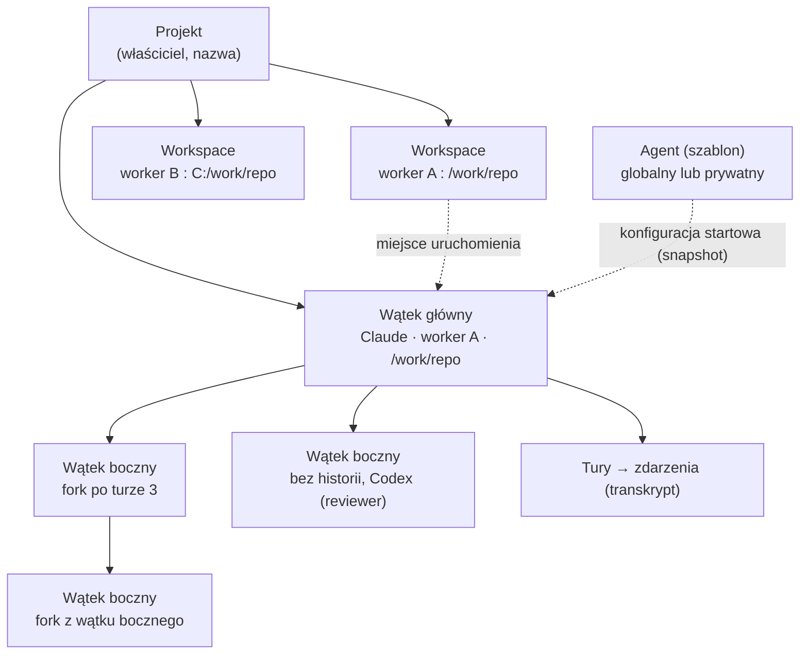
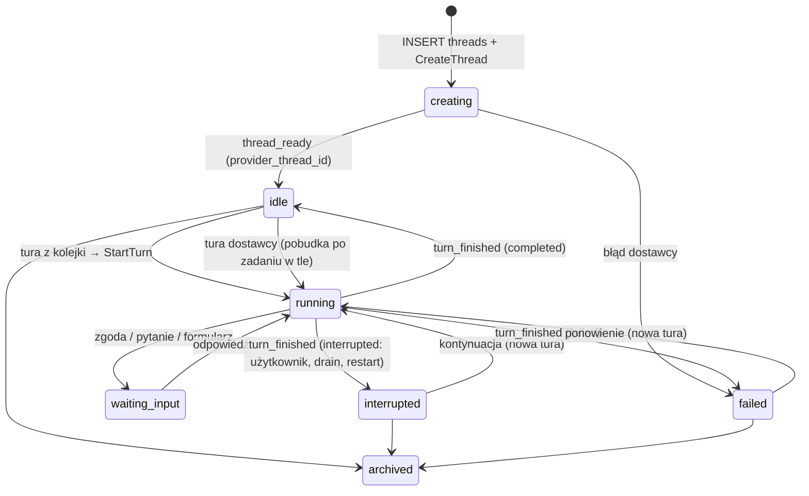

# Projekty, wątki i wątki boczne

## Nowy wątek boczny w webie

„New side thread” z panelu szczegółów, menu wątku i palety poleceń otwiera
`/threads/[id]/new-side-thread`. Widok używa tego samego `ComposerBox`, `ModelControls`
i `PermissionPicker` co nowy wątek. Fokus trafia do wiadomości; Escape oraz „Back”
wracają do wątku głównego. Escape w otwartym pickerze najpierw zamyka picker.
Szkic bierze tryb uprawnień wątku głównego, z wyjątkiem Full access: wtedy zaczyna od Full auto.

**Tryby uprawnień** (`PermissionPicker`, „Permissions…”, domyślne wątków): Ask first, Accept edits,
Read only, Full auto (bez pytań, w sandboxie workspace'u) i Full access (bez pytań i bez sandboxa,
[protocol.md](protocol.md#modele-effort-i-steer)). Full access ma kolor rose i ikonę `shield-off`
(pigułka kompozytora, panel, hover card, `PermissionModeTitle` z odznaką „No sandbox”). Każdy wybór
Full access w pickerze i w domyślnych wątków potwierdza dialog „Turn on full access?”
(`FullAccessConfirm`); w „Permissions…” potwierdzeniem jest przycisk „Turn on full access” zamiast
„Save”. Fork użytkownika, szkic wątku bocznego i harmonogram dostają co najwyżej Full auto.
Subagent uruchamiany narzędziem dziedziczy tryb właściciela, także Full access.
Settings → Threads → Subagents wybiera **Same as parent** (domyślnie) lub stały tryb,
który nie przekroczy uprawnień rodzica. Gateway zapisuje rozstrzygnięty tryb na dziecku;
późniejsza zmiana rodzica nie zmienia istniejących dzieci. Tryb tury może ograniczyć
dziedziczenie poniżej domyślnego trybu wątku. Ograniczenie Full access przez komputer
do Full auto ma wyjaśnienie w panelu szczegółów web i mobile. Szczegóły: [agent-bus.md](agent-bus.md).

Breadcrumb nad stroną pokazuje projekt, wątek główny (link) i „New side thread”; „Same directory on …” podaje komputer.
Długie nazwy są ucinane; podpowiedź pokazuje pełny komputer, projekt, katalog i gałąź worktree.
Projekt, komputer, workspace, worktree oraz gałąź bazowa nie mają pickerów: ten przepływ
zawsze używa miejsca wątku głównego. Dostawca i instancja pochodzą z rodzica także w BFF;
picker modelu oferuje tylko modele tej instancji. Wysiłek i uprawnienia można zmienić.

Przełącznik „Use main thread history” jest domyślnie włączony i kontynuuje historię
do ostatniej zakończonej tury rodzica. Wyłączenie zaczyna od samego zadania.
Tytuł jest generowany jak w zwykłym wątku. Wiadomość, wzmianki i załączniki trafiają
do wspólnego `CreateThread`; zgody i lineage nadal egzekwuje gateway.

## No project — rozmowy na maszynie

Pierwsza pozycja pickera projektu na ekranie „What should we work on?” to **No project**
z przerywaną kwadratową ikoną. Wystarczy wybrać worker oraz zwykłe ustawienia agenta, modelu,
wysiłku i uprawnień. Można zacząć bez żadnego zwykłego projektu i bez konfigurowania katalogów
workera. Worker offline pozostaje widoczny, ale kompozytor czeka na jego połączenie.

Przy `CreateThread` worker tworzy katalog
`<data_dir>/scratch/<user-id>/<thread-id>` i uruchamia w nim agenta.
UUID zapewnia stałą, bezpieczną nazwę: zmiana tytułu nie zmienia katalogu. Nowe katalogi na POSIX
mają uprawnienia `0700`. Worker sprawdza rzeczywiste ścieżki oraz odrzuca symlinki w zarządzanym
poddrzewie scratch, zanim utworzy ich dzieci. Istniejące stare katalogi scratch pozostają użyteczne
pod zapisanym cwd; zmiana bazy nie przenosi plików.

Wątki boczne, także `spawn_thread`, oraz forki zachowują cwd rodzica lub źródła. Nowe niezależne
rozmowy i kolejne wykonania harmonogramu dostają osobne katalogi. Pełną ścieżkę pokazuje panel
szczegółów; można ją skopiować z menu. Archiwizacja, usunięcie w UI i zakończenie pracy nie usuwają
plików. **Brak automatycznego czyszczenia**: użytkownik usuwa katalog ręcznie dopiero wtedy,
gdy żaden fork ani wątek boczny nie potrzebuje plików.

Sidebar, filtr projektów, hover card i paleta poleceń pokazują „No project” oraz tę samą ikonę.
Settings → Threads → „Project and worker” pozwala wybrać worker w grupie „No project”.
Systemowy projekt nie występuje w Settings → Projects. Harmonogram nowego wątku pozwala
wybrać „No project” i konkretny worker. Boty również mogą wskazać tę pozycję i workspace
workera przez `list_projects` oraz `start_thread`.

Przed wysłaniem pierwszej wiadomości katalog scratch jeszcze nie istnieje, więc lista plików
we wzmiankach jest pusta. Katalog komend i umiejętności pochodzi wtedy z katalogu domowego
workera; po utworzeniu wątku katalog i wyszukiwanie plików używają jego dokładnego cwd.

## Filtr, menu i archiwum

Tło zaznaczenia w sidebarze wskazuje wyłącznie otwarty wątek, także podczas pracy i najechania.
Pracę oznaczają pierścień i etykieta „Working” z czasem; sam stan pracy nie dodaje tła ani
nie przygasza tekstu. Hover niezaznaczonego wiersza jest słabszy od zaznaczenia, a fokus
klawiatury ma osobny obrys. Te same reguły obowiązują dla wątków głównych i bocznych.

Przycisk obok „Search threads” otwiera wyszukiwanie projektów i wybór wielu projektów.
Filtr oraz przypięcia są wspólne dla urządzeń, zapisane w gateway.
Wyszukiwanie tytułów wątków głównych i bocznych oraz nazw projektów działa wewnątrz filtra.
Aktywny filtr ma licznik i szybkie czyszczenie; pusty wynik ma „Clear filters”.

Pod aktywnymi wątkami znajduje się zwijana sekcja „Archived · N” z chevronem. Licznik obejmuje
główne wiersze pasujące do filtra projektów i wyszukiwania. Stan rozwinięcia zapisuje się w gateway
(`sidebar.archived_expanded`), także między urządzeniami. Zwinięta sekcja pobiera sam licznik, a
pierwszą stronę (20 wierszy) pobiera z wyprzedzeniem: gdy pasek jest bezczynny (ponownie po zmianie
licznika) oraz po najechaniu lub fokusie na nagłówku. Ta strona zostaje w pamięci podręcznej; zmiana
wątku lub projektu ze strumienia i ponowne połączenie oznaczają ją jako nieaktualną. Rozwinięcie
pokazuje ją od razu (nieaktualną odświeża w tle), a bez niej po 200 ms pokazuje szkielet kilku
wierszy o docelowej wysokości. Wysokość listy płynnie podąża za treścią (szkielet, wiersze, kolejne
strony), nowe wiersze wchodzą z lekkim opóźnieniem kolejnych; przy `prefers-reduced-motion` bez
ruchu. „Load more” pobiera kolejne strony; zwinięcie zostawia w pamięci tylko pierwszą. Wiersz ma przygaszony awatar projektu, ucięty tytuł, względny czas
archiwizacji po prawej i to samo menu z „Unarchive”. Zwinięcie pozostawia sam nagłówek; jeśli otwarty
wątek jest archiwalny, sekcja pokazuje jego wyróżniony wiersz i przypina całość u dołu podczas
przewijania. Wyjątkiem są boczne pod aktywnym rodzicem: pozostają w jego „Previous agents”.
Archiwizacja otwartego wątku ani wejście w archiwalny wątek nie rozwijają sekcji: wystarcza ten wiersz.
Indeks startowy nie przesyła całego archiwum. Szczegóły stron: [ui-api.md](ui-api.md#pasek-boczny-i-cykl-życia-wątku).

Menu otwiera prawy przycisk myszy, przytrzymanie na ekranie dotykowym, klawisz Menu lub Shift+F10
na wierszu i przycisk „…” po najechaniu lub ustawieniu fokusu. Dotknięcie przechodzi do wątku.
Strzałki obsługują menu, Escape zamyka je i oddaje fokus. Telefon używa dolnego arkusza.
Akcje: nowa karta, nowy wątek w projekcie, przypięcie, rename, generowanie tytułu, stan przeczytania,
filtr projektu, kopiowanie, ustawienia, archiwizacja i usunięcie. Odpowiednie akcje bieżącego wątku są w Cmd+K.

Na web/desktop najechanie na główny wiersz lub fokus wewnątrz niego zamienia znak dostawcy
w prawym dolnym rogu na przycisk „Archive”. Slot zachowuje rozmiar i pozycję, więc podpis
komputera i katalogu nadal się ucina bez przesunięć. Zamiana statusu/czasu na „…” używa
tych samych klas i tokenów ruchu co znak dostawcy/Archive, w obu kierunkach i bez opóźnienia.
Otwarte menu utrzymuje oba przyciski widoczne; przy ograniczeniu ruchu zamiana jest natychmiastowa.
W kompaktowym archiwum „Unarchive” zajmuje zarezerwowane miejsce obok menu „…”. Skrót nie otwiera wątku,
respektuje te same potwierdzenia i ograniczenia dostępności co menu, a po powodzeniu oddaje
fokus następnemu wierszowi (ostatni — poprzedniemu; pusta lista — wyszukiwaniu).
Na ekranach bez hovera i z grubym wskaźnikiem skrót jest ukryty; menu pozostaje dostępne.
Archiwizacja z menu i skrótu oferuje toast „Thread archived” z „Undo” przez sześć sekund.
Cofnięcie przywraca wątek i jego kaskadę przez istniejące API, bez wznawiania pracy.

Archiwum zachowuje czytelną oś czasu. Zamiast kompozytora pokazuje ikonę, czas i autora archiwizacji
(użytkownik, agent albo archiwizacja razem z rodzicem), „Unarchive” i odnośnik do rodzica subagenta.
Przywrócenie płynnie przywraca kompozytor. Starsze archiwum pokazuje tylko znane informacje.
Gateway odrzuca wiadomości do archiwum.

Archiwizacja przerywa turę, lecz pozostawia zadania w tle do zakończenia lub
ręcznego zatrzymania. Wynik zadania nadal zapisuje się w archiwum; ani notatka
platformy, ani natywna pobudka harnessu nie zaczynają nowej tury. Przywrócenie
wątku pokazuje wynik bez automatycznego wznawiania kontynuacji. Szczegóły:
[execution.md](execution.md#pobudka-agent-dowiaduje-się-o-każdym-końcu-zadania).

Główny wątek i jego boczne archiwizują się razem. Gateway w jednej transakcji oznacza aktywne
boczne jako `archived_by=cascade`, przerywa działające tury i anuluje kolejkę, harmonogramy oraz
oczekujące dostarczenia, tak jak przy niezależnej archiwizacji. Przywrócenie głównego odtwarza tylko
dzieci z tym oznaczeniem. Boczne zarchiwizowane wcześniej przez użytkownika albo agenta pozostają
w archiwum. „Unarchive with parent” przy takim dziecku przywraca głównego i jego kaskadę.
Samodzielna archiwizacja bocznego nie zmienia rodzica ani rodzeństwa. Najpierw trzeba przywrócić
rodzica, aby niezależnie przywrócić jego dziecko. W Archived główny ma jeden wiersz, a boczne są
pod nim w „Previous agents”; nie powielają się jako osobne wyniki ani na aktywnej liście.

Subagenci są dostępni w szczegółach rodzica, bez własnych wierszy w sidebarze. Domyślna preferencja
urządzenia grupuje zakończonych pod rozwijanym „N finished”, także gdy nie ma aktywnych.
Wiersz pokazuje dostawcę, tytuł, wynik i czas; otwiera historię oraz kompozytor subagenta.
Archiwalny subagent wymaga najpierw „Unarchive”. Szczegóły preferencji: [ui-api.md](ui-api.md#pasek-boczny-i-cykl-życia-wątku).
Przypięcia używają FLIP,
archiwizacja/usunięcie zwija wiersz; menu i grupy respektują wspólne tokeny oraz ograniczenie ruchu.
Wspólny `SidebarThreadChildren` utrzymuje ten sam układ dzieci w obu listach; kompaktowy
`SidebarArchivedThread` korzysta ze wspólnego `SidebarThreadLink`, więc obsługa menu pozostaje jedna.

Usunięcie jest miękkie (`deleted_at`): ukrywa wątek także w wyszukiwaniu, wzmiankach i `list_threads`.
Razem z rodzicem usuwa dzieci, przerywa ich tury, anuluje harmonogramy i kolejkę. Potwierdzenie podaje
liczbę dzieci. „Undo” działa przez sześć sekund, przywraca tę partię, zachowuje wcześniejsze archiwum
i nie wznawia pracy. Nie ma interfejsu trwałego usuwania. Kontrakt: [ui-api.md](ui-api.md#pasek-boczny-i-cykl-życia-wątku).
Archiwizacja i usunięcie anulują również oczekujące dostarczenie odpowiedzi `ask_user` oraz notatek
zadań w tle. Przywrócenie nie odtwarza tych powiadomień jako nowych tur.

Status: **projekt**, schemat zaimplementowany (`packages/db/src/migrations/0001_init.sql`, testy na PostgreSQL w `packages/db/test`).

Powiązane: [data-model.md](data-model.md), [protocol.md](protocol.md), [durability.md](durability.md).

Tytuły generowane przez SDK na workerze, ustawienia i zasady rename/regeneracji: [thread-titles.md](thread-titles.md).

## 1. Pojęcia

| Pojęcie | Co to jest |
|---|---|
| **Projekt** | Logiczna jednostka pracy użytkownika (np. repozytorium). Grupuje wątki. |
| **Workspace** | Fizyczne miejsce projektu: katalog na konkretnym workerze. Ten sam projekt może mieć kopie na kilku maszynach. |
| **Agent** | Szablon: dostawca, model, instrukcje, tryb uprawnień. Globalny (dla wszystkich) albo prywatny. **Nie ma miejsca uruchomienia.** |
| **Wątek** | Jedna trwała rozmowa. Na całe życie przypięta do: jednego dostawcy (Claude albo Codex), jednego wątku u dostawcy, jednego workera i jednego katalogu. |
| **Wątek boczny** | Wątek pod wątkiem głównym (albo innym bocznym), w workspace rodzica na tym samym workerze. Domyślnie ten sam katalog/worktree; jawnie można wybrać checkout albo własny worktree. Może dziedziczyć historię rodzica (fork). |
| **Tura** | Jedno wejście (użytkownika albo agenta) i praca dostawcy do zakończenia. Jednostka kolejkowania, przerwania i forka. |
| **Zdarzenie** | Element transkryptu: `(thread_id, seq)`, tylko dopisywane. |

Zmiana względem wcześniejszego szkicu: `agents.worker_id` i `agents.cwd` znikają. Miejsce uruchomienia należy do wątku, nie do agenta. Dzięki temu globalnego agenta można użyć w wątku dowolnego projektu na dowolnym workerze. `conversations`, `messages` i `agent_sessions` zastępuje para wątki + tury.

## 2. Dlaczego wątek jest przypięty do workera i katalogu

Historia rozmowy u dostawcy leży w plikach na urządzeniu (`~/.claude/projects`, `~/.codex/sessions`) i jest związana z katalogiem roboczym. Wznowienie (`resume`, `thread/resume`) i fork (`forkSession`, `thread/fork`) działają tylko tam. Stąd niezmienniki:

- placement wątku (`worker_id`, `workspace_id`, `cwd`, `provider`) jest **niezmienny** (trigger `threads_before_update`),
- `provider_thread_id` ustawia się raz, przy zdarzeniu `thread_ready`,
- wątek boczny ma **ten sam** worker i workspace co rodzic; domyślnie dziedziczy katalog/worktree,
  a jawny wybór checkoutu lub własnego worktree podlega triggerom miejsca i właściciela (migracja `0067`),
- jeśli worker zostanie wycofany, jego wątki stają się tylko do odczytu. Transkrypt w PostgreSQL zostaje.

Przeniesienie pracy na inną maszynę to nowy wątek w innym workspace tego samego projektu, nie migracja wątku.

### Projekt na wielu workerach i systemach

Projekt nie jest przypięty do maszyny. Ma dowolnie wiele workspace'ów, każdy to para (worker, katalog), np. to samo repozytorium na serwerze Linux, na Macu i na Windows. Wątek wybiera jeden workspace i zostaje na nim do końca.

- **Ścieżki według systemu workera**, nie gateway (`apps/gateway/src/store/paths.ts`). Styl wynika z `os` zgłoszonego przez workera, a gdy jest nieznany — z samej ścieżki. Gateway zapisuje ścieżkę w postaci kanonicznej (separatory systemu, bez końcowego separatora, rozwiązane `..`).
- **Sprawdzenia workspace'u:** dowolna ścieżka bezwzględna, bez duplikatu w projekcie na tym workerze (bez rozróżniania wielkości liter na Windows i macOS). Dodanie i zmiana katalogu wymagają połączonego workera, który sprawdza istnienie katalogu. `cwd` wątku leży w jego workspace; wątek boczny jest w workspace rodzica. Worker ponownie sprawdza ścieżki rzeczywiste przy starcie wątku. Dostęp ograniczają uprawnienia użytkownika OS oraz tryb uprawnień i sandbox danego wątku.
- **Worker offline:** wątek i wiadomości są przyjmowane, a komendy czekają w outboxie do ponownego połączenia tego workera. Komendy nigdy nie trafiają do innego workera projektu.
- Synchronizacja kodu między kopiami projektu (git push/pull) jest poza platformą: workspace'y to niezależne katalogi.
- **Na których workerach żyje projekt:** na tych, na których ma workspace (wszystkich albo tylko niektórych, jak skonfiguruje użytkownik). Nowy wątek wybiera projekt, a potem worker spośród jego workspace'ów. `UpdateWorkspace` zmienia katalog (te same sprawdzenia co przy dodaniu); istniejące wątki zostają w swoim `cwd`. `RemoveWorkspace` zdejmuje projekt z workera (archiwizacja workspace'u): nowe wątki główne nie mogą go wybrać, istniejące działają dalej, a ich wątki boczne i forki powstają w tym samym workspace'ie.

## 3. Wątki boczne

- Tworzy je użytkownik (`origin = user`) albo agent przez szynę agentów (`origin = agent`, patrz 6).
- Dziedziczą projekt, właściciela, drzewo (`root_thread_id`), worker, workspace i katalog.
- **Dwa poziomy:** wątek główny (0) i wątki boczne (1). Wątek boczny nie ma własnych wątków bocznych (`threads_max_depth`); fork wątku bocznego to jego rodzeństwo.
- `interaction_route`: kto odpowiada na zgody i pytania wątku bocznego, użytkownik (`human`) albo agent wątku głównego (`parent`, domyślnie dla wątków tworzonych przez agenta).
- **Bez forka** mogą użyć innego dostawcy i agenta niż rodzic, np. Codex jako reviewer w wątku prowadzonym przez Claude.
- **Z forkiem** muszą zachować dostawcę, bo historia jest w formacie dostawcy.

### Fork: dziedziczenie historii

| | Claude Agent SDK | Codex app-server |
|---|---|---|
| Operacja | `forkSession(sessionId, { upToMessageId })`, operacja na plikach, bez wywołania modelu | `thread/fork { threadId, lastTurnId }` |
| Punkt forka | uuid wiadomości kończącej turę | id tury |
| Ograniczenia | fork nie kopiuje historii cofania (file-history) | nie z tury w toku |

Wspólny mianownik i reguła platformy: **fork zawsze na granicy zakończonej tury** (`completed`, `failed` albo `interrupted`; nigdy z tury w toku).

- `fork_after_turn_id` wskazuje turę źródła. Gdy nie jest podany, baza przypina go przy tworzeniu do ostatniej tury `completed`. Odziedziczona historia nie zmienia się już potem, nawet gdy źródło pracuje dalej.
- `turns.provider_turn_ref` zapamiętuje punkt forka u dostawcy (Codex: id tury, Claude: uuid wiadomości). Worker dostaje go w `ForkSpec`.
- Fork wątku w trakcie tury jest dozwolony. Dziedziczy wtedy stan do ostatniej zakończonej tury.

### Fork od tury („Fork from here”)

Przycisk pod zakończoną turą (obok „Copy answer”) albo „Fork thread” w menu wątku i palecie (od ostatniej zakończonej tury) tworzy **nowy wątek główny** z historią do tej tury włącznie i od razu go otwiera.

- **Gdzie:** ten sam projekt, workspace i katalog, ten sam dostawca, instancja, model, wysiłek, tryb uprawnień i instrukcje co wątek, z którego forkujemy. Wyjątek: Full access się nie dziedziczy, fork zaczyna w Full auto. Wątek główny, a nie boczny: to nowa rozmowa użytkownika (osobna pozycja w skrzynce, własne wątki boczne), a nie praca pod źródłem; wątek boczny z forkiem do wybranej tury też jest możliwy (`parent_thread_id` + `fork` + `fork_at_turn_id`), ale UI go nie oferuje.
- **Drzewo:** forkowany wątek główny zaczyna własne drzewo (`root_thread_id` = on sam). Baza (migracja 0020) wymaga od niego tego samego projektu, właściciela i workera co źródło (historia dostawcy leży na tym workerze); wątek boczny z forkiem nadal musi być w drzewie źródła.
- **Punkt:** `CreateThread.fork_at_turn_id` to tura z widocznej historii wątku `fork_thread_id`: jego własna albo odziedziczona do jego punktu forka. Tura odziedziczona należy do innego wątku; źródłem forka (`fork_source_thread_id`) staje się wtedy wątek, do którego tura należy — jego historia do tej tury jest dokładnie tym, co widać. Tura musi być zakończona i mieć punkt u dostawcy (`provider_turn_ref`); tura, której dostawca nie zaczął (np. worker odrzucił `StartTurn`), nie ma go, więc gateway odmawia („fork from an earlier turn”). Worker też odmawia (`FORK_POINT_UNKNOWN`), gdy `ForkSpec.after_turn_id` nie ma `after_provider_turn_ref` — nigdy nie kopiuje wtedy całej historii po cichu.
- **Tury nieudane i przerwane:** fork od nich jest dozwolony (historia do tego miejsca; Codex `thread/fork` przyjmuje każdą turę poza tą w toku, Claude kopiuje transkrypt do ostatniego wpisu tury).
- **Pochodzenie:** `Thread.fork_source_thread_id`, `fork_after_turn_id` i `fork_after_turn_ordinal`. UI pokazuje „Forked from ‹tytuł› · Turn N” nad własną osią czasu i w panelu wątku.

### Transkrypt bez kopiowania

Zdarzenia źródła nie są kopiowane. Widoczna historia wątku to prefiksy źródeł (rekurencyjnie przez łańcuch forków), każdy do `last_seq` tury forka, plus własne zdarzenia. Zwraca ją funkcja `thread_timeline(thread_id)`. Odziedziczone wiersze mają `inherited = true` i zachowują `thread_id` źródła, więc UI może je oznaczyć.

### Edycja od wiadomości („Edit from here”) — kontrakt

Rewind zachowuje identyfikator, miejsce i ustawienia wątku Canopy. Cofnięta wiadomość
wraca do kompozytora razem ze wzmiankami, cytatami i załącznikami. Wysłanie rozpoczyna
nową turę sprzed tej wiadomości. Nie wykonuje ponownie żadnego starego narzędzia.

Zweryfikowane możliwości przypiętych harnessów:

| Harness | Rzeczywista możliwość | Wybór Canopy |
|---|---|---|
| Claude Agent SDK 0.3.316 | `resumeSessionAt` zachowuje wpis wskazany UUID włącznie. `forkSession({ upToMessageId })` tworzy trwały prefiks bez inferencji. `enableFileCheckpointing` i `rewindFiles(uuid, { dryRun })` obsługują osobno pliki. | Nowa sesja z prefiksem przed wybraną turą; oryginalna sesja zostaje. Pierwsza własna tura bez zachowanej historii zaczyna pustą sesję. |
| Codex 0.164.0 | Przypięte typy mają `thread/revert { threadId, beforeTurnId }`, **nie** `thread/rollback`. Operacja zmienia trwałą historię tylko w trybie paginowanym i nie przywraca plików. `thread/fork { lastTurnId }` zachowuje wskazaną turę włącznie. | Fork do poprzedniej zachowanej tury, pod tym samym wątkiem Canopy. Oryginalna sesja zostaje dostępna do cofnięcia rewindu. |
| Grok CLI 1.0.70, ACP v1 | Dokumentacja CLI opisuje `x.ai/rewind/*`, ale nie podaje kontraktu. Handshake nie ogłasza metod; sprawdzone `x.ai/rewind/list`, `apply` i `restore` zwracają `-32601 Method not found`. Bazowe ACP nie ma rewindu. | Jawne „Edit from here is not available for this agent.” Bez modyfikacji prywatnych plików ani udawania skróconej historii. |

Źródła: typy `sdk.d.ts` z zainstalowanego SDK; [checkpointy Claude](https://code.claude.com/docs/en/agent-sdk/file-checkpointing);
`packages/codex-protocol/src/gen/v2/ThreadRevertParams.ts` oraz
[implementacja przypiętego Codexa](https://github.com/openai/codex/blob/rust-v0.164.0/codex-rs/app-server/src/request_processors/thread_processor.rs);
[ACP Groka](https://docs.x.ai/build/cli/headless-scripting) i dołączone do CLI rozdziały
„Agent mode” oraz „Sessions”. Nie zmieniamy przypiętych wersji.

Gateway egzekwuje właściciela, zapisanie wiadomości i granice historii. Edycja
obejmuje własne wiadomości rozpoczynające turę; steer nie jest osobną granicą harnessu.
Boty, subagenci i odziedziczone wiadomości nie podlegają tej operacji. Nie wolno
przekroczyć granicy celu lub wykonania harmonogramu. Aktywna praca wątku bocznego
wymaga wcześniejszego zatrzymania. „Stop and edit” zatrzymuje bieżącą turę przed
cofnięciem. Potwierdzenie mówi o zatrzymaniu zadań w tle i anulowaniu kolejki,
steerów, oczekujących interakcji oraz ich zaległych dostarczeń.

Domyślnie cofamy wyłącznie historię. Claude oferuje „Conversation and files” tylko
po udanym podglądzie istniejącego checkpointu; pokazuje znane ścieżki. Dotyczy to
plików śledzonych przez narzędzia edycji Claude, nie dowolnych efektów shella ani
edycji subagentów. Stare tury bez checkpointu i Codex pokazują „Files stay as they
are.” Fork Claude nie kopiuje file-history, więc przywracanie korzysta z sesji
źródłowej przed przełączeniem. Nie odtwarzamy zgód ani zadań przy cofnięciu rewindu.

Rewind ma trwały zamiar, komendę w outboxie i wynik w journalu workera. Komenda
pozostaje dostarczalna do potwierdzenia, także po TTL zwykłego outboxu. Dłuższe
rozłączenie nie pozostawia wątku trwale zablokowanego. Do rozstrzygnięcia gateway
blokuje nowe wejścia. Commit wyniku przełącza wyłącznie
sesję dostawcy i oznacza suffix tur jako zastąpiony; nie usuwa zdarzeń, itemów ani
załączników. Trwałe zdarzenie rewindu i upserty tur docierają przez rosnący seq,
również do luster i klientów po reconnect. Nie wymagają pełnego snapshotu.
Domyślna oś czasu ukrywa suffix pod „N messages rewound · Show”. Odczyty dla modelu
pomijają zastąpione tury. Nowa sesja nie zawiera ich nawet po restarcie workera.
Zapisany kontekst generowania tytułu jest czyszczony; ponowne generowanie korzysta
z pierwszej widocznej wiadomości. Wynik wcześniejszego zlecenia tytułu jest unieważniony.
Cofnięcie rewindu jest możliwe przed rozpoczęciem kolejnej tury; przywraca sesję
i widoczność historii, pozostawiając pliki w aktualnym stanie.
Obowiązują te same granice automatyzacji i aktywnych dzieci: dodanie celu lub
harmonogramu po rewindzie blokuje Undo, także zanim powstanie następna tura.

Lista tur operacji i seq jej wykonania/cofnięcia są trwałe (`thread_rewind_turns`,
`completed_seq`, `restored_seq`). Fork widzi historię źródła z chwili swojego
punktu: późniejszy rewind źródła go nie zmienia. Nowy fork pomija wiadomości
cofnięte przed swoim punktem. UUID granic Claude zawsze jest powiązany z sesją
zapisaną przy turze; fork SDK zmienia UUID kopii.

Komendy negocjują addytywną capability `thread_rewind_v1`. `WORKER_LINK_PROTOCOL`
pozostaje 1, a starszy worker dostaje odmowę z instrukcją aktualizacji, zanim
powstanie zamiar lub zmieni się historia. Zamrożony UpdateService pozostaje bez zmian.
Web używa zwartego popovera przy akcji z tooltipem „Edit from here”; mobile tej
samej akcji w menu przytrzymania. Ruch korzysta ze wspólnych tokenów.

## 4. Cykl życia wątku i tury

- **Jedna tura w toku na wątek** (`turns_one_running`). Kolejne wejścia czekają jako `queued` i są wysyłane po zakończeniu bieżącej tury. `queued` z `Turn.dispatched = true` już startuje (komenda w outboxie), więc UI pokazuje ją na osi czasu i scheduler czeka na jej wynik przed kolejną turą. `running` potwierdza zdarzenie workera. Wiadomość może też wejść do tury w toku jako steer ([ui-api.md](ui-api.md#kolejka)).
- `turn_id` generuje gateway przed wysłaniem, więc `StartTurn` jest idempotentne. `client_request_id` deduplikuje ponowione akcje z UI.
- Każda komenda niesie pełny `ThreadSpec` (placement, ustawienia, `provider_thread_id`). Worker może więc wznowić wątek nawet po utracie lokalnego stanu. Baza jest źródłem prawdy, a SQLite workera to dziennik i cache.

### Komendy właściciela

Kompozytor głównego i bocznego wątku interpretuje pierwszy znak `!` jako jawną komendę
powłoki. Komenda działa na workerze przypisanym do wątku, w jego cwd workspace'u lub
worktree, dopiero po opuszczeniu kolejki albo przy dostarczeniu steera. Wątek boczny
dziedziczy katalog rodzica także dla tych komend. Agent otrzymuje zapisany wynik,
a nie tekst `!…`; szczegóły: [ui-api.md](ui-api.md#komendy-powłoki-w-kompozytorze).
Wiadomości agentów i botów nie włączają tego trybu.

## 5. Zasoby na workerze

- **Załadowany** wątek ma proces dostawcy w pamięci. Claude: jeden proces CLI na aktywny `query()`. Codex: wątki w jednym procesie `codex app-server`.
- **Utrwalony** wątek ma tylko pliki historii. Wznawiany jest leniwie przy `StartTurn`.
- Worker trzyma limit tur w toku oraz zwalnia bezczynne wątki po czasie (`UnloadThread` albo własna decyzja workera). Wątek z zadaniami w tle albo oczekującymi interakcjami nie jest bezczynny ([execution.md](execution.md#2-aktywność-wątku)). Dzięki trwałości zwolnienie nic nie kosztuje poza ponownym wczytaniem.
- Wiele wątków bocznych w jednym katalogu to wiele procesów naraz. Limit współbieżności jest per worker, a polityka zapisu per katalog (decyzja 1).

## 6. Szyna agentów a wątki boczne

Agenci delegują pracę, tworząc wątki boczne (`spawn_thread`, `origin = agent`, `spawned_by_call_id`), wysyłając do nich kolejne prompty (`send_message`) i sprawdzając ich stan (`get_thread`, `wait_threads`). Natywni subagenci dostawców są domyślnie wyłączeni. Dzięki temu:

- rozmowy agentów są zwykłymi wątkami, które użytkownik widzi w drzewie projektu i może przerwać,
- agent docelowy pracuje na tych samych plikach co wywołujący,
- dla agentów czatowych (runtime `gateway`) cel jest wątkiem bocznym bez workera i katalogu.

Szczegóły: [agent-bus.md](agent-bus.md). Wywołanie agenta poza bieżącym drzewem wątków: na razie poza zakresem.

## 7. Dostęp

- Projekt, jego wątki, tury i transkrypty należą do właściciela projektu. Wątki boczne dziedziczą właściciela.
- Agent globalny użyty w wątku nie daje innym użytkownikom wglądu w ten wątek.
- Workspace może wskazywać tylko worker, do którego właściciel projektu ma dostęp (własny albo współdzielony). Sprawdza to gateway.

## 8. Decyzje do podjęcia

1. **Współbieżny zapis w jednym katalogu.** Wątki boczne dzielą katalog, więc dwie tury mogą jednocześnie zmieniać te same pliki. Opcje:
   - (a) bez ograniczeń, odpowiedzialność użytkownika,
   - (b) **dzierżawa zapisu per katalog:** w danej chwili tylko jedna tura w trybie zapisu, pozostałe tylko do odczytu albo w kolejce (propozycja),
   - (c) wątki boczne domyślnie tylko do odczytu, zapis na żądanie.
2. **Czy projekt może być współdzielony** (członkowie projektu), czy na razie tylko właściciel.
3. **Agenci czatowi w projektach:** czy wątki czatowe zawsze należą do projektu (obecny schemat: tak), czy potrzebny jest kontekst „bez projektu”.
4. **Izolacja przez `git worktree`** — działa, opis w sekcji 9.

## 9. Git worktrees

Izolacja korzysta z osobnych rekordów `worktrees` i `threads.worktree_id`; workspace projektu zostaje
ten sam, a miejsce wątku (`cwd` + worktree) pozostaje niezmienne. Git wykonuje worker, ustawienia
i autoryzację rozstrzyga gateway. `spawn_thread` domyślnie dziedziczy worktree rodzica; jawny
`workspace_mode` może wybrać checkout, nowy worktree albo domyślny tryb zakresu. Boty i harmonogramy
korzystają z tych samych ustawień i polityk sprzątania, z ochroną aktywnej pracy i lokalnych zmian.
Szczegóły kontraktu, bezpieczeństwa i etapów: [worktrees.md](worktrees.md).
