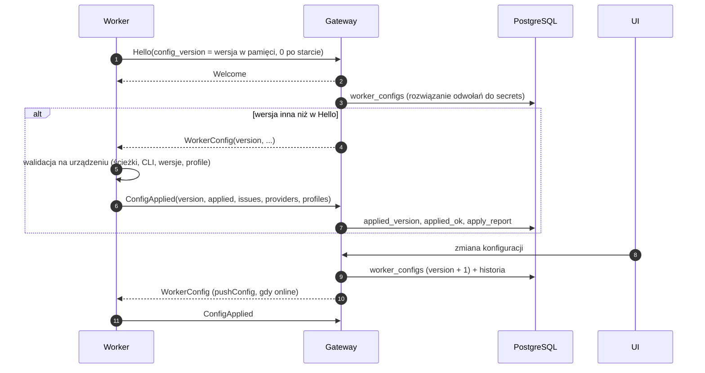

# Konfiguracja workerów

Status: **zaimplementowana**:
- kontrakt: `WorkerConfig`, `ConfigApplied`, `Hello.config_version`,
- worker: `apps/worker/src/config` (konfiguracja lokalna i zastosowanie zdalnej),
- gateway: `WorkerLinkOptions.config`, `WorkerLink.pushConfig`,
- schemat: migracja `0002_worker_config`,
- testy jednostkowe, integracyjne (gRPC) i na PostgreSQL.

Gateway czyta konfigurację tymczasowo ze zmiennych środowiskowych, do czasu podpięcia `worker_configs`.

## 1. Zasada

**Cała konfiguracja workera jest zdalna.** Lokalnie worker zna tylko sposób połączenia z gateway. Worker zawsze łączy się sam (wychodzące HTTP/2), więc działa za NAT-em i firewallem bez otwierania portów.

| Lokalnie (plik na urządzeniu) | Zdalnie (gateway → `WorkerConfig`) |
|---|---|
| `gateway_url`, `worker_id`, `credential` | dozwolone katalogi (`allowed_roots`) |
| `ca_file` (prywatny certyfikat gateway) | dostawcy: włączony, ścieżka CLI, wymagana wersja |
| `data_dir` (dziennik, bloby w drodze) | profile dostawców (CLIProxyAPI) z kluczami |
| `ping_interval_seconds` (utrzymanie mapowania NAT) | natywne narzędzia (subagenci, harmonogram) |
| | limity (tury, zadania w tle, drain, zwalnianie) |
| | Codex: dowiązanie logowania urządzenia do izolowanego `CODEX_HOME` (`device_login`) |

## 2. Plik lokalny

```json
{
  "gateway_url": "https://agents.example.com",
  "worker_id": "0196f0c1-0000-7000-8000-0000000000aa",
  "credential": "…",
  "ca_file": "/etc/open-agents/gateway-ca.pem",
  "ping_interval_seconds": 30
}
```

- Lokalizacja: `OA_WORKER_CONFIG` albo domyślna per system:
  - Linux: `$XDG_CONFIG_HOME/open-agents/worker.json`,
  - macOS: `~/Library/Application Support/open-agents/worker.json`,
  - Windows: `%APPDATA%\open-agents\worker.json`.
- Dekodowanie jest ścisłe (Effect Schema): nieznany klucz to błąd. Ustawienie zdalne wpisane lokalnie nie zostanie po cichu zignorowane.
- Plik zawiera poświadczenie, więc jak klucz SSH nie może być dostępny dla innych użytkowników (POSIX: `chmod 600`). Inaczej worker kończy pracę z kodem 78 (`EX_CONFIG`), żeby supervisor nie restartował go w pętli. Na Windows ACL ustawia instalator.
- Plik tworzy rejestracja workera (enrollment): token z UI zamieniany na `worker_id` i `credential`.

## 3. Przepływ



- **Walidacja jest na urządzeniu**, bo tylko ono wie, czy katalog istnieje i jaka wersja CLI jest zainstalowana:
  - błędny wpis (ścieżka względna, brak katalogu, brak CLI, zła wersja, profil bez klucza) wyłącza tylko ten wpis i trafia do `issues`,
  - błąd krytyczny (np. zduplikowane id profilu) odrzuca całą konfigurację, a worker zostaje przy poprzedniej.
- **Ścieżki:** katalogi są rozwiązywane do ścieżek rzeczywistych (symlinki), a sprawdzanie `cwd` wątku (`isAllowedPath`) porównuje ścieżki rzeczywiste przez `path.relative`, więc `/repo-other` nie przejdzie jako `/repo`.
- **Worker bez konfiguracji** odrzuca komendy z `WORKER_NOT_CONFIGURED`.

## 4. Sekrety

- Klucze (np. CLIProxyAPI) są w tabeli `secrets`, zaszyfrowane przez gateway (szyfrowanie kopertowe, `key_id` do rotacji). `worker_configs.config` ma tylko odwołania `{"secretRef": "<id>"}`.
- Gateway rozwiązuje odwołania przy wysyłce. Konfiguracja idzie jednym strumieniem gRPC po TLS do tego jednego workera.
- Worker trzyma klucze **tylko w pamięci**: nie zapisuje ich na dysk, do argv ani do logów. Po restarcie procesu `Hello.config_version = 0`, więc gateway wysyła konfigurację ponownie.
- Rotacja: `worker_config_secrets` wskazuje workery, którym trzeba wysłać nową wersję.

Zmiana względem wcześniejszego założenia „poświadczenia LLM nie opuszczają urządzenia”: dotyczy ono teraz tylko logowania CLI na urządzeniu (`claude login`, `codex login`). Klucze pośredników zarządzane centralnie przechodzą przez gateway.

## 5. Bezpieczeństwo

Zdalne `allowed_roots` oznaczają, że kto kontroluje gateway, ten wskazuje workerowi katalogi. Tak czy inaczej gateway zleca agentom pracę z shellem na urządzeniu, więc zaufanie do gateway już jest pełne w granicach uprawnień użytkownika systemowego workera. Środki:

- worker działa jako **dedykowany użytkownik systemowy** z dostępem tylko do potrzebnych katalogów (to jest właściwa granica bezpieczeństwa na urządzeniu),
- zmiana konfiguracji wymaga uprawnień (właściciel workera albo admin dla współdzielonych) i trafia do `audit_log` oraz `worker_config_history`,
- `ConfigApplied` pokazuje w UI, co faktycznie obowiązuje na urządzeniu.

## 6. Zmiana na żywo

- Katalogi, limity i domyślne narzędzia natywne obowiązują od następnej tury.
- Zmiana profili albo ustawień Codexa wymaga restartu `codex app-server`. Worker robi to, gdy nie ma tur Codexa w toku (nowe tury czekają). Do zaimplementowania z adapterami.

## 7. Schemat (`0002_worker_config`)

| Tabela | Rola |
|---|---|
| `worker_configs` | bieżąca konfiguracja per worker: `version` (musi rosnąć przy zmianie, trigger), `config` z odwołaniami do sekretów, ostatni raport (`applied_version` ≤ `version`) |
| `worker_config_history` | każda wysłana wersja (trigger), audyt i powrót |
| `secrets` | zaszyfrowane sekrety, unikalna nazwa per właściciel (także globalne) |
| `worker_config_secrets` | które sekrety są używane; blokuje usunięcie używanego sekretu |
