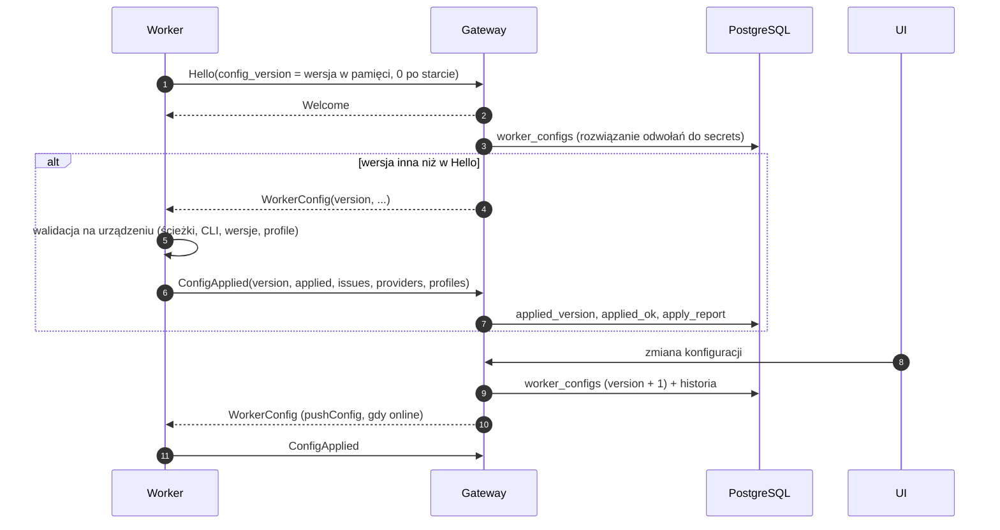
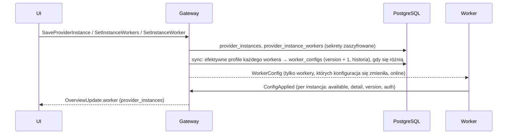

# Konfiguracja workerów

CLI **Claude Code (`claude`), Codex (`codex`) i Grok (`grok`)** muszą być już
zainstalowane na komputerze workera. Dotyczy to desktopu, samodzielnych binarek
i Dockera. Canopy ich nie zawiera, nie pobiera i nie aktualizuje. Użytkownik
zapewnia wersję, login oraz PATH usługi albo ścieżkę pliku wykonywalnego instancji.
W Dockerze CLI trzeba zamontować lub dodać do własnego obrazu; instalacja CLI
na hoście nie udostępnia go automatycznie w kontenerze.

Claude Agent SDK jest biblioteką JS. Każde uruchomienie przekazuje jawne
`pathToClaudeCodeExecutable`; fallback do opcjonalnego binarnego pakietu SDK jest
wykluczony. Brak instalacji pokazuje „Claude Code is not installed on this computer”
w istniejącym statusie providera i instancji. Instancja z własną ścieżką działa
także bez domyślnego `claude` na PATH. Brak CLI nie blokuje połączenia workera
z gatewayem; po instalacji użyj odświeżenia providerów.

Grok używa `WorkerConfig.grok` (pole 640), `PROVIDER_GROK` i tych samych globalnych instancji native/CLIProxyAPI co Claude/Codex. Nowy `worker add` włącza również Groka; istniejące workery wymagają `grok.enabled: true` w konfiguracji zdalnej. Login native jest czytany z domu CLI; endpointy dostają prywatny home procesu i klucz w env. Szczegóły oraz instrukcja uruchomienia: [grok-adapter.md](grok-adapter.md#włączenie-na-stosie-użytkownika).

Boty używają globalnej instancji endpointowej z gateway, bez nadpisań workera,
zmiennych procesu harnessu ani logowania CLI urządzenia. Model i effort należą
do bota; klucz endpointu pozostaje sekretem gateway. Zasady: [bots.md](bots.md).

Status: **zaimplementowana**:
- kontrakt: `WorkerConfig`, `ConfigApplied`, `Hello.config_version`,
- worker: `apps/worker/src/config` (konfiguracja lokalna i zastosowanie zdalnej),
- gateway: `WorkerLinkOptions.config`, `WorkerLink.pushConfig`,
- schemat: migracja `0002_worker_config`,
- testy jednostkowe, integracyjne (gRPC) i na PostgreSQL.

Gateway przechowuje konfigurację w `worker_configs`; lokalny plik zawiera tylko połączenie.

## Dodanie maszyny z UI

1. W **Settings → Workers → Add worker** podaj nazwę i opcjonalne **Worker tags**.
   Picker podpowiada ręczne tagi używane przez Twoje workery. Kreator może jednym kliknięciem
   włączyć Network access i wybiera jego pierwszy adres. W Settings → Workers można zapisać
   własny origin (np. nazwę z Network access); pusty przywraca wybór automatyczny.
   Adres kreatora dotyczy nowych instalacji. Istniejące workery zachowują działający endpoint;
   po włączeniu Network access przechodzą automatycznie na osiągalną trasę z pinem.
2. Wybierz **Install script**, **Docker**, **Manual** albo **Over SSH**.
   Domyślny skrypt pobiera zweryfikowaną binarkę dokładnej wersji gatewaya, rejestruje
   worker i uruchamia usługę użytkownika. Nie wymaga Bun, Git ani źródeł Canopy.
   Obsługuje Linux x64/arm64 oraz macOS arm64. Dla buildów bez wydania kreator pokazuje
   jawny fallback do wydania GitHub z kanału gatewaya; zgodność może wymagać aktualizacji gatewaya.
3. Wybierz **Check connection**. Kreator pokazuje status z istniejącego overview stream,
   wykryte wersje CLI oraz czas ważności tokenu. **Generate new token** odwołuje poprzedni
   token przed utworzeniem nowego. Po zamknięciu kreatora tokenu nie można odczytać ponownie;
   nieużyte zaproszenie można odwołać na liście **Pending enrollments**.
4. Po **Connected** wybierz instancje providerów i **Finish**. Przełączniki korzystają
   z istniejącego `SetInstanceWorker`; zmiany zapisują się od razu. Domyślne przypisania
   globalnych instancji są synchronizowane przy enrollment. CLI dostawców i ich logowania
   instalujesz osobno (`claude`, `codex`, `grok`); brak loginu nie blokuje samego połączenia.

Przykład Maca przez Tailscale: ACL muszą pozwalać na TCP do portu Network access.
Wybierz osiągalny adres tego komputera, **macOS** i wykonaj komendę na Macu. Wszystkie metody
instalacji (skrypt, ręczna, Docker i SSH) przekazują `--fingerprint` z pełnym SHA-256.
Enrollment najpierw wykonuje sam handshake TLS i porównuje pin; dopiero potem wysyła token.

Tagi wybrane w kreatorze dotyczą każdej metody, również SSH i ponownego generowania
tokenu. Gateway przechowuje je przy zaproszeniu; komendy i token nie zawierają
tagów. Rejestracja zapisuje je atomowo z workerem. Pierwsze połączenie dobiera już
przypisane instrukcje, skille i pluginy na podstawie tagów ręcznych i automatycznych.
Ponowna instalacja SSH istniejącego workera zachowuje jego konfigurację i tagi;
zmiany wykonuje się w jego szczegółach w Workers.

W **Settings → Workers** rozwiń maszynę albo otwórz jej szczegóły. **Worker tags**
pokazuje wykryte OS/architekturę i pozostałe automatyczne fakty tylko do odczytu,
oraz edytowalne **Manual tags**. **Save tags** zapisuje zmianę z kontrolą rewizji,
audytuje ją i uruchamia ponowne uzgodnienie przypisań. Worker offline odbierze
aktualny stan po połączeniu. Workery z połączonego komputera wymagają edycji
w Workers na swoim komputerze macierzystym. Agent environment pokazuje tagi
tylko do odczytu z odnośnikiem **Edit in Workers**.
Plik 0600 zapisuje `gateway_certificate` i `gateway_fingerprint`; WorkerLink oraz niezależny
UpdateService sprawdzają certyfikat i dokładny pin. Nie trzeba instalować systemowego CA.
Listener procesu BFF/lokalnego workera nadal obsługuje dotychczasowe połączenia HTTP(S),
a istniejące pliki z `ca_file` zachowują działanie.

Aktualizacja nie wymaga ponownego enrollmentu. Capability `network_route_migration` pozwala gatewayowi
przesłać zaufany pin i adresy dotychczasowym łączem. Worker weryfikuje nową trasę bez rozłączania starej,
zapisuje atomowo plik z kopią `.bak` i zachowuje pierwotny endpoint w `gateway_fallback`.
Nieudana weryfikacja lub zapis nie przerywa pracy; przyczyna jest widoczna w Settings → Workers.
Wyłączony albo nieosiągalny Network access pozostawia WorkerLink i self-update na porcie serwera.
Zapisana konfiguracja przetrwa restart, a utrata nowej trasy przywróci połączenie z pierwotnym serwerem.
Desktop remote nie nadpisuje zmigrowanego adresu podczas startu; lokalny worker desktopu pomija migrację.

### Skrypt instalacyjny

```sh
curl -fsSL https://canopy.example.com/install/worker.sh | sh -s -- \
  --gateway https://gateway.example.com:7443 --token TOKEN --name 'Home server'
```

Pierwszy adres jest originem **web BFF**, drugi originem **gRPC workera**. Skrypt
wykrywa platformę i pobiera `/install/worker/<os>/<arch>` oraz `?sha256=1` z web BFF.
Gateway udostępnia wyłącznie własną wersję z weryfikowanego mirrora, nigdy „latest”.
Brak binarki daje czytelny błąd. Fallback kreatora używa jawnych `--release-url` i
`--checksum-url` wskazujących to samo wydanie GitHub; SHA-256 jest sprawdzany przed wykonaniem.

Binarka trafia do `~/.local/share/canopy/bin/canopy-worker` (zapisywalny katalog
do self-update), config do `~/.config/canopy/worker.json` z prawami `0600`, także na macOS.
Istniejący config jest zachowywany wraz z adresem gatewaya, bez ponownego enrollment.
`--force` z nowym tokenem jawnie go zastępuje; ponowne uruchomienie instaluje ponownie
binarkę i usługę. Symlink/pusty config bez `--force` jest odrzucany. `--no-service` pomija usługę
i wypisuje komendę ręcznego startu. Token ani credential nie trafiają do outputu.
Pliki tymczasowe są usuwane także po błędzie i przerwaniu.

Usługa systemd `--user` ma `Restart=always`; LaunchAgent ma `KeepAlive=true`.
PATH obejmuje m.in. `~/.local/bin`, Bun, Volta, Homebrew, mise i zainstalowane wersje
Node z mise/nvm oraz npm global prefix, jeśli npm jest dostępny. Skrypt nie instaluje
CLI agentów: wypisuje wykryte `claude`/`codex`/`grok` i komendy logowania.
Na Linuxie potrzebna jest sesja systemd użytkownika; po SSH skrypt używa istniejącego
`/run/user/<uid>`. Administrator może wykonać `loginctl enable-linger USER`, aby worker
działał po wylogowaniu. macOS wymaga aktywnej sesji GUI użytkownika dla LaunchAgent.

### Docker i instalacja ręczna

Zakładka **Docker** podaje `docker run` i Compose z obrazem
`ghcr.io/itsoltech/canopy-worker:v<VERSION>` (lub kanałem dla buildu bez wersji wydania).
Enrollment wykonuje się raz z wolumenem `/home/canopy`; ten sam wolumen przechowuje
config, dziennik i loginy. Obraz bazowy nie zawiera CLI agentów — rozszerz go i zaloguj
dostawców w kontenerze. Na zwykłej maszynie Settings → Workers instaluje i aktualizuje CLI na kliknięcie
([provider-cli.md](provider-cli.md)); w kontenerze tylko je pokazuje. **Manual** pobiera binarkę i `checksums.txt` z tego samego
GitHub Release, sprawdza SHA-256, uruchamia `enroll` i drukuje `service`.
Wygenerowaną usługę zapisuje i uruchamia administrator maszyny/użytkownik według
wydrukowanych poleceń. Szczegóły: [deploy.md](deploy.md).

### Instalacja przez SSH

W **Settings → Workers → Install over SSH** wybierz **Show public key** i skopiuj
publiczny klucz Ed25519 do `~/.ssh/authorized_keys` docelowego użytkownika.
Gateway tworzy jedną parę na właściciela; prywatny klucz jest szyfrowany AES-256-GCM
tym samym `CANOPY_SECRETS_KEY` co pozostałe sekrety. Nigdy nie trafia do BFF, przeglądarki,
workera ani logów. Rotacja wymaga zastąpienia publicznego klucza na hostach; nie zmienia
credentiali już zarejestrowanych workerów.

W kreatorze **Over SSH** podaj `login@host[:port]` (IPv6: `login@[adres]:port`).
**Check host key** zatrzymuje handshake przed uwierzytelnieniem. Sprawdź pokazany fingerprint
SHA-256 niezależnym kanałem i wybierz **Trust fingerprint and install**. Gateway zapisuje
pin per właściciel/host/port; późniejsza zmiana klucza jest twardym błędem, bez automatycznej
akceptacji. Rotacja klucza Canopy nie usuwa pinów hostów. Cel musi być osiągalny z gatewaya
przez SSH, a z celu muszą być osiągalne web BFF oraz adres gRPC workera (np. przez Tailscale).

Gateway wykonuje wyłącznie ustalony `sh -s`, przesyła skrypt i świeży jednorazowy token
przez szyfrowane stdin, bez dowolnych komend od klienta. Output ma limit 128 KB,
redakcję sekretów i usuwanie znaków sterujących; buforowanie linii chroni przed tokenem
podzielonym na pakiety. Handshake ma timeout 15 s, cała operacja 5 minut; anulowanie
zamyka kanał i odwołuje niezużyte zaproszenie. Po aktywacji usługi gateway czeka do
60 sekund na WorkerLink Hello; sam kod wyjścia instalatora nie oznacza połączenia.
Usługa już uruchomiona na celu może
pozostać aktywna po anulowaniu. Operacje są owner-scoped i zapisują audyt bez sekretów.
Przy braku mirrora SSH może użyć jawnego fallbacku kanału z komunikatem w output;
skrypt nadal weryfikuje hash manifestu wybranego wydania. Ponowna instalacja zachowuje
istniejący config, a SSH wskazuje wtedy istniejący worker zamiast tworzyć drugi enrollment.
Nie ma obejścia mismatchu w UI: administrator musi niezależnie zweryfikować i usunąć
nieaktualny pin z `worker_ssh_hosts` dla właściwego właściciela.

### CLI i usługa użytkownika (źródła / development)

```bash
# Z katalogu repozytorium; TOKEN pochodzi z kreatora, nie zapisuj go w logach.
bun apps/worker/src/main.ts enroll --gateway http://canopy-gateway:7443 --token TOKEN
bun apps/worker/src/main.ts

# Własne lokalizacje (np. drugi worker na tym samym komputerze):
bun apps/worker/src/main.ts enroll --gateway http://canopy-gateway:7443 --token TOKEN \
  --config /absolute/path/worker.json --data-dir /absolute/path/worker-data
bun apps/worker/src/main.ts --config /absolute/path/worker.json

# Drukuje unit systemd --user na Linuxie albo plist launchd na macOS:
bun apps/worker/src/main.ts service --config /absolute/path/worker.json
```

W przykładach development powyżej entrypoint działa przez Bun; instalacja binarna
używa bezpośrednio `canopy-worker`. `--config` ma pierwszeństwo przed
`CANOPY_WORKER_CONFIG`; bez obu obowiązują ścieżki per OS opisane niżej. `enroll` rezerwuje
plik z `0600` **przed** wymianą tokenu. Istniejący plik jest odrzucany bez wydania tokenu;
`--force` zapisuje nowy prywatny plik i atomowo go podmienia, nie podąża za symlinkiem.
Nie wypisuje credentialu. Utrata odpowiedzi albo awaria po zużyciu tokenu wymaga nowego
enrollment (lub rotacji credentialu istniejącego workera); token nie odtwarza sekretu.
Przerwanie procesu podczas enrollment może zostawić pusty zarezerwowany plik; po sprawdzeniu
jego zawartości usuń go albo użyj `--force`. Kopiowana komenda zawiera token, więc do użycia
traktuj ją jak hasło (również w historii shella i schowku).

Komenda `service` tylko drukuje treść i komendy aktywacji — niczego nie instaluje.
Binarka standalone uruchamia się także przez `canopy-worker run --config …`;
`canopy-worker --version` pokazuje wspólną wersję aplikacji. Drukowana usługa ma
`Restart=always` (systemd) / `KeepAlive=true` (launchd), a binarka używa supervisora
z rollbackiem. Checkout źródeł i Docker pozostają zarządzane zewnętrznie.
Niezależny kanał aktualizacji startuje z lokalnym credentialem po enrollment,
bez oczekiwania na zgodność WorkerLink ani konfigurację CLI; [aktualizacje](updates.md).
Utwórz wskazany katalog `~/.config/systemd/user` albo `~/Library/LaunchAgents`, zapisz
wydrukowany fragment i wykonaj podane komendy. Fragment zawiera absolutne ścieżki do Bun,
repo i configu oraz PATH użytkownika (CLI muszą być tam dostępne). Katalog checkoutu musi
pozostać na miejscu. Na Linuxie `systemctl --user enable --now canopy-worker` uruchamia
usługę użytkownika; działanie po wylogowaniu wymaga osobnego skonfigurowania linger
przez administratora. launchd uruchamia worker w sesji zalogowanego użytkownika.

### Tokeny i zarządzanie dostępem

- Migracja **0044_worker_enrollment** dodaje `worker_enrollments`: właściciel, nazwa,
  SHA-256 tokenu, daty utworzenia/wygaśnięcia/użycia/odwołania i utworzony worker.
  Token oraz credential mają po 32 losowe bajty (base64url); baza zna tylko ich hashe.
  Migracja **0064_worker_enrollment_tags** dodaje ręczne tagi zaproszenia (do 32),
  zapisane wyłącznie po stronie gatewaya i kopiowane przy wymianie tokenu.
- Token jest ważny **30 minut** i działa raz. `WorkerEnrollmentService.Enroll` jest
  anonimowym RPC na tym samym porcie co `WorkerLinkService`, bez tokenu usługi UI.
  Ma wspólny limit **60 prób/minutę na proces gateway**, także dla błędnych tokenów.
  Nie ufa nagłówkom proxy; dla wdrożeń publicznych można dodatkowo ograniczyć IP na brzegu.
  Maksymalnie 20 aktywnych zaproszeń na właściciela; lista obejmuje ostatni dzień (do 100 wpisów).
- Wymiana blokuje wiersz i w jednej transakcji sprawdza ważność, tworzy worker należący do
  właściciela tokenu, zapisuje fakty maszyny, ręczne tagi i początkowy config, synchronizuje instancje
  oraz oznacza token jako użyty. Klient nie wybiera właściciela. Błędy nie odróżniają
  złego, zużytego, odwołanego i wygasłego tokenu; nie odbijają wartości wejścia ani SQL.
- Menu **…**: **Rename**, **Rotate credential**, **Revoke**, **Archive**. Rotacja zachowuje
  ID/workspace'y/historię, natychmiast zamyka link i pokazuje nowy fragment `worker.json`
  tylko raz. Podmień credential, zachowując lokalne `data_dir`/`ca_file`, i zrestartuj worker.
  Revoke ustawia `revoked_at`, odłącza i blokuje reconnect. Obejmuje też rozpoczęty handshake.
- Archive dodatkowo ustawia `archived_at` workera i jego workspace'ów. Wątki i transkrypty
  pozostają czytelne, ale nie mogą pracować na tym workerze. Katalogi na urządzeniu nie są
  kasowane. **Revoke/Archive nie kończą procesów na urządzeniu**; worker po utracie linku
  może nadal wykonywać rozpoczęte zadania. Zatrzymaj jego usługę lokalnie. Ponowne dodanie
  przez kreator tworzy nowe ID i nie przenosi starych wątków.
- Operacje zapisują w `audit_log` aktora, akcję i identyfikator, bez sekretów. BFF zwraca
  odpowiedzi z tokenem/credentialem z `Cache-Control: no-store`; sekrety nie trafiają do
  overview, listy tokenów ani logów. Kreator trzyma token w pamięci do zamknięcia.

Administracyjna ścieżka bez UI pozostaje dostępna:
`bun apps/gateway/src/cli.ts worker add --name NAME --gateway-url URL`.
Wypisuje **sekretny** `worker.json`; przekieruj go do pliku z umask 077, nie do logów.

## 1. Zasada

**Cała konfiguracja workera jest zdalna.** Lokalnie worker zna tylko sposób połączenia z gateway. Worker zawsze łączy się sam (wychodzące HTTP/2), więc działa za NAT-em i firewallem bez otwierania portów.

| Lokalnie (plik na urządzeniu) | Zdalnie (gateway → `WorkerConfig`) |
|---|---|
| `gateway_url`, `worker_id`, `credential` | dostawcy i ich ustawienia |
| `ca_file` (prywatny certyfikat gateway) | dostawcy: włączony, ścieżka CLI, wymagana wersja |
| `data_dir` (dziennik, bloby w drodze, scratch) | profile dostawców (wbudowany `native` i własne) z kluczami i zmiennymi środowiskowymi |
| `ping_interval_seconds` (utrzymanie mapowania NAT) | natywne narzędzia (subagenci, harmonogram) |
| | limity (tury, zadania w tle, drain, zwalnianie) |
| | Codex: dowiązanie logowania urządzenia do izolowanego `CODEX_HOME` (`device_login`) |
| | instancje dostawców: efektywny wynik globalnych definicji i nadpisań workera (sekcja 9) |

## 2. Plik lokalny

```json
{
  "gateway_url": "https://agents.example.com",
  "worker_id": "0196f0c1-0000-7000-8000-0000000000aa",
  "credential": "…",
  "ca_file": "/etc/canopy/gateway-ca.pem",
  "ping_interval_seconds": 30
}
```

- Lokalizacja: `CANOPY_WORKER_CONFIG` albo domyślna per system:
  - Linux: `$XDG_CONFIG_HOME/canopy/worker.json`,
  - macOS: `~/Library/Application Support/canopy/worker.json`,
  - Windows: `%APPDATA%\canopy\worker.json`.
- Dekodowanie jest ścisłe (Effect Schema): nieznany klucz to błąd. Wyjątkiem zgodności są stare `allowedRoots` i `allowed_roots`: są przyjmowane i ignorowane, podobnie jak pole historyczne w zdalnej konfiguracji i bazie. Worker nie ma listy dozwolonych katalogów.
- Plik zawiera poświadczenie, więc jak klucz SSH nie może być dostępny dla innych użytkowników (POSIX: `chmod 600`). Inaczej worker kończy pracę z kodem 78 (`EX_CONFIG`), żeby supervisor nie restartował go w pętli. Na Windows ACL ustawia instalator.
- Plik tworzy rejestracja workera (enrollment): token z UI zamieniany na `worker_id` i `credential`.

## 3. Przepływ



- **Walidacja jest na urządzeniu**, bo tylko ono wie, czy katalog istnieje i jaka wersja CLI jest zainstalowana:
  - błędny wpis (ścieżka względna, brak katalogu, brak CLI, zła wersja, profil bez klucza) wyłącza tylko ten wpis i trafia do `issues`,
  - błąd krytyczny (np. zduplikowane id profilu) odrzuca całą konfigurację, a worker zostaje przy poprzedniej.
- **Ścieżki:** workspace może wskazywać dowolny bezwzględny katalog dostępny dla użytkownika OS workera. Przy dodaniu lub zmianie workspace'u gateway pyta połączonego workera o katalog. Przy starcie wątku worker ponownie rozwiązuje dowiązania i sprawdza, czy ścieżka istnieje i jest katalogiem. Brak katalogu daje czytelny błąd; zwykły workspace nie tworzy katalogów.
- **Worker bez konfiguracji** odrzuca komendy z `WORKER_NOT_CONFIGURED`.

## 4. Sekrety

- Klucze (np. CLIProxyAPI) i zmienne profilu oznaczone jako sekret są w tabeli `secrets`, zaszyfrowane przez gateway (szyfrowanie kopertowe, `key_id` do rotacji). `worker_configs.config` (i historia) ma tylko odwołania `{"secretRef": "<id>"}` w `profiles[].apiKey` i `profiles[].env[].value`.
- Gateway rozwiązuje odwołania przy wysyłce. Konfiguracja idzie jednym strumieniem gRPC po TLS do tego jednego workera.
- Worker trzyma klucze **tylko w pamięci**: nie zapisuje ich na dysk, do argv ani do logów. Po restarcie procesu `Hello.config_version = 0`, więc gateway wysyła konfigurację ponownie.
- Rotacja: `worker_config_secrets` wskazuje workery, którym trzeba wysłać nową wersję.

Zmiana względem wcześniejszego założenia „poświadczenia LLM nie opuszczają urządzenia”: dotyczy ono teraz tylko logowania CLI na urządzeniu (`claude login`, `codex login`). Klucze pośredników zarządzane centralnie przechodzą przez gateway.

Konta [Connectors](connectors.md) mają podobne przypisanie „all / chosen workers”,
ale ich poświadczenia **nie są synchronizowane**. Worker dostaje jedynie katalog
narzędzi w `ThreadSpec.connector_tools`; wywołania wracają do gateway linkiem gRPC.
Konto należy do właściciela wątku. Granty botów są niezależne od grantów workerów.

## 5. Bezpieczeństwo

### Katalogi No project

Scratch ma stałą bazę `<data_dir>/scratch`, zgłaszaną przez workera w `Hello.scratch_root`.
Gateway zapewnia workspace `<data_dir>/scratch/<user-id>`, a `CreateThread` z
`ThreadSpec.scratch` tworzy podkatalog UUID wątku. Worker sprawdza każdy składnik zarządzanego
poddrzewa; symlinki są błędem. Na POSIX nowe katalogi mają `0700`. Brak praw zapisu uniemożliwia
start. Zmiana `data_dir` dotyczy tylko przyszłych niezależnych rozmów. Istniejące wątki i forki
zachowują zapisane cwd, także pod poprzednim `data_dir`.
Stare katalogi muszą istnieć; worker ich nie przenosi ani nie odtwarza w dawnej lokalizacji.
Pliki nie są usuwane automatycznie. Ich pełną ścieżkę i zasady ręcznego usuwania pokazuje panel wątku.

Bez roots worker może uruchamiać wątki w dowolnym katalogu dostępnym dla jego użytkownika
systemowego. Tryby uprawnień i sandboxy nadal obowiązują osobno dla każdego wątku.
Gateway zleca agentom pracę z shellem na urządzeniu, więc zaufanie do gateway obejmuje
uprawnienia użytkownika systemowego workera. Środki:

- worker działa jako **dedykowany użytkownik systemowy** z dostępem tylko do potrzebnych katalogów (to jest właściwa granica bezpieczeństwa na urządzeniu),
- zmiana konfiguracji wymaga uprawnień (właściciel workera albo admin dla współdzielonych) i trafia do `audit_log` oraz `worker_config_history`,
- `ConfigApplied` pokazuje w UI, co faktycznie obowiązuje na urządzeniu.

## 6. Zmiana na żywo

- Limity i domyślne narzędzia natywne obowiązują od następnej tury.
- Zmiana profili albo ustawień Codexa wymaga restartu `codex app-server`. Worker robi to, gdy nie ma żadnej tury w toku (zmiana czeka do końca ostatniej). Restartują się tylko procesy, których ustawienia się zmieniły (osobny app-server profilu ze zmiennymi, sekcja 8.1); ich wątki wznawiają się w nowym procesie (`thread/resume`), a procesy w tle zamkniętego procesu kończą się jako przerwane.
- Claude Code dostaje środowisko profilu przy każdej turze (`query()` per tura), więc zmiana obowiązuje od następnej tury po zastosowaniu konfiguracji.

## 7. Schemat (`0002_worker_config`)

| Tabela | Rola |
|---|---|
| `worker_configs` | bieżąca konfiguracja per worker: `version` (musi rosnąć przy zmianie, trigger), `config` z odwołaniami do sekretów, ostatni raport (`applied_version` ≤ `version`) |
| `worker_config_history` | każda wysłana wersja (trigger), audyt i powrót |
| `secrets` | zaszyfrowane sekrety, unikalna nazwa per właściciel (także globalne) |
| `worker_config_secrets` | które sekrety są używane; blokuje usunięcie używanego sekretu |

## 8. Profile dostawców

> Od migracji `0018_global_providers` profile nie są definiowane per worker: są **globalnymi instancjami dostawców** (sekcja 9), a `WorkerConfig.profiles` workera to ich efektywny wynik. Reguły zmiennych (8.1) obowiązują dalej; wybór modeli (8.2) zastąpiły wybory instancji (9.3). Opis poniżej zostaje jako historia tej wersji.

Status: **zastąpione przez sekcję 9** (kontrakt: `ProviderProfileConfig.display_name/env/disabled`, `ProfileEnvVar`, `ProviderProfile.display_name`; UI: `ListProviderProfiles`, `SaveProviderProfile`, `DeleteProviderProfile`, `SetModelSelection`, `ListModelsRequest.unfiltered`; gateway `store/profiles.ts`; worker `providers/profiles.ts`, `runtime/host.ts`; migracja `0015_provider_profiles`; ekran Settings → Workers → worker).

**Model.** Profil to część konfiguracji workera (`WorkerConfig.profiles`, wersjonowana, z historią):

| Pole | Znaczenie |
|---|---|
| `id` | stały (wątki go zapisują, `threads.provider_profile_id`); dla nowego profilu powstaje z nazwy (`team-proxy`, przy kolizji `-2`…) |
| `display_name` | nazwa w UI i pickerach; zmiana nazwy nie zmienia `id` |
| `kind` | `NATIVE` (logowanie CLI na urządzeniu) albo `CLIPROXYAPI` = endpoint zgodny z API Anthropic/OpenAI pod jednym adresem (Claude `<base>/v1/messages`, Codex `<base>/v1/responses`; np. CLIProxyAPI) z kluczem |
| `providers` | Claude, Codex albo oba (puste = oba) |
| `base_url`, `api_key` | tylko endpoint; klucz jako sekret |
| `env` | zmienne środowiskowe procesu harnessu, każda jawna albo sekret |
| `disabled` | wyłączony przez użytkownika |

Wbudowany profil `native` zawsze istnieje (worker dodaje go, gdy konfiguracja go nie wymienia). Można mu nadać nazwę i zmienne, nie można zmienić połączenia, wyłączyć ani usunąć.

**Usunięcie i wyłączenie.** Profilu, którego używa jakiś (niezarchiwizowany) wątek, nie da się usunąć (`FailedPrecondition`, w UI propozycja wyłączenia): wątek straciłby informację, jak dotrzeć do modelu. Wyłączony profil worker raportuje jako `available = false`, `detail = "disabled"` (bez wpisu w `issues`); gateway odrzuca na nim nowe wątki, a tura istniejącego wątku kończy się błędem `provider profile "<id>" is unavailable: disabled`, więc wątek mówi, dlaczego nie działa. Po włączeniu działa dalej. Usunięcie nieużywanego profilu usuwa też jego wybór modeli i sekrety.

**Sekrety.** Gateway szyfruje klucz i wartości zmiennych `secret` przy zapisie (`secrets`, nazwa `profile-<uuid>`), w konfiguracji zostają odwołania; sekrety `profile-*`, do których nic się już nie odwołuje, są usuwane przy każdej zmianie. Do UI (odpowiedzi, `ListProviderProfiles`, overview) wracają tylko flagi: `api_key_set`, a zmienna-sekret z pustą wartością. Zapis bez wartości sekretu (`ProfileEnvVarInput.value` nieustawione, `api_key` nieustawiony) zostawia zapisany sekret; `api_key = ""` go usuwa. Zachowanie sekretu działa po nazwie, więc zmiana nazwy zmiennej-sekretu wymaga ponownego podania wartości. Worker trzyma sekrety tylko w pamięci, a w raportach i błędach podaje wyłącznie nazwy zmiennych (testy: `tests/integration/provider-profiles.test.ts`, `worker-profile-env.test.ts`).

**Współbieżność.** `expected_config_version` w `SaveProviderProfileRequest` i `DeleteProviderProfileRequest`: inna wersja = `FailedPrecondition` (BFF 409), UI pobiera profile od nowa.

### 8.1. Zmienne środowiskowe profilu

Reguły są wspólne dla UI, gateway (odrzuca zapis) i workera (wyłącza profil z powodem): `@canopy/domain`, `profiles/env.ts`.

- Nazwa: `[A-Za-z_][A-Za-z0-9_]*`, do 128 znaków, bez powtórzeń (bez rozróżniania wielkości liter); wartość do 32 KiB, bez NUL; najwyżej 64 zmienne.
- **Zakazane zawsze** (ustawia je worker; porównanie bez wielkości liter): `HOME`, `USERPROFILE`, `PATH`, `PWD`, `CLAUDE_CONFIG_DIR`, `CODEX_HOME`, `CLAUDE_CODE_ENTRYPOINT` oraz prefiks `CANOPY_*` (klucze endpointów dla Codexa, `CANOPY_<ID>_API_KEY`).
- **Zakazane dla endpointu** (ustawia je profil): `ANTHROPIC_BASE_URL`, `ANTHROPIC_AUTH_TOKEN`, `ANTHROPIC_API_KEY`, `CLAUDE_CODE_OAUTH_TOKEN`. Profil `NATIVE` może je ustawić (np. `ANTHROPIC_API_KEY` zamiast logowania, `CLAUDE_CODE_USE_BEDROCK` + dane AWS).
- Ten sam prefiks obejmuje ustawienia workera (`CANOPY_*`).

Gdzie trafiają:

| Harness | Jak |
|---|---|
| Claude Code | `options.env` każdej tury: środowisko workera, potem zmienne profilu, potem zmienne auth endpointu |
| Codex | zmienne należą do procesu, więc profil ze zmiennymi ma **własny `codex app-server`** (ten sam izolowany `CODEX_HOME`, więc wątki przechodzą między procesami przez `thread/resume`); profile bez zmiennych dzielą jeden proces. Komendy idą do procesu profilu wątku, a steer, przerwanie i zatrzymanie zadania w tle do procesu, który ma wątek załadowany |

Kiedy obowiązują: Claude od następnej tury po zastosowaniu konfiguracji; Codex po restarcie procesu profilu, który worker robi, gdy nie ma tur w toku (sekcja 6). Polecenia, które agent uruchamia, dziedziczą środowisko harnessu (Codex domyślnie pomija w nich zmienne z `KEY`, `SECRET`, `TOKEN` w nazwie — `shell_environment_policy`).

Potwierdzone na żywo (2026-11-02, profil endpointu na CLIProxyAPI): Codex (`gpt-6.1-sol`, osobny app-server profilu) i Claude (`sonnet`) uruchomiły `printf` i zwróciły jawną zmienną profilu oraz informację, że zmienna-sekret jest ustawiona; klucz i wartość sekretu nie pojawiły się w odpowiedziach dla UI ani w logach gateway, workera i BFF.

### 8.2. Wybór modeli

Per worker, profil i dostawca użytkownik wybiera, które modele katalogu (`worker_model_catalogs`) widać w pickerach (`provider_model_selections`, poza konfiguracją workera: nie zmienia wersji ani nie restartuje harnessu):

- brak wiersza = katalog taki, jak przysłał worker (z jego własnym `hidden`, np. Codex),
- wiersz: `shown` (widoczne), `known` (katalog w chwili zapisu), `show_new`; model jest widoczny, gdy jest w `shown` albo nie ma go w `known` i `show_new` = true. Model ukryty przez dostawcę można tak pokazać,
- gateway nie usuwa modeli, tylko ustawia `ModelInfo.hidden` w `ListModels` i `OverviewUpdate.models` (`applyModelSelections` w `store/models.ts`); `ListModelsRequest.unfiltered` zwraca pełny katalog (ekran wyboru). Walidacja modelu wątku i wiadomości (`modelProblem`, `turnEffort`) używa pełnego katalogu, więc wątek na ukrytym modelu działa dalej (na żywo: tura na ukrytym `gpt-6-astra`), a picker wątku zna nazwę i wysiłki modelu.

## 9. Globalne instancje dostawców

Połączenie instancji wybiera zapisane **Proxy** z Settings → Proxies, zamiast
osobnego URL i klucza. Nadpisanie workera również może wybrać proxy. Wbudowany
login pozostaje natywny; przycisk dodaje nową instancję, a **Move to a proxy**
przenosi ręczne zmienne połączenia po stronie gateway. Migracja `0057`, deduplikacja,
sekrety i dokładne mapowania Claude/Codex/Grok: [proxies.md](proxies.md).

Status: **zaimplementowane** (migracja `0018_global_providers`; gateway `store/instances.ts`, `store/instance-config.ts`; kontrakt UI: `ListProviderInstances`, `SaveProviderInstance`, `DeleteProviderInstance`, `SetInstanceWorkers`, `SetInstanceWorker`, `SetInstanceModels`, `RefreshProviders`, `StartProviderLogin`, `Worker.provider_instances`; kontrakt workera: `ProviderProfileConfig.executable_path/home_path/shadow_home_path/launch_args/own_login`, `ProviderProfile.version/auth/authenticated`, komendy `ProbeProviders`, `StartLogin`; worker `config/remote.ts`, `runtime/host.ts`, `providers/codex/login.ts`; UI Settings → Providers).

### 9.1. Model

**Instancja** = harness (Claude Code, Codex albo Grok) + `id`, zdefiniowana **raz w gateway** i włączana na wybranych workerach. Klucz to para (harness, id), bo wątki zapisują dostawcę i profil osobno (`threads.provider`, `threads.provider_profile_id`): ten sam `id` może mieć instancja Claude i instancja Codexa (np. `native`, `cliproxyapi`).

| Globalnie (`provider_instances`) | Per worker (`provider_instance_workers`) |
|---|---|
| `label`, `accent_color` (kropka w pickerze) | `enabled`: `NULL` = jak `all_workers`, inaczej wybór dla tego workera |
| `kind`: `native` (logowanie harnessu) albo `endpoint` (zapisane proxy) | `proxy_id`: inne proxy lub `NULL` (wybór instancji) |
| `proxy_id`; `base_url`, `api_key` jako projekcja zgodności | `overrides.binaryPath`, `homePath`, `shadowHomePath`, `launchArgs` (ścieżki zależne od systemu) |
| `env` (jawne i sekrety) | `overrides.env`: dodane albo zastąpione po nazwie (bez wielkości liter) |
| `runtime`: `binaryPath`, `homePath`, `shadowHomePath`, `launchArgs`, `ownLogin` | |
| `favorites` (kolejność), `hidden_models`, `shown_models`, `custom_models` | |
| `all_workers` (także workery zarejestrowane później), `built_in`, `revision` | |

Wbudowane instancje `claude/native`, `codex/native` i `grok/native` (logowanie CLI na urządzeniu) istnieją zawsze, na wszystkich workerach; można im nadać nazwę, zmienne i ścieżki, wyłączyć na wybranym workerze, ale nie usunąć ani zmienić rodzaju połączenia.

### 9.2. Synchronizacja



- **Efektywna konfiguracja** = definicja ⊕ nadpisania workera (`effectiveProfile`): jeden `ProviderProfileConfig` na instancję, z jednym dostawcą w `providers`, w kolejności dostawca, `native`, id. Porównanie z zapisaną konfiguracją ignoruje kolejność kluczy (jsonb), więc niezmieniony worker nie dostaje nowej wersji.
- **Wyłączona instancja jest na workerze nieobecna**: nie dostaje ani definicji, ani sekretów. Wyjątki: wbudowane `native` (inaczej worker dodałby je sam) i instancja, której używają wątki tego workera — dostają zaślepkę bez sekretów `disabled: true`, więc ich tury kończą się czytelnym `provider profile "<id>" is unavailable: disabled`.
- Gateway synchronizuje wszystkie workery przy starcie (`syncProviderInstances`, np. zaraz po migracji) i po każdej zmianie; CLI (`worker add --cliproxy-url`) zakłada instancje `cliproxyapi` obu dostawców (albo nadpisania istniejących) i synchronizuje nowego workera.
- **Sekrety**: klucz proxy i zmienne-sekrety w `secrets` (nazwa `instance-<uuid>`), w definicji, nadpisaniach i konfiguracjach tylko `{"secretRef"}`. Sekrety `instance-*` i `profile-*`, do których nie odwołuje się żadne proxy, definicja, nadpisanie ani konfiguracja, są usuwane po każdej zmianie. Do UI wracają tylko flagi (`secret_set`, `api_key_set`, zmienna-sekret z pustą wartością); sekret bez nowej wartości zostaje (zmienna po nazwie).
- **Współbieżność**: `expected_revision` w `SaveProviderInstanceRequest` / `DeleteProviderInstanceRequest`; inna = `FailedPrecondition` (BFF 409).
- Instancji, której używają wątki, nie da się usunąć ani zmienić jej rodzaju połączenia (`FailedPrecondition`); można ją wyłączyć.

### 9.3. Modele w pickerach

Wybór modeli jest globalny dla instancji i nie zmienia wersji konfiguracji: model jest widoczny, gdy jest w `shown_models` albo dostawca go nie ukrywa i nie ma go w `hidden_models`; `custom_models` dochodzą do listy (bez danych o wysiłku, walidacja je przyjmuje); ulubione idą pierwsze, w kolejności użytkownika (`applyInstanceModels`). Gateway oznacza modele jako `hidden`, nie usuwa ich (wątek na ukrytym modelu działa dalej). `ListModelsRequest.unfiltered` daje pełny katalog (ekran ustawień). Gwiazdka w pickerze zmienia ulubione instancji (`SetInstanceModelsRequest.favorites_only`); dotychczasowe ulubione z ustawień użytkownika (`UserSettings.model_favorites`) przeniosła migracja.

Pickery (nowy wątek i wątek) pokazują dla wybranego workera tylko instancje `enabled && available` z `Worker.provider_instances` (z kolorem akcentu i ulubionymi); zmiana workera zmienia listę, a wątek zostaje przy swojej instancji (także wyłączonej). `CreateThread` odrzuca instancję wyłączoną na workerze (`… is turned off on <worker>`) albo niedostępną.

### 9.4. Na workerze

- Profile są identyfikowane parą (dostawca, id): duplikat tej pary jest błędem krytycznym; `native` worker dodaje sam tylko dla dostawców, których konfiguracja nie wymienia. Wyłączona zaślepka nie jest dalej walidowana. Profil dla obu dostawców (konfiguracja lokalna albo starsza; także `native` dodany przez workera) jest rozbijany na instancję per dostawca i tak sprawdzany i raportowany: wyłączony Claude nie wyłącza strony Codexa.
- **Środowisko uruchomienia instancji** (`hasOwnRuntime`): własny plik wykonywalny, `home_path` (katalog CLI właściciela urządzenia, z którego dowiązywane jest logowanie), `shadow_home_path` (izolowany katalog harnessu; dotąd zawsze `<data_dir>/codex-home` / `claude-home`), argumenty uruchomienia, `own_login`. Instancja z `home_path` albo `own_login` bez `shadow_home_path` dostaje własny katalog `<data_dir>/homes/<harness>-<id>` (dwa logowania nie dzielą katalogu).
  - Codex: instancja z własnym środowiskiem (albo zmiennymi) ma własny `codex app-server`: `<binary> app-server … <launch_args>`, `CODEX_HOME` = jej katalog. Wątki instancji z własnym katalogiem żyją w nim (zmiana katalogu instancji z wątkami = ich sesje zostają w starym).
  - Claude: per zapytanie `pathToClaudeCodeExecutable`, `CLAUDE_CONFIG_DIR` w `env` i `extraArgs` (z `--flag wartość`); pomocnicze funkcje SDK (`forkSession`, `getSessionMessages`) czytają katalog z procesu, więc wywołania idą po kolei z ustawionym `CLAUDE_CONFIG_DIR` katalogu instancji.
- **Raport per instancja** (`ConfigApplied.profiles`): `version` (wersja jej pliku wykonywalnego albo dostawcy), `auth` i `authenticated`: endpoint — „endpoint key”; native — login w katalogu (Codex `auth.json`: „ChatGPT” albo „OpenAI API key”, czytany tylko kształt; Claude `.credentials.json`: „Claude account”; na macOS Claude trzyma login w pęku kluczy: nieznane), albo klucz w zmiennych (`ANTHROPIC_API_KEY` itd.). Native bez logowania, brak CLI albo plik wykonywalny, który się nie uruchamia, robią instancję niedostępną z powodem (`not signed in`, `no Codex login on this device`, `… not found or not runnable`) — bez wpisu w `issues`.
- **`ProbeProviders`** (UI: Refresh): worker stosuje bieżącą konfigurację jeszcze raz (sprawdza wersje i logowania), wysyła `ConfigApplied` z tą samą wersją i katalog modeli, potem odpowiada. Capability `probe_providers`.

### Środowisko agentów

Settings → Agent environment przechowuje w DB wersjonowane dokumenty, skille, pluginy i tagi;
to osobny oczekiwany stan z capability `agent_environment_v1`, nie pole konfiguracji
CLI ani zmienna procesu. Instrukcje trafiają do domyślnych izolowanych domów i
każdego domu instancji wyznaczonego przez `instanceShadowHome`, opcjonalnie również
do domu CLI urządzenia. Zmiana konfiguracji instancji uruchamia ponowne uzgodnienie.
Claude dopisuje tylko zarządzany blok do system promptu, zachowując
`settingSources: ["project", "local"]`. Codex czyta `AGENTS.md` z faktycznego
`CODEX_HOME`. Lokalne teksty poza blokiem pozostają na urządzeniu; dla platformowego
Claude nie są częścią dopisanego promptu. Zmiany dotyczą nowych sesji.
Skille negocjują osobną capability `agent_skills_v1`. Claude ładuje zarządzane
`<actual home>/canopy-environment/skills` jako jawny lokalny plugin bez włączania
user settings. Codex platformowy czyta `<actual CODEX_HOME>/skills`; osobny cel CLI
urządzenia to `~/.agents/skills`, którego nie izoluje zmiana `CODEX_HOME`.
Grok łączy disposable process home z trwałym `<actual home>/skills`. Manifest
własności w `data_dir` pozwala usuwać tylko pliki Canopy; lokalne zmiany wymagają
rozstrzygnięcia driftu. Nie instalujemy zależności ani nie uruchamiamy skryptów.
Pluginy Claude/Codex negocjują `agent_plugins_v1`. Worker zapisuje zatwierdzone
bundle do `plugins/cache/canopy-<uuid>-<harness>/<name>/local` w tych samych
rzeczywistych domach. Zarządza wyłącznie własnymi namespace w Claude settings
i registry v2 oraz blokiem pluginów/marketplace w Codex `config.toml`.
Nie włącza prywatnych user settings w SDK Claude. Drift plików/aktywacji blokuje
nowe sesje; zgoda i commit są audytowane w gateway. Usunięcie przypisania usuwa
własny kod/aktywację, zachowuje lokalne dodatki. Działający Codex app-server może
wymagać restartu workera z UI po zakończeniu tur, aby odrzucić wcześniejszy cache.
Patrz [agent-environment.md](agent-environment.md#marketplace-i-pluginy--protokół-etapu-4).

### 9.5. Logowanie z aplikacji

Codex ma logowanie w API app-servera: `account/login/start` z `chatgptDeviceCode` zwraca adres i jednorazowy kod. `StartProviderLogin` (instancja Codexa `native` z `own_login`, worker z capability `codex_device_login`) uruchamia krótko żyjący `codex app-server` z `CODEX_HOME` = katalog instancji; UI pokazuje kod i link („Continue with ChatGPT”), użytkownik potwierdza w dowolnej przeglądarce, Codex zapisuje `auth.json` w katalogu instancji, worker po `account/login/completed` (najwyżej 15 min) wysyła nowy `ConfigApplied` („Authenticated · ChatGPT”). Tokeny nie opuszczają katalogu Codexa. Claude Code nie ma logowania w API SDK: instancja Claude używa logowania urządzenia (`claude login` w swoim katalogu CLI), klucza w zmiennych albo endpointu.

### 9.6. Migracja z profili per worker (`0018`)

Każdy profil każdego workera staje się instancją każdego dostawcy, którego obsługiwał, **z tym samym id** (wątki dalej się rozwiązują). Pierwszy worker (po id) definiuje instancję; późniejszy worker z innym adresem, kluczem albo zmiennymi dostaje je jako swoje nadpisania; profil o tym samym id, ale innym rodzaju połączenia, dostaje instancję `<id>-<n>`, a wątki tego workera przechodzą na nią. `disabled` → wyłączona na tym workerze. Wybór modeli (`provider_model_selections`) → `hidden_models` / `shown_models` instancji (najnowszy), ulubione z ustawień użytkownika → `favorites`; tabela `provider_model_selections` jest usunięta. Na żywym stosie: `cliproxyapi` (oba dostawcy, CLI) i niejawne `native` → `claude/cliproxyapi`, `codex/cliproxyapi`, `claude/native`, `codex/native`; gateway po starcie zapisuje workerowi nową wersję z profilami per dostawca (test: `packages/db/test/global-providers.test.ts`).
